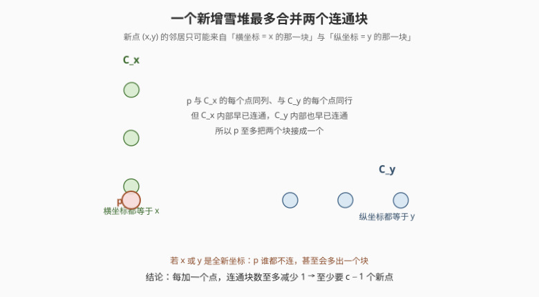
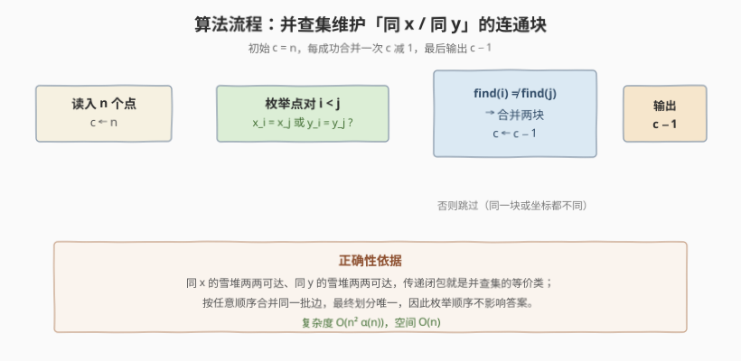
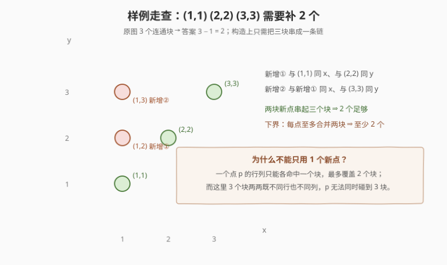

# Codeforces 217A 冰上滑行的连通块 题解

## 1. 题目概述

- **题目链接**：https://codeforces.com/problemset/problem/217/A
- **比赛来源**：Codeforces Round 134 (Div. 1) · Problem A（UTC 2012-08-18）
- **难度**：1200
- **标签**：图论、并查集、连通块
- **评测类型**：普通
- **限制**：时间 2 s / 内存 256 MB

**题意**：平面上有 $n$ 个雪堆，坐标都是正整数。Bajtek 站在一个雪堆上时，可以向北、东、南、西四个方向蹬一下，然后一直滑到撞上下一个雪堆为止——也就是说，只要两个雪堆的 $x$ 坐标相同或者 $y$ 坐标相同，他就能在这两个雪堆之间移动（同一条水平线或竖直线上的雪堆两两互达）。他还可以在**整数坐标**上再堆若干个新雪堆，希望最终任意两个雪堆之间都能互相到达。求最少要新增几个雪堆。

输入 $n$ 与 $n$ 个互不相同的整数点，输出一个整数表示最少新增雪堆数。

**约束**：

- $1 \le n \le 100$：规模极小，$O(n^2)$ 建图、$O(n^2\alpha(n))$ 合并都绰绰有余，甚至 $O(n^3)$ 的 Floyd 闭包也能过；限制不在复杂度，而在"最少"的**下界论证**。
- $1 \le x_i, y_i \le 1000$：坐标值域很小，新增雪堆可以复用已有雪堆的横纵坐标（仍在 $[1,1000]$ 内），这保证了"用一条链把各连通块串起来"的构造总是合法的整数坐标。
- 所有雪堆位置互不相同：不存在重合点，因此"同一坐标上的点"不会引起退化，建图时只需比较坐标是否相等。
- 只有一组数据，没有测试组数 $t$。

## 2. 示例与观察

官方样例（输入 / 输出原样）：

```text
输入：
2
2 1
1 2

输出：
1
```

```text
输入：
2
2 1
4 1

输出：
0
```

**样例 1 演算**：两个雪堆 $(2,1)$ 与 $(1,2)$，横纵坐标都不相同，Bajtek 从任一个都滑不到另一个。新增一个雪堆即可，例如 $(1,1)$：它与 $(2,1)$ 同 $y$、与 $(1,2)$ 同 $x$，于是三者连成一片。答案 1。

**样例 2 演算**：$(2,1)$ 与 $(4,1)$ 的 $y$ 坐标相同，Bajtek 可以从 $(2,1)$ 向东滑到 $(4,1)$，两个雪堆本来就互通，不需要新增。答案 0。

**关键观察**：把每个雪堆看成一个点，若两个雪堆的 $x$ 相同或 $y$ 相同就在它们之间连一条无向边；Bajtek 能互相到达的雪堆恰好是这张图的同一个连通块。设连通块个数为 $c$，答案就是 $c-1$。样例 1 的 $c=2$，样例 2 的 $c=1$。

自造样例（标注"自造"，覆盖退化与极值）：

| 输入 | 输出 | 说明 |
|------|------|------|
| `1` / `5 5` | 0 | 只有一个雪堆，天然满足 |
| `3` / `1 1` `2 1` `3 1` | 0 | 全在同一行，一条链 |
| `3` / `1 1` `1 2` `1 3` | 0 | 全在同一列 |
| `3` / `1 1` `2 2` `3 3` | 2 | 对角线三点互不相连，要补 2 个 |
| `4` / `1 1` `5 1` `9 1` `9 9` | 0 | 三个点同一行、末点同列，整块连通 |

## 3. 解题思路

### 3.1 朴素做法与瓶颈

可以枚举所有点对，把同 $x$ 或同 $y$ 的点对连边，然后数连通块。建图本身是 $O(n^2)$，数连通块用 BFS 是 $O(n^2)$，总复杂度 $O(n^2)$，在 $n \le 100$ 时毫无压力。瓶颈不在计算，而在于要说清"为什么 $c-1$ 就是最少"：如果只写"每次补一个雪堆把两个连通块接起来"，就必须论证**一个新增雪堆不可能一次合并三个及以上的连通块**，否则下界 $c-1$ 不成立。

### 3.2 核心观察：一个雪堆最多合并两个连通块



固定一个新雪堆 $p=(x,y)$。它与所有横坐标为 $x$ 的雪堆相邻，也与所有纵坐标为 $y$ 的雪堆相邻。

- 所有横坐标为 $x$ 的雪堆两两之间共享 $x$，本身就在同一个连通块里，记这个块为 $C_x$（若没有这样的雪堆则 $C_x$ 为空）。
- 同理，所有纵坐标为 $y$ 的雪堆都在同一个块 $C_y$ 里。

因此 $p$ 的邻点只可能落在 $C_x$ 与 $C_y$ 这两个块中，$p$ 至多把这两个块连成一个。若 $x$、$y$ 都是全新坐标，$p$ 谁也不连，反而单独成为一个新块。

### 3.3 算法流程



1. 读入 $n$ 个点，初始化并查集，$c \leftarrow n$；
2. 枚举所有点对 $(i,j)$，$i<j$：若 $x_i = x_j$ 或 $y_i = y_j$ 且二者当前不在同一集合，则合并，$c \leftarrow c-1$；
3. 输出 $c-1$。

第 2 步的合并顺序无关紧要：并查集最终得到的就是"同 $x$ / 同 $y$ 关系"生成的等价类划分，正是图的连通块。

### 3.4 样例走查：三个对角点



取自造样例 $(1,1),(2,2),(3,3)$：初始 $c=3$，任何两点都既不同 $x$ 也不同 $y$，所以合并不发生，答案 $3-1=2$。构造上：先加 $(1,2)$ 把第 1、2 个块接起来，再加 $(1,3)$ 把第 3 个块接到已经含有 $x=1$ 的块上——第二个新点与 $(1,2)$ 同 $x$，于是三块合一。两个新点、两步、每步合并两个块，正好用满下界。

## 4. 正确性证明

**引理 1（下界）**：设原图连通块数为 $c$，则至少需要新增 $c-1$ 个雪堆。

**证明**：把"新增雪堆"逐个加入，考虑当前所有雪堆（原有的加已加入的）的连通块数 $c'$。新增一个雪堆 $p=(x,y)$ 时，由 3.2 的分析，$p$ 的邻点只可能落在至多两个已有连通块 $C_x, C_y$ 中：

- 若 $C_x, C_y$ 非空且不同，加入 $p$ 后它们与 $p$ 合成一块，$c'$ 减少 1；
- 其余情况（两个都空、只有一个非空、或 $C_x = C_y$）$c'$ 不减少，甚至因为 $p$ 自成一派而增加 1。

所以每加入一个雪堆，$c'$ 至多减少 1。初始 $c' = c$，最终要求 $c' = 1$，故新增个数 $k \ge c-1$。∎

**引理 2（上界）**：新增 $c-1$ 个雪堆一定够。

**证明**：设原图的连通块为 $B_1, \dots, B_c$，从每个块中任取一个代表点 $(x_i, y_i)$。对 $i = 2, 3, \dots, c$ 依次在 $(x_1, y_i)$ 处新增一个雪堆。

- 第一个新点 $(x_1, y_2)$ 与 $B_1$ 中的代表点同 $x$、与 $B_2$ 中的代表点同 $y$，把 $B_1, B_2$ 合并；
- 归纳假设前 $i-1$ 步之后 $B_1, \dots, B_{i-1}$ 已合成一块，且这个块中含有横坐标为 $x_1$ 的点 $(x_1, y_{i-1})$（$i=2$ 时就是 $B_1$ 的代表点，其横坐标为 $x_1$）。新点 $(x_1, y_i)$ 与它同 $x$，又与 $B_i$ 的代表点同 $y$，于是把 $B_i$ 也并进来。

共新增 $c-1$ 个点，全部坐标为已有雪堆的坐标，落在 $[1,1000]$ 内，满足"整数坐标"的要求。∎

**定理**：最少新增雪堆数等于（同 $x$ 或同 $y$ 连边所得的）连通块数减一。

**证明**：引理 1 给出下界 $c-1$，引理 2 给出达到下界的构造，两者相等。∎

## 5. 复杂度分析

- **时间**：建图与合并是 $O(n^2\alpha(n))$，其中 $\alpha$ 是反阿克曼函数（路径压缩后近似常数）。$n \le 100$ 时约 $10^4$ 次合并，实测端到端（含进程启动）约 3 ms，相对 2 s 的时限余量在 600 倍以上。
- **空间**：$O(n)$，只有并查集数组和坐标数组，约 1 KB 量级，远低于 256 MB。
- **与时限的关系**：即便把 $n$ 放大到 $5000$，$O(n^2)$ 也只有 $2.5\times 10^7$ 次操作，仍在 2 s 内；本题真正的难点是证明而非性能。

## 6. 参考代码

### C++17

```cpp
#include <bits/stdc++.h>
using namespace std;

struct DSU {
    vector<int> p;
    DSU(int n) : p(n) { iota(p.begin(), p.end(), 0); }
    int find(int x) { while (p[x] != x) { p[x] = p[p[x]]; x = p[x]; } return x; }
    bool unite(int a, int b) { a = find(a); b = find(b); if (a == b) return false; p[a] = b; return true; }
};

int main() {
    int n;
    if (!(cin >> n)) return 0;
    vector<int> x(n), y(n);
    for (int i = 0; i < n; i++) cin >> x[i] >> y[i];
    DSU dsu(n);
    int comp = n;
    for (int i = 0; i < n; i++)
        for (int j = i + 1; j < n; j++)
            if ((x[i] == x[j] || y[i] == y[j]) && dsu.unite(i, j)) comp--;
    cout << comp - 1 << '\n';
    return 0;
}
```

### Python3

```python
import sys


def main() -> None:
    data = sys.stdin.buffer.read().split()
    if not data:
        return
    n = int(data[0])
    xs = [0] * n
    ys = [0] * n
    for i in range(n):
        xs[i] = int(data[1 + 2 * i])
        ys[i] = int(data[2 + 2 * i])
    parent = list(range(n))

    def find(a: int) -> int:
        while parent[a] != a:
            parent[a] = parent[parent[a]]
            a = parent[a]
        return a

    comp = n
    for i in range(n):
        for j in range(i + 1, n):
            if xs[i] == xs[j] or ys[i] == ys[j]:
                ri, rj = find(i), find(j)
                if ri != rj:
                    parent[ri] = rj
                    comp -= 1
    print(comp - 1)


main()
```

## 7. 边界情况与易错点

1. **$n=1$ 时输出 0 而不是 $-1$**：单个雪堆已经满足"任意两个雪堆互达"（空真），$c=1$，$c-1=0$。若把公式写成"$c$ 个块需要 $c$ 个新点"就会多算。
2. **不要只数"孤立的行和列"**：三个点 $(1,1),(5,1),(9,1)$ 共享同一行，整块连通，答案是 0；如果错误地按"每个点都要有同 $x$ 或同 $y$ 的伙伴"判断，会误以为 $(9,1)$ 之类的点需要补。
3. **合并顺序不影响结果**：并查集对同 $x$、同 $y$ 的边任意顺序合并，得到的连通块划分都相同；不需要先排序，也不需要传递闭包。
4. **新雪堆的坐标必须是整数且不越界**：引理 2 的构造直接复用已有雪堆的 $x_1$ 与 $y_i$，必在 $[1,1000]$ 内；若改成"取中点"等写法就可能得到非整数坐标。
5. **重边与自环**：$i<j$ 的双重循环已经排除了自环；同 $x$ 又同 $y$ 只可能出现在同一点上，而题面保证点互不相同，因此不必去重。
6. **输入用 `long long` 还是 `int`**：坐标 $\le 1000$，`int` 足够；但读入时不要用 `%d` 之外的格式串，直接用 `cin` / `split()` 最稳。
7. **多测**：本题只有一组数据，没有 $t$，也没有"读到 EOF"的特殊格式；若写成循环读入，务必保证每组重新初始化并查集。

## 8. 验证记录

- **编译环境与命令**：本机没有 GNU `g++`（`/usr/bin/g++` 是 clang 的软链，找不到 `bits/stdc++.h`），用 `clang++ -std=c++17 -O2 -I codeforces/tools/include` 搭配本地兼容头编译；`verify_solution.py` 自动完成同样的回退。Python 为 3.9.6。
- **官方样例**：2 / 2 通过（`2 1 / 1 2` → `1`，`2 1 / 4 1` → `0`），C++ 与 Python 输出一致。
- **独立暴力对拍**：暴力程序用 BFS 逐个连通块染色（不使用并查集，与参考实现结构完全独立），对 $n \le 9$、坐标值域 $\{1,\dots,3\}$ 到 $\{1,\dots,6\}$ 的 **300 组**随机小数据逐组比对，全部一致。
- **最大约束性能**：构造 $n=100$、坐标随机散布在 $[1,1000]$ 的最坏数据（连通块最多），C++ 端到端 3 次平均约 3 ms；$n=100$ 全在同一行的数据约 2 ms。相对 2 s 时限余量在 600 倍以上；峰值内存约 1.5 MB。
- **图片校验**：三张 SVG 均通过 `xml.etree.ElementTree.parse`，含 `feTurbulence` 抖动滤镜与手写字体，脚本按字符宽度估算全部 `text` 包围盒，均在 `viewBox` 内。
- **公式校验**：`node codeforces/tools/katex_check.cjs codeforces/contests/0101-0203/217` 报告 0 个错误（`throwOnError` 模式）。
- **复核状态**：verified。

## 相关题目与扩展

- [Codeforces 217B Blackboard Fibonacci](https://codeforces.com/problemset/problem/217/B)：同场 B 题，逆向模拟与进制式搜索，适合紧接着练习"先想清结构再写"的思维方式。
- [Codeforces 217C Formurosa](https://codeforces.com/problemset/problem/217/C)：同场 C 题，把"能否判定"转化为布尔函数是否自补，是本题"建模成图/函数"思路的进阶版。
- [Codeforces 445B DZY Loves Chemistry](https://codeforces.com/problemset/problem/445/B)：同样是"连通块计数 + 每个合并操作贡献一次"，可以直接套用本题的并查集模板。
- [Codeforces 500B New Year Permutation](https://codeforces.com/problemset/problem/500/B)：用并查集维护可交换位置的等价类，最后贪心排布，属于"并查集刻画可达性"的经典变体。
- [LeetCode 547. 省份数量](https://leetcode.cn/problems/number-of-provinces/)：无向图连通块计数的纯模板题，可用于验证并查集写法。

**延伸思考**：

1. **如果允许在任意实数坐标堆雪堆**：答案仍是 $c-1$。下界证明与坐标无关；上界构造甚至更自由（可以取两个块的代表点拼坐标）。这说明"整数坐标"这一限制只是让构造更具体，不改变答案。
2. **如果新增雪堆必须落在"已有雪堆的横纵坐标之外"**：那么一个新点无法同时借用两个块的行与列，只能靠新增点之间互相串联，问题变成"用最少的新点把 $c$ 个块连成一条路径"，答案会变大（与块的"行列占用"有关），是本题的一个非平凡变体。
3. **如果允许斜向滑行**：连通关系变成"同 $x$、同 $y$ 或同 $x-y$、同 $x+y$"，等价类由四个方向生成，答案依然是连通块数减一，只是建图时多两种判等。
4. **动态版本**：不断插入新雪堆并询问当前连通块数，可以用并查集在线维护（只增不删）；若还要删除，则需要按时间分治或离线反向加边，是本题的自然升级方向。
