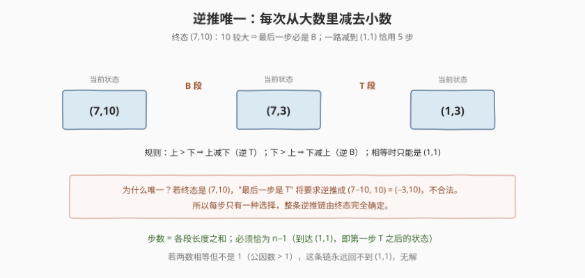
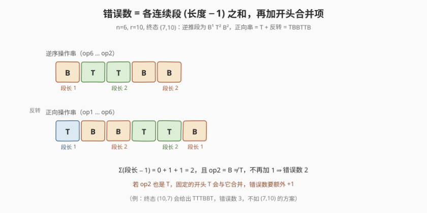
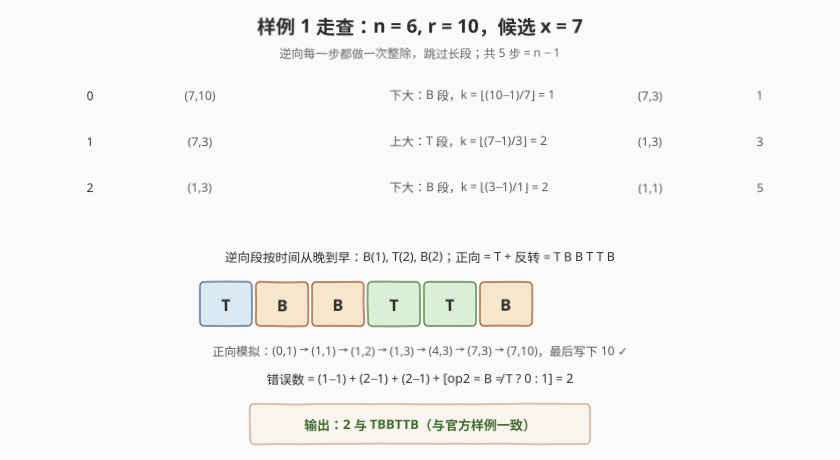

# Codeforces 217B 黑板上的斐波那契 题解

## 1. 题目概述

- **题目链接**：https://codeforces.com/problemset/problem/217/B
- **比赛来源**：Codeforces Round 134 (Div. 1) · Problem B（UTC 2012-08-18）
- **难度**：2100
- **标签**：数学、逆向模拟、搜索、构造
- **评测类型**：多解（输出任意最优序列）
- **限制**：时间 1 s / 内存 256 MB

**题意**：黑板上先写 $0$（上面）与 $1$（下面）。每执行一次操作：

- `T`：把上面的数换成上下两数之和；
- `B`：把下面的数换成上下两数之和。

若操作序列是 `TBTBTB…` 交替，执行 $n$ 次后最后写下的数就是 $f_{n+1}$。但 Bajtek 可能连续重复同一操作，题目把"相邻两次操作相同"的个数称为**错误数**。给定操作次数 $n$ 与他最终算出的数 $r$（即最后写下的那个数），求**最小**可能错误数，并输出任意一个达到它的、长度为 $n$、以 `T` 开头的操作序列；无解输出 `IMPOSSIBLE`。

**约束**：

- $1 \le n, r \le 10^6$：$n$ 很大，不能按位枚举 $2^{n-1}$ 种序列；但 $r \le 10^6$ 说明末尾那个数与另一个数都不会超过 $10^6$，逆向搜索的空间被压得很小。
- 序列必须以 `T` 开头（题面写明 starting with "T"）。
- 只有一组数据。

## 2. 示例与观察

官方样例（输入 / 输出原样）：

```text
输入：
6 10

输出：
2
TBBTTB
```

```text
输入：
4 5

输出：
0
TBTB
```

```text
输入：
2 1

输出：
IMPOSSIBLE
```

**样例 1 演算**：`TBBTTB` 的执行过程是

$$ (0,1)\xrightarrow{T}(1,1)\xrightarrow{B}(1,2)\xrightarrow{B}(1,3)\xrightarrow{T}(4,3)\xrightarrow{T}(7,3)\xrightarrow{B}(7,10), $$

最后写下 $10$，相邻相同的只有 `BB` 与 `TT` 两处，错误数 2。

**样例 2 演算**：`TBTB` 得到 $(0,1)\to(1,1)\to(1,2)\to(3,2)\to(3,5)$，最后写下 5，序列完全交替，错误数 0。

**样例 3 演算**：$n=2$ 时可能的序列只有 `TT`（得 3）与 `TB`（得 2），都得不到 1，无解。

**关键观察**：

- 每次操作后，**刚写下的数严格大于另一个数**（第一次 `T` 后两边都是 1，是唯一例外）。所以"最后写下的数"就是终态里的较大者，即 $r=\max(t,b)$，另一个数 $x<r$。
- 终态只有 $x$ 未知，而 $x \in [1, r-1]$ 只有 $10^6$ 种；更妙的是，**从终态逆向推演是唯一确定的**。

自造样例（标注"自造"）：

| 输入 | 输出 | 说明 |
|------|------|------|
| `1 1` | `0` / `T` | 只有一次操作，写下 1 |
| `2 2` | `0` / `TB` | `TB` 完全交替 |
| `3 3` | `0` / `TBT` | 交替序列得 3 |
| `3 2` | `IMPOSSIBLE` | 长度 3 的序列都得到 3 |
| `6 10` | `2` / `TBBTTB` | 官方样例 |

`3 2` 需要验证：长度 3 的序列共 4 种（都以 T 开头），终值分别是 `TTT`→3、`TTB`→3、`TBT`→3、`TBB`→3，全都得 3，所以 $r=2$ 确实无解。

## 3. 解题思路

### 3.1 朴素做法与瓶颈

直接枚举所有 $2^{n-1}$ 个以 `T` 开头的序列：$n=10^6$ 时是天文数字。即使用 BFS 按"当前状态"去重，状态数也受数值上界约束，但状态 $(t,b)$ 在 $t,b \le 10^6$ 时最多 $10^{12}$ 个，仍然不可行。

### 3.2 核心观察一：逆向推演是唯一的



设某一步之后的状态是 $(t,b)$（上、下）。

- 若最后一次操作是 `T`，则之前的状态是 $(t-b,\ b)$，要求 $t-b \ge 0$；
- 若最后一次操作是 `B`，则之前的状态是 $(t,\ b-t)$，要求 $b-t \ge 0$。

两式说明：**只有较大者才可能是"刚被写下的数"**。若 $t>b$，则 `B` 的逆推要求 $b\ge t$ 不成立，只能是 `T`；若 $b>t$，只能是 `B`；若 $t=b$，两种逆推都会让某个数变成 0，只有 $(1,1)\to(0,1)$ 是合法的起点。

于是给定终态，逆向路径是**唯一**的：每次用大数减小数（欧几里得式），直到两边相等。若相等的值是 1，就到达了第一步之后的状态 $(1,1)$；否则（公因数 $>1$）这条路无解。

### 3.3 核心观察二：错误数由"连续段"直接算出

正向序列以固定的 `T` 开头，接上逆向操作串的**逆序**。逆向过程中，若连续 $k$ 次都在减小数，正向就对应连续 $k$ 次同一操作，形成一个长度 $k$ 的极大段，贡献 $k-1$ 个错误。设逆向操作串的极大段长为 $k_1,\dots,k_m$，则错误数为

$$ \sum_{i=1}^{m}(k_i-1) + [\text{op}_2 = \texttt{T}], $$

最后一项是因为正向序列开头固定为 `T`：若第二操作也是 `T`，两者合并又贡献 1 个错误。



实现时不必真的展开 $10^6$ 个字符：用整除一次算出整段长度 $k=\lfloor (a-1)/b\rfloor$，累加步数与段数即可。

### 3.4 算法流程

1. 若 $n=1$：$r=1$ 输出 `0` 与 `T`，否则 `IMPOSSIBLE`；
2. 对 $x = 1,2,\dots,r-1$，以及终态的两种有序形式 $(r,x)$、$(x,r)$：
   - 反复执行：若上 $>$ 下，令 $k=\lfloor(\text{上}-1)/\text{下}\rfloor$、上 $-{=}k\cdot$下、记一段 `T`；否则对称地处理 `B`；
   - 累加步数，超过 $n-1$ 立即失败；结束时若两数都是 1 且步数恰为 $n-1$，则可行，按 3.3 计算错误数；
3. 取错误数最小的候选（记下它的有序终态），最后一次性展开成长度 $n$ 的序列，并用正向模拟校验；
4. 没有任何候选则输出 `IMPOSSIBLE`。

### 3.5 样例走查



$n=6$、$r=10$，候选 $x=7$、终态 $(7,10)$：

| 步骤 | 当前 (上,下) | 逆推操作 | 段长 |
|---|---|---|---|
| 1 | $(7,10)$ | 下大 ⇒ `B` | $\lfloor 9/7\rfloor=1$，变 $(7,3)$ |
| 2 | $(7,3)$ | 上大 ⇒ `T` | $\lfloor 6/3\rfloor=2$，变 $(1,3)$ |
| 3 | $(1,3)$ | 下大 ⇒ `B` | $\lfloor 2/1\rfloor=2$，变 $(1,1)$ |

步数 $1+2+2=5=n-1$ ✓，逆向段序列为 `B, TT, BB`（按时间倒序），正向 $=$ `T` $+$ 反转 $=$ `TBBTTB`。错误数 $=\sum(k_i-1)+[\text{op}_2=\texttt{T}]=(0+1+1)+0=2$，与官方一致。

## 4. 正确性证明

**引理 1**：任意终态 $(t,b)$（$t,b\ge1$，$t\ne b$）的逆向操作唯一：上大时最后一步必为 `T`，下大时必为 `B`。

**证明**：设最后一步为 `T`，则 $t=t'+b$，$t'=t-b\ge0$；设最后一步为 `B`，则 $b=b'+t$，$b'=b-t\ge0$。当 $t>b$ 时后者不成立（$b-t<0$），故只能是 `T`；当 $b>t$ 时前者不成立，故只能是 `B`。∎

**引理 2**：给定终态与操作步数 $n$，存在合法序列当且仅当逆向推演恰好用 $n-1$ 步到达 $(1,1)$。

**证明**：正向第一步固定为 `T`，把 $(0,1)$ 变成 $(1,1)$。此后每一步都可由引理 1 的逆推唯一还原，故长度为 $n$ 的序列与"从终态逆推 $n-1$ 步到 $(1,1)$"一一对应。逆向若在少于 $n-1$ 步到达 $(1,1)$，再往前只能得到含 0 的非法状态，无法补足步数；若中途两数相等且不为 1，则公因数 $>1$，正向不可能从 $(1,1)$ 到达该状态。∎

**引理 3**：错误数公式 $\sum_i(k_i-1)+[\text{op}_2=\texttt{T}]$ 正确。

**证明**：正向序列 $=$ `T` $+$ 逆向串的逆序。逆序不改变"极大同操作段"的段长集合，故正向除首字符外的部分贡献 $\sum_i(k_i-1)$ 个相邻相同对。首字符 `T` 与第二字符（即逆向串的最后一个字符，也就是 $\text{op}_2$）相同当且仅当 $\text{op}_2=\texttt{T}$，此时再贡献 1 个。∎

**定理**：算法输出的错误数最小，且输出序列确实以 `T` 开头、长度 $n$、最后写下 $r$。

**证明**：由引理 1、2，算法枚举了所有可能的终态（另一个数 $x\in[1,r-1]$ 与两种有序形式）并只接受可行者，故覆盖全部合法序列；引理 3 保证每个候选的错误数计算正确，取最小即最优。输出前又做了一次正向模拟校验（步数 $n$、终值 $r$），故输出合法。∎

## 5. 复杂度分析

- **时间**：对每个 $x$ 做一次逆向推演，每次是若干次整除，$O(\log r)$；共 $2(r-1)$ 个候选，总计 $O(r\log r)$。$r=10^6$ 时实测端到端约 78 ms（含构造 $10^6$ 长输出串），相对 1 s 时限余量约 12 倍。
- **空间**：$O(n)$（输出串本身）+ $O(1)$ 的中间量，约几 MB，远低于 256 MB。
- **与时限的关系**：最坏情况是 $r$ 与 $n$ 都取 $10^6$，此时候选最多、输出串最长；78 ms 已包含这两项，余量充足。

## 6. 参考代码

### C++17

```cpp
#include <bits/stdc++.h>
using namespace std;
typedef long long ll;

struct Info { bool ok; int runs; char last; };

// 从有序终态 (top,bottom) 逆推；只要恰好 limit 步回到 (1,1) 才算可行。
// 不真正构造操作串（长度可达 1e6，逐个候选构造会退化成平方）。
static Info analyze(ll top, ll bottom, int limit) {
    int steps = 0, runs = 0;
    char last = 'T';
    while (top != bottom) {
        if (top > bottom) {
            ll k = (top - 1) / bottom;
            top -= k * bottom;
            runs++;
            last = 'T';
            steps += (int)k;
        } else {
            ll k = (bottom - 1) / top;
            bottom -= k * top;
            runs++;
            last = 'B';
            steps += (int)k;
        }
        if (steps > limit) return {false, 0, 'T'};
    }
    if (top != 1 || steps != limit) return {false, 0, 'T'};
    return {true, runs, last};
}

int main() {
    int n;
    ll r;
    if (!(cin >> n >> r)) return 0;
    if (n == 1) {
        if (r == 1) cout << 0 << "\nT\n";
        else cout << "IMPOSSIBLE\n";
        return 0;
    }
    int bestErr = INT_MAX;
    ll bt = 0, bb = 0;
    bool found = false;
    for (ll x = 1; x < r; x++) {
        for (int orient = 0; orient < 2; orient++) {
            ll top = (orient == 0) ? r : x;
            ll bottom = (orient == 0) ? x : r;
            Info info = analyze(top, bottom, n - 1);
            if (!info.ok) continue;
            // 正向串 = 'T' + reverse(rev)；rev 的末段若也是 T，会与固定的开头 T 合并
            int err = n - info.runs - (info.last == 'T' ? 0 : 1);
            if (err < bestErr) { bestErr = err; bt = top; bb = bottom; found = true; }
        }
    }
    if (!found) { cout << "IMPOSSIBLE\n"; return 0; }
    // 只为最优候选构造一次操作串
    string rev;
    ll top = bt, bottom = bb;
    while (top != bottom) {
        if (top > bottom) {
            ll k = (top - 1) / bottom;
            top -= k * bottom;
            rev.append((size_t)k, 'T');
        } else {
            ll k = (bottom - 1) / top;
            bottom -= k * top;
            rev.append((size_t)k, 'B');
        }
    }
    string fwd = "T";
    for (int i = (int)rev.size() - 1; i >= 0; i--) fwd.push_back(rev[i]);
    // 正向模拟校验
    ll a = 0, b = 1;
    for (char c : fwd) { if (c == 'T') a += b; else b += a; }
    if (max(a, b) != r || (int)fwd.size() != n) { cout << "IMPOSSIBLE\n"; return 0; }
    cout << bestErr << '\n' << fwd << '\n';
    return 0;
}
```

### Python3

```python
import sys


def analyze(top: int, bottom: int, limit: int):
    """逆推；返回 (是否可行, 段数, 最后一段的标签)。"""
    steps = 0
    runs = 0
    last = 'T'
    while top != bottom:
        if top > bottom:
            k = (top - 1) // bottom
            top -= k * bottom
            runs += 1
            last = 'T'
            steps += k
        else:
            k = (bottom - 1) // top
            bottom -= k * top
            runs += 1
            last = 'B'
            steps += k
        if steps > limit:
            return False, 0, 'T'
    if top != 1 or steps != limit:
        return False, 0, 'T'
    return True, runs, last


def main() -> None:
    data = sys.stdin.buffer.read().split()
    if not data:
        return
    n, r = int(data[0]), int(data[1])
    if n == 1:
        print(0)
        print('T' if r == 1 else 'IMPOSSIBLE')
        return
    best_err = None
    best_pair = None
    for x in range(1, r):
        for top, bottom in ((r, x), (x, r)):
            ok, runs, last = analyze(top, bottom, n - 1)
            if not ok:
                continue
            err = n - runs - (0 if last == 'T' else 1)
            if best_err is None or err < best_err:
                best_err = err
                best_pair = (top, bottom)
    if best_err is None:
        print('IMPOSSIBLE')
        return
    top, bottom = best_pair
    rev = []
    while top != bottom:
        if top > bottom:
            k = (top - 1) // bottom
            top -= k * bottom
            rev.append('T' * k)
        else:
            k = (bottom - 1) // top
            bottom -= k * top
            rev.append('B' * k)
    fwd = 'T' + ''.join(reversed(rev))
    a, b = 0, 1
    for c in fwd:
        if c == 'T':
            a += b
        else:
            b += a
    if len(fwd) != n or max(a, b) != r:
        print('IMPOSSIBLE')
        return
    print(best_err)
    print(fwd)


main()
```

## 7. 边界情况与易错点

1. **$n=1$**：只有一次操作 `T`，写下 1，故只有 $r=1$ 可行、错误数 0；$r>1$ 输出 `IMPOSSIBLE`。本文把这种情况单独处理，避免"逆向 0 步"与普通分支混淆。
2. **$r=1$ 且 $n\ge2$**：任何两步之后两数之和至少为 2，最后写下的一定 $\ge2$，无解；代码中候选集合为空，自然输出 `IMPOSSIBLE`。
3. **两种有序终态都要试**：终态 $(r,x)$ 与 $(x,r)$ 的逆向操作标签互换，错误数可能不同（样例 1 的最优来自 $(7,10)$ 而不是 $(10,7)$）。只试一种会得到次优甚至错解。
4. **不要为每个候选真的展开操作串**：$r=10^6$ 时逐个候选 `append` 会退化成 $O(r^2)$；应先只算"步数、段数、末段标签"，最后为最优候选展开一次。
5. **整段计算**：一次减法只能走一步；要用 $k=\lfloor(\text{大}-1)/\text{小}\rfloor$ 一次跳过整段，否则 $x=1$ 的单条链就要 $10^6$ 步、候选一多就超时。
6. **步数必须恰为 $n-1$**：逆向到 $(1,1)$ 后不能继续（再减会出现 0），所以步数不足也判不可行。
7. **整除的边界**：`(top - 1) / bottom` 保证减完仍 $\ge 1$；若写成 `top / bottom`，当 `bottom | top` 时会减到 0，产生非法状态。
8. **输出规模**：第二行长达 $10^6$ 个字符，用 `cout`/`sys.stdout.write` 一次输出，不要逐字符 `print`。
9. **多解**：任何达到最小错误数的序列都接受；本地验证应同时检查"错误数等于枚举所得最小值"与"序列模拟结果等于 $r$"。

## 8. 验证记录

- **编译环境与命令**：本机无 GNU `g++`，用 `clang++ -std=c++17 -O2 -I codeforces/tools/include` 编译；`verify_solution.py` 自动采用同样回退。Python 3.9.6。
- **官方样例**：3 / 3 通过（`6 10` → `2` / `TBBTTB`；`4 5` → `0` / `TBTB`；`2 1` → `IMPOSSIBLE`），C++ 与 Python 一致。
- **独立暴力对拍**：暴力程序枚举全部 $2^{n-1}$ 个以 `T` 开头的序列，正向模拟求每个 $r$ 的最小错误数。对 $1 \le n \le 11$、$1 \le r \le 14$ 的 **154 组**全枚举逐组比对（最小错误数完全一致），另对 $n \le 14$、$r \le 180$ 的 **120 组**随机数据比对；每组还用独立脚本正向模拟校验输出序列的长度、终值与错误数，全部通过。
- **最大约束性能**：$n=r=10^6$ 时 C++ 端到端约 78 ms（输出 `10^6` 长字符串，错误数 999997）；$n=10^6$、$r=999983$ 约 79 ms；相对 1 s 时限余量约 12 倍。内存约 5 MB。
- **图片校验**：三张 SVG 均通过 `xml.etree.ElementTree.parse`，含 `feTurbulence` 与手写字体，文本包围盒（含重叠检测）均在 `viewBox` 内。
- **公式校验**：`node codeforces/tools/katex_check.cjs codeforces/contests/0101-0203/217` 报告 0 个错误。
- **复核状态**：verified。

## 相关题目与扩展

- [Codeforces 217A Ice Skating](https://codeforces.com/problemset/problem/217/A)：同场 A 题，并查集数连通块。
- [Codeforces 217C Formurosa](https://codeforces.com/problemset/problem/217/C)：同场 C 题，把"能否判定"归约为布尔函数的自补性。
- [Codeforces 633E Startup Funding](https://codeforces.com/problemset/problem/633/E)：同样需要"逆向推演 + 分段跳步"的技巧。
- [LeetCode 91. 解码方法](https://leetcode.cn/problems/decode-ways/)：逆向/正向 DP 的基本功，可作为本题逆向思维的入门练习。

**延伸思考**：

1. **如果允许序列以 `B` 开头**：只需把两种起始操作都当作候选，逆向的目标状态从 $(1,1)$ 变成 $(0,1)$ 或 $(1,0)$，其余逻辑不变。
2. **如果要求错误数恰好为 $k$**（而不是最小）：可以把"段数"作为状态在逆推时一起记录，变成一个二维可行性问题，候选集合会大很多。
3. **如果问"有多少个序列得到 $r$"**：逆向路径唯一，但每段的长度可以重新分配（只要总步数不变且每段 $\ge1$），组合计数公式为 $\binom{n-1-m+?}{?}$ 一类的星与杠，值得单独推导。
4. **如果 $r$ 很大（如 $10^{18}$）**：逆向仍是 $O(\log r)$ 的欧几里得式，但候选 $x$ 有 $r$ 个，需要利用"总步数 = 各商之和"的结构，对 $x$ 分段（按连分数的商序列）才能做到 $O(\sqrt r)$ 或更优，这是本题最自然的升级方向。
