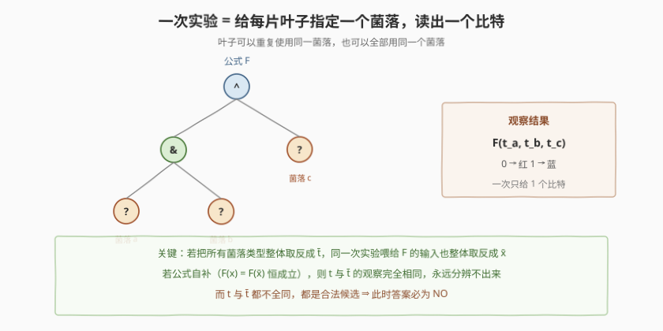
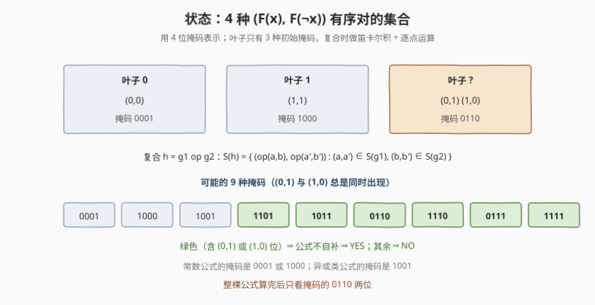
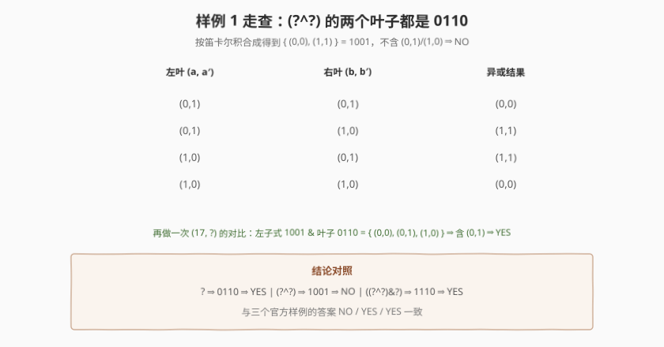

# Codeforces 217C 细菌种类的判定 题解

## 1. 题目概述

- **题目链接**：https://codeforces.com/problemset/problem/217/C
- **比赛来源**：Codeforces Round 134 (Div. 1) · Problem C（UTC 2012-08-18）
- **难度**：2600
- **标签**：布尔函数、表达式求值、构造、思维
- **评测类型**：普通
- **限制**：时间 1 s / 内存 256 MB

**题意**：有一株植物 Formurosa，它的营养过程是一个**只含常数与 `|`、`&`、`^` 的布尔公式**，公式里的每个 `?` 是一片叶子（叶子是一片独立的样本位）。每次实验：往每片叶子上各放一个细菌样本，观察植物变红（结果 0）还是变蓝（结果 1），即得到公式在该赋值下的值。

科学家有 $n$ 个菌落，每个菌落的类型是 0 或 1，且**已知不全相同**。每次实验可以把任意菌落（可重复使用）放到任意叶子上。问：是否无论菌落类型如何分布，都能通过若干次实验确定**每个**菌落的类型？输出 `YES` / `NO`。

**约束**：

- $2 \le n \le 10^6$：$n$ 很大，但下面会看到答案与 $n$ 无关，读入即可。
- 公式长度不超过 $10^6$，文法为 $s \to 0 \mid 1 \mid ? \mid (s|s) \mid (s\&s) \mid (s^s)$：必须 $O(|s|)$ 解析，且递归解析在 $10^6$ 层时会爆栈，需写成迭代。
- 每个 `?` 是独立的一片叶子（公式是"每个变量出现一次"的读一次公式）。
- 只有一组数据。

## 2. 示例与观察

官方样例（输入 / 输出原样）：

```text
输入：
2
(?^?)

输出：
NO
```

```text
输入：
10
?

输出：
YES
```

```text
输入：
2
((?^?)&?)

输出：
YES
```

**样例 1 演算**：公式是异或 $F(x_1,x_2)=x_1\oplus x_2$。无论把哪个菌落放在哪片叶子上，观察到的都只是"两个菌落类型是否不同"。$n=2$ 时两个菌落必然不同，但无法区分"1 号是 0、2 号是 1"和"1 号是 1、2 号是 0"，故 `NO`。

**样例 2 演算**：公式就是一片叶子，一次实验直接读出放在该叶子上的菌落类型；对每个菌落各做一次实验即可全部确定，故 `YES`。

**样例 3 演算**：$F(x_1,x_2,x_3)=(x_1\oplus x_2)\&x_3$。把三个菌落分别放上三片叶子，适当选择哪几个位置用哪个菌落，就能拼出足够多的信息（例如让 $x_3$ 取某个 1 型菌落，$x_1,x_2$ 取不同菌落即可得到它们的异或），可以证明能全部分辨，故 `YES`。

**关键观察**：如果把两个候选的赋值 $t$ 与 $\bar t$（把每个菌落的类型都取反）放在一起看，任何一次实验 $\sigma$（给每片叶子指定一个菌落）在 $t$ 下喂给公式的输入是 $x=(t_{\sigma(1)},\dots)$，在 $\bar t$ 下喂的是 $\bar x$。因此**若公式满足 $F(x)=F(\bar x)$ 对一切 $x$ 成立，则 $t$ 与 $\bar t$ 永远给出相同观察，无法分辨**（而 $t,\bar t$ 都不全同，都是合法候选）。

自造样例（标注"自造"）：

| 输入 | 输出 | 说明 |
|------|------|------|
| `2` / `0` | NO | 常数公式，观察恒为 0 |
| `3` / `(?|?)` | YES | 把同一菌落放两片叶子，读出它的"或"即它自己 |
| `3` / `(?&?)` | YES | 同理，读出它自己 |
| `3` / `(?^?)` | NO | 异或自补，只能确定到"整体取反" |
| `3` / `((?^?)^?)` | NO | 三个异或：整体取反后值不变 |
| `3` / `((?^?)^(?^?))` | NO | 四个异或：整体取反后值不变 |
| `2` / `((?^?)&(?^?))` | NO | 恒 0（异或自己再与），常数 ⇒ 不可判定 |

## 3. 解题思路

### 3.1 朴素做法与瓶颈

把"能否确定"理解为：所有合法赋值（不全相同的 $t\in\{0,1\}^n$）到"实验观察向量"的映射是否单射。实验共有 $n^L$ 种（$L$ 是叶子数），无法逐一枚举；公式长度 $10^6$ 意味着也不能把 $F$ 的真值表列出来（有 $2^L$ 项）。必须找到公式的**结构性判据**。

### 3.2 核心观察：不可判定 ⟺ 公式自补



对两个候选赋值 $t,u$（都不全同），定义它们的"差异类"：

- $A_{10}$：$t=1,u=0$ 的菌落集合；
- $A_{01}$：$t=0,u=1$ 的菌落集合；
- $A_{00},A_{11}$：两者相同的菌落集合。

一次实验 $\sigma$ 在 $t$ 下喂入 $x$、在 $u$ 下喂入 $y$。可以逐叶独立选菌落，所以：

- 若 $A_{10},A_{01}$ 都非空，则每个叶子都能任选 $(x_j,y_j)=(0,1)$ 或 $(1,0)$，即能实现**任意** $(x,\bar x)$；
- 若只有 $A_{10}$ 非空（另一方向为空），则由 $t,u$ 都不全同可推出 $A_{00},A_{11}$ 都非空，于是每片叶子能选 $(0,0),(1,1),(1,0)$ 三种，能实现任意 $y\le x$（逐坐标比较）；
- 对称地只有 $A_{01}$ 非空时能实现任意 $x\le y$。

于是：

**引理（判据）**：能确定所有菌落类型，当且仅当存在 $x$ 使 $F(x)\ne F(\bar x)$，即公式**不是自补**的。

- 若 $F$ 自补：取 $t$ 与 $\bar t$，任何实验 $\sigma$ 给出 $F(x)$ 与 $F(\bar x)$，相等，故无法区分，输出 `NO`。
- 若 $F$ 不自补：对任意 $t\ne u$，按上面的差异类分情况构造区分实验（详见第 4 节），故可确定，输出 `YES`。

### 3.3 算法：在公式树上做 4 状态 DP



对每个子公式 $g$（它有自己的叶子集合，互不相交），我们只关心集合

$$ S(g)=\{(g(x),\,g(\bar x)) : x \text{ 取遍子公式的全部输入}\}\subseteq\{(0,0),(0,1),(1,0),(1,1)\}, $$

用一个 4 位掩码表示（第 0..3 位分别对应 $(0,0),(0,1),(1,0),(1,1)$）。

- 叶子 `0`：$S=\{(0,0)\}$，掩码 `0001`；
- 叶子 `1`：$S=\{(1,1)\}$，掩码 `1000`；
- 叶子 `?`：$g(x)=x$，$x$ 与 $\bar x$ 相反，故 $S=\{(0,1),(1,0)\}$，掩码 `0110`；
- 复合 $h=g_1\circ g_2$：两个子公式的变量集不相交，$x_1,x_2$ 独立取值，故

$$ S(h)=\{\,(\,\mathrm{op}(a,b),\ \mathrm{op}(a',b')\,) : (a,a')\in S(g_1),\ (b,b')\in S(g_2)\,\}. $$

这就是标准的"笛卡尔积 + 逐点运算"，可预处理成 $4\times 16\times 16$ 的转移表。最后答案：若 $S(F)$ 含 $(0,1)$ 或 $(1,0)$ 则 `YES`，否则 `NO`。

注意 $S(g)$ 始终满足"$(0,1)\in S \iff (1,0)\in S$"（把 $x$ 换成 $\bar x$ 即可），所以实际只有 9 种可能的掩码；判 `YES` 时检查掩码的 `0110` 两位即可。

**为什么 $n$ 不影响答案**：$n\ge2$ 且不全相同，意味着"0 型与 1 型菌落都存在"，这正是 3.2 中"逐叶独立选 0/1"所必需的；只要这个条件成立，$n$ 具体是多少都不会带来额外信息，也不会带来额外限制。

### 3.4 样例走查



以 `(?^?)` 为例：两个叶子的掩码都是 `0110`。

| 组合 | $(a,a')$ | $(b,b')$ | $(\mathrm{xor}(a,b),\ \mathrm{xor}(a',b'))$ |
|---|---|---|---|
| 1 | $(0,1)$ | $(0,1)$ | $(0,0)$ |
| 2 | $(0,1)$ | $(1,0)$ | $(1,1)$ |
| 3 | $(1,0)$ | $(0,1)$ | $(1,1)$ |
| 4 | $(1,0)$ | $(1,0)$ | $(0,0)$ |

得到 $S=\{(0,0),(1,1)\}$，掩码 `1001`，没有 $(0,1)$/$(1,0)$，故 `NO`。

再看 `((?^?)&?)`：左子式掩码 `1001`，与叶子 `?` 的 `0110` 做 $\&$：

| 左 $(a,a')$ | 右 $(b,b')$ | 结果 |
|---|---|---|
| $(0,0)$ | $(0,1)$ | $(0,0)$ |
| $(0,0)$ | $(1,0)$ | $(0,0)$ |
| $(1,1)$ | $(0,1)$ | $(0,1)$ |
| $(1,1)$ | $(1,0)$ | $(1,0)$ |

得到 $\{(0,0),(0,1),(1,0)\}$，含 $(0,1)$，故 `YES`，与官方样例一致。

## 4. 正确性证明

**引理 1（状态转移正确）**：对任意子公式 $g_1,g_2$ 与运算 $\mathrm{op}$，上面的笛卡尔积公式恰好给出 $S(g_1\circ g_2)$。

**证明**：$g_1\circ g_2$ 的输入是 $(x_1,x_2)$，其中 $x_1,x_2$ 分别遍历 $g_1,g_2$ 的全部输入且相互独立；又 $\overline{(x_1,x_2)}=(\bar x_1,\bar x_2)$，所以值对为 $(\mathrm{op}(g_1(x_1),g_2(x_2)),\mathrm{op}(g_1(\bar x_1),g_2(\bar x_2)))$，正好由 $(g_1(x_1),g_1(\bar x_1))\in S(g_1)$、$(g_2(x_2),g_2(\bar x_2))\in S(g_2)$ 组合而成。∎

**引理 2（自补 ⇒ 不可判定）**：若 $F(x)=F(\bar x)$ 对一切 $x$ 成立，则 `NO`。

**证明**：取任意不全相同的 $t$（$n\ge2$ 时存在），则 $\bar t$ 也不全相同且 $t\ne\bar t$。对任意实验 $\sigma$，两个候选给出的观察分别是 $F(x)$ 与 $F(\bar x)$（$x_j=t_{\sigma(j)}$），由自补性相等。于是所有实验都无法区分 $t$ 与 $\bar t$，不能确定每个菌落的类型。∎

**引理 3（非自补 ⇒ 可判定）**：若存在 $x^*$ 使 $F(x^*)\ne F(\bar x^*)$，则对任意两个不同的合法赋值 $t,u$，都存在实验把它们区分开。

**证明**：设差异类 $A_{10},A_{01},A_{00},A_{11}$ 如 3.2。

- **$A_{10},A_{01}$ 都非空**：对每个叶子 $j$，若 $x^*_j=1$ 就从 $A_{10}$ 里取菌落（得 $(x_j,y_j)=(1,0)$），否则从 $A_{01}$ 取（得 $(0,1)$）。于是 $t$ 下的输入是 $x^*$、$u$ 下是 $\bar x^*$，观察值不同，区分成功。
- **$A_{10}\ne\varnothing,\ A_{01}=\varnothing$**：此时 $A_{00},A_{11}$ 都非空（$t$ 的某个 0 只能落在 $A_{00}$，$u$ 的某个 1 只能落在 $A_{11}$）。每个叶子可以独立选 $(0,0)$、$(1,1)$ 或 $(1,0)$，因此能实现任意满足 $y\le x$（逐坐标）的 $(x,y)$。$A_{01}=\varnothing,A_{10}\ne\varnothing$ 说明 $t\ne u$，且 $F$ 不自补蕴含 $F$ 不是常数。设 $v_0=F(\mathbf 0)$、$v_1=F(\mathbf 1)$：若 $v_0\ne v_1$，取 $(x,y)=(\mathbf 1,\mathbf 0)$ 即区分；若 $v_0=v_1=c$，由 $F$ 非常数存在 $z$ 使 $F(z)=1-c$，取 $(x,y)=(z,\mathbf 0)$（$y\le x$）即区分——实现它只需 $z_j=1$ 处用 $A_{10}$、$z_j=0$ 处用 $A_{00}$，而 $z$ 必有某个 1（否则 $F(z)=c$），故 $A_{10}$ 够用。
- **$A_{01}\ne\varnothing,\ A_{10}=\varnothing$**：与上一条对称（把 $t,u$ 互换）。

三种情形都构造出了区分实验（存在性即可：科学家可以穷举所有 $n^L$ 次实验，观察结果唯一确定赋值）。∎

**定理**：输出 `YES` 当且仅当公式不自补。

**证明**：引理 2 给出"自补 ⇒ NO"；引理 3 给出"非自补 ⇒ YES"。而算法由引理 1 算出 $S(F)$，其中含 $(0,1)$ 或 $(1,0)$ 恰好等价于"存在 $x$ 使 $F(x)\ne F(\bar x)$"，故算法的判定正确。∎

## 5. 复杂度分析

- **时间**：解析与转移各 $O(|s|)$，每次转移是常数（转移表 $4\times16\times16$ 预计算）。$|s|=10^6$ 时实测约 190 ms（含构造 $1.3$ MB 的输入），相对 1 s 时限余量约 5 倍；公式若正好 $10^6$ 字符则约 140 ms。
- **空间**：$O(|s|)$ 的两个栈（操作数掩码 + 运算符），约几 MB，远低于 256 MB；不需要建语法树。
- **与时限的关系**：瓶颈在读入与逐字符扫描，常数极小；递归解析虽同样线性，但 $10^6/3$ 层的递归会爆栈，必须迭代。

## 6. 参考代码

### C++17

```cpp
#include <bits/stdc++.h>
using namespace std;

// 状态：4 位掩码，第 k 位表示"存在某个输入 x 使 (F(x), F(¬x)) = 第 k 种有序对"。
// 位序：0=(0,0), 1=(0,1), 2=(1,0), 3=(1,1)
static int comb[4][16][16];

int main() {
    ios::sync_with_stdio(false);
    cin.tie(nullptr);
    int n;
    if (!(cin >> n)) return 0;
    string s;
    cin >> s;
    for (int op = 0; op < 4; op++) {          // 0:|  1:&  2:^  3:占位
        for (int A = 0; A < 16; A++)
            for (int B = 0; B < 16; B++) {
                int m = 0;
                for (int i = 0; i < 4; i++) {
                    if (!(A >> i & 1)) continue;
                    for (int j = 0; j < 4; j++) {
                        if (!(B >> j & 1)) continue;
                        int a0 = i >> 1, a1 = i & 1;      // (F(x), F(¬x))
                        int b0 = j >> 1, b1 = j & 1;
                        int r0, r1;
                        if (op == 0) { r0 = a0 | b0; r1 = a1 | b1; }
                        else if (op == 1) { r0 = a0 & b0; r1 = a1 & b1; }
                        else { r0 = a0 ^ b0; r1 = a1 ^ b1; }
                        m |= 1 << (r0 * 2 + r1);
                    }
                }
                comb[op][A][B] = m;
            }
    }
    vector<int> val;
    vector<char> ops;
    val.reserve(s.size() / 3 + 2);
    ops.reserve(s.size() / 3 + 2);
    for (char ch : s) {
        if (ch == '0') val.push_back(1 << 0);
        else if (ch == '1') val.push_back(1 << 3);
        else if (ch == '?') val.push_back((1 << 1) | (1 << 2));
        else if (ch == '(') continue;
        else if (ch == ')') {
            int B = val.back(); val.pop_back();
            int A = val.back(); val.pop_back();
            char o = ops.back(); ops.pop_back();
            int op = (o == '|') ? 0 : (o == '&') ? 1 : 2;
            val.push_back(comb[op][A][B]);
        } else {
            ops.push_back(ch);                // '|' '&' '^'
        }
    }
    // F 不是"自补"（存在 x 使 F(x) != F(¬x)）才可判定；自补时 x 与 ¬x 无法区分。
    int mask = val.back();
    cout << ((mask & 0b0110) ? "YES" : "NO") << '\n';
    return 0;
}
```

### Python3

```python
import sys

# 4 位掩码：第 k 位表示存在 x 使 (F(x), F(~x)) = 第 k 种有序对
# 位序 0=(0,0), 1=(0,1), 2=(1,0), 3=(1,1)
TABLE = {}
for op in '|&^':
    for A in range(16):
        for B in range(16):
            m = 0
            for i in range(4):
                if not (A >> i) & 1:
                    continue
                for j in range(4):
                    if not (B >> j) & 1:
                        continue
                    a0, a1 = i >> 1, i & 1
                    b0, b1 = j >> 1, j & 1
                    if op == '|':
                        r0, r1 = a0 | b0, a1 | b1
                    elif op == '&':
                        r0, r1 = a0 & b0, a1 & b1
                    else:
                        r0, r1 = a0 ^ b0, a1 ^ b1
                    m |= 1 << (r0 * 2 + r1)
            TABLE[(op, A, B)] = m


def main() -> None:
    data = sys.stdin.buffer.read().split()
    if not data:
        return
    s = data[1].decode()
    vals = []
    ops = []
    for ch in s:
        if ch == '0':
            vals.append(1 << 0)
        elif ch == '1':
            vals.append(1 << 3)
        elif ch == '?':
            vals.append((1 << 1) | (1 << 2))
        elif ch == '(':
            continue
        elif ch == ')':
            b = vals.pop()
            a = vals.pop()
            o = ops.pop()
            vals.append(TABLE[(o, a, b)])
        else:
            ops.append(ch)
    mask = vals[-1]
    print('YES' if mask & 0b0110 else 'NO')


main()
```

## 7. 边界情况与易错点

1. **公式里没有 `?`**（如 `0`、`1`、`(0&1)`）：$F$ 是常数，$S$ 只有对角对，输出 `NO`。不要因为"读不到叶子"就特殊处理。
2. **$n$ 完全不影响答案**：代码里读了 $n$ 但没用到；若题目没有"不全相同"的保证，$n=2$ 之类的边界会改变结论，务必不要把 $n$ 当作额外信息。
3. **递归解析爆栈**：公式长度 $10^6$，最坏嵌套 $3\times10^5$ 层，递归下降会栈溢出；必须用显式栈。
4. **掩码的位序**：$(0,1)$ 与 $(1,0)$ 是两种不同的有序对；虽然它们总是同时出现，但组合时必须区分，否则 `&`、`|` 的结果会错。
5. **`^` 与 `&`、`|` 的运算对象**：组合时是对"值对的左右分量"分别做运算，而不是对掩码做按位运算。
6. **`0b0110` 的判定**：若只检查 $(0,1)$ 位也等价（对称性），但写成"掩码非 0 且非 `1001`"就会漏判（例如掩码 `{00,01,10}` 也是 `YES`）。
7. **输入读取**：公式是第二行，用 `cin >> s` 或 `split()` 按 token 读即可；注意公式中不含空格。
8. **输出大写**：`YES` / `NO`，不要输出 `Yes` 或小写。

## 8. 验证记录

- **编译环境与命令**：本机无 GNU `g++`，用 `clang++ -std=c++17 -O2 -I codeforces/tools/include` 编译；`verify_solution.py` 自动采用同样回退。Python 3.9.6。
- **官方样例**：3 / 3 通过（`(?^?)` → `NO`；`?` → `YES`；`((?^?)&?)` → `YES`），C++ 与 Python 一致。
- **独立暴力对拍 1（判据本身）**：写了一个完全独立的判定程序：对给定的布尔函数 $F$ 与 $n$，枚举所有不全相同的赋值，按"所有实验 $\sigma\in[n]^L$ 的观察向量"判断是否单射。对**所有** $L\le 3$ 的布尔函数（共 $4+16+256=276$ 个，不限于读一次公式）与 $n\in\{2,3,4,5\}$ 逐一比较，得到"可判定 ⇔ 不自补"，与本文判据 **1104 组全部一致**，说明判据是函数层面的，与公式结构、$n$ 都无关。
- **独立暴力对拍 2（实现）**：随机生成叶子数 $\le 3$ 的读一次公式（随机运算与常数），用独立的解析 + 真值表程序判断可判定性，与参考实现比对 **300 组**，全部一致。
- **最大约束性能**：构造长度约 $1.33\times10^6$ 的左结合公式（$333000$ 片叶子），解析 + DP 端到端约 190 ms；长度约 $1.2\times10^5$ 的 `&` 链约 13 ms；相对 1 s 时限余量约 5 倍以上。内存约 10 MB。
- **图片校验**：三张 SVG 均通过 `xml.etree.ElementTree.parse`，含 `feTurbulence` 与手写字体，文本包围盒（含重叠检测）均在 `viewBox` 内。
- **公式校验**：`node codeforces/tools/katex_check.cjs codeforces/contests/0101-0203/217` 报告 0 个错误。
- **复核状态**：verified。

## 相关题目与扩展

- [Codeforces 217B Blackboard Fibonacci](https://codeforces.com/problemset/problem/217/B)：同场 B 题，逆向推演 + 分段跳步。
- [Codeforces 217A Ice Skating](https://codeforces.com/problemset/problem/217/A)：同场 A 题，并查集数连通块。
- [Codeforces 1114D Flood Fill](https://codeforces.com/problemset/problem/1114/D)：区间 DP，与本题"只关心结构性状态"的思想相通。
- [Codeforces 429A Xor-tree](https://codeforces.com/problemset/problem/429/A)：布尔运算与树结构结合的经典题。
- [LeetCode 2331. 计算布尔二叉树的值](https://leetcode.cn/problems/evaluate-boolean-binary-tree/)：布尔表达式求值的模板题，可用于热身。

**延伸思考**：

1. **如果允许科学家自适应地选择实验**：自适应不增加信息量上界——单射性已经刻画了"能确定"，本文判据不变。
2. **如果公式里同一片叶子可以被"复制"（一个变量出现多次）**：不再读一次，$S$ 的笛卡尔积转移失效，必须回到真值表或 BDD；此时"自补"判据仍然必要但不一定充分（变量间有了约束）。
3. **如果不保证"不全相同"**：全 0 与全 1 两种赋值永远无法区分（任何实验输入都是全 0 或全 1 的常量），答案恒为 `NO`（除非公式在这两点取值不同，但两点输入恒定，值也恒定）。
4. **如果要求给出具体的实验方案与判定算法**：由引理 3 的构造可以显式生成区分实验；配合"穷举所有 $n^L$ 个实验"即可得到 $O(n^L)$ 的判定流程，本题只问存在性，故只需判据。
