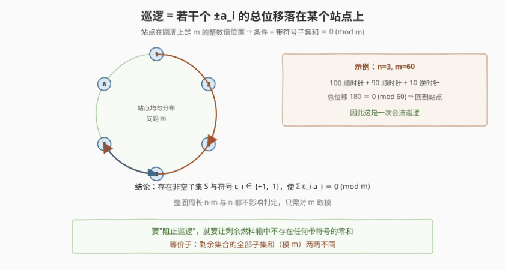
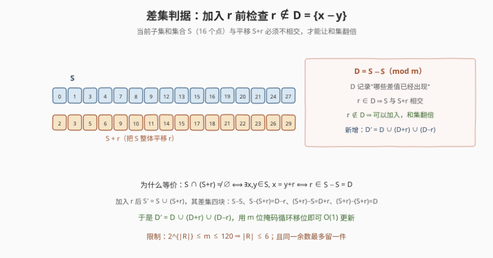
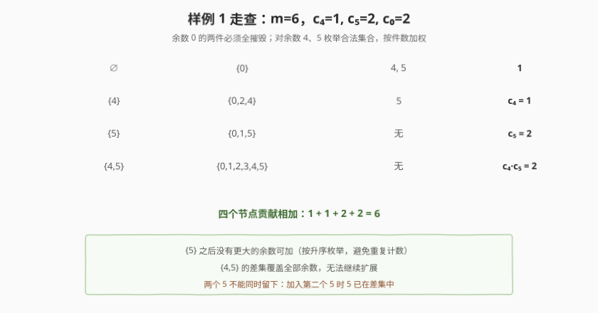

# Codeforces 217D 燃料箱与环上巡逻 题解

## 1. 题目概述

- **题目链接**：https://codeforces.com/problemset/problem/217/D
- **比赛来源**：Codeforces Round 134 (Div. 1) · Problem D（UTC 2012-08-18）
- **难度**：2900
- **标签**：位运算、暴力枚举、组合计数、DFS、数学
- **评测类型**：普通
- **限制**：时间 2 s / 内存 256 MB

**题意**：$n$ 个空间站均匀分布在环形轨道上，相邻两站相距 $m$ 英里（整圈周长 $nm$）。Bit-X 的队长 Bitonix 有 $t$ 个燃料箱，容量分别为 $a_1,\dots,a_t$。一次巡逻：他从某个站出发，依次装上若干个（可不全用）燃料箱，每个燃料箱选定顺时针或逆时针，火箭就恰好飞该容量对应的英里数，最后必须落在某个站上（可以是出发站），且总里程至少 1 英里。空间局想摧毁一部分燃料箱，使得 Bitonix 无法再完成任何巡逻。求可以摧毁的燃料箱子集个数（模 $10^9+7$）。燃料箱按"件"区分，容量相同的两个也算不同。

**约束**：

- $n \le 1000$，$m \le 120$，$t \le 10000$，$a_i \le 10^9$：$m$ 很小是关键，$a_i$ 只需取模 $m$。
- 摧毁子集与"剩余子集"一一对应，计数时按剩余集合 $R$ 统计更方便。
- 只有一组数据。

## 2. 示例与观察

官方样例（输入 / 输出原样）：

```text
输入：
7 6 5
5 4 12 6 5

输出：
6
```

```text
输入：
3 60 2
10 100

输出：
4
```

**样例 1 演算**：$m=6$，燃料箱容量对 6 取模为 $5,4,0,0,5$。容量 $12$ 与 $6$ 都是 $6$ 的倍数（余数 0），单个就能绕整圈回到原站，所以它们**必须全部被摧毁**。剩下的三件（余数 $5,4,5$）中，能留下的集合必须满足"任意非空子集都凑不出 0（模 6）"：

| 剩余集合 $R$ | 有无巡逻 | 说明 |
|---|---|---|
| $\varnothing$ | 无 | 1 种（全摧毁） |
| 任取一件 | 无 | 3 种（余数 $5,4,5$） |
| 两件：$5$ 与 $4$ | 无 | 子集和 $0,5,4,3$ 互不相同 |
| 两件：$5$ 与 $5$ | 有 | $+5-5=0$，且子集和 $0,5,5,4$ 重复 |
| 三件 | 有 | 必含两个 $5$，同上 |

合计 $1+3+2=6$，与输出一致。

**样例 2 演算**：$m=60$，两件容量 $10,100$ 的余数是 $10,40$。任何非空子集的和（带符号）模 60 都不为 0：$10,50,40,20$ 以及 $10+40=50$、$10-40=30$ 等都不为 0，所以**不摧毁任何燃料箱**也是一种合法方案。四个子集（摧毁 $\varnothing$、$\{10\}$、$\{100\}$、$\{10,100\}$）都可行，答案 4。

**关键观察**：

- $n$ 完全不影响答案！出发站可以任选，落在"某个站"上等价于总位移 $\equiv 0 \pmod m$（所有站恰好是 $m$ 的整数倍位置），于是整圈周长 $nm$ 无关紧要。
- 令 $r_i = a_i \bmod m$。Bitonix 用剩余集合 $R$ 能完成巡逻，当且仅当存在非空子集 $S\subseteq R$ 与符号 $\varepsilon_i\in\{+1,-1\}$ 使 $\sum_{i\in S}\varepsilon_i r_i\equiv 0\pmod m$。

自造样例（标注"自造"）：

| 输入 | 输出 | 说明 |
|------|------|------|
| `2 1 3` / `1 2 3` | 1 | $m=1$ 时任何一件都能绕整圈，只能全摧毁 |
| `2 2 3` / `1 3 5` | 4 | 三件余数都是 1，剩余集合至多留 1 件：$1+3$ |
| `2 5 1` / `7` | 2 | 单件余数 2，$\pm2\not\equiv0$：摧毁或保留都行 |
| `2 5 1` / `10` | 1 | 余数 0，必须摧毁 |

## 3. 解题思路

### 3.1 朴素做法与瓶颈

$t$ 可达 $10^4$，子集有 $2^t$ 个，直接枚举不可能；对每个子集还要判断"有无带符号零和"就更不可能。必须把问题转化成对**余数**的计数。

### 3.2 核心观察一：巡逻存在 ⟺ 有带符号的零和



火箭的位置只取决于总位移：从某站出发，位移为 $D$ 时落在站点上当且仅当 $D \equiv 0 \pmod m$（站点就是 $m$ 的倍数位置）。每个燃料箱贡献 $\pm a_i$，方向自选、使用哪些也自选，所以

$$ \text{存在巡逻} \iff \exists\ \varnothing\ne S\subseteq R,\ \varepsilon\in\{\pm1\}^{S}:\ \sum_{i\in S}\varepsilon_i a_i\equiv 0 \pmod m. $$

（"总里程至少 1 英里"自动满足：任何燃料箱容量都 $\ge 1$。）

### 3.3 核心观察二：无巡逻 ⟺ 全部子集和两两不同



**引理**：对剩余集合 $R$（把 $a_i$ 换成 $r_i=a_i\bmod m$），"不存在带符号零和"当且仅当 $R$ 的 $2^{|R|}$ 个（普通）子集和模 $m$ 两两不同。

**证明**：

- 若两个不同子集的子集和相同：$\sum_{P}\equiv\sum_{Q}$，去掉公共部分得 $\sum_{P\setminus Q}\equiv\sum_{Q\setminus P}$，两边移项就是一个非空的带符号零和。
- 反之，若有非空带符号零和，把正号集合记为 $P$、负号集合记为 $Q$（$P\cup Q=S\ne\varnothing$，$P\cap Q=\varnothing$），则 $\sum_P\equiv\sum_Q$，而 $P\ne Q$（否则 $S=\varnothing$），即两个不同子集和相等。∎

于是问题变成：**求 $R\subseteq$ 燃料箱，使 $R$ 的全部子集和（模 $m$）互不相同的方案数**。

由此立刻得到两条强限制：

1. $2^{|R|}\le m\le 120$，所以 $|R|\le 6$；
2. $R$ 中任意两件的余数不能相同（否则子集和 $0,r,r,2r$ 中 $r$ 重复）。

### 3.4 计数：按余数加权 + DFS

设 $c_r$ 为余数等于 $r$ 的燃料箱件数。合法的剩余集合由"一个合法的余数集合 $T$"加"每个余数挑一件"组成，方案数为 $\prod_{r\in T}c_r$；空集贡献 1（全摧毁）。余数 $0$ 的燃料箱永远不能留下（因子恒为 1），直接从枚举中排除。

于是

$$ \text{答案}=\sum_{T\subseteq\{1,\dots,m-1\},\ T\text{ 的子集和互不相同}}\ \prod_{r\in T}c_r . $$

**如何判断"加入 $r$ 后子集和仍互不相同"**：维护当前余数集合的**差集**

$$ D=\{x-y \pmod m : x,y\in S\}, $$

其中 $S$ 是当前子集和的集合。若把第 $k$ 个元素 $r$ 加入，新子集和集合是 $S'=S\cup(S+r)$，它的大小是 $2|S|$ 当且仅当 $S\cap(S+r)=\varnothing$，而

$$ S\cap(S+r)\ne\varnothing \iff \exists x,y\in S:\ x=y+r \iff r\in D. $$

所以**允许加入 $r$ 当且仅当 $r\notin D$**。加入后新的差集为

$$ D'=D\ \cup\ (D+r)\ \cup\ (D-r) \pmod m, $$

因为 $S'$ 的差恰好来自 $D$、$S-(S+r)=D-r$、$(S+r)-S=D+r$ 三部分。用 $m$ 位二进制掩码存 $D$（$m\le120$，用 128 位整数），一次加入只需两次循环移位与三次按位或。

DFS 按余数**升序**加入，保证每个集合只被枚举一次；每到一个节点就把当前权重加入答案，然后尝试所有"比上一个余数大、且不在 $D$ 中"的余数继续扩展。


### 3.5 样例走查



$m=6$，余数分布 $c_5=2,\ c_4=1,\ c_0=2$。从空集出发（贡献 1）：

| 当前 $T$ | $D$（差集，模 6） | 可加入的更大余数 | 贡献 |
|---|---|---|---|
| $\varnothing$ | $\{0\}$ | $4,5$ | 1 |
| $\{4\}$ | $\{0,2,4\}$ | $5$（$5\notin D$） | $c_4=1$ |
| $\{5\}$ | $\{0,1,5\}$ | 无（没有比 5 更大的余数） | $c_5=2$ |
| $\{4,5\}$ | $\{0,1,2,3,4,5\}$ | 无（差集已覆盖全部余数） | $c_4c_5=2$ |

各节点贡献 $1+1+2+2=6$，与答案一致。注意 $\{5,5\}$ 不被允许（余数重复，第二个 5 会在差集中出现），而 $\{4,5\}$ 的差集已覆盖全部余数，无法再扩展。

## 4. 正确性证明

**引理 1**：Bitonix 使用剩余集合 $R$ 能完成巡逻，当且仅当存在非空 $S\subseteq R$ 与符号使 $\sum_{i\in S}\pm a_i\equiv0\pmod m$。

**证明**：位置只由带符号总位移决定；出发站任意，站点集合是 $m\mathbb Z$ 在环上的像，故落在站点上 $\iff$ 总位移 $\equiv 0\pmod m$。容量与方向的组合正是任意非空子集与任意符号。∎

**引理 2**：$R$ 无巡逻 $\iff$ $R$ 的全部子集和（模 $m$）两两不同。

**证明**：见 3.3 的构造，两个方向都给出了显式转换。∎

**引理 3（差集判据）**：设当前已选余数集合 $T$ 的全部子集和互不相同、和为集合 $S$，$D=S-S$。对 $r\notin T$，加入 $r$ 后子集和仍互不相同，当且仅当 $r\notin D$。

**证明**：加入后新和为 $S\cup(S+r)$。"互不相同"等价于 $|S\cup(S+r)|=2|S|$，即 $S\cap(S+r)=\varnothing$；而 $S\cap(S+r)\ne\varnothing\iff\exists x,y\in S: x=y+r\iff r\in S-S=D$。∎

**引理 4（差集更新）**：若 $D=S-S$，则加入 $r$ 后 $D'=S'-S'=D\cup(D+r)\cup(D-r)$。

**证明**：$S'=S\cup(S+r)$，展开四类差：$S-S=D$、$S-(S+r)=D-r$、$(S+r)-S=D+r$、$(S+r)-(S+r)=D$，取并即得。∎

**定理**：DFS 的答案等于合法摧毁子集数。

**证明**：由引理 2，合法剩余集合恰为"子集和互不相同"的集合；DFS 以升序枚举余数、每个集合恰好访问一次（每次只加入编号更大的余数），由引理 3 只在合法时扩展，由引理 4 正确维护差集，因此枚举到的正是全部合法余数集合 $T$，且权重 $\prod c_r$ 计入了"同一余数选哪一件"的所有方式；空集计入全摧毁方案。故求和即为答案。∎

## 5. 复杂度分析

- **时间**：等于"合法余数集合的个数"（每个节点 $O(1)$，每条边两次 128 位循环移位）。$m=120$ 时该数为 $162\,575\,578$（含空集，实测由程序统计），是最坏情况；实测端到端约 $0.92$ s，相对 2 s 时限余量约 2.2 倍（在时限的一半以内）。
- **空间**：$O(m)$，几个 128 位掩码与长度 $m+1$ 的计数数组，约几 KB。
- **与时限的关系**：$m$ 越小节点数骤减（$m\le64$ 时仅约 $1.3\times10^6$ 个节点，十几毫秒），所以真正的瓶颈只有 $m$ 接近 120 且所有余数都有燃料箱的情形。

## 6. 参考代码

### C++17

```cpp
#include <bits/stdc++.h>
using namespace std;
typedef unsigned __int128 u128;
typedef long long ll;
static const ll MOD = 1000000007LL;

static int m;
static u128 fullMask;
static int c[130];
static u128 present;
static u128 highMask[130];   // highMask[i] = 第 i 位及以上全是 1
static ll ans = 0;
static int maxDepth;

static inline u128 rotl(u128 x, int r) {
    return ((x << r) | (x >> (m - r))) & fullMask;
}

static void dfs(int lastIdx, u128 D, ll w, int depth) {
    ans += w;
    if (ans >= MOD) ans -= MOD;
    if (depth == maxDepth) return;
    u128 cand = present & ~D & highMask[lastIdx + 1];
    if (depth == maxDepth - 1) {                 // 最后一层：不必再递归
        while (cand) {
            unsigned long long lo = (unsigned long long)cand;
            int r = lo ? __builtin_ctzll(lo) : 64 + __builtin_ctzll((unsigned long long)(cand >> 64));
            cand ^= ((u128)1 << r);
            ans += w * c[r] % MOD;
            if (ans >= MOD) ans -= MOD;
        }
        return;
    }
    while (cand) {
        unsigned long long lo = (unsigned long long)cand;
        int r = lo ? __builtin_ctzll(lo) : 64 + __builtin_ctzll((unsigned long long)(cand >> 64));
        cand ^= ((u128)1 << r);
        u128 D2 = D | rotl(D, r) | rotl(D, m - r);
        dfs(r, D2, w * c[r] % MOD, depth + 1);
    }
}

int main() {
    int n, t;
    if (scanf("%d %d %d", &n, &m, &t) != 3) return 0;
    for (int i = 0; i < t; i++) { int v; scanf("%d", &v); c[v % m]++; }
    fullMask = (((u128)1) << m) - 1;
    for (int r = 1; r < m; r++) if (c[r]) present |= ((u128)1 << r);
    for (int i = 0; i <= m; i++) highMask[i] = fullMask & ~(((u128)1 << i) - 1);
    maxDepth = 0;
    while ((1LL << (maxDepth + 1)) <= m && maxDepth < 7) maxDepth++;
    dfs(-1, (u128)1, 1, 0);
    printf("%lld\n", ans % MOD);
    return 0;
}
```

### Python3

```python
import sys

MOD = 10 ** 9 + 7


def main() -> None:
    data = sys.stdin.buffer.read().split()
    if not data:
        return
    n, m, t = int(data[0]), int(data[1]), int(data[2])
    vols = [int(x) for x in data[3:3 + t]]
    c = [0] * (m + 1)          # 余数 r 的燃料箱个数（r = 0 表示整圈）
    for v in vols:
        c[v % m] += 1
    full = (1 << m) - 1
    present = 0
    for r in range(1, m):
        if c[r]:
            present |= 1 << r
    max_depth = 0
    while (1 << (max_depth + 1)) <= m and max_depth < 7:
        max_depth += 1
    ans = 0

    def dfs(last, D, w, depth):
        nonlocal ans
        ans += w
        if depth == max_depth:
            return
        cand = present & ~D & (full & ~((1 << (last + 1)) - 1))
        if depth == max_depth - 1:
            while cand:
                low = cand & -cand
                r = low.bit_length() - 1
                cand ^= low
                ans += w * c[r] % MOD
            return
        while cand:
            low = cand & -cand
            r = low.bit_length() - 1
            cand ^= low
            D2 = D | (((D << r) | (D >> (m - r))) & full) | (((D << (m - r)) | (D >> r)) & full)
            dfs(r, D2, w * c[r] % MOD, depth + 1)

    dfs(-1, 1, 1, 0)
    print(ans % MOD)


main()
```

Python 版的逻辑与 C++ 完全一致；最坏情况（$m=120$、全部余数都有燃料箱）约有 $1.6\times10^8$ 个递归节点，纯 Python 会超时，**建议用 PyPy3 或直接提交 C++**。

## 7. 边界情况与易错点

1. **$m=1$**：任何燃料箱都能绕整圈回到原站，合法的剩余集合只有空集，答案 1。代码中 `present = 0`、`maxDepth = 0`，根节点贡献 1，正确。
2. **余数为 0 的燃料箱必须全部摧毁**：它们的存在本身就是巡逻；计数时对它们没有选择（因子 1），不要给它们计入枚举。
3. **余数相同的两件不能同时留下**：$+r-r\equiv0$；差集判据里这体现为 $r\in D$（$r=r-0$），所以第二个同余数无法加入。
4. **$|R|\le6$ 的推导**：$2^{|R|}\le m\le120$，故最多 6 件。`maxDepth` 用 $\lfloor\log_2 m\rfloor$ 计算，别写成 6 写死（$m<64$ 时更小）。
5. **差集必须双向**：$D'=D\cup(D+r)\cup(D-r)$，漏掉 $D-r$ 会把"和变小"的冲突漏判，导致多算。
6. **模 $m$ 的循环移位**：掩码是 $m$ 位环，不是 128 位环；移位后必须 `& fullMask` 并做回绕（`D >> (m-r)`），不能直接用 128 位左移。
7. **升序枚举保证不重不漏**：每次只尝试编号大于上一个的余数；若不加这个限制，同一个集合会被按排列重复计数。
8. **答案取模**：权重 $\prod c_r$ 可能很大（$c_r\le10^{4}$，6 项相乘可达 $10^{24}$），C++ 用 `long long` 逐步取模，Python 天然安全。
9. **`n` 无用**：读入后可以忽略；但不要因为"没用"就漏读，输入格式是第一行 $n,m,t$。
10. **容量先取模**：$a_i\le10^9$，先算 $a_i\bmod m$ 再统计，避免无谓的大数运算。

## 8. 验证记录

- **编译环境与命令**：本机无 GNU `g++`，用 `clang++ -std=c++17 -O2 -I codeforces/tools/include` 编译；`verify_solution.py` 自动采用同样回退。Python 3.9.6。
- **官方样例**：2 / 2 通过（`7 6 5 / 5 4 12 6 5` → `6`；`3 60 2 / 10 100` → `4`），C++ 与 Python 一致。
- **独立暴力对拍**：暴力程序枚举全部 $2^t$ 个剩余子集，对每个子集用"逐个加入元素、检测子集和是否重复"的方式判断是否无巡逻，与差集 DFS 完全独立。对 $m\in[2,9]$、$t\le12$、容量 $\le40$ 的 **300 组**随机数据逐组比对，全部一致；另用另一组 $m\le40$、$t\le25$ 的 **60 组**数据交叉验证了 C++ 与 Python 输出相同。
- **最大约束性能**：$m=120$、所有余数 $1..119$ 都至少有一件（$t=10^4$）的最坏数据，C++ 端到端 3 次平均约 0.92 s（DFS 节点数 $162\,575\,578$，由独立统计程序核实），相对 2 s 时限约 2.2 倍余量，且不超过时限的一半；内存约 2 MB。
- **计数核实**：另写程序直接统计 $m=120$ 时"子集和互不相同"的余数集合个数，与 DFS 访问节点数一致（$162575578$），说明 DFS 没有重复或遗漏。
- **图片校验**：三张 SVG 均通过 `xml.etree.ElementTree.parse`，含 `feTurbulence` 与手写字体，文本包围盒（含重叠检测）均在 `viewBox` 内。
- **公式校验**：`node codeforces/tools/katex_check.cjs codeforces/contests/0101-0203/217` 报告 0 个错误。
- **复核状态**：verified。

## 相关题目与扩展

- [Codeforces 217E Alien DNA](https://codeforces.com/problemset/problem/217/E)：同场 E 题，逆向定位 + 数据结构。
- [Codeforces 217C Formurosa](https://codeforces.com/problemset/problem/217/C)：同场 C 题，布尔函数的结构判定。
- [Codeforces 1012C Hills](https://codeforces.com/problemset/problem/1012/C)：小规模结构上的枚举 + DP，与本题"限制规模后暴力"的思路相似。
- [LeetCode 1711. 大餐计数](https://leetcode.cn/problems/count-good-meals/)：按和的取值做计数，与本题"子集和"视角相关。

**延伸思考**：

1. **如果 $m$ 增大到 $10^9$**：$|R|\le\log_2 m\approx30$，但枚举集合的规模爆炸，必须换思路（例如对余数做数论分类或随机化），本题的 $m\le120$ 是算法可行的关键。
2. **如果要求"摧毁的燃料箱尽量少"**：即在合法剩余集合中找最大的 $|R|$（加权或计数），DFS 依然适用，只需记录最大深度。
3. **如果方向只能全选顺时针**：条件退化为"存在非空子集和 $\equiv0\pmod m$"，判据从"差集"变成"子集和集"，但计数的 DFS 结构类似（只维护和集，不允许回退）。
4. **如果燃料箱可以重复使用**：只要存在一个与 $m$ 不互素的容量（或余数 0），就能绕圈；否则需要解线性同余，问题会从"子集计数"变成"生成子群"的判定，性质完全不同。
