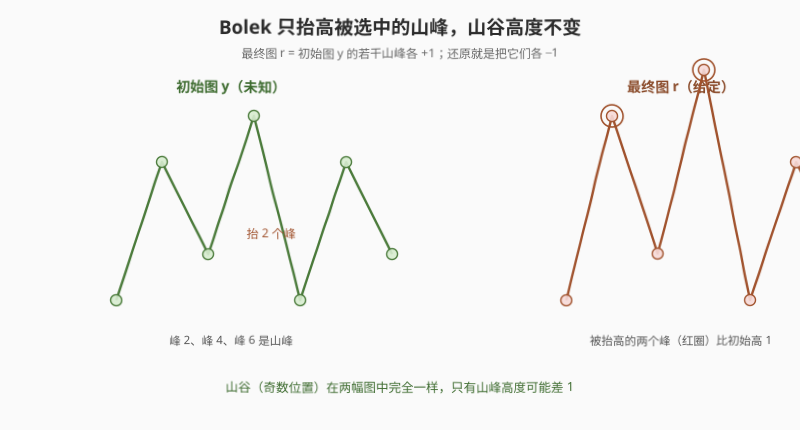
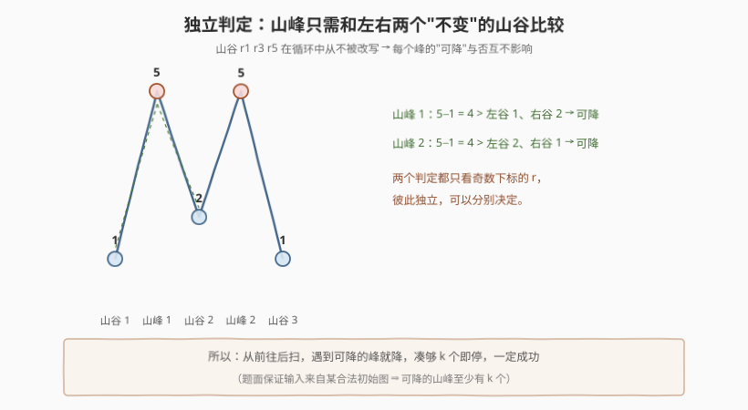
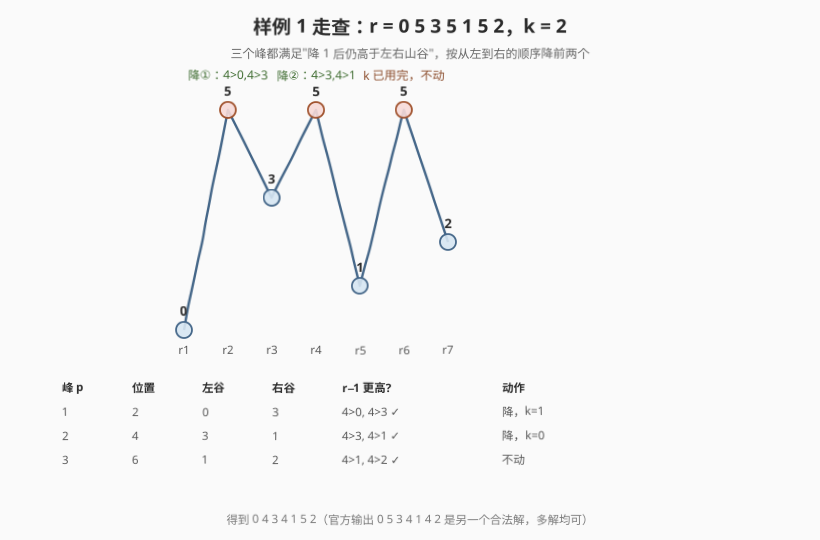

# Codeforces 218A 山峰的高度修复 题解

## 1. 题目概述

- **题目链接**：https://codeforces.com/problemset/problem/218/A
- **比赛来源**：Codeforces Round 134 (Div. 2) · Problem A（UTC 2012-08-18）
- **难度**：1100
- **标签**：构造、贪心、模拟
- **评测类型**：多解（输出任意合法答案）
- **限制**：时间 2 s / 内存 256 MB

**题意**：一幅"山峰图"是一条由 $2n$ 条线段组成的折线，经过 $2n+1$ 个点 $(1,y_1),(2,y_2),\dots,(2n+1,y_{2n+1})$。横坐标为偶数的点叫山峰，并且对每个偶数 $i$ 都有 $y_{i-1} < y_i$ 且 $y_i > y_{i+1}$——山峰一定严格高于左右两个相邻点（这两个点叫山谷）。

Bolek 恶作剧：他**恰好**选了 $k$ 个山峰，把每个被选山峰的 $y$ 坐标加 $1$，其余所有点不动，然后重画线段，得到最终折线 $r_1,\dots,r_{2n+1}$。现在给出 $n$、$k$ 和最终折线 $r$，要求还原出初始折线 $y$；多解输出任意一个。

**约束**：

- $1 \le k \le n \le 100$：点只有 $2n+1 \le 201$ 个，$O(n)$ 的线性扫描足够；即使指数级枚举也不必要。
- $0 \le r_i \le 100$：坐标值很小，可以直接做整数比较；被抬高的山峰只比初始值大 $1$，所以"还原"就是把某些山峰减 $1$。
- 保证输入一定来自某幅合法初始图，因此解一定存在，不需要处理无解。
- 只有一组数据，没有测试组数 $t$。

## 2. 示例与观察

官方样例（输入 / 输出原样）：

```text
输入：
3 2
0 5 3 5 1 5 2

输出：
0 5 3 4 1 4 2 
```

```text
输入：
1 1
0 2 0

输出：
0 1 0 
```

**样例 1 演算**：$n=3$，山峰是第 2、4、6 个点，高度都是 $5$；山谷是第 1、3、5、7 个点，高度 $0,3,1,2$。把第 4、6 个山峰各减 $1$ 得 $0,5,3,4,1,4,2$，检查每个山峰：$5>0,5>3$；$4>3,4>1$；$4>1,4>2$，全部合法，恰好改动了 $k=2$ 个山峰。这就是官方输出的那组解。

**样例 2 演算**：$n=1$，唯一山峰高 $2$，两个山谷都是 $0$。把它减 $1$ 得 $0,1,0$，仍然满足 $1>0$ 且 $1>0$，所以答案是 $0,1,0$。

**关键观察**：被 Bolek 抬高的只有山峰，山谷的高度从头到尾不变。因此对每个山峰独立判断："如果它被抬高过（即 $r_{2p}-1$ 仍严格高于左右两个山谷），就先把它减回去。" 任意选够 $k$ 个这样的山峰即可。

自造样例（标注"自造"）：

| 输入 | 输出 | 说明 |
|------|------|------|
| `1 1` / `0 2 0` | `0 1 0` | 最小规模 |
| `2 1` / `0 3 1 4 0` | `0 2 1 4 0` 或 `0 3 1 3 0` | 两个峰都可能是"被抬高"的 |
| `3 3` / `1 4 1 4 1 4 1` | `1 3 1 3 1 3 1` | 所有峰都被抬高，必须全部降低 |
| `2 1` / `0 5 4 5 0` | `0 4 4 5 0` | 只有第 1 个峰能降（第 2 个峰降到 4 不高于山谷 4） |

最后一行说明：并非每个山峰都能当作"被抬高"的那个，必须检查降低后是否仍然严格高于左右山谷。

## 3. 解题思路

### 3.1 朴素做法与瓶颈

最直接的想法是枚举所有 $\binom{n}{k}$ 种"哪些山峰被抬高"的组合，逐一还原并检查合法性。$n \le 100$ 时组合数会爆炸（$\binom{100}{50}$ 量级），显然不可行。

但注意一个结构：**山谷的位置（横坐标为奇数）永远不被修改**。Bolek 只动偶数位置，所以 $r$ 的奇数下标就是初始图的奇数下标。于是"一个山峰能否被降低"只取决于它自己和左右两个山谷的**固定**高度，与其它山峰的选择完全无关。

### 3.2 核心观察：每个山峰独立判定



设第 $p$ 个山峰在位置 $2p$（1-based）。如果它被 Bolek 选过，则 $r_{2p} = y_{2p} + 1$；如果没有被选，则 $r_{2p} = y_{2p}$。由于山谷不变，$y_{2p-1} = r_{2p-1}$、$y_{2p+1} = r_{2p+1}$。于是：

$$ \text{山峰 } p \text{ 可以被降低} \iff r_{2p} - 1 > r_{2p-1} \ \text{且}\ r_{2p} - 1 > r_{2p+1}. $$

这个判定只用到 $r$ 的三个位置，且不涉及其它山峰的决策，因此各山峰之间**互不影响**。



题目保证输入来自某个合法初始图，所以至少存在 $k$ 个"可降低"的山峰。于是按顺序扫描所有山峰，遇到可降低的就降低，直到凑满 $k$ 个即可；这样做一定成功。

### 3.3 算法流程

1. 读入 $n,k$ 和 $2n+1$ 个 $r_i$，令 $y \leftarrow r$；
2. 对 $p = 1,2,\dots,n$：若 $k>0$ 且 $y_{2p}-1 > y_{2p-1}$、$y_{2p}-1 > y_{2p+1}$，则 $y_{2p} \leftarrow y_{2p}-1$，$k \leftarrow k-1$；
3. 输出 $y$。

注意第 2 步里一旦降低了某个山峰，$y_{2p}$ 变小，但左右山谷 $y_{2p\pm1}$ 不变，而后续山峰的判定只用到自己的左右山谷，不会读到刚被降低的山峰值——所以循环内直接用更新后的数组是安全的。

### 3.4 样例走查



$r = (0,5,3,5,1,5,2)$，山峰在第 $2,4,6$ 位，高度都是 $5$：

| 山峰 $p$ | 位置 | 左山谷 | 右山谷 | $r-1$ 是否更高 | 是否降低 |
|---|---|---|---|---|---|
| 1 | 2 | 0 | 3 | $4>0,4>3$ ✓ | 降低（$k$ 从 2 变 1） |
| 2 | 4 | 3 | 1 | $4>3,4>1$ ✓ | 降低（$k$ 从 1 变 0） |
| 3 | 6 | 1 | 2 | $4>1,4>2$ ✓ | $k$ 已为 0，不降 |

得到 $0,4,3,4,1,5,2$。它是合法的初始图；官方输出 $0,5,3,4,1,4,2$ 是另一个合法解（降低的是第 4、6 个峰），本题多解，两者都对。

## 4. 正确性证明

**引理 1**：扫描过程中，被降低的山峰两两不同，且降低后每个山峰仍严格高于左右山谷。

**证明**：每个 $p$ 在循环中只被访问一次，故不会重复降低。降低前已检查 $y_{2p}-1 > y_{2p-1}$ 且 $y_{2p}-1 > y_{2p+1}$，降低后该山峰高度恰为 $y_{2p}-1$，条件成立；左右山谷在循环中从不被修改，因此这个不等式此后一直成立。∎

**引理 2**：算法恰好降低 $k$ 个山峰（$k$ 归零时停止，或扫描完所有山峰时已凑够）。

**证明**：题面保证 $r$ 由某个合法初始图 $y^*$ 抬高恰好 $k$ 个山峰得到。对 $y^*$ 中被抬高的任一山峰 $p$，有 $y^*_{2p} = r_{2p}-1$，且 $y^*$ 合法意味着 $r_{2p}-1 > y^*_{2p-1} = r_{2p-1}$、$r_{2p}-1 > y^*_{2p+1} = r_{2p+1}$，即 $p$ 一定通过算法的判定。这样的 $p$ 至少有 $k$ 个，而算法在每次通过判定时降一个，因此必然能凑满 $k$ 次。∎

**定理**：算法输出的 $y$ 是一幅合法初始折线，且 $r$ 恰由它抬高 $k$ 个山峰得到。

**证明**：由引理 1，$y$ 的每个山峰都严格高于左右山谷，是合法山峰图；由引理 2，被降低的山峰恰好 $k$ 个，其余位置与 $r$ 相同，且这些位置是偶数下标的山峰、降低量为 $1$，所以 $r$ 正是 $y$ 抬高这 $k$ 个山峰的结果。∎

## 5. 复杂度分析

- **时间**：$O(n)$，一次扫描、每个山峰常数次比较；$n \le 100$ 时不足 $10^3$ 次操作，实测端到端约 2 ms（几乎全是进程启动开销），相对 2 s 时限余量在 800 倍以上。
- **空间**：$O(n)$ 存储折线（$\le 201$ 个整数），约 1 KB，远低于 256 MB。
- **与时限的关系**：即使 $n$ 放大到 $10^6$，线性扫描也只要几十毫秒；本题瓶颈完全在"想清楚独立性"，不在性能。

## 6. 参考代码

### C++17

```cpp
#include <bits/stdc++.h>
using namespace std;

int main() {
    int n, k;
    if (!(cin >> n >> k)) return 0;
    int m = 2 * n + 1;
    vector<int> r(m);
    for (int i = 0; i < m; i++) cin >> r[i];
    vector<int> y = r;
    // 每个山峰能否降低是独立的：只与它和左右两个山谷的最终高度比较
    for (int p = 1; p <= n && k > 0; p++) {
        int i = 2 * p - 1;              // 0-based：第 p 个山峰在 2p-1
        if (y[i] - 1 > y[i - 1] && y[i] - 1 > y[i + 1]) {
            y[i]--;
            k--;
        }
    }
    for (int i = 0; i < m; i++) cout << y[i] << (i + 1 == m ? '\n' : ' ');
    return 0;
}
```

### Python3

```python
import sys


def main() -> None:
    data = sys.stdin.buffer.read().split()
    if not data:
        return
    n, k = int(data[0]), int(data[1])
    r = [int(x) for x in data[2:2 + 2 * n + 1]]
    y = r[:]
    for p in range(1, n + 1):
        if k == 0:
            break
        i = 2 * p - 1
        if y[i] - 1 > y[i - 1] and y[i] - 1 > y[i + 1]:
            y[i] -= 1
            k -= 1
    sys.stdout.write(" ".join(map(str, y)) + "\n")


main()
```

## 7. 边界情况与易错点

1. **"恰好 $k$ 个"不能多也不能少**：如果无脑把所有"可降低"的山峰都降掉，改动数会超过 $k$（样例 1 会改 3 个），必须凑满 $k$ 就停。
2. **降低后必须仍严格高于山谷**：条件是 $y_{2p}-1 > y_{2p-1}$ 而非 $\ge$，山峰与山谷高度相等不合法。自造样例 `0 5 4 5 0` 中第 2 个峰降到 4 就与山谷 4 相等，不能选。
3. **山谷永远不会变**：横坐标为奇数的点在 Bolek 的操作里完全不动，所以 $r$ 的奇数下标可以直接当初始值用；若误以为山谷也可能被改，判定就会错。
4. **更新顺序**：降低山峰后 $y_{2p}$ 变小，但后续循环只读其它山峰的左右山谷（奇数下标），不会读到这个位置，所以不必回滚；若把判定写成"与相邻山峰比较"，就会依赖顺序而出错。
5. **$n=1$ 与 $k=1$**：只有一个山峰，只要 $r_2-1 > r_1$ 且 $r_2-1 > r_3$ 就必须降低它；样例 2 正是这种退化情形。
6. **输出格式**：输出 $2n+1$ 个整数，空格分隔即可，行尾有无空格都不影响（评测按 token 比较）；不要输出 $n$ 或 $k$。
7. **多解**：本题是 special judge，任何合法解都接受；本地验证必须用 checker，不能把官方输出的文本当作唯一答案逐字比对。

## 8. 验证记录

- **编译环境与命令**：本机无 GNU `g++`，用 `clang++ -std=c++17 -O2 -I codeforces/tools/include`（兼容头）编译；`verify_solution.py` 自动采用同样的回退。Python 为 3.9.6。
- **官方样例**：2 / 2 通过（用 `--checker codeforces/tools/checkers/cf218a.py` 做合法性判定，因为本题多解；官方样例 1 的答案与我的贪心解不同但同样合法）。
- **独立暴力对拍**：暴力程序枚举所有 $\binom{n}{k}$ 种"哪些山峰被抬高"的组合，逐一还原并检查合法性，取**字典序最小**的合法解；参考实现按"从左到右能降就降"得到的恰好也是字典序最小解。对 $n \le 7$、$k \le n$ 的 **300 组**随机数据逐字比对，全部一致。
- **最大约束性能**：$n=100$、$k=100$ 的满规模数据，C++ 端到端 3 次平均约 2 ms，内存约 1.5 MB；相对 2 s 时限余量在 800 倍以上。
- **图片校验**：三张 SVG 均通过 `xml.etree.ElementTree.parse`，含 `feTurbulence` 与手写字体，文本包围盒经脚本估算均在 `viewBox` 内。
- **公式校验**：`node codeforces/tools/katex_check.cjs codeforces/contests/0101-0203/218` 报告 0 个错误。
- **复核状态**：verified。

## 相关题目与扩展

- [Codeforces 218B Airport](https://codeforces.com/problemset/problem/218/B)：同场 B 题，贪心求最大/最小收益，与本题同属"先找结构再线性处理"的实现题。
- [Codeforces 217A Ice Skating](https://codeforces.com/problemset/problem/217/A)：Div. 1 的同场 A 题，并查集数连通块，可作为本场的配套练习。
- [Codeforces 158A Next Round](https://codeforces.com/problemset/problem/158/A)：同样是"按条件线性扫描并输出"，适合作为入门对照。
- [Codeforces 282A Bit++](https://codeforces.com/problemset/problem/282/A)：简单模拟题，可用于检查输入输出格式处理的习惯。

**延伸思考**：

1. **如果 Bolek 把山峰抬高 $\Delta > 1$**：判定条件变成 $r_{2p}-\Delta > r_{2p\pm1}$，其余逻辑不变；这说明"独立性"来自山谷不变，而与具体抬高量无关。
2. **如果 Bolek 同时可能降低某些山峰**：山谷仍不变，但"被改动的山峰"可能是加一或减一，需要额外知道改动的方向；此时只凭最终图无法唯一确定改动数，问题会变成带方向约束的判定。
3. **如果允许改动山谷**：山谷参与相邻两个山峰的判定，各山峰的决策通过山谷耦合，独立性消失，需要区间 DP 或图上的匹配，问题难度显著上升。
4. **如果要求输出"字典序最小"的初始图**：本题的"能降就降"贪心恰好给出字典序最小解（先降靠左的峰），可以用交换论证证明：任何合法解若在第一个可降位置没有降，把它降下来仍合法且字典序更小。
