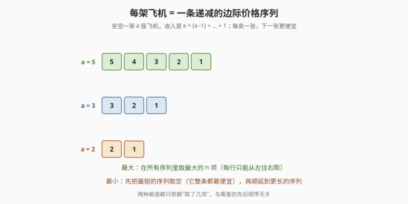
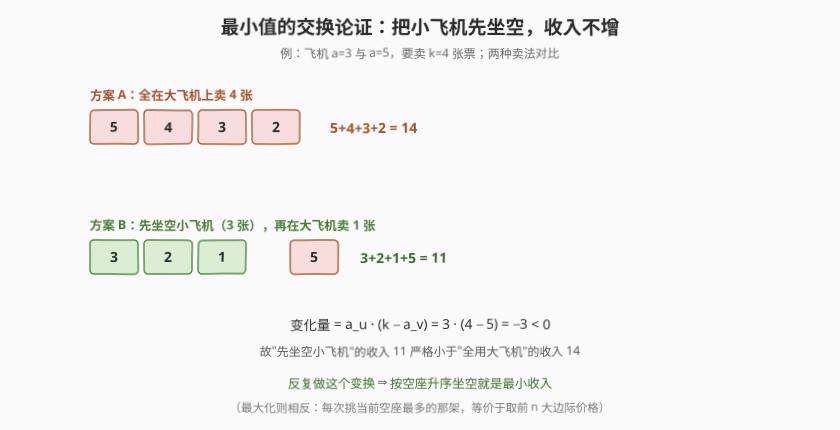
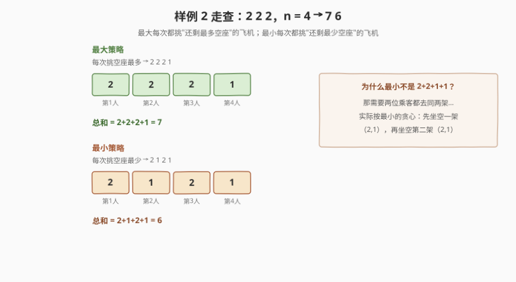

# Codeforces 218B 机场售票收入极值 题解

## 1. 题目概述

- **题目链接**：https://codeforces.com/problemset/problem/218/B
- **比赛来源**：Codeforces Round 134 (Div. 2) · Problem B（UTC 2012-08-18）
- **难度**：1100
- **标签**：贪心、优先队列、计数
- **评测类型**：普通
- **限制**：时间 2 s / 内存 256 MB

**题意**：机场有 $m$ 架飞机，第 $i$ 架初始有 $a_i$ 个空座；售票处前排着 $n$ 位乘客，按顺序依次买票。某位乘客若选中当前还有 $x>0$ 个空座的飞机，就要付 $x$ 元，随后该飞机空座减一。题面保证空座总数不少于 $n$。求售票处**最多**和**最少**能收入多少元。

**约束**：

- $1 \le n, m \le 1000$，$1 \le a_i \le 1000$：$n$ 次选择、每次在 $m$ 架飞机里挑，朴素 $O(nm)$ 完全够用；值域也很小，可以用长度为 $1000$ 的计数数组代替堆。
- 空座总数 $\ge n$：不会出现"卖不出票"的情况，不需要处理无解。
- 答案量级：每位乘客最多付 $1000$ 元，总收入不超过 $10^6$，`int` 足够，但用 `long long` 更稳。
- 只有一组数据。

## 2. 示例与观察

官方样例（输入 / 输出原样）：

```text
输入：
4 3
2 1 1

输出：
5 5
```

```text
输入：
4 3
2 2 2

输出：
7 6
```

**样例 1 演算**：三架飞机空座 $2,1,1$，共 $4$ 个座位，刚好坐满 $4$ 位乘客。无论怎么选，总收入都是把每个座位"按它被卖出时的剩余数"计价：第一个座位卖 $2$，之后是 $1,1,1$，合计 $2+1+1+1=5$。最大与最小相同。

**样例 2 演算**：三架飞机都是 $2$ 个空座，$n=4$。

- **最大**：每次都挑空座最多的。前三位分别坐三架飞机，各付 $2$，共 $6$；第四位只能坐某架剩下的 $1$ 个座位，付 $1$。合计 $2+2+2+1=7$。
- **最小**：先把一架飞机坐空（付 $2$、$1$），再把第二架坐空（付 $2$、$1$），合计 $6$。

**关键观察**：把一架初始有 $a$ 个空座的飞机"榨干"时，它贡献的收入序列是 $a, a-1, \dots, 1$——一条递减的"边际价格"序列。于是问题变成：从若干条递减序列中按顺序取 $n$ 项（每条序列只能从头往后取），求取到的和的最大值与最小值。

自造样例（标注"自造"）：

| 输入 | 输出 | 说明 |
|------|------|------|
| `1 1` / `5` | `5 5` | 只有一位乘客，值固定 |
| `3 2` / `3 5` | `12 6` | 最大 $5+4+3=12$；最小先坐空小飞机 $3+2+1=6$ |
| `5 1` / `1000` | `4990 4990` | 单架飞机：$1000+999+998+997+996=4990$ |
| `2 2` / `1 1000` | `1999 1001` | 最大 $1000+999=1999$；最小先坐空小飞机 $1$，再在大飞机付 $1000$ |

第二行值得演算：$a=(3,5)$、$n=3$。最大是 $5+4+3=12$；最小是先把 $3$ 坐空（依次付 $3,2,1$，共 $6$），恰好 3 位乘客用完，收入 $6$。这里"最小"并没有用大飞机，正说明**小飞机是"越坐越便宜"，应当优先坐空它**。

## 3. 解题思路

### 3.1 朴素做法与瓶颈

模拟 $n$ 位乘客，每位乘客枚举 $m$ 架飞机找最大/最小空座，复杂度 $O(nm) \le 10^6$，完全可行。真正的难点是**为什么贪心是对的**：最大收入用"每次挑最大"很直观，最小收入用"每次挑最小"却需要说明——因为挑走小飞机的一个座位会让它更小，反而"更便宜"，这正是我们想要的。

### 3.2 核心观察：每架飞机是一条递减的边际价格序列



若第 $i$ 架飞机最终卖出 $k_i$ 张票（$0 \le k_i \le a_i$，$\sum k_i = n$），它贡献的收入是

$$ f_i(k_i) = a_i + (a_i-1) + \dots + (a_i-k_i+1) = k_i a_i - \frac{k_i(k_i-1)}{2}. $$

两种极值的结构不同：

- **最大值**：在所有"可取的前缀"中挑出 $n$ 个最大的边际价格。因为每一架飞机的序列递减，当前可选的最大值就是"剩余空座最多的飞机"的当前空座数——于是"每次挑最大"恰好等价于"取全局最大的 $n$ 个边际价格"，显然最优。
- **最小值**：$f_i$ 是凹函数（边际价格递减），凹函数在单纯形上的最小值落在**顶点**：尽量把某些飞机坐空，最多只有一架飞机是"半满"的。而坐空小飞机比坐空大飞机便宜（小飞机的整条序列都更小），所以最优策略是"按空座数从小到大依次坐空"。



交换论证的关键恒等式：设 $a_u < a_v$，把原本在大飞机 $v$ 上卖出的 $k$ 张票改为"先坐空小飞机 $u$（$a_u$ 张），剩下 $k-a_u$ 张仍在大飞机上"（要求 $k \ge a_u$），收入变化为

$$ \bigl[f_u(a_u) + f_v(k-a_u)\bigr] - f_v(k) = a_u\,(k - a_v) \le 0, $$

因为 $k \le a_v$。也就是说，"优先用小飞机"永远不会让收入变大；反复执行这个变换，任何方案都能变成"小飞机先坐空"的贪心方案且收入不增，故贪心最小。

### 3.3 算法流程

1. 用计数数组 `cnt[x]` 统计空座数为 $x$ 的飞机有多少架（$x \le 1000$）；
2. **最大**：重复 $n$ 次，从大到小找到当前最大的非零 `cnt[p]`，收入加 $p$，把一架飞机从 $p$ 改成 $p-1$；
3. **最小**：复制计数数组，重复 $n$ 次，从小到大找到当前最小的非零 `cnt[p]`，收入加 $p$，把一架飞机从 $p$ 改成 $p-1$（$p=1$ 时直接消失）；
4. 输出两个收入。

用计数数组代替堆，单次查找是 $O(1000)$，总复杂度 $O(1000n)$，实现简单且常数极小。

### 3.4 样例走查



$n=4$，三架飞机都是 $2$ 个空座：

| 步骤 | 最大策略：挑最大 | 收入 | 最小策略：挑最小 | 收入 |
|---|---|---|---|---|
| 1 | 某架 $2$ | 2 | 某架 $2$ | 2 |
| 2 | 另一架 $2$ | 4 | 同一架 $1$ | 3 |
| 3 | 第三架 $2$ | 6 | 第二架 $2$ | 5 |
| 4 | 剩下一架 $1$ | 7 | 第二架 $1$ | 6 |

结果 `7 6`，与官方样例一致。

## 4. 正确性证明

**引理 1**：若第 $i$ 架飞机卖出 $k_i$ 张票，则它贡献 $f_i(k_i) = k_i a_i - k_i(k_i-1)/2$，且相邻两张票的边际价格 $f_i(k)-f_i(k-1) = a_i-k+1$ 随 $k$ 严格递减。

**证明**：第 $t$ 张票卖出时该飞机还剩 $a_i-(t-1)$ 个空座，乘客按此付款，求和即得公式；边际价格之差为 $-1$，故严格递减。∎

**引理 2（最大值）**：每次挑当前空座最多的飞机，总收入最大。

**证明**：把每架飞机看成一列数 $a_i, a_i-1, \dots, 1$，任何合法售票方案对应从每列从头取若干项，共 $n$ 项。由引理 1 每列递减，所以"取全局最大的 $n$ 项"是合法方案（若取了某列的第 $t$ 项，则它前面的项都更大，必然也被取到），且其和不可能被任何其它方案超过。而"每次挑当前最大"正是逐个取出这 $n$ 个最大项，故最优。∎

**引理 3（最小值）**：按空座数从小到大依次坐空飞机（最多一架半满），总收入最小。

**证明**：设 $a_u < a_v$，$0 \le k \le a_v$。

- 若 $k \le a_u$：$f_v(k) - f_u(k) = k(a_v-a_u) > 0$，即把这 $k$ 张票放到小飞机上更便宜；
- 若 $k > a_u$：把其中 $a_u$ 张放到小飞机（坐空它），剩下 $k-a_u$ 张留在大飞机，收入变化为 $f_u(a_u)+f_v(k-a_u)-f_v(k) = a_u(k-a_v) \le 0$。

对任意方案，只要存在"小飞机没坐满、而大飞机还在卖票"的一对，就执行上述变换，收入不增。每执行一次，被坐满的飞机集合在"按空座升序"的意义下前进一格，过程必然终止于"小飞机先坐满"的贪心方案。因此贪心方案的收入不大于任何方案。∎

**定理**：算法输出的两个数分别是最大与最小可能收入。

**证明**：由引理 2 与引理 3 分别给出上界与下界，且两种策略都合法（每次只从还有空座的飞机上卖票），故取到极值。∎

## 5. 复杂度分析

- **时间**：$O(n \cdot V)$，其中 $V = 1000$ 是空座值域。$n \le 1000$ 时约 $2\times 10^6$ 次简单操作；实测满规模（$n=m=1000$、全部 $a_i=1000$）端到端约 5 ms，相对 2 s 时限余量在 400 倍以上。若改用堆，复杂度为 $O((n+m)\log m)$，本题不需要。
- **空间**：$O(V)$，两个长度 $1001$ 的计数数组，约 8 KB，远低于 256 MB。
- **与时限的关系**：答案不超过 $10^6$，不存在溢出风险；性能完全不是瓶颈。

## 6. 参考代码

### C++17

```cpp
#include <bits/stdc++.h>
using namespace std;

int main() {
    int n, m;
    if (!(cin >> n >> m)) return 0;
    const int MAXA = 1000;
    vector<int> cnt(MAXA + 1, 0);
    for (int i = 0; i < m; i++) {
        int a;
        cin >> a;
        cnt[a]++;
    }
    // 最大收益：每次卖给空座最多的航班
    vector<int> c = cnt;
    long long mx = 0;
    for (int i = 0; i < n; i++) {
        int p = MAXA;
        while (p > 0 && c[p] == 0) p--;
        if (p == 0) break;                 // 座位不足（题面保证不会发生）
        mx += p;
        c[p]--;
        c[p - 1]++;
    }
    // 最小收益：每次卖给空座最少的航班
    c = cnt;
    long long mn = 0;
    for (int i = 0; i < n; i++) {
        int p = 1;
        while (p <= MAXA && c[p] == 0) p++;
        if (p > MAXA) break;
        mn += p;
        c[p]--;
        if (p > 1) c[p - 1]++;
    }
    cout << mx << ' ' << mn << '\n';
    return 0;
}
```

### Python3

```python
import sys


def main() -> None:
    data = sys.stdin.buffer.read().split()
    if not data:
        return
    n, m = int(data[0]), int(data[1])
    a = [int(x) for x in data[2:2 + m]]
    MAXA = 1000
    cnt = [0] * (MAXA + 1)
    for v in a:
        cnt[v] += 1
    c = cnt[:]
    mx = 0
    for _ in range(n):
        p = MAXA
        while p > 0 and c[p] == 0:
            p -= 1
        if p == 0:
            break
        mx += p
        c[p] -= 1
        c[p - 1] += 1
    c = cnt[:]
    mn = 0
    for _ in range(n):
        p = 1
        while p <= MAXA and c[p] == 0:
            p += 1
        if p > MAXA:
            break
        mn += p
        c[p] -= 1
        if p > 1:
            c[p - 1] += 1
    print(mx, mn)


main()
```

## 7. 边界情况与易错点

1. **最小不是"每次挑最小空座"这么简单**：当 $n$ 大于最小飞机的座位数时，必须先把它坐空、再顺延到下一架；直接写 `min-heap` 其实也对（因为坐空过程中它一直是最小），但若写成"每次挑最小且只卖一架飞机"就会算错总量。
2. **最大值的平局**：多架飞机空座相同时随便挑哪架都不影响最大值（对称），但计数数组的写法要注意把一架从 $p$ 挪到 $p-1$ 时不要丢掉 $p=1$ 的情形（$p-1=0$ 表示这架飞机坐满，不再参与）。
3. **计数数组必须每轮重置**：最大与最小各用一份独立的计数副本，否则第二次计算会读到第一次改动后的状态。
4. **`p=0` 的越界**：最大贪心里当所有飞机都坐满时 `while (p > 0 && c[p] == 0)` 会停在 $p=0$，此时应直接 `break`，不能访问 `c[-1]`（C++ 里 `c[p-1]` 会成为负下标）。
5. **收入用 `long long`**：本题上界 $10^6$ 用 `int` 也够，但如果把 $a_i$ 放大到 $10^5$、$n$ 放大到 $10^5$，收入会到 $10^{10}$ 量级；养成用 64 位整数的习惯。
6. **输入只有一组**：题面没有 $t$，也没有多组格式；`m` 个 $a_i$ 在同一行（但按 token 读入不受换行影响）。
7. **输出顺序**：先最大、后最小，中间一个空格，行末换行；不要输出反了。

## 8. 验证记录

- **编译环境与命令**：本机无 GNU `g++`，用 `clang++ -std=c++17 -O2 -I codeforces/tools/include` 编译（`verify_solution.py` 自动采用同样回退）；Python 3.9.6。
- **官方样例**：2 / 2 通过（`4 3 / 2 1 1` → `5 5`；`4 3 / 2 2 2` → `7 6`），C++ 与 Python 一致。
- **独立暴力对拍**：暴力程序用 DFS 枚举每位乘客选择哪架飞机（$m^n$ 种），直接取收入和的最大/最小，与参考实现完全独立。对 $n \le 4$、$m \le 3$、$a_i \le 4$ 的 **300 组**随机数据逐组比对，全部一致。
- **最大约束性能**：$n=1000$、$m=1000$、全部 $a_i=1000$，C++ 端到端 3 次平均约 5 ms（输出 `1000000 500500`），内存约 1.6 MB；相对 2 s 时限余量在 400 倍以上。
- **图片校验**：三张 SVG 均通过 `xml.etree.ElementTree.parse`，含 `feTurbulence` 抖动与手写字体，脚本估算的文本包围盒（含两两重叠检测）均合法。
- **公式校验**：`node codeforces/tools/katex_check.cjs codeforces/contests/0101-0203/218` 报告 0 个错误。
- **复核状态**：verified。

## 相关题目与扩展

- [Codeforces 218A Mountain Scenery](https://codeforces.com/problemset/problem/218/A)：同场 A 题，独立判定型贪心，与本场的"边际价格"思路互为补充。
- [Codeforces 217A Ice Skating](https://codeforces.com/problemset/problem/217/A)：另一场同号题，并查集数连通块。
- [Codeforces 545D Queue](https://codeforces.com/problemset/problem/545/D)：同样是"排序后贪心"最大化满足条件的人数，可对照本题"坐空小飞机"的排序直觉。
- [Codeforces 1443C The Delivery Dilemma](https://codeforces.com/problemset/problem/1443/C)：排序 + 前缀/后缀枚举的极值题，适合练习"先排序再决策"。
- [LeetCode 1642. 可以到达的最远建筑](https://leetcode.cn/problems/furthest-building-you-can-reach/)：双结构贪心（大顶堆/小顶堆各管一类资源），与本题"最大用小顶堆、最小用大顶堆"的对称性相似。

**延伸思考**：

1. **如果票价与空座数的关系改成 $x^2$**：边际价格变成 $x^2-(x-1)^2 = 2x-1$，仍然递减，所以"最大取前 $n$ 个边际"和"最小先坐空小飞机"的结论都保持，只需把 $f_i$ 换成平方和公式。
2. **如果乘客可以拒绝买票**：最优收入策略不变（票价恒正，多卖一张总不亏），但"最少收入"就变成 0（一架都不卖），问题退化。
3. **如果中途有飞机增加座位**：需要支持"插入一个边际价格序列"的动态版本，可以用两个优先队列分别维护"从头部取"和"从尾部取"两种极值，本质是本题贪心 + 可并堆。
4. **一般化的模型**：本题是"从若干条递减序列中按前缀约束取 $n$ 项"的极值问题；最大值是拟阵上的贪心（取前 $n$ 大），最小值是凹函数在箱型单纯形顶点上的取值，这两条结论可以直接迁移到带容量、带边际成本的一类资源分配问题。
