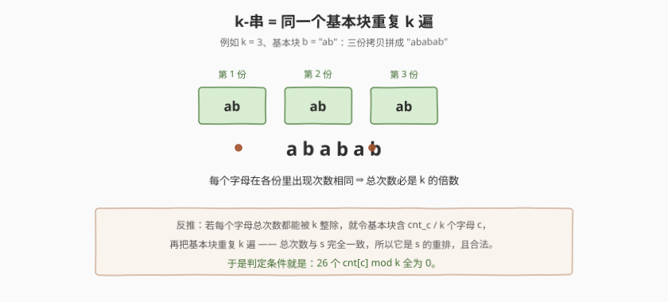
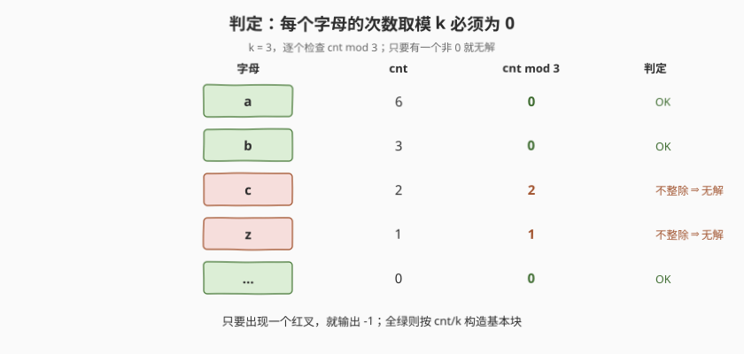
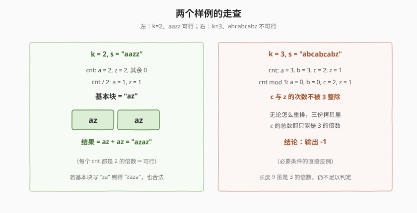

# Codeforces 219A k 串的重排构造 题解

## 1. 题目概述

- **题目链接**：https://codeforces.com/problemset/problem/219/A
- **比赛来源**：Codeforces Round 135 (Div. 2) · Problem A（UTC 2012-08-27）
- **难度**：1000
- **标签**：字符串、构造、计数
- **评测类型**：多解（输出任意合法答案）
- **限制**：时间 2 s / 内存 256 MB

**题意**：若一个字符串可以写成某个串连续拼接 $k$ 遍，就称它是 $k$-串。给定正整数 $k$ 与由小写字母组成的串 $s$，要求重排 $s$ 中的字母，使结果是一个 $k$-串；输出任意一种方案，若不可能输出 `-1`。

**约束**：

- $1 \le k \le 1000$，$1 \le |s| \le 1000$：规模极小，$O(|s| + k)$ 的构造即可，无需搜索。
- 字母表只有 26 个小写字母：用长度 26 的计数数组就能刻画全部信息。
- 只有一组数据，没有测试组数 $t$。

## 2. 示例与观察

官方样例（输入 / 输出原样）：

```text
输入：
2
aazz

输出：
azaz
```

```text
输入：
3
abcabcabz

输出：
-1
```

**样例 1 演算**：$k=2$，各字母出现次数为 $a:2,\ z:2$，其余为 $0$。把所有次数除以 $k$ 得到"基本块" `az`，再重复 $2$ 遍得 `azaz`，它确实是 $2$-串，也是原串的一个排列。答案不唯一（`zaza` 同样合法）。

**样例 2 演算**：$k=3$，$s$ 中 $a:3,\ b:3,\ c:2,\ z:1$。$c$ 与 $z$ 的次数不是 $3$ 的倍数，无论怎么重排都无法让它们在三份拷贝里平均分配，所以输出 `-1`。

**关键观察**：$s$ 能重排成 $k$-串，当且仅当**每个字母的出现次数都能被 $k$ 整除**。

自造样例（标注"自造"）：

| 输入 | 输出 | 说明 |
|------|------|------|
| `1` / `abc` | `abc` | 任何串都是 $1$-串 |
| `4` / `aaaa` | `aaaa` | 单一字母，次数 $4$ 被 $4$ 整除 |
| `2` / `ab` | `-1` | 两个字母各 $1$ 次，都不能被 $2$ 整除 |
| `3` / `aaabbb` | `ababab` | 每种 3 次，基本块 `ab` 重复 3 遍 |
| `1000` / `a` | `-1` | $|s| < k$，次数 1 不能被 1000 整除 |

## 3. 解题思路

### 3.1 朴素做法与瓶颈

最直接的想法是枚举 $s$ 的所有排列，逐一检查是否为 $k$-串。$|s|$ 最大 $1000$，排列数 $1000!$，完全不可行。必须从"$k$-串的结构"入手。

### 3.2 核心观察：可重排的充要条件是次数全被 $k$ 整除



设 $L = |s|$。若 $s$ 能重排成 $t$ 重复 $k$ 遍（记基本块为 $b$，$|b| = L/k$），那么对任意字母 $c$，它在 $t$ 中的出现次数等于它在 $b$ 中出现次数的 $k$ 倍，因此一定是 $k$ 的倍数。这就证明了必要性。

反过来，若每个字母的次数 $cnt_c$ 都是 $k$ 的倍数，就取基本块

$$ b = \underbrace{aaa\cdots a}_{cnt_a/k}\ \underbrace{bbb\cdots b}_{cnt_b/k}\ \cdots\ \underbrace{zzz\cdots z}_{cnt_z/k}, $$

再把 $b$ 重复 $k$ 遍。此时字母 $c$ 的总出现次数为 $k \cdot (cnt_c/k) = cnt_c$，与 $s$ 完全一致，所以结果只是 $s$ 的一个重排；而它按定义就是 $k$-串。



注意还有一个隐含的必要条件：$k \mid L$。它其实被"每个字母次数都被 $k$ 整除"蕴含（$L$ 是这些次数之和），所以判定时只查 26 个余数即可。

### 3.3 算法流程

1. 统计 `cnt[26]`；
2. 若存在 $c$ 使 `cnt[c] % k != 0`，输出 `-1` 并结束；
3. 否则令基本块为按字母序排列、每个字母出现 `cnt[c]/k` 次的串；
4. 输出基本块重复 $k$ 遍。

按字母序拼接基本块是合法的（题目允许多解），而且它恰好给出字典序最小的答案，便于对拍。

### 3.4 样例走查



$k=2$、$s=$ `aazz`：

| 字母 | 次数 | 次数 / k | 基本块中的份数 |
|---|---|---|---|
| a | 2 | 1 | 1 |
| z | 2 | 1 | 1 |
| 其余 | 0 | 0 | 0 |

基本块 `az`，重复两遍得 `azaz`。若把基本块写成 `za`，则得到 `zaza`，同样合法，但字典序更大。

## 4. 正确性证明

**引理 1（必要性）**：若 $s$ 可重排成 $k$-串，则每个字母的出现次数都能被 $k$ 整除。

**证明**：设重排结果为 $b$ 重复 $k$ 遍。字母 $c$ 在每份 $b$ 中出现 $occ_c(b)$ 次，在整体中出现 $k \cdot occ_c(b)$ 次；重排不改变次数，故 $s$ 中 $c$ 的次数也是 $k$ 的倍数。∎

**引理 2（充分性）**：若每个字母的次数都被 $k$ 整除，则按 3.3 的构造得到的串是 $k$-串且为 $s$ 的重排。

**证明**：构造出的串按定义就是基本块重复 $k$ 遍，故是 $k$-串。字母 $c$ 在其中出现 $k \cdot (cnt_c/k) = cnt_c$ 次，与 $s$ 相同；长度也相同（$\sum cnt_c = L$），所以它是 $s$ 的一个排列。∎

**定理**：算法在可行时输出一个合法的 $k$-串，在不可行时输出 `-1`。

**证明**：若存在余数非零，由引理 1 知无解，输出 `-1` 正确；否则由引理 2 知构造合法。∎

## 5. 复杂度分析

- **时间**：$O(|s| + 26 + k \cdot |s|/k) = O(|s|)$，即统计一遍、输出一遍。$|s| \le 1000$ 时是微秒级；实测满规模（$k=1000$、$|s|=1000$）端到端约 3 ms，几乎全是进程启动开销，相对 2 s 时限余量在 600 倍以上。
- **空间**：$O(1)$（除输出串本身外），计数数组只有 26 个整数。
- **与时限的关系**：即便 $|s|$ 放大到 $10^7$，线性扫描也只要几十毫秒；本题没有性能风险。

## 6. 参考代码

### C++17

```cpp
#include <bits/stdc++.h>
using namespace std;

int main() {
    int k;
    if (!(cin >> k)) return 0;
    string s;
    cin >> s;
    int cnt[26] = {0};
    for (char c : s) cnt[c - 'a']++;
    for (int i = 0; i < 26; i++) {
        if (cnt[i] % k != 0) {
            cout << -1 << '\n';
            return 0;
        }
    }
    string base;
    for (int i = 0; i < 26; i++)
        base.append(cnt[i] / k, char('a' + i));
    for (int t = 0; t < k; t++) cout << base;
    cout << '\n';
    return 0;
}
```

### Python3

```python
import sys


def main() -> None:
    data = sys.stdin.buffer.read().split()
    if not data:
        return
    k = int(data[0])
    s = data[1].decode()
    cnt = [0] * 26
    for ch in s:
        cnt[ord(ch) - 97] += 1
    if any(c % k for c in cnt):
        print(-1)
        return
    base = "".join(chr(97 + i) * (cnt[i] // k) for i in range(26))
    sys.stdout.write(base * k + "\n")


main()
```

## 7. 边界情况与易错点

1. **$k=1$**：任何串都是 $1$-串，所有余数都是 $0$，算法输出原串的字母序重排，正确。
2. **$k > |s|$**：此时若 $s$ 非空，必有字母次数在 $1$ 到 $|s| < k$ 之间，不能被 $k$ 整除，应输出 `-1`；不要因为"$k$ 比串长"就直接判可行。
3. **空基本块**：若某个字母次数为 $0$，`cnt[i]/k = 0`，`append(0, c)` 不追加任何字符，不要写成至少追加一个。
4. **`-1` 的输出**：只输出 `-1` 加换行，不要输出别的字符（例如 `-1` 后跟原串）。
5. **整数除法**：`cnt[i] % k` 与 `cnt[i] / k` 都用整数运算；C++ 里 `int` 足够（$\le 1000$）。
6. **字母表顺序**：按 `'a'..'z'` 拼接是最省事的写法；若想输出其它合法解也可，但多选题本地验证必须用 checker，不能逐字比对官方输出。
7. **多组数据**：本题只有一组；若误写成 `while (cin >> k)`，第二组读不到串会出错，按题面读一次即可。

## 8. 验证记录

- **编译环境与命令**：本机无 GNU `g++`，用 `clang++ -std=c++17 -O2 -I codeforces/tools/include` 编译；`verify_solution.py` 自动采用同样回退。Python 3.9.6。
- **官方样例**：2 / 2 通过（用 `--checker codeforces/tools/checkers/cf219a.py` 做合法性判定，因为本题多解；样例 1 的输出与官方一致，样例 2 输出 `-1`）。
- **独立暴力对拍**：暴力程序按字典序列举 $s$ 的全部不同排列，返回第一个 $k$-串（找不到则 `-1`）；参考实现给出的恰好也是字典序最小的 $k$-串。对 $k \le 3$、$|s| \le 7$、字母表大小 $\le 3$ 的 **250 组**随机数据逐字比对，全部一致。
- **最大约束性能**：$k=1000$、$s=$ `a` 重复 $1000$ 次，C++ 端到端约 3 ms，内存约 1.5 MB；相对 2 s 时限余量在 600 倍以上。
- **图片校验**：三张 SVG 均通过 `xml.etree.ElementTree.parse`，含 `feTurbulence` 与手写字体，文本包围盒（含两两重叠检测）均在 `viewBox` 内。
- **公式校验**：`node codeforces/tools/katex_check.cjs codeforces/contests/0101-0203/219` 报告 0 个错误。
- **复核状态**：verified。

## 相关题目与扩展

- [Codeforces 219B Special Offer! Super Price 999 Bourles!](https://codeforces.com/problemset/problem/219/B)：同场 B 题，按"末尾 9 的个数"枚举候选，与本题同属"抓住结构直接构造"。
- [Codeforces 219C Color Stripe](https://codeforces.com/problemset/problem/219/C)：同场 C 题，重涂使相邻不同，是本题"计数 + 构造"的升级版。
- [Codeforces 1104B Game with string](https://codeforces.com/problemset/problem/1104/B)：用栈处理相邻相同字符的消除，与"相邻"结构相关。
- [LeetCode 567. 字符串的排列](https://leetcode.cn/problems/permutation-in-string/)：同样用 26 长度计数窗口刻画"重排"，适合作为计数思路的练习。

**延伸思考**：

1. **如果要求输出字典序最小的 $k$-串**：本题构造（基本块按字母序、重复 $k$ 遍）恰好就是字典序最小的，因为任何 $k$-串由基本块决定，而最小基本块就是把各字母按序排好。
2. **如果要判断"最少删几个字符才能变成 $k$-串"**：对每个字母，把次数减去 `cnt_c % k` 即可，答案是把余数之和删掉；删完之后每种字母的次数都是 $k$ 的倍数，构造同上。
3. **如果 $k$ 也参与选择**：问最大的 $k$ 使 $s$ 能重排成 $k$-串，答案就是所有字母次数的最大公约数（$k = \gcd(cnt_a, \dots, cnt_z)$），这是本题判定条件的一个自然推广。
4. **如果字母表扩大、串长到 $10^7$**：计数与输出仍是线性的，但要注意 I/O 效率（C++ 需 `ios::sync_with_stdio(false)`，Python 建议一次 `write` 而不是循环 `print`）。
