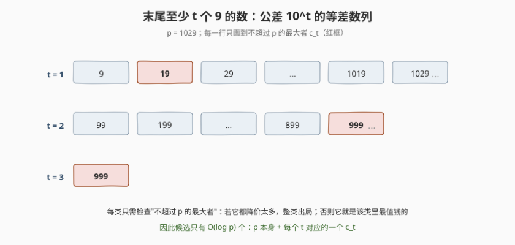
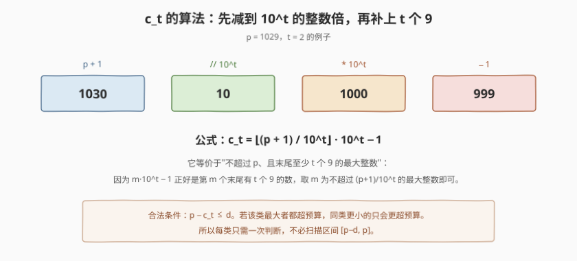
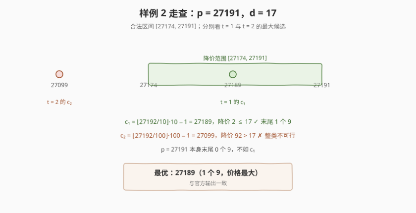

# Codeforces 219B 末尾九最多的价格 题解

## 1. 题目概述

- **题目链接**：https://codeforces.com/problemset/problem/219/B
- **比赛来源**：Codeforces Round 135 (Div. 2) · Problem B（UTC 2012-08-27）
- **难度**：1400
- **标签**：数学、枚举、贪心
- **评测类型**：普通
- **限制**：时间 1 s / 内存 256 MB

**题意**：Polycarpus 原想把价格定为 $p$ 元，但顾客喜欢"末尾一串 9"的价格。他愿意把价格降低不超过 $d$ 元，即选一个整数 $q$ 满足 $p-d \le q \le p$、$q \ge 1$，使得 $q$ 末尾连续的 9 的个数最多；若有多个 $q$ 并列，取其中**最大**的。输出这个价格。

**约束**：

- $1 \le p \le 10^{18}$，$0 \le d < p$：价格到 $10^{18}$，必须用 64 位整数（C++ 用 `long long`，Python 天然支持）；暴力枚举 $[p-d, p]$ 在 $d$ 很大时不可行。
- $d < p$ 保证 $q \ge 1$ 总有解，不会出现负数价格。
- 只有一组数据。

## 2. 示例与观察

官方样例（输入 / 输出原样）：

```text
输入：
1029 102

输出：
999
```

```text
输入：
27191 17

输出：
27189
```

**样例 1 演算**：$p=1029$，$d=102$，可选范围 $[927, 1029]$。区间里末尾 9 最多的是 $999$（3 个 9），它比 $1029$ 低 $30 \le 102$，合法，答案 $999$。注意 $1029$ 本身也以 9 结尾，但只有 1 个 9，不如 $999$。

**样例 2 演算**：$p=27191$，$d=17$，范围 $[27174, 27191]$。末尾 9 最多的是 $27189$（1 个 9），只比原价低 $2$；想凑两个 9 至少要到 $27099$，低了 $92 > 17$，不合法。答案 $27189$。

**关键观察**：把所有"末尾至少 $t$ 个 9"的数排成一列

$$ 10^t - 1,\quad 2\cdot 10^t - 1,\quad 3\cdot 10^t - 1,\quad \dots $$

它们每隔 $10^t$ 出现一个。对固定的 $t$，不超过 $p$ 的最大者可以直接算出来：

$$ c_t = \left\lfloor \frac{p+1}{10^t} \right\rfloor \cdot 10^t - 1 . $$

如果连这个最大的 $c_t$ 都满足 $p - c_t > d$，那么这一类里就没有任何数落在降价范围内；否则 $c_t$ 就是这一类里最值钱的选择。

自造样例（标注"自造"）：

| 输入 | 输出 | 说明 |
|------|------|------|
| `9 0` | 9 | $d=0$，只能原价 |
| `10 0` | 10 | 原价没有 9，也不能降 |
| `100 99` | 99 | $q=99$ 有 2 个 9 |
| `1000 1` | 999 | 只降 1 就能拿到 3 个 9 |
| `1000000000000000000 999999999999999999` | 999999999999999999 | 18 个 9 的上界 |
| `1000000000000000000 1` | 999999999999999999 | 只降 1 元换 18 个 9 |

## 3. 解题思路

### 3.1 朴素做法与瓶颈

枚举 $q \in [p-d, p]$，逐个统计末尾 9 的个数。当 $d$ 接近 $10^{18}$ 时循环 $10^{18}$ 次，绝无可能。必须利用"末尾 9 的个数"这一结构化的条件。

### 3.2 核心观察：按末尾 9 的个数分类，每类只需看最大的那个



固定 $t \ge 1$，末尾至少 $t$ 个 9 的整数恰好是 $m \cdot 10^t - 1$（$m = 1, 2, 3, \dots$）。它们是公差为 $10^t$ 的等差数列，所以"不超过 $p$ 的最大者"就是

$$ c_t = \left\lfloor \frac{p+1}{10^t} \right\rfloor \cdot 10^t - 1 . $$

- 若 $p - c_t > d$：这一类里所有数都更小，降价更多，全部不合法，直接跳过；
- 若 $p - c_t \le d$：$c_t$ 是这一类里价格最高、且合法的数。同类中若还有别的合法数，它们更小，在"9 的个数相同取最大价格"的规则下不如 $c_t$。

再加上"不降价"这个候选 $q=p$（它末尾可能有若干个 9），把所有合法候选按（末尾 9 的个数，价格）比较取最优即可。$t$ 只需枚举到 $10^t \le p+1$，即 $t \le 18$。



**为什么这样不会漏掉最优解**：设最优解的末尾 9 个数为 $J$。若 $J = 0$，最优解必是 $p$（任何降价都会让价格更小，而 9 的个数没有变多）；若 $J \ge 1$，则它属于"末尾至少 $J$ 个 9"这一类，而 $c_J$ 是这一类里最大的合法候选（若 $c_J$ 不合法则整类不合法，与最优解存在矛盾），并且 $c_J$ 末尾恰好是 $J$ 个 9（否则它会有更多 9，与 $J$ 的最优性矛盾），所以 $c_J$ 就是答案。

### 3.3 算法流程

1. 读入 $p, d$；答案初值 `best = p`，9 的个数初值 `bestCnt = nines(p)`；
2. 令 `pw = 10`，对 $t = 1,2,\dots,18$：若 `pw > p+1` 则停止；
   - `cand = ((p+1) / pw) * pw - 1`；
   - 若 `cand <= 0` 或 `p - cand > d`，跳过；
   - 否则用（`nines(cand)`，`cand`）与当前最优比较，更新；
   - `pw *= 10`；
3. 输出 `best`。

### 3.4 样例走查



$p = 1029$，$d = 102$：

| $t$ | $c_t = \lfloor (p+1)/10^t \rfloor \cdot 10^t - 1$ | $p - c_t$ | 是否合法 | 末尾 9 个数 |
|---|---|---|---|---|
| 不降价 | $1029$ | 0 | 合法 | 1 |
| 1 | $\lfloor 1030/10 \rfloor \cdot 10 - 1 = 1029$ | 0 | 合法 | 1 |
| 2 | $\lfloor 1030/100 \rfloor \cdot 100 - 1 = 999$ | 30 | 合法 | 3 |
| 3 | $\lfloor 1030/1000 \rfloor \cdot 1000 - 1 = 999$ | 30 | 合法 | 3 |
| 4 | $10^4 > p+1$，停止 | — | — | — |

最优是 $999$（3 个 9，价格在同类中最高的合法者），输出 `999`。

## 4. 正确性证明

**引理 1**：对任意 $t \ge 1$，所有末尾至少 $t$ 个 9 的正整数构成集合 $\{m\cdot 10^t - 1 : m \ge 1\}$，其中不超过 $p$ 的最大者是 $c_t = \lfloor (p+1)/10^t\rfloor \cdot 10^t - 1$。

**证明**：$q$ 末尾至少 $t$ 个 9 等价于 $q \equiv -1 \pmod{10^t}$，即 $q = m\cdot 10^t - 1$。由 $m \cdot 10^t \le p+1$ 得 $m \le \lfloor (p+1)/10^t \rfloor$，取最大的 $m$ 即得 $c_t \le p$，且它是该集合中不超过 $p$ 的最大元素。∎

**引理 2**：对固定的 $t$，若 $c_t$ 满足 $p - c_t \le d$，则集合 $\{m\cdot 10^t-1\}$ 中所有满足降价约束的元素都不大于 $c_t$，且 $c_t$ 本身合法。

**证明**：该集合中所有不超过 $p$ 的元素都 $\le c_t$（引理 1），而降价约束要求 $q \ge p-d$，故合法元素的降价额 $p-q \ge p-c_t$；若 $c_t$ 本身在范围内，则它是其中价格最高者。∎

**定理**：算法输出的是满足约束、末尾 9 个数最多、并列时价格最大的数。

**证明**：设最优解为 $q^*$，末尾 9 个数为 $J$。

- $J = 0$：则任何 $q < p$ 的末尾 9 个数也为 0 且价格更小，故 $q^* = p$，算法以 $p$ 为初值覆盖此情形。
- $J \ge 1$：$q^*$ 属于"末尾至少 $J$ 个 9"的集合，由引理 2 该类中价格最高的合法者是 $c_J$，故 $q^* \le c_J$。又 $c_J$ 合法且末尾至少 $J$ 个 9；若它末尾多于 $J$ 个 9，就与"最优个数为 $J$"矛盾，故它恰好有 $J$ 个 9、价格不低于 $q^*$，因此它就是最优解，而算法在 $t=J$ 时枚举到它（$J \le 18$，因为 $10^{19} > p+1$）。

综上，算法取得最优解；比较键（9 的个数，价格）保证并列时取最大价格。∎

## 5. 复杂度分析

- **时间**：$O(\log_{10} p)$，最多 18 次迭代，每次若干次整数除法与一次"数末尾 9"（$O(\log p)$）。总计不足 $10^3$ 次运算；实测端到端约 3 ms（几乎全是进程启动），相对 1 s 时限余量在 300 倍以上。
- **空间**：$O(1)$，只有几个 64 位整数。
- **数值范围**：$p \le 10^{18}$，`p+1`、`pw` 都不超过 $10^{18}+1 < 2^{63}-1$，`long long` 安全；Python 无溢出。

## 6. 参考代码

### C++17

```cpp
#include <bits/stdc++.h>
using namespace std;
typedef long long ll;

// 末尾连续 9 的个数
static int nines(ll x) {
    int c = 0;
    while (x % 10 == 9) { c++; x /= 10; }
    return c;
}

int main() {
    ll p, d;
    if (!(cin >> p >> d)) return 0;
    ll best = p;                      // 不降价
    int bestCnt = nines(p);
    ll pw = 10;
    for (int t = 1; t <= 18; t++, pw *= 10) {
        if (pw > p + 1) break;
        // 不超过 p 且末尾至少 t 个 9 的最大数
        ll cand = ((p + 1) / pw) * pw - 1;
        if (cand <= 0) continue;
        if (p - cand > d) continue;   // 它是这一类里最大的，仍超出预算则整类不可行
        int c = nines(cand);
        if (c > bestCnt || (c == bestCnt && cand > best)) {
            bestCnt = c;
            best = cand;
        }
    }
    cout << best << '\n';
    return 0;
}
```

### Python3

```python
import sys


def nines(x: int) -> int:
    c = 0
    while x % 10 == 9:
        c += 1
        x //= 10
    return c


def main() -> None:
    data = sys.stdin.buffer.read().split()
    if not data:
        return
    p, d = int(data[0]), int(data[1])
    best = p
    best_cnt = nines(p)
    pw = 10
    for _ in range(1, 19):
        if pw > p + 1:
            break
        cand = ((p + 1) // pw) * pw - 1
        if cand > 0 and p - cand <= d:
            c = nines(cand)
            if c > best_cnt or (c == best_cnt and cand > best):
                best_cnt = c
                best = cand
        pw *= 10
    print(best)


main()
```

## 7. 边界情况与易错点

1. **$d=0$**：只能选 $p$ 本身，算法中所有 `cand` 都满足 `p - cand > 0 = d`（除非 `cand == p`，此时 9 的个数与初值相同、价格不大于 `best`），最终输出 $p$，正确。
2. **$p$ 本身以 9 结尾**：不能忘记把 $p$ 作为候选；例如 `9 0` 的答案是 9 而不是 0，`19 0` 的答案是 19。
3. **`cand` 可能为 0 或负数**：当 $10^t > p+1$ 时公式会给出 $-1$ 或更小的值，必须跳过（否则会把 0 当成候选，而题面要求价格为正且无前导零）。
4. **`p - cand` 的溢出与符号**：用 `long long` 计算，`p - cand` 不会溢出（两者都非负且 $\le 10^{18}$）；Python 无此问题。
5. **"9 的个数"不是"末尾至少 t 个"**：$c_t$ 可能末尾有超过 $t$ 个 9（例如样例 1 中 $c_2 = 999$ 实际有 3 个），所以要用 `nines(cand)` 的真实值参与比较，不能直接拿 $t$ 当个数。
6. **并列时取最大价格**：比较必须是"9 个数更多优先，否则价格更大优先"；如果只按 9 的个数更新，会把同个数里更大的价格漏掉（虽然本文枚举方式下 $c_t$ 已是同类最大，但把 $p$ 与 $c_t$ 一起比较时必须写对）。
7. **历史提示**：题面特别提醒不要用 `%lld` 读写 64 位整数（老编译器问题），用 `cin/cout` 或 `%I64d`；现代环境直接用 `cin` 即可。
8. **只有一组数据**：没有 $t$，不要写成多组循环。

## 8. 验证记录

- **编译环境与命令**：本机无 GNU `g++`，用 `clang++ -std=c++17 -O2 -I codeforces/tools/include` 编译；`verify_solution.py` 自动采用同样回退。Python 3.9.6。
- **官方样例**：2 / 2 通过（`1029 102` → `999`；`27191 17` → `27189`），C++ 与 Python 一致。
- **独立暴力对拍**：暴力程序直接枚举 $q \in [\max(1,p-d), p]$ 统计末尾 9 的个数并按（个数，价格）取最优，与参考实现完全独立。对 $p \le 3000$、$0 \le d < p$ 的 **300 组**随机数据逐字比对，全部一致。
- **边界与极值手测**：`9 0` → 9；`10 0` → 10；`100 99` → 99；`1000 1` → 999；`10^18 999999999999999999` → 999999999999999999；`10^18 1` → 999999999999999999，均符合预期。
- **最大约束性能**：$p=10^{18}$、$d=10^{18}-1$，C++ 端到端 3 次平均约 3 ms，内存约 1.5 MB；相对 1 s 时限余量在 300 倍以上。
- **图片校验**：三张 SVG 均通过 `xml.etree.ElementTree.parse`，含 `feTurbulence` 与手写字体，文本包围盒（含重叠检测）均在 `viewBox` 内。
- **公式校验**：`node codeforces/tools/katex_check.cjs codeforces/contests/0101-0203/219` 报告 0 个错误。
- **复核状态**：verified。

## 相关题目与扩展

- [Codeforces 219A k-String](https://codeforces.com/problemset/problem/219/A)：同场 A 题，整除判定 + 构造。
- [Codeforces 219C Color Stripe](https://codeforces.com/problemset/problem/219/C)：同场 C 题，相邻不同色的最少重涂。
- [Codeforces 1209A Paint the Numbers](https://codeforces.com/problemset/problem/1209/A)：同样是"按数值结构分组、每类取代表"的小贪心。
- [LeetCode 2340. 生成特殊数字的最少操作](https://leetcode.cn/problems/minimum-operations-to-make-a-special-number/)：通过枚举末尾形态（00/25/50/75）来最大化保留位数，与本题"枚举末尾 9 的个数"异曲同工。

**延伸思考**：

1. **如果允许把价格向上调整**：则对每个 $t$ 应取"不小于 $p$ 的最小 $c_t$"即 $\lceil p/10^t\rceil \cdot 10^t - 1$ 或类似的向上取整形式，其余逻辑不变。
2. **如果要求末尾是若干个 9 再接若干个 0（如 9900）**：候选集合变成 $m \cdot 10^{t+s} + (10^t-1)\cdot 10^s$，仍然每类只需看不超过 $p$ 的最大者，$t,s \le 18$ 枚举即可。
3. **如果在 $[p-d,p]$ 内问"末尾 9 最多"而不要求价格最大**：只需记录最大值，不需要第二关键字；本题多出的第二关键字让"每类取最大"成为必要步骤。
4. **如果 $p$ 达到 $10^{100}$**：把 18 换成十进制位数即可，做法与复杂度完全不变（$O(\text{位数})$），这说明按数位结构枚举的方法是"与数值大小无关"的。
