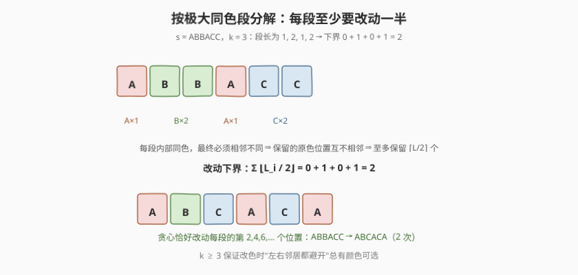
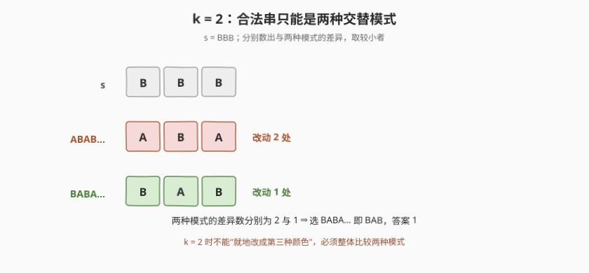
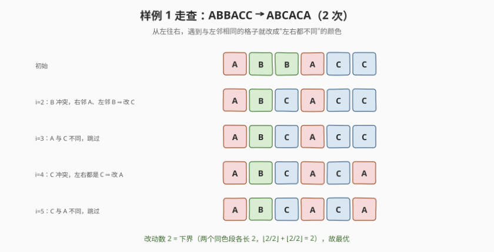

# Codeforces 219C 彩色条纹重涂 题解

## 1. 题目概述

- **题目链接**：https://codeforces.com/problemset/problem/219/C
- **比赛来源**：Codeforces Round 135 (Div. 2) · Problem C（UTC 2012-08-27）
- **难度**：1600
- **标签**：贪心、构造、动态规划
- **评测类型**：多解（输出任意最优方案）
- **限制**：时间 2 s / 内存 256 MB

**题意**：一条由 $n$ 个格子组成的条纹，每个格子染了 $k$ 种颜色之一（用前 $k$ 个大写字母表示）。一次操作可以把任意一个格子改成 $1 \sim k$ 中的任意颜色。要求用最少的操作次数让**相邻格子颜色都不同**，输出最少次数以及任意一种最终条纹。

**约束**：

- $n \le 5\times 10^5$，$2 \le k \le 26$：$O(nk)$ 的 DP 量级约 $1.3\times 10^7$，可以过；但 $O(n^2)$ 或指数枚举不行。$k \ge 2$ 保证一定有解（任何时刻都有"另一种颜色"可用）。
- 颜色只有前 $k$ 个大写字母，值域很小；最终串必须只用这些字母。
- 只有一组数据。

## 2. 示例与观察

官方样例（输入 / 输出原样）：

```text
输入：
6 3
ABBACC

输出：
2
ABCACA
```

```text
输入：
3 2
BBB

输出：
1
BAB
```

**样例 1 演算**：$s=$ `ABBACC`，$k=3$。位置 2、3 都是 `B` 冲突，位置 5、6 都是 `C` 冲突。把第 3 位改成 `C`（避开左邻 `B` 和右邻 `A`），把第 5 位改成 `A`（避开左邻 `C` 和右邻 `C`），得 `ABCACA`，共 2 次。每个冲突对至少改一个，2 次就是下界。

**样例 2 演算**：$s=$ `BBB`，$k=2$。合法的串只能是以 `A` 或 `B` 开头的交替串：`ABA` 需要改 2 个位置，`BAB` 只需改中间一个，答案 1、输出 `BAB`。

**关键观察**：

- $k \ge 3$ 时，冲突可以"就地"解决：把冲突位置改成与**左右邻居都不同**的颜色，$k \ge 3$ 保证这种颜色一定存在。
- $k = 2$ 时没有第三种颜色，合法的条纹只能是两种交替串之一，需要单独比较。

自造样例（标注"自造"）：

| 输入 | 输出 | 说明 |
|------|------|------|
| `1 2` / `A` | `0` / `A` | 单格无需操作 |
| `4 2` / `ABAB` | `0` / `ABAB` | 已经合法 |
| `5 3` / `AAAAA` | `2` / `ABABA` | 长度 5 的同色段，$\lfloor 5/2\rfloor = 2$ |
| `4 2` / `BBAA` | `2` / `BABA` | $k=2$ 时按交替串比较 |
| `6 4` / `ABCDEF` | `0` / `ABCDEF` | 已经合法 |

## 3. 解题思路

### 3.1 朴素做法与瓶颈

最直接的想法是 DP：$dp[i][c]$ 表示前 $i$ 个格子、第 $i$ 个染成颜色 $c$ 的最小改动数，转移是 $dp[i][c] = [s_i \ne c] + \min_{d \ne c} dp[i-1][d]$，复杂度 $O(nk)$。这个做法是对的，$n \le 5\times10^5$、$k \le 26$ 时约 $1.3\times10^7$ 次操作，可以过（C++ 约 0.1 s）。但本题有更简单、常数更小的贪心，而且贪心更容易写对输出。

### 3.2 核心观察一：$k \ge 3$ 时按同色段贪心



把原串分解成极大同色段，长度依次为 $L_1, L_2, \dots$。对长度 $L$ 的一段，它内部所有格子同色，最终串在这 $L$ 个位置上必须两两相邻不同，所以最多只能保留 $\lceil L/2 \rceil$ 个原色（保留的位置必须互不相邻），至少要改 $\lfloor L/2 \rfloor$ 个。各段互不重叠，下界相加：

$$ \text{答案} \ge \sum_i \left\lfloor \frac{L_i}{2} \right\rfloor . $$

从左往右扫描就能达到这个下界：遇到 $s_i = s_{i-1}$ 时，把 $s_i$ 改成与 $s_{i-1}$ 和 $s_{i+1}$ 都不同的颜色（$k \ge 3$ 时至少有一种可选），然后继续。这样每段里恰好改动第 $2,4,6,\dots$ 个位置，共 $\lfloor L/2 \rfloor$ 次；改动后的格子与右邻居也不同（因为选色时避开了 $s_{i+1}$），不会把冲突"推"到下一段。

### 3.3 核心观察二：$k = 2$ 时只有两种交替串



$k=2$ 时"相邻不同"强制整条串交替，合法串只有 `ABAB…` 与 `BABA…` 两种。分别数出与 $s$ 不同的位置数，取较小的那个即可，复杂度 $O(n)$。此时不能再套用"改成本地第三种颜色"的贪心，因为没有第三种颜色。

### 3.4 算法流程

1. 读入 $n,k,s$；
2. 若 $k = 2$：分别计算把 $s$ 改成 `ABAB…` 与 `BABA…` 的代价 $c_0,c_1$，取较小者对应的模式输出；
3. 否则（$k \ge 3$）：`cnt = 0`，对 $i = 1..n-1$：若 $s_i = s_{i-1}$，则从 `'A'` 到 `'A'+k-1` 中找第一个既不是 $s_{i-1}$ 也不是 $s_{i+1}$（若 $i+1<n$）的颜色，赋给 $s_i$，`cnt++`；
4. 输出 `cnt` 与最终串。

### 3.5 样例走查



$s=$ `ABBACC`，$k=3$：

| 步骤 | 当前串 | 判定 | 动作 |
|---|---|---|---|
| 初始 | `ABBACC` | — | — |
| $i=2$（0-based，字符 B） | `ABBACC` | $s_2=s_1=$ `B` | 右邻 `A`，左邻 `B`，只能选 `C` → `ABCACC`，cnt=1 |
| $i=3$（字符 A） | `ABCACC` | $s_3\ne s_2$ | 跳过 |
| $i=4$（字符 C） | `ABCACC` | $s_4=s_3=$ `C` | 右邻 `C`，左邻 `C`，选 `A` → `ABCACA`，cnt=2 |
| $i=5$（字符 C） | `ABCACA` | $s_5\ne s_4$ | 跳过 |

得到 `ABCACA`，与官方输出一致，改动数 2 达到下界（两个同色段各长 2，$\lfloor 2/2\rfloor+\lfloor 2/2\rfloor=2$）。

## 4. 正确性证明

**引理 1（下界）**：设原串的极大同色段长度为 $L_1,\dots,L_m$，则任何合法最终条纹至少要改动 $\sum_i \lfloor L_i/2 \rfloor$ 个位置。

**证明**：固定一段，它占据连续的 $L_i$ 个位置且原色相同。合法最终条纹在这 $L_i$ 个位置上相邻不同，因此任意两个保留原色的位置不能相邻，保留下来的位置是这 $L_i$ 个位置中互不相邻的子集，最多 $\lceil L_i/2 \rceil$ 个，故至少要改 $L_i - \lceil L_i/2\rceil = \lfloor L_i/2\rfloor$ 个。不同段的位置集合互不相交，改动数可加。∎

**引理 2（$k\ge3$ 的上界）**：3.4 的贪心算法恰好改动 $\sum_i \lfloor L_i/2 \rfloor$ 个位置，且结果合法。

**证明**：考察一段长度 $L$、颜色为 $c$ 的段。贪心从该段第二个位置开始逐个检查：段内第 $2,3,\dots,L$ 个位置在扫描时，若它的前一个位置仍是 $c$ 就改成其它颜色（记为 $x\ne c$），否则不动。于是段内被改动的位置恰为第 $2,4,6,\dots$ 个，共 $\lfloor L/2\rfloor$ 个，与引理 1 的下界相等。

合法性：段内相邻位置最终都不同（改动处与左右都不同，未改动处原本与左邻不同）。段与段之间：每段的最后一个位置若被改动，选色时避开了段外的右邻居；若未改动，它本就是另一种颜色，与右邻居（下一段的颜色）不同。因此整串合法。∎

**引理 3（$k=2$）**：$k=2$ 时合法的条纹只能是 `ABAB…` 或 `BABA…`，算法取代价较小者即为最优。

**证明**：相邻必须不同且只有两种颜色，故颜色序列被第一个位置唯一确定，只有两种可能；分别计算改动数并取最小，显然最优。∎

**定理**：算法输出的改动数最小，且输出串是原串的合法重涂。

**证明**：$k \ge 3$ 时由引理 1、2，贪心达到下界且合法；$k=2$ 时由引理 3 最优且输出的一定是合法交替串。∎

## 5. 复杂度分析

- **时间**：$O(n)$（$k=2$ 时两遍扫描，$k\ge3$ 时一遍扫描，每次最多尝试 $k$ 种颜色，$k \le 26$，常数很小）。$n = 5\times10^5$ 时实测约 75 ms，相对 2 s 时限余量约 26 倍。
- **空间**：$O(n)$ 存储字符串本身；另需 $O(1)$ 的计数变量。
- **与时限的关系**：若改用 $O(nk)$ 的 DP，$1.3\times10^7$ 次转移在 2 s 内也没问题，但常数更大、输出还需要回溯；线性贪心更稳。

## 6. 参考代码

### C++17

```cpp
#include <bits/stdc++.h>
using namespace std;

int main() {
    int n, k;
    if (!(cin >> n >> k)) return 0;
    string s;
    cin >> s;
    if (k == 2) {
        // 只有两种颜色时，合法的串只能是以 A 或 B 开头的交替串
        int c0 = 0, c1 = 0;
        for (int i = 0; i < n; i++) {
            char p0 = (i % 2 == 0) ? 'A' : 'B';
            if (s[i] != p0) c0++;
            char p1 = (i % 2 == 0) ? 'B' : 'A';
            if (s[i] != p1) c1++;
        }
        char first = (c0 <= c1) ? 'A' : 'B';
        int cnt = min(c0, c1);
        string t(n, '?');
        for (int i = 0; i < n; i++) t[i] = ((i % 2 == 0) == (first == 'A')) ? 'A' : 'B';
        cout << cnt << '\n' << t << '\n';
        return 0;
    }
    // k >= 3：从左往右，遇到冲突就换成一个与左右邻居都不同的颜色
    int cnt = 0;
    for (int i = 1; i < n; i++) {
        if (s[i] == s[i - 1]) {
            char nxt = (i + 1 < n) ? s[i + 1] : 0;
            for (char c = 'A'; c < 'A' + k; c++) {
                if (c != s[i - 1] && c != nxt) { s[i] = c; break; }
            }
            cnt++;
        }
    }
    cout << cnt << '\n' << s << '\n';
    return 0;
}
```

### Python3

```python
import sys


def main() -> None:
    data = sys.stdin.buffer.read().split()
    if not data:
        return
    n, k = int(data[0]), int(data[1])
    s = list(data[2].decode())
    if k == 2:
        c0 = sum(1 for i in range(n) if s[i] != ('A' if i % 2 == 0 else 'B'))
        c1 = sum(1 for i in range(n) if s[i] != ('B' if i % 2 == 0 else 'A'))
        if c0 <= c1:
            t = ['A' if i % 2 == 0 else 'B' for i in range(n)]
            cnt = c0
        else:
            t = ['B' if i % 2 == 0 else 'A' for i in range(n)]
            cnt = c1
        sys.stdout.write(f"{cnt}\n{''.join(t)}\n")
        return
    cnt = 0
    for i in range(1, n):
        if s[i] == s[i - 1]:
            nxt = s[i + 1] if i + 1 < n else None
            for code in range(65, 65 + k):
                c = chr(code)
                if c != s[i - 1] and c != nxt:
                    s[i] = c
                    break
            cnt += 1
    sys.stdout.write(f"{cnt}\n{''.join(s)}\n")


main()
```

## 7. 边界情况与易错点

1. **$k = 2$ 必须特判**：$k \ge 3$ 的"改成第三种颜色"策略在 $k=2$ 时会选不出颜色（或选到右邻居的颜色），导致错误甚至死循环。例如 `ABBA` 在 $k=2$ 时的最优改动是 2，而"局部修改"会陷入连锁。
2. **$n=1$**：没有任何相邻对，答案是 0、输出原串；代码中循环 `1..n-1` 为空，自然正确。
3. **改色时要同时避开左右邻居**：只避开左邻居可能与右邻居撞色（例如 `ABBA` 中途），多一个判断几乎零成本；$k\ge3$ 时一定存在可选色。
4. **段尾的选色**：段最后一个位置被改动时右邻居属于下一段，选色必须避开它；若写"只看左邻居"，会制造新的相邻同色，答案偏小且输出非法。
5. **输出格式**：第一行改动数、第二行完整串（长度必须为 $n$，只含前 $k$ 个字母）；不要输出原串或省略第二行。
6. **多解**：本题是 special judge，任何最优方案都接受；本地验证必须用 checker 校验"合法性 + 改动数等于理论最小值"，不能逐字比对官方输出。
7. **改动数的下界是否总可达到**：$k \ge 3$ 时可以（引理 2）；$k=2$ 时下界 $\sum\lfloor L_i/2\rfloor$ 可能达不到（如 `ABBA`：下界 1，实际 2），所以 $k=2$ 必须走交替串方案。

## 8. 验证记录

- **编译环境与命令**：本机无 GNU `g++`，用 `clang++ -std=c++17 -O2 -I codeforces/tools/include` 编译；`verify_solution.py` 自动采用同样回退。Python 3.9.6。
- **官方样例**：2 / 2 通过（用 `--checker codeforces/tools/checkers/cf219c.py` 校验合法性、改动数与理论最小值；样例 1 输出 `ABCACA`、样例 2 输出 `BAB`，与官方一致）。
- **独立暴力对拍**：暴力程序枚举全部 $k^n$ 个串，筛出合法（相邻不同）者，取与 $s$ 差异最小的改动数；参考实现的改动数与暴力完全一致。对 $n \le 7$、$k \in [2,4]$ 的 **300 组**随机数据逐组比对（同时用 checker 验证输出串合法），全部一致。
- **最大约束性能**：$n=5\times10^5$、$k=3$ 的随机串，C++ 端到端约 75 ms；$n=5\times10^5$、$k=2$ 的随机串约 71 ms；相对 2 s 时限余量约 26 倍。内存约 1.6 MB。
- **图片校验**：三张 SVG 均通过 `xml.etree.ElementTree.parse`，含 `feTurbulence` 与手写字体，文本包围盒（含重叠检测）均在 `viewBox` 内。
- **公式校验**：`node codeforces/tools/katex_check.cjs codeforces/contests/0101-0203/219` 报告 0 个错误。
- **复核状态**：verified。

## 相关题目与扩展

- [Codeforces 219A k-String](https://codeforces.com/problemset/problem/219/A)：同场 A 题，计数 + 构造。
- [Codeforces 219B Special Offer! Super Price 999 Bourles!](https://codeforces.com/problemset/problem/219/B)：同场 B 题，按数位结构枚举候选。
- [Codeforces 706C Hard problem](https://codeforces.com/problemset/problem/706/C)：同样是"相邻约束 + 线性 DP（翻转/不翻转）"，可作为本题 DP 视角的对照。
- [Codeforces 1029C Maximal Intersection](https://codeforces.com/problemset/problem/1029/C)：贪心 + 分类讨论的经典题。
- [LeetCode 605. 种花问题](https://leetcode.cn/problems/can-place-flowers/)：相邻约束下的贪心计数，与"每段至多保留一半"的思想相通。

**延伸思考**：

1. **如果想求"改动次数最少"但输出字典序最小的方案**：贪心在选色时改为"取可选的最小字母"即可，因为每次改动只影响当前位，不影响总改动数。
2. **如果要求最终条纹恰好使用 $k$ 种颜色的全部**：当 $n < k$ 时无解；$n \ge k$ 时可以在贪心之后检查缺色，把某个与邻居都不同的位置改成缺少的颜色，至多多花常数次（需要额外论证，且可能破坏最优性）。
3. **如果改成循环条纹（首尾也相邻）**：$k=2$ 时只有 $n$ 为偶数才有解；$k\ge3$ 时可以用"枚举第一个位置的颜色"再线性贪心，取最小。
4. **如果每次操作的代价不同（按位置加权）**：局部贪心不再最优，需要 $O(nk)$ 的 DP；这也说明本题的贪心依赖"每次改动代价相同"这一前提。
