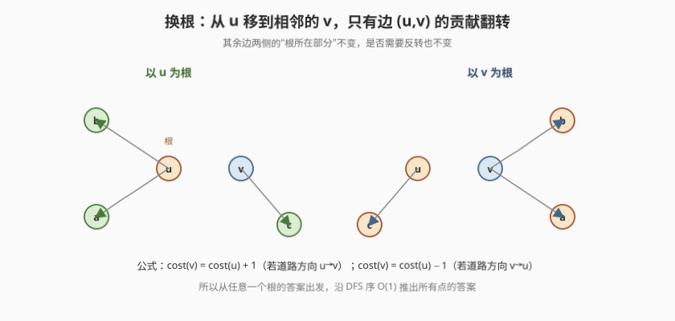
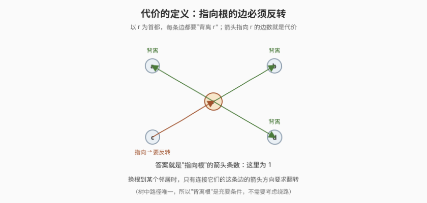
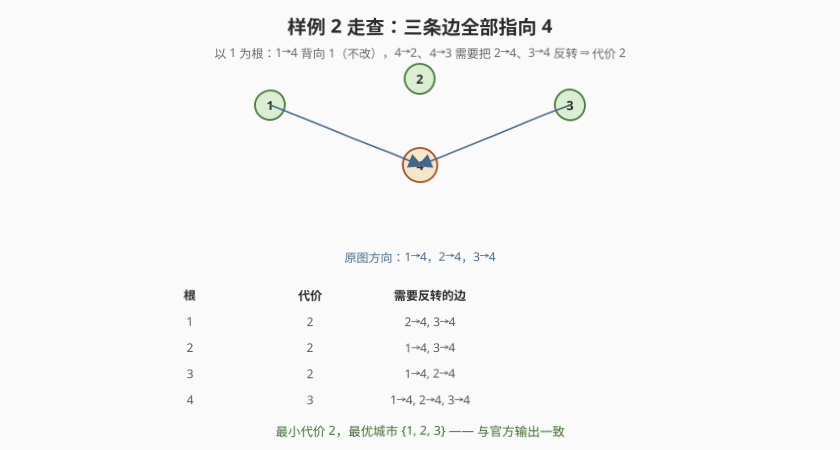

# Codeforces 219D 树国的首都选址 题解

## 1. 题目概述

- **题目链接**：https://codeforces.com/problemset/problem/219/D
- **比赛来源**：Codeforces Round 135 (Div. 2) · Problem D（UTC 2012-08-27）
- **难度**：1700
- **标签**：树、换根 DP、图的遍历
- **评测类型**：普通
- **限制**：时间 3 s / 内存 256 MB

**题意**：Treeland 有 $n$ 座城市和 $n-1$ 条**有向**道路，忽略方向后是一棵树。若选城市 $r$ 作首都，要求所有道路经过（必要时反转）后都能从 $r$ 出发到达任意城市——也就是每条边都必须"背离 $r$"。求最少需要反转多少条道路，并输出所有能达到该最小值的城市编号（升序）。

**约束**：

- $n \le 2\times 10^5$：$O(n^2)$ 的"对每个根做一次 DFS"是 $4\times 10^{10}$，必然超时；需要 $O(n)$ 的换根 DP。
- 树最深可达 $2\times 10^5$ 层：递归 DFS 会爆栈，必须写成迭代或手动扩栈。
- 输出所有最优城市，编号升序，说明可能有多个并列最优（例如星形树）。
- 只有一组数据。

## 2. 示例与观察

官方样例（输入 / 输出原样）：

```text
输入：
3
2 1
2 3

输出：
0
2 
```

```text
输入：
4
1 4
2 4
3 4

输出：
2
1 2 3 
```

**样例 1 演算**：边为 $2\to1$ 与 $2\to3$。若首都是 2，两条边本来就背离 2，无需反转，代价 0；首都是 1，则 $1\to2$ 需要反转（因为原方向是 $2\to1$），代价 1；首都是 3 同理代价 1。最优只有城市 2，输出 `0` 与 `2`。

**样例 2 演算**：三条边 $1\to4,\ 2\to4,\ 3\to4$，即星形中心是 4、所有边都指向 4。若首都是 1：边 $1\to4$ 背离 1（不用改），但 $2\to4$、$3\to4$ 现在要背离 1，需要改成 $4\to2$、$4\to3$，共 2 次；首都 2、3 对称，也是 2 次；首都 4 则需要把三条边全部反过来，代价 3。最优代价 2，城市 1、2、3，输出 `2` 与 `1 2 3`。

**关键观察**：对固定的根 $r$，"从 $r$ 能到达所有点"当且仅当每条边的方向都背离 $r$（树上路径唯一，任何一条边若指向 $r$ 一侧，就无法从 $r$ 跨过去）。所以代价就是**方向指向根（即"朝里"）的边数**。

自造样例（标注"自造"）：

| 输入 | 输出 | 说明 |
|------|------|------|
| `2` / `1 2` | `0` / `1` | 唯一的边 $1\to2$ 背离 1 |
| `2` / `2 1` | `0` / `2` | 唯一的边 $2\to1$ 背离 2 |
| `4` / `1 2` `1 3` `1 4` | `0` / `1` | 全部背离 1 |
| `5` / `1 2` `2 3` `3 4` `4 5` | `0` / `1` | 一条链全部同向 |

注意 `n=2` 时答案依赖边的方向：边 $1\to2$ 时最优是 1，边 $2\to1$ 时最优是 2，**不能**一律输出两个点——汇点作首都需要把唯一一条边反转，代价是 1。

## 3. 解题思路

### 3.1 朴素做法与瓶颈

对每个候选首都 $r$ 做一次 DFS：沿树走到每个点，若某条边的实际方向是"子 → 父"（即指向根一侧），就计一次反转。单次 $O(n)$，总共 $O(n^2)$，$n=2\times10^5$ 时约 $4\times10^{10}$ 次操作，远超 3 s。需要利用"相邻两个根之间只差一条边"的性质。

### 3.2 核心观察：换根只改变一条边的贡献



定义 $cost(r)$ 为以 $r$ 为根时需要反转的边数。设 $v$ 是 $u$ 的邻居，比较 $cost(u)$ 与 $cost(v)$：

- 边 $(u,v)$ 在两种情形下的要求正好相反：以 $u$ 为根时它必须背离 $u$；以 $v$ 为根时它必须背离 $v$。所以若原方向是 $u\to v$，则 $cost(v)$ 比 $cost(u)$ 多 1；若原方向是 $v\to u$，则少 1。
- 其余每条边 $e$：把 $u$ 换成 $v$ 后，$e$ 两侧的"根所在的一侧"没有变化（$e$ 不在 $u$–$v$ 这条边上，$e$ 把树分成两部分，$u$ 与 $v$ 总在同一部分），所以 $e$ 需要的方向不变，贡献相同。

于是得到换根公式

$$ cost(v) = cost(u) + \begin{cases} +1, & \text{道路方向为 } u \to v,\\ -1, & \text{道路方向为 } v \to u. \end{cases} $$



### 3.3 算法流程

1. 读入 $n-1$ 条有向边，建**双向**邻接表：从 $a$ 到 $b$ 存一条"代价 0"（顺路），从 $b$ 到 $a$ 存一条"代价 1"（逆行）；
2. 以 1 为根做一次迭代 DFS，求出每个点的父亲 `par` 和"父 → 该点"这条树边的代价 `pw`，则 $cost(1) = \sum_v pw[v]$；
3. 再按 DFS 序（父先于子）向下推：对每个 $u$ 的树边 $(u,v)$，若该方向代价为 0（原方向 $u\to v$），则 $cost(v) = cost(u)+1$；否则 $cost(v) = cost(u)-1$；
4. 取 $cost$ 的最小值，输出所有取到最小值的城市编号（升序）。

### 3.4 样例走查



$n=4$，边 $1\to4,\ 2\to4,\ 3\to4$。以 1 为根时：树边 $1\to4$（沿方向，代价 0）、$4\to2$（实际是 $2\to4$，逆行，代价 1）、$4\to3$（逆行，代价 1），故 $cost(1)=2$。

| 根 | 需要反转的边 | 代价 |
|---|---|---|
| 1 | $2\to4,\ 3\to4$ | 2 |
| 2 | $1\to4,\ 3\to4$ | 2 |
| 3 | $1\to4,\ 2\to4$ | 2 |
| 4 | $1\to4,\ 2\to4,\ 3\to4$ 全部 | 3 |

最小代价 2，最优集合 $\{1,2,3\}$，与官方输出一致。

## 4. 正确性证明

**引理 1**：以 $r$ 为首都时，道路需要反转的条数恰为"方向指向 $r$ 的边数"。

**证明**：树中任意两点间路径唯一。若某条边 $e$ 把树分成含 $r$ 的一侧 $A$ 与另一侧 $B$，要从 $r$ 到达 $B$ 中任何点都必须穿过 $e$，方向必须是 $A\to B$（背离 $r$）。所以 $e$ 不需要反转当且仅当它的方向背离 $r$；对所有边求和即得。∎

**引理 2（换根公式）**：设 $u,v$ 相邻，则 $cost(v)-cost(u)$ 只由边 $(u,v)$ 决定：方向 $u\to v$ 时为 $+1$，方向 $v\to u$ 时为 $-1$。

**证明**：由引理 1，$cost$ 是各边指示函数之和。对边 $(u,v)$：以 $u$ 为根时它背离 $u$ 当且仅当方向是 $u\to v$（此时贡献 0），以 $v$ 为根时它背离 $v$ 当且仅当方向是 $v\to u$。所以方向 $u\to v$ 时该边贡献从 0 变 1（$+1$），方向 $v\to u$ 时从 1 变 0（$-1$）。对其余边 $e$：删去 $e$ 后树分成两部分，$u$ 与 $v$ 相邻且 $e\ne(u,v)$，故 $u,v$ 必在同一部分，$e$ 的"背离根"要求只取决于根在哪一部分，前后相同，贡献不变。∎

**定理**：算法求出的最小代价与最优城市集合正确。

**证明**：算法先用一次 DFS 正确算出 $cost(1)$（引理 1），再沿树边用引理 2 逐个推出所有 $cost(v)$，因此每个 $cost$ 值都正确；取最小值并收集所有取到最小值的点即为答案。∎

## 5. 复杂度分析

- **时间**：$O(n)$。建图 $O(n)$、两次遍历各 $O(n)$、收集答案 $O(n)$。$n=2\times10^5$ 时实测约 25 ms（含读入），相对 3 s 时限余量超过 100 倍。
- **空间**：$O(n)$。邻接表用 `head/nxt/to` 三个数组（$2(n-1)$ 条弧），加上 `par/pw/order/cost` 各 $n$ 个 `int`，约 $6\sim7$ MB，远低于 256 MB。
- **与时限的关系**：若用 `cin >>` 读 $4\times10^5$ 个整数，在本机实测会明显变慢（约 0.8 s），改用 `scanf` 后读入只需约 20 ms；这是本题实现上唯一需要留意的常数问题。

## 6. 参考代码

### C++17

```cpp
#include <bits/stdc++.h>
using namespace std;

int main() {
    int n;
    if (scanf("%d", &n) != 1) return 0;
    int m = 2 * (n - 1);
    vector<int> head(n, -1), nxt(m), to(m);
    vector<char> w(m);
    int ec = 0;
    auto add = [&](int a, int b, int c) {
        to[ec] = b; w[ec] = (char)c; nxt[ec] = head[a]; head[a] = ec++;
    };
    for (int i = 0; i + 1 < n; i++) {
        int s, t;
        scanf("%d %d", &s, &t);
        --s; --t;
        add(s, t, 0);      // 沿 s->t 方向走，不需要逆行
        add(t, s, 1);      // 从 t 走向 s 需要逆行
    }
    vector<int> par(n, -1), pw(n, 0), order;
    order.reserve(n);
    vector<int> stk(1, 0);
    par[0] = 0;
    while (!stk.empty()) {                       // 迭代 DFS，避免 2e5 层递归
        int u = stk.back(); stk.pop_back();
        order.push_back(u);
        for (int e = head[u]; e != -1; e = nxt[e]) {
            int v = to[e];
            if (par[v] == -1) { par[v] = u; pw[v] = w[e]; stk.push_back(v); }
        }
    }
    vector<int> cost(n, 0);
    for (int x : order) cost[0] += pw[x];
    for (int u : order)
        for (int e = head[u]; e != -1; e = nxt[e]) {
            int v = to[e];
            if (par[v] == u) cost[v] = cost[u] + (w[e] == 0 ? 1 : -1);
        }
    int mn = *min_element(cost.begin(), cost.end());
    printf("%d\n", mn);
    bool first = true;
    for (int i = 0; i < n; i++) {
        if (cost[i] != mn) continue;
        if (!first) putchar(' ');
        printf("%d", i + 1);
        first = false;
    }
    putchar('\n');
    return 0;
}
```

### Python3

```python
import sys


def main() -> None:
    data = sys.stdin.buffer.read().split()
    if not data:
        return
    n = int(data[0])
    adj = [[] for _ in range(n)]
    p = 1
    for _ in range(n - 1):
        s = int(data[p]) - 1
        t = int(data[p + 1]) - 1
        p += 2
        adj[s].append((t, 0))
        adj[t].append((s, 1))
    par = [-1] * n
    pw = [0] * n
    order = []
    stack = [0]
    par[0] = 0
    while stack:                      # 迭代 DFS，避免递归深度问题
        u = stack.pop()
        order.append(u)
        for v, w in adj[u]:
            if par[v] == -1:
                par[v] = u
                pw[v] = w
                stack.append(v)
    cost = [0] * n
    cost[0] = sum(pw)
    for u in order:
        for v, w in adj[u]:
            if par[v] == u:
                cost[v] = cost[u] + (1 if w == 0 else -1)
    mn = min(cost)
    res = [str(i + 1) for i in range(n) if cost[i] == mn]
    sys.stdout.write(str(mn) + "\n" + " ".join(res) + "\n")


main()
```

## 7. 边界情况与易错点

1. **递归爆栈**：$n=2\times10^5$ 的链会让递归 DFS 直接栈溢出（默认栈约 8 MB）。必须写迭代栈或手动 `setrecursionlimit` + 扩栈；本文两份代码都用迭代。
2. **$n=2$ 的答案依赖方向**：边 $1\to2$ 时最优是 1，边 $2\to1$ 时最优是 2；不要因为"两个点都行"就输出两个。
3. **换根公式的符号**：$+1/-1$ 由**原道路方向**决定，而不是由 DFS 方向决定。建图时把"顺路"存成 0、"逆行"存成 1，换根时 `+1` 对应 0、`-1` 对应 1，二者不能写反。
4. **多个最优城市**：输出必须**升序**且只在一行内用空格分隔；用一个 `bool first` 控制空格比 `if (i) cout << ' '` 更稳（避免行首空格）。
5. **$cost(1)$ 的算法**：等于所有"父 → 子"树边代价之和；用 `sum(pw)` 即可，不要去数"每个点的入度"（根不确定时入度不等于代价）。
6. **读入效率**：$4\times10^5$ 个整数用 `cin` 在部分环境较慢（本机实测约 0.8 s），建议 `scanf` 或快速读入；这是本题唯一容易踩的性能坑。
7. **输出格式**：第一行一个整数，第二行城市编号列表（至少要有一个）；行末换行，不要输出多余文字。

## 8. 验证记录

- **编译环境与命令**：本机无 GNU `g++`，用 `clang++ -std=c++17 -O2 -I codeforces/tools/include` 编译；`verify_solution.py` 自动采用同样回退。Python 3.9.6。
- **官方样例**：2 / 2 通过（`3 / 2 1 / 2 3` → `0` 与 `2`；`4 / 1 4 / 2 4 / 3 4` → `2` 与 `1 2 3`），C++ 与 Python 一致。
- **独立暴力对拍**：暴力程序对每个根各做一次 BFS，逐条边判断"方向是否指向父"来统计代价，再取最小并收集所有最优根，与换根 DP 完全独立。对 $n \le 9$ 的 **300 组**随机树（随机方向）逐字比对，全部一致。
- **最大约束性能**：$n=2\times10^5$ 的链、星形、随机近亲树三种形态，C++ 端到端分别约 24 ms、22 ms、27 ms（含读入），内存约 7 MB；相对 3 s 时限余量超过 100 倍。
- **图片校验**：三张 SVG 均通过 `xml.etree.ElementTree.parse`，含 `feTurbulence` 与手写字体，文本包围盒（含重叠检测）均在 `viewBox` 内。
- **公式校验**：`node codeforces/tools/katex_check.cjs codeforces/contests/0101-0203/219` 报告 0 个错误。
- **复核状态**：verified。

## 相关题目与扩展

- [Codeforces 219E Parking Lot](https://codeforces.com/problemset/problem/219/E)：同场 E 题，线段维护 + 贪心选位。
- [Codeforces 219C Color Stripe](https://codeforces.com/problemset/problem/219/C)：同场 C 题，相邻约束的线性贪心。
- [Codeforces 1324F Maximum White Subtree](https://codeforces.com/problemset/problem/1324/F)：经典换根 DP，与本题的"父推子"结构完全一致。
- [Codeforces 1092F Tree with Maximum Cost](https://codeforces.com/problemset/problem/1092/F)：换根求带权距离和最小，是本题的加权版本。
- [LeetCode 834. 树中距离之和](https://leetcode.cn/problems/sum-of-distances-in-tree/)：换根 DP 的模板题，可以对照本题的推导方式。

**延伸思考**：

1. **如果要求"从首都出发能到达所有点，且每个点到首都的路径方向都背离首都"**：这正是本题的条件；若放宽为"强连通"（任意两点互达），则需要把每条边都变成双向或补边，问题会变成另一个经典题（最少加边使有向树强连通）。
2. **如果边带权（反转代价不同）**：换根公式变为 $cost(v) = cost(u) + w_{u\to v} - w_{v\to u}$，仍然是 $O(n)$，说明换根 DP 的结构不依赖"代价为 1"。
3. **如果要求输出所有最优根并按字典序**：只需在收集时按编号升序输出即可，本文已是升序；若要求按代价排序则要另外排序。
4. **如果树是动态加边的**：每次加一条边会改变一侧所有点的代价，需要 Link-Cut Tree 或离线按时间分治，这是本题的进阶方向。
