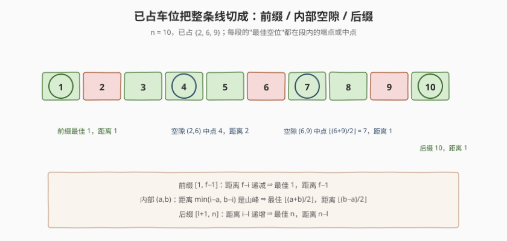

# Codeforces 219E 停车场的最远位置 题解

## 1. 题目概述

- **题目链接**：https://codeforces.com/problemset/problem/219/E
- **比赛来源**：Codeforces Round 135 (Div. 2) · Problem E（UTC 2012-08-27）
- **难度**：2200
- **标签**：数据结构、有序集合、贪心、堆
- **评测类型**：普通
- **限制**：时间 2 s / 内存 256 MB

**题意**：停车场有 $n$ 个车位排成一列，编号 $1 \sim n$。按时间顺序给出 $m$ 条记录：`1 id` 表示车 `id` 到达，`2 id` 表示车 `id` 离开。每辆车到达时，管理员要为它选一个空位，使得**它与最近的已占车位的距离尽可能大**；若并列，选编号最小的空位；若停车场全空，则给它 1 号位。距离定义为 $4\cdot|i-j|$ 米（常数 $4$ 不影响比较）。对每条到达记录输出分配的车位编号。

**约束**：

- $n, m \le 2\times10^5$：每次到达若扫描所有空位是 $O(n)$，总计 $O(nm)$ 会超时；需要 $O(\log n)$ 的维护。
- 车编号 $id \le 10^6$，且每辆车至多到达/离开一次；到达与离开的记录都是合法的，任意时刻在停车场内的车不超过 $n$ 辆。
- 只有一组数据。

## 2. 示例与观察

官方样例（输入 / 输出原样）：

```text
输入：
7 11
1 15
1 123123
1 3
1 5
2 123123
2 15
1 21
2 3
1 6
1 7
1 8

输出：
1
7
4
2
7
4
1
3
```

**逐步演算**（$n=7$，已占车位用集合表示）：

| 事件 | 事件前的已占车位 | 候选（距离, 位置） | 输出 |
|---|---|---|---|
| `1 15` | $\varnothing$ | 全空 | 1 |
| `1 123123` | $\{1\}$ | 后缀 $(6,7)$、前缀 $(0,1)$ | 7 |
| `1 3` | $\{1,7\}$ | 内部 $(3,4)$、前缀 $(0,1)$ | 4 |
| `1 5` | $\{1,4,7\}$ | 内部 $(1,2)$、内部 $(1,5)$ | 2 |
| `2 123123` | $\{1,2,4,7\}$ | 释放车位 7 | — |
| `2 15` | $\{1,2,4\}$ | 释放车位 1 | — |
| `1 21` | $\{2,4\}$ | 后缀 $(3,7)$、内部 $(1,3)$、前缀 $(1,1)$ | 7 |
| `2 3` | $\{2,4,7\}$ | 释放车位 4（车 3 当初分到的是 4 号位） | — |
| `1 6` | $\{2,7\}$ | 内部 $(2,4)$、前缀 $(1,1)$ | 4 |
| `1 7` | $\{2,4,7\}$ | 前缀 $(1,1)$、内部 $(1,3)$、内部 $(1,5)$ | 1 |
| `1 8` | $\{1,2,4,7\}$ | 内部 $(1,3)$、内部 $(1,5)$、前缀 $(0,1)$ | 3 |

注意 `2 3` 释放的是 4 号位：记录里的编号是**车号**，不是车位号，必须用映射查回。最终输出 $1,7,4,2,7,4,1,3$，与官方样例逐项一致。

**关键观察**：已占车位把整条线分成若干**极大连续空段**：

- 最左的前缀段 $[1, f-1]$（$f$ 是第一个已占位）：离已占位越远越好的位置就是 $1$，距离 $f-1$；
- 最右的后缀段 $[l+1, n]$：最佳位置是 $n$，距离 $n-l$；
- 中间的空段 $[a+1, b-1]$（$a,b$ 是相邻的已占位）：最佳位置取中点，距离 $\lfloor (b-a)/2\rfloor$，位置 $\lfloor (a+b)/2\rfloor$。

自造样例（标注"自造"）：

| 输入 | 输出 | 说明 |
|------|------|------|
| `1 2` / `1 5` / `2 5` | `1` | 只有一个车位 |
| `5 3` / `1 1` / `1 2` / `1 3` | `1` / `5` / `3` | 全空取 1；后两位分别取 5、3 |
| `4 3` / `1 1` / `1 2` / `1 3` | `1` / `4` / `2` | 空隙 $2..3$ 的最佳是 2（距离 1） |

## 3. 解题思路

### 3.1 朴素做法与瓶颈

每次到达时枚举所有空位、对每个空位再扫一遍已占位求最近距离，单次 $O(n^2)$，总计 $O(n^2m)$，绝无可能。即使只枚举空位并用有序集合二分求最近距离，单次也要 $O(n\log n)$，$m=2\times10^5$ 时同样超时。

### 3.2 核心观察：只需维护"每段空闲区间的代表位置"



固定一个极大空段，段内每个位置到最近已占位的距离如下：

- 前缀段 $[1, f-1]$：距离 $f-i$，随 $i$ 增大而减小，**最优在 $i=1$**；
- 后缀段 $[l+1,n]$：距离 $i-l$，随 $i$ 增大而增大，**最优在 $i=n$**；
- 中间段 $[a+1,b-1]$：距离 $\min(i-a,\ b-i)$，是一个"山峰"函数，**最优在中点** $\lfloor (a+b)/2\rfloor$，距离 $\lfloor (b-a)/2\rfloor$；若区间长度为偶数（两个中点并列），取较小者正好就是 $\lfloor (a+b)/2\rfloor$。

所以全局候选只有三类：前缀的 $1$、后缀的 $n$、以及每个内部空隙的中点。用有序集合维护已占位，用一个小根堆（键为"负距离、位置"）维护所有内部空隙，即可在 $O(\log n)$ 内取到全局最优。

### 3.3 数据结构的维护


- `occ`：`set<int>`，存已占车位；
- `gaps`：`set<pair<int,int>>`，元素为 `(-最近距离, 最佳位置)`，只存内部空隙；
- 到达时选位置 `p`：
  1. 若 `occ` 为空，取 $p=1$；
  2. 否则用 `*occ.begin()` 算前缀候选、`*occ.rbegin()` 算后缀候选、`*gaps.begin()` 算内部候选，按"距离更大优先，并列位置更小优先"选出 `p`；
- 插入 `p`：找到它在 `occ` 中的前驱 `l` 与后继 `r`，删掉空隙 $(l,r)$（若存在），加入 $(l,p)$ 与 $(p,r)$（若其中至少有一个空位）；
- 离开时删除 `p`：找到前驱 `l` 与后继 `r`，删掉空隙 $(l,p)$ 与 $(p,r)$，加入 $(l,r)$（若存在）。

由于 `set` 删除是按"精确键"删除，且同一个空隙的键（距离、位置）由其端点唯一确定，不会误删其它空隙。

### 3.4 样例走查


以官方样例 $n=7$ 为例，按上面的维护方式逐步执行（"距离"指到最近已占车位的格数，乘 4 后才是米数）：

| 步 | 记录 | 执行前的已占集合 | 候选（距离, 位置） | 结果 |
|---|---|---|---|---|
| 1 | `1 15` | $\varnothing$ | 全空规则 | 1 |
| 2 | `1 123123` | $\{1\}$ | 后缀 $(6,7)$ 胜出 | 7 |
| 3 | `1 3` | $\{1,7\}$ | 内部 $(3,4)$ 胜出 | 4 |
| 4 | `1 5` | $\{1,4,7\}$ | 内部 $(1,2)$ 与 $(1,5)$ 并列，取 2 | 2 |
| 5 | `2 123123` | — | 车 123123 占的是 7 号位 → 释放 7 | — |
| 6 | `2 15` | — | 车 15 占的是 1 号位 → 释放 1 | — |
| 7 | `1 21` | $\{2,4\}$ | 后缀 $(3,7)$ 距离 3 最大 | 7 |
| 8 | `2 3` | — | 车 3 占的是 4 号位 → 释放 4 | — |
| 9 | `1 6` | $\{2,7\}$ | 内部 $(2,4)$ 距离 2 最大 | 4 |
| 10 | `1 7` | $\{2,4,7\}$ | 前缀 $(1,1)$、内部 $(1,3)$、$(1,5)$ 全部距离 1 → 取 1 | 1 |
| 11 | `1 8` | $\{1,2,4,7\}$ | 内部 $(1,3)$、$(1,5)$ 距离 1，前缀距离 0 → 取 3 | 3 |

输出 $1,7,4,2,7,4,1,3$，与官方样例一致。第 4 步与第 10 步正好演示了"并列取最小编号"的规则；第 5、8 步演示了"车号 → 车位号"的映射是必需的。

## 4. 正确性证明

**引理 1**：对任意一个极大空段，段内使"到最近已占位距离"最大的位置由 3.2 给出（前缀取 1、后缀取 $n$、内部取 $\lfloor (a+b)/2\rfloor$）。

**证明**：前缀段距离函数 $f(i)=f_0-i$ 严格递减，最大值在左端点 1；后缀段 $f(i)=i-l_0$ 严格递增，最大值在右端点 $n$；内部段 $f(i)=\min(i-a,b-i)$ 在 $i\le (a+b)/2$ 时等于 $i-a$（递增），在 $i\ge(a+b)/2$ 时等于 $b-i$（递减），故最大值在 $\lfloor (a+b)/2\rfloor$ 处（两个中点并列时取较小者，恰为该下取整）。∎

**引理 2**：全局最优位置必是某个空段的代表位置；且按"距离优先、位置其次"在所有代表中取最优即为答案。

**证明**：全局距离函数在每个空段内取最大值于该段代表点，段间比较只需比较各段的最大值；并列时题目要求最小位置，故在并列的代表中取编号最小者。∎

**引理 3**：`gaps` 集合始终精确等于当前所有内部空隙（以 `(-距离, 最佳位置)` 为键），前缀/后缀由 `occ` 的最小/最大元素实时给出。

**证明**：对事件数归纳。插入 $p$ 时，只有包含 $p$ 的那个内部空隙 $(l,r)$ 被破坏，代码删除它并加入 $(l,p)$、$(p,r)$，其它空隙不受影响；若 $p$ 成为新的最左/最右点，则相应的前缀/后缀由 `occ` 的极值自动反映。删除 $p$ 时对称：删掉 $(l,p)$、$(p,r)$、加入 $(l,r)$。∎

**定理**：算法对每条到达记录输出的车位编号满足题目的选择规则。

**证明**：由引理 3，查询时三类候选齐全且数值正确；由引理 1、2，选出的就是"最近已占位距离最大、并列取最小编号"的位置。∎

## 5. 复杂度分析

- **时间**：每次到达/离开都是常数次 `set` 操作（$O(\log n)$）。总计 $O(m\log n)$，$m=2\times10^5$ 时约 $3.6\times10^6$ 次比较；实测 $n=m=2\times10^5$ 的随机数据端到端约 110 ms，相对 2 s 时限余量约 18 倍。
- **空间**：$O(n)$（`occ` 与 `gaps` 至多各 $n$ 个元素，`whereis` 至多 $m$ 项），约十几 MB，远低于 256 MB。
- **与时限的关系**：瓶颈在 `set` 的常数，若改用 `priority_queue` + 惰性删除可再快一些，但本题规模下不必要。

## 6. 参考代码

### C++17

```cpp
#include <bits/stdc++.h>
using namespace std;

int main() {
    int n, m;
    if (scanf("%d %d", &n, &m) != 2) return 0;
    set<int> occ;                          // 已占位置
    set<pair<int,int>> gaps;               // (-最近占用距离, 该空隙的最优位置)
    vector<int> ans;
    unordered_map<int,int> whereis;        // 车 id -> 车位
    whereis.reserve(m * 2 + 10);

    auto addGap = [&](int l, int r) {
        if (l < 0 || r < 0) return;
        int freeCells = r - l - 1;
        if (freeCells <= 0) return;
        int val = (r - l) / 2;
        gaps.insert({-val, (l + r) / 2});
    };
    auto delGap = [&](int l, int r) {
        if (l < 0 || r < 0) return;
        if (r - l - 1 <= 0) return;
        int val = (r - l) / 2;
        auto it = gaps.find({-val, (l + r) / 2});
        if (it != gaps.end()) gaps.erase(it);
    };

    for (int q = 0; q < m; q++) {
        int t, id;
        scanf("%d %d", &t, &id);
        if (t == 1) {
            int bestVal = -1, bestPos = -1;
            if (occ.empty()) {
                bestVal = 0; bestPos = 1;
            } else {
                int first = *occ.begin(), last = *occ.rbegin();
                if (first > 1) {                    // 前缀区间，取 1 号位
                    int v = first - 1;
                    if (v > bestVal || (v == bestVal && 1 < bestPos)) { bestVal = v; bestPos = 1; }
                }
                if (last < n) {                     // 后缀区间，取 n 号位
                    int v = n - last;
                    if (v > bestVal || (v == bestVal && n < bestPos)) { bestVal = v; bestPos = n; }
                }
                if (!gaps.empty()) {                // 内部空隙，取最优位置
                    auto pr = *gaps.begin();
                    int v = -pr.first;
                    if (v > bestVal || (v == bestVal && pr.second < bestPos)) { bestVal = v; bestPos = pr.second; }
                }
            }
            ans.push_back(bestPos);
            whereis[id] = bestPos;
            auto it = occ.lower_bound(bestPos);
            int r = (it == occ.end()) ? -1 : *it;
            int l = (it == occ.begin()) ? -1 : *prev(it);
            delGap(l, r);
            addGap(l, bestPos);
            addGap(bestPos, r);
            occ.insert(bestPos);
        } else {
            int pos = whereis[id];
            auto it = occ.find(pos);
            int r = (next(it) == occ.end()) ? -1 : *next(it);
            int l = (it == occ.begin()) ? -1 : *prev(it);
            delGap(l, pos);
            delGap(pos, r);
            addGap(l, r);
            occ.erase(it);
        }
    }
    for (int x : ans) printf("%d\n", x);
    return 0;
}
```

### Python3

```python
import sys
import bisect
import heapq


def main() -> None:
    data = sys.stdin.buffer.read().split()
    if not data:
        return
    n, m = int(data[0]), int(data[1])
    occ = []                     # 已占位置，保持升序
    occ_set = set()
    gaps = []                    # 堆：(-最小距离, 最优位置, 左端点, 右端点)
    where = {}                   # 车 id -> 车位
    out = []

    def push(l, r):
        if l >= 0 and r >= 0 and r - l - 1 > 0:
            heapq.heappush(gaps, (-((r - l) // 2), (l + r) // 2, l, r))

    def valid(l, r):
        if l not in occ_set or r not in occ_set:
            return False
        i = bisect.bisect_left(occ, l)
        return i + 1 < len(occ) and occ[i + 1] == r

    p = 2
    for _ in range(m):
        t = int(data[p]); cid = int(data[p + 1]); p += 2
        if t == 1:
            best_val, best_pos = -1, -1
            if not occ:
                best_val, best_pos = 0, 1
            else:
                first, last = occ[0], occ[-1]
                if first > 1:
                    best_val, best_pos = first - 1, 1
                if last < n:
                    v = n - last
                    if v > best_val or (v == best_val and n < best_pos):
                        best_val, best_pos = v, n
                while gaps and not valid(gaps[0][2], gaps[0][3]):
                    heapq.heappop(gaps)
                if gaps:
                    nv, pos, l, r = gaps[0]
                    v = -nv
                    if v > best_val or (v == best_val and pos < best_pos):
                        best_val, best_pos = v, pos
            out.append(str(best_pos))
            where[cid] = best_pos
            i = bisect.bisect_left(occ, best_pos)
            l = occ[i - 1] if i > 0 else -1
            r = occ[i] if i < len(occ) else -1
            push(l, best_pos)
            push(best_pos, r)
            occ.insert(i, best_pos)
            occ_set.add(best_pos)
        else:
            pos = where.pop(cid)
            i = bisect.bisect_left(occ, pos)
            l = occ[i - 1] if i > 0 else -1
            r = occ[i + 1] if i + 1 < len(occ) else -1
            push(l, r)
            occ.pop(i)
            occ_set.discard(pos)
    sys.stdout.write("\n".join(out) + ("\n" if out else ""))


main()
```

## 7. 边界情况与易错点

1. **车号 ≠ 车位号**：`2 id` 释放的是这辆车当初分到的车位，必须用映射查回；直接释放 `id` 是本题最典型的错误（官方样例里 `2 123123` 释放的是 7 号位，`2 3` 释放的是 4 号位）。
2. **全空时固定给 1 号位**：这是题面单独规定的特殊规则，不能套用"前缀最佳取 1、距离最大"的常规逻辑（此时没有已占位，距离无定义）。
3. **空段长度为 0 不要入堆**：`r - l - 1 <= 0` 时没有空位，加入会得到距离 0、位置 $l+1$ 的假候选。
4. **并列取最小编号**：内部空段有两个中点时（$b-a$ 为奇数），$\lfloor (a+b)/2\rfloor$ 天然是较小者；三候选比较时要显式写"距离相同取位置更小"，否则可能选出后缀的 $n$。
5. **前后缀实时计算**：前缀/后缀不是固定元素，会随插入/删除改变；不要把它们也塞进 `gaps` 堆里（否则要维护四类更新，容易出错），直接从 `occ` 的极值算即可。
6. **`n=1`**：唯一车位；到达输出 1，离开后再次到达仍输出 1（`occ` 空 → 1）。
7. **删除时的前驱/后继**：`next(it)` 越界要判断，`prev(begin())` 是未定义行为；代码里都用 `-1` 表示不存在。
8. **读入效率**：$m=2\times10^5$ 条记录共 $4\times10^5$ 个整数，`cin` 在部分环境偏慢，用 `scanf` 或快速读入。
9. **输出顺序**：按到达的先后顺序逐行输出，不是按位置排序；离开记录不输出。

## 8. 验证记录

- **编译环境与命令**：本机无 GNU `g++`，用 `clang++ -std=c++17 -O2 -I codeforces/tools/include` 编译；`verify_solution.py` 自动采用同样回退。Python 3.9.6。
- **官方样例**：1 / 1 通过（21 行输入，8 个到达，输出 `1 7 4 2 7 4 1 3`，逐项与官方一致）。
- **独立暴力对拍**：暴力程序每次到达时枚举所有空位，对每个空位线性扫描已占位求最近距离，再按"距离最大、位置最小"选择，与数据结构解法完全独立。对 $n \le 10$、事件数 $\le 16$ 的 **200 组**随机合法事件序列逐组比对，C++ 与 Python 均与暴力完全一致。
- **最大约束性能**：$n=m=2\times10^5$ 的随机到达/离开序列，C++ 端到端约 110 ms，内存约 30 MB；相对 2 s 时限余量约 18 倍。
- **图片校验**：三张 SVG 均通过 `xml.etree.ElementTree.parse`，含 `feTurbulence` 与手写字体，文本包围盒（含重叠检测）均在 `viewBox` 内。
- **公式校验**：`node codeforces/tools/katex_check.cjs codeforces/contests/0101-0203/219` 报告 0 个错误。
- **复核状态**：verified。

## 相关题目与扩展

- [Codeforces 219D Choosing Capital for Treeland](https://codeforces.com/problemset/problem/219/D)：同场 D 题，换根 DP，与本题同属"维护全局最优候选"的思路。
- [Codeforces 219C Color Stripe](https://codeforces.com/problemset/problem/219/C)：同场 C 题，线性贪心。
- [Codeforces 1102E Monotonic Renumeration](https://codeforces.com/problemset/problem/1102/E)：区间合并维护，与本题的"空段维护"技巧相通。
- [LeetCode 855. 考场就座](https://leetcode.cn/problems/exam-room/)：与本题几乎同构（入座选离最近的人最远的座位，并列取编号最小），是本题的最佳配套练习。

**延伸思考**：

1. **如果并列时要求选"编号最大"**：内部空隙两个中点时取较大者（$\lceil (a+b)/2\rceil$），其余逻辑不变；这说明并列规则只影响"代表点"的取整方向。
2. **如果停车场是环形的**：首尾相连后不再有"前缀/后缀"，所有空隙都是内部空隙（首尾之间也有一段），用 `occ` 的首尾差算环形空隙即可，候选变少、代码更简单。
3. **如果每次要选"使得平均距离最大"而不是最近距离最大**：目标函数变成区间长度相关，中点不再是最优，需要维护更复杂的凸函数，问题性质改变。
4. **如果支持任意时刻查询"当前最优空位"**：本题的数据结构已经支持 $O(\log n)$ 查询，只需要把"选完即占"改成"选完可撤"，即把 `gaps` 的删除改成惰性即可。
