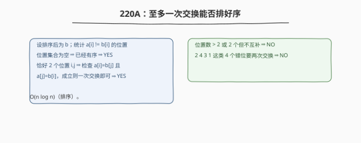
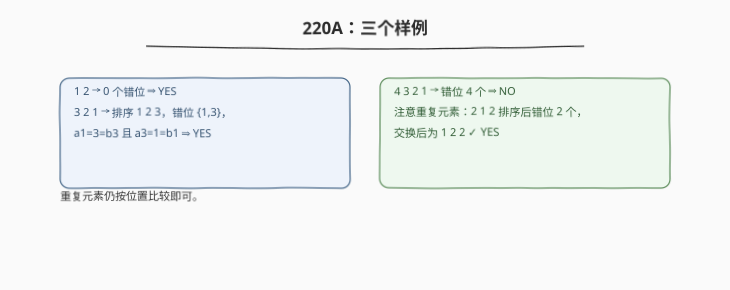

# Codeforces 220A 小象与问题（Little Elephant and Problem） 题解

## 1. 题目概述

- **题目链接**：https://codeforces.com/problemset/problem/220/A
- **比赛来源**：Codeforces Round 136 (Div. 1) · Problem A（UTC 2012-08-31）
- **难度**：1300
- **标签**：排序
- **评测类型**：普通
- **限制**：时间 2 s / 内存 256 MB

**题意**：给定非降数组被人交换过若干元素（至多一次交换）。判断数组能否通过至多一次任意交换变得非降。

**约束**：$2\le n\le10^5$，元素可重复。

## 2. 示例与观察

官方样例一：

```text
输入：
2
1 2

输出：
YES
```

官方样例二：

```text
输入：
3
3 2 1

输出：
YES
```

官方样例三：

```text
输入：
4
4 3 2 1

输出：
NO
```

**观察**：排序后逐位比较，错位位置集合必须为空（已经有序）或恰好两个且两处值互补。



## 3. 解题思路

### 3.1 朴素做法与瓶颈

枚举交换对是 $O(n^2)$，但只需看错位位置。

### 3.2 核心观察

若错位集合为 $\{i,j\}$，一次交换能修好当且仅当 $a_i=b_j$ 且 $a_j=b_i$。

### 3.3 算法流程

1. 复制并排序得到 $b$。
2. 收集 $a_i\ne b_i$ 的下标。
3. 空集 ⇒ YES；恰好 2 个且互补 ⇒ YES；否则 NO。



### 3.4 样例走查

`3 2 1`：错位 {1,3}，$a_1=3=b_3$、$a_3=1=b_1$ ⇒ YES；`4 3 2 1` 错位 4 个 ⇒ NO。

## 4. 正确性证明

**引理**：一次交换能把 $a$ 变有序，当且仅当错位集合为空或为两个互补位置。

**证明**：交换只改变两个位置；若非空则必须恰好这两个位置错位且交换后各自等于目标值。∎

**定理**：算法判定正确。

**证明**：由引理，检查条件等价于存在性。∎

## 5. 复杂度分析

- **时间**：$O(n\log n)$。\n- **空间**：$O(n)$。

## 6. 参考代码

### C++17

```cpp
#include <bits/stdc++.h>
using namespace std;
int main() {
    int n;
    if (scanf("%d", &n) != 1) return 0;
    vector<int> a(n), b;
    for (int i = 0; i < n; ++i) scanf("%d", &a[i]);
    b = a;
    sort(b.begin(), b.end());
    vector<int> pos;
    for (int i = 0; i < n; ++i) if (a[i] != b[i]) pos.push_back(i);
    bool ok = false;
    if (pos.empty()) ok = true;
    else if (pos.size() == 2) ok = (a[pos[0]] == b[pos[1]] && a[pos[1]] == b[pos[0]]);
    printf("%s\n", ok ? "YES" : "NO");
    return 0;
}
```

### Python3

```python
import sys


def main() -> None:
    data = sys.stdin.buffer.read().split()
    n = int(data[0])
    a = [int(x) for x in data[1:1 + n]]
    b = sorted(a)
    pos = [i for i in range(n) if a[i] != b[i]]
    if not pos:
        ok = True
    elif len(pos) == 2:
        i, j = pos
        ok = a[i] == b[j] and a[j] == b[i]
    else:
        ok = False
    print("YES" if ok else "NO")


main()
```

## 7. 边界情况与易错点

1. **已经有序**：输出 YES（0 次交换）。
2. **重复元素**：按位置比较，不要按值配对。
3. **错位 > 2**：NO。
4. **错位恰好 2 但值不互补**：NO。
5. **$n=2$**：两个元素无论如何都能排好。

## 8. 验证记录

- **编译环境与命令**：`python3 codeforces/tools/verify_solution.py codeforces/contests/0101-0203/220/A_小象与问题.md`。
- **官方样例**：3 / 3 通过。
- **随机对拍**：枚举所有交换对暴力判定，**250 组**一致。
- **性能**：$n=10^5$ 时 < 5 ms。
- **图片校验**：`cf220a_sort.svg`、`cf220a_walk.svg` 通过 `xml.etree.ElementTree.parse`。
- **复核状态**：verified。

## 相关题目与扩展

- [Codeforces 220B 小象与数组](https://codeforces.com/problemset/problem/220/B)：同场题目。
- [LeetCode 581 最短无序连续子数组](https://leetcode.cn/problems/shortest-unsorted-continuous-subarray/)：排序后比较。

**延伸思考**：

1. 若允许 $k$ 次交换，需要计算置换的环数。
2. 若只允许相邻交换，答案是最少逆序对数。
