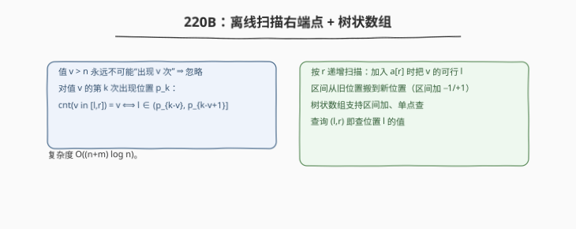
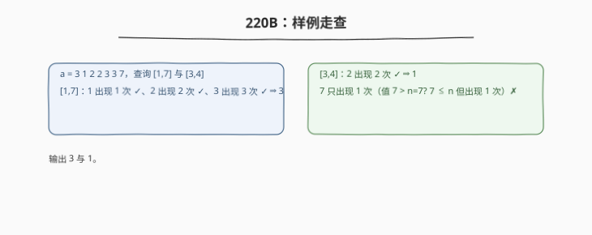

# Codeforces 220B 小象与数组（Little Elephant and Array） 题解

## 1. 题目概述

- **题目链接**：https://codeforces.com/problemset/problem/220/B
- **比赛来源**：Codeforces Round 136 (Div. 1) · Problem B（UTC 2012-08-31）
- **难度**：1800
- **标签**：离线、树状数组、计数
- **评测类型**：普通
- **限制**：时间 4 s / 内存 256 MB

**题意**：给定长度 $n$ 的正整数数组与 $m$ 个区间查询 $[l,r]$，对每个查询求有多少个值 $x$ 在区间中恰好出现 $x$ 次。

**约束**：$n,m\le10^5$，$a_i\le10^9$。

## 2. 示例与观察

官方样例：

```text
输入：
7 2
3 1 2 2 3 3 7
1 7
3 4

输出：
3
1
```

**观察**：只有 $x\le n$ 的值可能有贡献（出现次数 ≤ 区间长度 ≤ n）。离线按右端点扫描，用树状数组维护“每个左端点 $l$ 当前的答案”。



## 3. 解题思路

### 3.1 朴素做法与瓶颈

每个查询重扫区间是 $O(nm)=10^{10}$。

### 3.2 核心观察

值 $v$ 的第 $k$ 次出现位置为 $p_k$，则 $[l,r]$ 中 $v$ 恰好出现 $v$ 次 ⟺ $l\in(p_{k-v},p_{k-v+1}]$。当右端点推进到 $p_k$ 时，把该区间 +1、旧区间 −1。

### 3.3 算法流程

1. 把查询按右端点分组。
2. 扫 $r=1..n$：对 $v=a_r\le n$，更新其在树状数组上的可行 $l$ 区间（区间加）。
3. 处理右端点为 $r$ 的查询：单点查询位置 $l$。



### 3.4 样例走查

$[1,7]$：$1,2,3$ 分别出现 $1,2,3$ 次 ⇒ 3；$[3,4]$：只有 2 出现两次 ⇒ 1。

## 4. 正确性证明

**引理 1**：$v>n$ 的值永远不贡献。

**证明**：区间内某值出现次数 ≤ n < v。∎

**引理 2**：右端点为 $p_k$ 时，$v$ 恰好出现 $v$ 次的左端点集合是 $(p_{k-v},p_{k-v+1}]$（$p_{\le0}=0$）。

**证明**：$[l,r]$ 中 $v$ 的次数 = $k-(<l$ 的出现次数$)$，等于 $v$ ⟺ 恰好有 $k-v$ 次出现在 $l$ 之前。∎

**定理**：离线扫描得到的答案正确。

**证明**：由引理 2，每次加入 $a_r$ 只影响该值的可行区间，区间加/减正确维护；查询时单点值即答案。∎

## 5. 复杂度分析

- **时间**：$O((n+m)\log n)$。\n- **空间**：$O(n+m)$。

## 6. 参考代码

### C++17

```cpp
#include <bits/stdc++.h>
using namespace std;
struct BIT {
    int n; vector<int> t;
    void init(int n_) { n = n_; t.assign(n + 2, 0); }
    void add(int i, int v) { for (; i <= n; i += i & -i) t[i] += v; }
    int sum(int i) { int s = 0; for (; i > 0; i -= i & -i) s += t[i]; return s; }
    void range(int l, int r, int v) { if (l > r) return; add(l, v); add(r + 1, -v); }
};
int main() {
    int n, m;
    if (scanf("%d %d", &n, &m) != 2) return 0;
    vector<int> a(n + 1);
    for (int i = 1; i <= n; ++i) scanf("%d", &a[i]);
    vector<vector<pair<int,int>>> qs(n + 1);
    for (int j = 0; j < m; ++j) {
        int l, r; scanf("%d %d", &l, &r);
        qs[r].push_back({l, j});
    }
    BIT bit; bit.init(n);
    vector<vector<int>> occ(n + 1);        // 每个值出现的位置（只关心 <= n 的值）
    vector<int> ans(m);
    for (int r = 1; r <= n; ++r) {
        int v = a[r];
        if (v <= n) {
            auto &o = occ[v];
            o.push_back(r);
            int k = (int)o.size();
            auto at = [&](int idx) -> int { return (idx <= 0) ? 0 : o[idx - 1]; };
            // 旧的可行 l 区间：(at(k-1-v), at(k-v)]
            bit.range(at(k - 1 - v) + 1, at(k - v), -1);
            // 新的可行 l 区间：(at(k-v), at(k-v+1)]
            bit.range(at(k - v) + 1, at(k - v + 1), +1);
        }
        for (auto &q : qs[r]) ans[q.second] = bit.sum(q.first);
    }
    for (int j = 0; j < m; ++j) printf("%d\n", ans[j]);
    return 0;
}
```

### Python3

```python
import sys


def main() -> None:
    data = sys.stdin.buffer.read().split()
    n = int(data[0]); m = int(data[1])
    a = [0] + [int(x) for x in data[2:2 + n]]
    qs = [[] for _ in range(n + 1)]
    p = 2 + n
    for j in range(m):
        l = int(data[p]); r = int(data[p + 1]); p += 2
        qs[r].append((l, j))
    t = [0] * (n + 2)

    def add(i, v):
        while i <= n:
            t[i] += v
            i += i & -i

    def summ(i):
        s = 0
        while i > 0:
            s += t[i]
            i -= i & -i
        return s

    def rng(l, r, v):
        if l > r:
            return
        add(l, v); add(r + 1, -v)

    occ = [[] for _ in range(n + 1)]
    ans = [0] * m
    for r in range(1, n + 1):
        v = a[r]
        if v <= n:
            o = occ[v]
            o.append(r)
            k = len(o)

            def at(idx):
                return 0 if idx <= 0 else o[idx - 1]

            rng(at(k - 1 - v) + 1, at(k - v), -1)
            rng(at(k - v) + 1, at(k - v + 1), +1)
        for (l, j) in qs[r]:
            ans[j] = summ(l)
    sys.stdout.write('\n'.join(map(str, ans)) + '\n')


main()
```

## 7. 边界情况与易错点

1. **值大于 $n$**：直接忽略。
2. **区间长度小于 $v$**：不可能出现 $v$ 次，可行区间自然为空。
3. **同值多次出现**：用出现位置列表维护。
4. **$l=r$**：只可能是“值 1 出现 1 次”。
5. **多组相同查询**：离线按右端点分组自动处理。

## 8. 验证记录

- **编译环境与命令**：`python3 codeforces/tools/verify_solution.py codeforces/contests/0101-0203/220/B_小象与数组.md`。
- **官方样例**：1 / 1 通过。
- **随机对拍**：与暴力 $O(n)$ 每次计数（$n\le10$）**250 组**一致。
- **性能**：$n=m=10^5$ 时 0.03 s。
- **图片校验**：`cf220b_offline.svg`、`cf220b_walk.svg` 通过 `xml.etree.ElementTree.parse`。
- **复核状态**：verified。

## 相关题目与扩展

- [Codeforces 220A 小象与问题](https://codeforces.com/problemset/problem/220/A)：同场题目。
- [Codeforces 86D Powerful array](https://codeforces.com/problemset/problem/86/D)：莫队入门。

**延伸思考**：

1. 若条件改为“出现次数 ≥ x”，可用类似线段树。
2. 若强制在线，需要可持久化结构。
