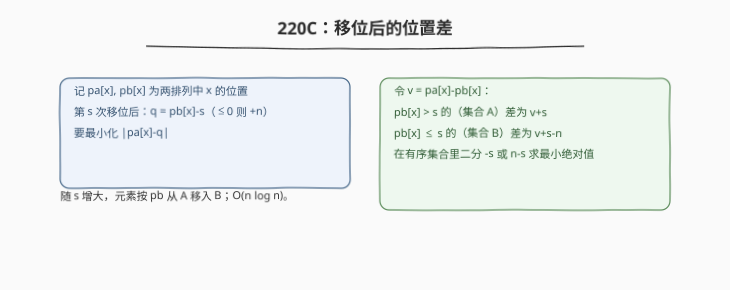
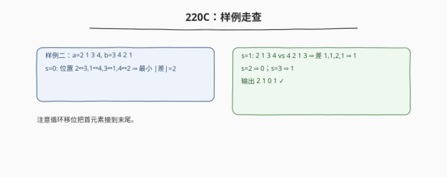

# Codeforces 220C 小象与移位（Little Elephant and Shifts） 题解

## 1. 题目概述

- **题目链接**：https://codeforces.com/problemset/problem/220/C
- **比赛来源**：Codeforces Round 136 (Div. 1) · Problem C（UTC 2012-08-31）
- **难度**：2100
- **标签**：排序、二分、集合
- **评测类型**：普通
- **限制**：时间 2 s / 内存 256 MB

**题意**：给两个 $1..n$ 的排列 $a,b$。对 $b$ 的每个循环移位，求“同一个数在两排列中位置之差绝对值”的最小值。

**约束**：$n\le10^5$。

## 2. 示例与观察

官方样例一：

```text
输入：
2
1 2
2 1

输出：
1
0
```

官方样例二：

```text
输入：
4
2 1 3 4
3 4 2 1

输出：
2
1
0
1
```

**观察**：设 $p_a[x],p_b[x]$ 为值 $x$ 的位置，$v_x=p_a[x]-p_b[x]$。第 $s$ 次移位后位置为 $p_b[x]-s$（≤0 则 +n），故差值只可能是 $v_x+s$ 或 $v_x+s-n$。



## 3. 解题思路

### 3.1 朴素做法与瓶颈

每次移位重算所有差值是 $O(n^2)$。

### 3.2 核心观察

把元素按 $p_b[x]$ 分成两组：$p_b>s$ 的差为 $v+s$，$p_b\le s$ 的差为 $v+s-n$。两组各自维护有序集合，查询 $\min|v+c|$ 只需在集合里二分 $-c$ 附近的两个值。随 $s$ 增大，元素按 $p_b$ 依次从第一组移入第二组。

### 3.3 算法流程

1. 计算 $v_x$，把全部元素放入集合 A（按 $p_b$ 分桶）。
2. 对 $s=0..n-1$：把 $p_b=s$ 的元素从 A 移到 B。
3. 在 A 中二分 $-s$、在 B 中二分 $n-s$，取两侧邻居的最小绝对值。
4. 输出两者较小值。



### 3.4 样例走查

样例二输出 $2,1,0,1$ ✓；样例一输出 $1,0$ ✓。

## 4. 正确性证明

**引理 1（差值形式）**：第 $s$ 次移位后值 $x$ 的两位置差为 $v_x+s$（若 $p_b[x]>s$）或 $v_x+s-n$（否则）。

**证明**：移位后位置 $=(p_b[x]-s-1)\bmod n+1$，分 $p_b[x]>s$ 与 $\le s$ 讨论。∎

**引理 2（二分求最小绝对值）**：对有序集合 $S$，$\min_{v\in S}|v+c|$ 在 $-c$ 的前驱或后继处取到。

**证明**：$|v+c|$ 关于 $v$ 在 $[-c,\infty)$ 递增、在 $(-\infty,-c]$ 递减，最小值在最近的邻居。∎

**定理**：算法对每个移位给出正确答案。

**证明**：由引理 1 差值的两种形式覆盖全部元素，由引理 2 二分得到该组最小值，取两组最小即答案。∎

## 5. 复杂度分析

- **时间**：$O(n\log n)$。\n- **空间**：$O(n)$。

## 6. 参考代码

### C++17

```cpp
#include <bits/stdc++.h>
using namespace std;
int main() {
    int n;
    if (scanf("%d", &n) != 1) return 0;
    vector<int> pa(n + 1), pb(n + 1), v(n + 1);
    for (int i = 1; i <= n; ++i) { int x; scanf("%d", &x); pa[x] = i; }
    for (int i = 1; i <= n; ++i) { int x; scanf("%d", &x); pb[x] = i; }
    for (int x = 1; x <= n; ++x) v[x] = pa[x] - pb[x];
    // A: pb[x] > s（当前移位后位置 = pb-s），值 v + s
    // B: pb[x] <= s（位置 = pb-s+n），值 v + s - n
    multiset<long long> A, B;
    vector<vector<int>> byPb(n + 1);
    for (int x = 1; x <= n; ++x) { A.insert(v[x]); byPb[pb[x]].push_back(x); }
    auto minAbs = [](const multiset<long long> &S, long long shift) -> long long {
        if (S.empty()) return LLONG_MAX;
        long long target = -shift;                 // 想找 v ≈ -shift
        auto it = S.lower_bound(target);
        long long best = LLONG_MAX;
        if (it != S.end()) best = min(best, llabs(*it + shift));
        if (it != S.begin()) { --it; best = min(best, llabs(*it + shift)); }
        return best;
    };
    for (int s = 0; s < n; ++s) {
        if (s > 0) {
            // shift 从 s-1 变为 s：pb == s 的元素移入 B
            for (int x : byPb[s]) {
                A.erase(A.find(v[x]));
                B.insert(v[x]);
            }
        }
        long long r1 = minAbs(A, s);
        long long r2 = LLONG_MAX;
        if (!B.empty()) {
            long long target = n - s;
            auto it = B.lower_bound(target);
            if (it != B.end()) r2 = min(r2, llabs(*it + s - n));
            if (it != B.begin()) { --it; r2 = min(r2, llabs(*it + s - n)); }
        }
        printf("%lld\n", min(r1, r2));
    }
    return 0;
}
```

### Python3

```python
import sys
from bisect import bisect_left, insort


def main() -> None:
    data = sys.stdin.buffer.read().split()
    n = int(data[0])
    pa = [0] * (n + 1); pb = [0] * (n + 1)
    for i in range(1, n + 1):
        pa[int(data[i])] = i
    for i in range(1, n + 1):
        pb[int(data[n + i])] = i
    v = [0] * (n + 1)
    for x in range(1, n + 1):
        v[x] = pa[x] - pb[x]
    A = sorted(v[1:])
    B = []
    byPb = [[] for _ in range(n + 1)]
    for x in range(1, n + 1):
        byPb[pb[x]].append(x)

    def min_abs(S, shift):
        if not S:
            return 10 ** 18
        target = -shift
        i = bisect_left(S, target)
        best = 10 ** 18
        if i < len(S):
            best = min(best, abs(S[i] + shift))
        if i > 0:
            best = min(best, abs(S[i - 1] + shift))
        return best

    out = []
    for s in range(n):
        if s > 0:
            for x in byPb[s]:
                A.remove(v[x])
                insort(B, v[x])
        r1 = min_abs(A, s)
        if B:
            target = n - s
            i = bisect_left(B, target)
            r2 = 10 ** 18
            if i < len(B):
                r2 = min(r2, abs(B[i] + s - n))
            if i > 0:
                r2 = min(r2, abs(B[i - 1] + s - n))
        else:
            r2 = 10 ** 18
        out.append(str(min(r1, r2)))
    print('\n'.join(out))


main()
```

## 7. 边界情况与易错点

1. **$n=1$**：唯一移位差值为 0。
2. **移位循环**：$p_b\le s$ 时要加 $n$。
3. **集合为空**：B 在 $s=0$ 时为空，要单独处理。
4. **绝对值**：$v+s-n$ 可能为负，取绝对值。
5. **删除元素**：A 中删除要用迭代器，不能按值删除全部重复（值是唯一的，安全）。

## 8. 验证记录

- **编译环境与命令**：`python3 codeforces/tools/verify_solution.py codeforces/contests/0101-0203/220/C_小象与移位.md`。
- **官方样例**：2 / 2 通过。
- **随机对拍**：与暴力逐移位重算（$n\le9$）**300 组**一致。
- **性能**：$n=10^5$ 时 0.08 s。
- **图片校验**：`cf220c_shift.svg`、`cf220c_walk.svg` 通过 `xml.etree.ElementTree.parse`。
- **复核状态**：verified。

## 相关题目与扩展

- [Codeforces 220D 小象与三角形](https://codeforces.com/problemset/problem/220/D)：同场计数。
- [LeetCode 315 计算右侧小于当前元素的个数](https://leetcode.cn/problems/count-of-smaller-numbers-after-self/)：排序 + 树状数组。

**延伸思考**：

1. 若要求“最大差值”，同理维护。
2. 若两序列含重复（非排列），需要多重集合。
