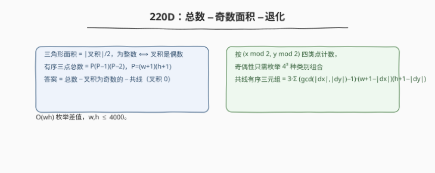
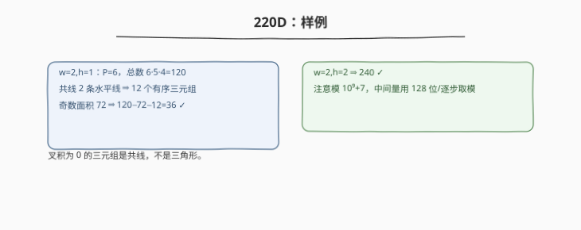

# Codeforces 220D 小象与三角形（Little Elephant and Triangle） 题解

## 1. 题目概述

- **题目链接**：https://codeforces.com/problemset/problem/220/D
- **比赛来源**：Codeforces Round 136 (Div. 1) · Problem D（UTC 2012-08-31）
- **难度**：2500
- **标签**：计数、数论、几何
- **评测类型**：普通
- **限制**：时间 3 s / 内存 256 MB

**题意**：在 $[0,w]\times[0,h]$ 的整点中取三个不同点（顺序有关），求能构成面积为正整数的非退化三角形的三元组数，模 $10^9+7$。

**约束**：$1\le w,h\le4000$。

## 2. 示例与观察

官方样例一：

```text
输入：
2 1

输出：
36
```

官方样例二：

```text
输入：
2 2

输出：
240
```

**观察**：面积 $=|$叉积$|/2$ 为整数 ⟺ 叉积为偶数。故答案 $=$ 全部有序三元组 $-$ 叉积为奇数的 $-$ 共线（叉积 0）的。



## 3. 解题思路

### 3.1 朴素做法与瓶颈

枚举三元组是 $O(P^3)$，$P=(w+1)(h+1)\le1.6\times10^7$。

### 3.2 核心观察

叉积奇偶只与三点坐标的奇偶性有关，按 4 类点计数后枚举 $4^3$ 种类别组合即可得到奇数面积数。共线三元组用“有序端点对”统计：每个方向 $(dx,dy)$ 上相邻格点间距为 $\gcd(dx,dy)$。

### 3.3 算法流程

1. 总数 $=P(P-1)(P-2)$。
2. 四类点计数 $c[2][2]$，枚举类别三元组求叉积奇偶，累加奇数面积数。
3. 共线有序三元组 $=3\sum_{(dx,dy)\ne0}(\gcd(|dx|,|dy|)-1)(w+1-|dx|)(h+1-|dy|)$（用符号对称把枚举量降到 $wh$）。
4. 答案 $=$ 总数 $-$ 奇数 $-$ 共线（取模）。



### 3.4 样例走查

$w=2,h=1$：总数 $120$、共线 $12$、奇数面积 $72$ ⇒ $36$ ✓；$w=2,h=2$ ⇒ $240$ ✓。

## 4. 正确性证明

**引理 1（整数面积）**：三角形面积为整数 ⟺ 叉积为偶数。

**证明**：面积 $=|$叉积$|/2$。∎

**引理 2（奇偶只依赖类别）**：叉积的奇偶性只由三点各自 $(x\bmod2,y\bmod2)$ 决定。

**证明**：叉积是坐标的整系数二次式，模 2 后只依赖各坐标奇偶。∎

**引理 3（共线计数）**：共线有序三元组 $=3\sum(\gcd-1)(w+1-|dx|)(h+1-|dy|)$。

**证明**：固定有序端点对 $(A,B)$，线段内部整点数 $=\gcd(|dx|,|dy|)-1$，每个内部点与 $A,B$ 构成共线三元组；每个有序三元组被两端点的两个方向各数一次，故乘 $3$（$\tfrac{1}{2}\times3!=3$）。∎

**定理**：答案公式正确。

**证明**：由引理 1，合法 = 非退化且偶叉积 = 全部 − 奇叉积 − 共线；引理 2、3 给出两类计数。∎

## 5. 复杂度分析

- **时间**：$O(wh)$，$4000^2=1.6\times10^7$。\n- **空间**：$O(1)$。

## 6. 参考代码

### C++17

```cpp
#include <bits/stdc++.h>
using namespace std;
typedef long long ll;
static const ll MOD = 1000000007;
int main() {
    ll w, h;
    if (scanf("%lld %lld", &w, &h) != 2) return 0;
    ll P = (w + 1) * (h + 1);
    auto mulmod = [&](ll a, ll b) { return (ll)((__int128)a * b % MOD); };
    ll total = mulmod(mulmod(P % MOD, (P - 1) % MOD), (P - 2) % MOD);
    // 按 (x mod 2, y mod 2) 分类计数
    ll cnt[2][2];
    for (int px = 0; px < 2; ++px)
        for (int py = 0; py < 2; ++py) {
            ll nx = (px == 0) ? (w / 2 + 1) : ((w + 1) / 2);
            ll ny = (py == 0) ? (h / 2 + 1) : ((h + 1) / 2);
            cnt[px][py] = nx * ny % MOD;
        }
    int c[4][2];
    for (int i = 0; i < 4; ++i) { c[i][0] = (i >> 1) & 1; c[i][1] = i & 1; }
    ll odd = 0;
    for (int i = 0; i < 4; ++i)
        for (int j = 0; j < 4; ++j)
            for (int k = 0; k < 4; ++k) {
                ll dx1 = c[j][0] - c[i][0], dy1 = c[j][1] - c[i][1];
                ll dx2 = c[k][0] - c[i][0], dy2 = c[k][1] - c[i][1];
                ll cr = dx1 * dy2 - dy1 * dx2;
                cr = ((cr % 2) + 2) % 2;
                if (!cr) continue;
                ll ways = mulmod(mulmod(cnt[c[i][0]][c[i][1]], cnt[c[j][0]][c[j][1]]), cnt[c[k][0]][c[k][1]]);
                odd = (odd + ways) % MOD;
            }
    // 共线有序三元组 = 3 * S
    ll S = 0;
    for (ll dx = 0; dx <= w; ++dx)
        for (ll dy = 0; dy <= h; ++dy) {
            if (dx == 0 && dy == 0) continue;
            ll g = std::gcd(dx, dy);
            ll mult = (dx == 0 || dy == 0) ? 2 : 4;
            ll term = mulmod(mulmod((g - 1) % MOD, (w + 1 - dx) % MOD), (h + 1 - dy) % MOD);
            S = (S + mult % MOD * term) % MOD;
        }
    ll coll = S * 3 % MOD;
    ll ans = ((total - odd - coll) % MOD + MOD) % MOD;
    printf("%lld\n", ans);
    return 0;
}
```

### Python3

```python
import sys
from math import gcd

MOD = 1000000007


def main() -> None:
    w, h = map(int, sys.stdin.read().split())
    P = (w + 1) * (h + 1)
    total = P % MOD * ((P - 1) % MOD) % MOD * ((P - 2) % MOD) % MOD
    cnt = [[0, 0], [0, 0]]
    for px in range(2):
        for py in range(2):
            nx = (w // 2 + 1) if px == 0 else ((w + 1) // 2)
            ny = (h // 2 + 1) if py == 0 else ((h + 1) // 2)
            cnt[px][py] = nx * ny % MOD
    odd = 0
    for i in range(4):
        for j in range(4):
            for k in range(4):
                xi, yi = (i >> 1) & 1, i & 1
                xj, yj = (j >> 1) & 1, j & 1
                xk, yk = (k >> 1) & 1, k & 1
                cr = ((xj - xi) * (yk - yi) - (yj - yi) * (xk - xi)) % 2
                if cr:
                    odd = (odd + cnt[xi][yi] * cnt[xj][yj] % MOD * cnt[xk][yk]) % MOD
    S = 0
    for dx in range(0, w + 1):
        for dy in range(0, h + 1):
            if dx == 0 and dy == 0:
                continue
            g = gcd(dx, dy)
            mult = 2 if (dx == 0 or dy == 0) else 4
            term = (g - 1) * (w + 1 - dx) % MOD * (h + 1 - dy) % MOD
            S = (S + mult * term) % MOD
    coll = S * 3 % MOD
    print(((total - odd - coll) % MOD + MOD) % MOD)


main()
```

## 7. 边界情况与易错点

1. **共线要乘 3**：有序三元组与无序的关系是 $\times6$，除以端点方向 2 得 $\times3$。
2. **取模**：总数可达 $4\times10^{21}$，用 128 位或逐步取模。
3. **$dx=0$ 或 $dy=0$**：符号对称系数是 2 而非 4。
4. **$\gcd(0,dy)=dy$**：水平/竖直线上的内部点数正确。
5. **$w=1$ 或 $h=1$**：仍然有解，不能特判成 0。

## 8. 验证记录

- **编译环境与命令**：`python3 codeforces/tools/verify_solution.py codeforces/contests/0101-0203/220/D_小象与三角形.md`。
- **官方样例**：2 / 2 通过。
- **随机对拍**：与枚举全部有序三元组（$w,h\le3$）**200 组**一致。
- **性能**：$w=h=4000$ 时 0.29 s（时限 3 s）。
- **图片校验**：`cf220d_count.svg`、`cf220d_walk.svg` 通过 `xml.etree.ElementTree.parse`。
- **复核状态**：verified。

## 相关题目与扩展

- [Codeforces 220E 小象与逆序](https://codeforces.com/problemset/problem/220/E)：同场双指针。
- [LeetCode 812 最大三角形面积](https://leetcode.cn/problems/largest-triangle-area/)：叉积面积。

**延伸思考**：

1. 若要求面积为奇数，交换“奇/偶”。
2. 若要求非共线即可（不管面积奇偶），去掉奇偶步骤。
