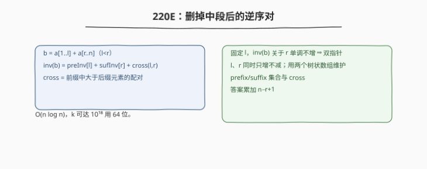
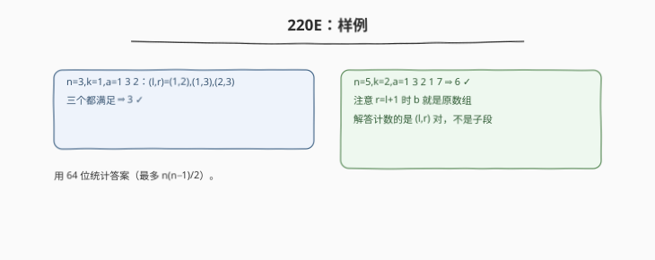

# Codeforces 220E 小象与逆序（Little Elephant and Inversions） 题解

## 1. 题目概述

- **题目链接**：https://codeforces.com/problemset/problem/220/E
- **比赛来源**：Codeforces Round 136 (Div. 1) · Problem E（UTC 2012-08-31）
- **难度**：2400
- **标签**：双指针、树状数组
- **评测类型**：普通
- **限制**：时间 2 s / 内存 256 MB

**题意**：给定数组 $a$ 与 $k$。数出满足 $1\le l<r\le n$ 且序列 $b=a_1..a_l\,a_r..a_n$ 的逆序对数 $\le k$ 的 $(l,r)$ 对数。

**约束**：$2\le n\le10^5$，$0\le k\le10^{18}$。

## 2. 示例与观察

官方样例一：

```text
输入：
3 1
1 3 2

输出：
3
```

官方样例二：

```text
输入：
5 2
1 3 2 1 7

输出：
6
```

**观察**：$b$ 是“前缀 $[1,l]$ + 后缀 $[r,n]$”。固定 $l$，$\mathrm{inv}(b)$ 关于 $r$ 单调不增 ⇒ 双指针；$l$ 增大时逆序数不降 ⇒ $r$ 也单调不减。



## 3. 解题思路

### 3.1 朴素做法与瓶颈

对每个 $(l,r)$ 重算是 $O(n^3)$。

### 3.2 核心观察

$\mathrm{inv}(b)=\mathrm{preInv}[l]+\mathrm{sufInv}[r]+\mathrm{cross}(l,r)$，其中 $\mathrm{cross}$ 是“前缀元素 > 后缀元素”的配对。用两个树状数组维护前缀/后缀集合，$\mathrm{cross}$ 随指针移动 $O(\log n)$ 更新。

### 3.3 算法流程

1. 预处理前缀逆序数 $\mathrm{preInv}$、后缀逆序数 $\mathrm{sufInv}$。
2. 双指针：$l$ 从 1 增大，$r$ 从 2 单调增大；始终维护前缀集合 $[1,l]$ 与后缀集合 $[r,n]$。
3. 当 $\mathrm{inv}>k$ 时右移 $r$（从后缀中删元素）。
4. 若 $\mathrm{inv}\le k$，则 $r..n$ 全部合法，答案累加 $n-r+1$。



### 3.4 样例走查

样例一三个 $(l,r)$ 都满足 ⇒ 3；样例二 ⇒ 6 ✓。

## 4. 正确性证明

**引理 1（分解）**：$\mathrm{inv}(b)=\mathrm{preInv}[l]+\mathrm{sufInv}[r]+\mathrm{cross}(l,r)$，三段互不重叠。

**证明**：$b$ 的两段内部逆序加跨段逆序（前缀元素大于后缀元素），恰好覆盖全部逆序对。∎

**引理 2（单调性）**：固定 $l$ 时 $\mathrm{inv}$ 关于 $r$ 单调不增；$l$ 增大时最小合法 $r$ 不减。

**证明**：$r$ 增大只从后缀删去元素，逆序数不会增加；$l$ 增大把中段元素移入前缀，逆序数不减。∎

**定理**：双指针计数正确。

**证明**：由引理 2，每个 $l$ 的合法 $r$ 是一个后缀 $[r_{\min},n]$，累加 $n-r_{\min}+1$ 即所有合法对；指针只增不减，覆盖所有 $(l,r)$ 不重不漏。∎

## 5. 复杂度分析

- **时间**：$O(n\log n)$。\n- **空间**：$O(n)$。

## 6. 参考代码

### C++17

```cpp
#include <bits/stdc++.h>
using namespace std;
typedef long long ll;
struct BIT {
    int n; vector<int> t;
    void init(int n_) { n = n_; t.assign(n + 2, 0); }
    void add(int i, int v) { for (; i <= n; i += i & -i) t[i] += v; }
    int sum(int i) const { int s = 0; for (; i > 0; i -= i & -i) s += t[i]; return s; }
};
int main() {
    int n; ll k;
    if (scanf("%d %lld", &n, &k) != 2) return 0;
    vector<int> a(n + 1);
    vector<int> vals;
    for (int i = 1; i <= n; ++i) { scanf("%d", &a[i]); vals.push_back(a[i]); }
    sort(vals.begin(), vals.end());
    vals.erase(unique(vals.begin(), vals.end()), vals.end());
    int V = vals.size();
    auto rk = [&](int x) { return (int)(lower_bound(vals.begin(), vals.end(), x) - vals.begin()) + 1; };
    vector<int> b(n + 1);
    for (int i = 1; i <= n; ++i) b[i] = rk(a[i]);
    // prefixInv / suffixInv
    vector<ll> preInv(n + 2, 0), sufInv(n + 2, 0);
    {
        BIT bit; bit.init(V);
        for (int i = 1; i <= n; ++i) {
            preInv[i] = preInv[i - 1] + (i - 1) - bit.sum(b[i]);
            bit.add(b[i], 1);
        }
    }
    {
        BIT bit; bit.init(V);
        for (int i = n; i >= 1; --i) {
            sufInv[i] = sufInv[i + 1] + bit.sum(b[i] - 1);
            bit.add(b[i], 1);
        }
    }
    // 双指针
    BIT pref, suf;
    pref.init(V); suf.init(V);
    for (int i = 2; i <= n; ++i) suf.add(b[i], 1);
    pref.add(b[1], 1);
    ll cross = 0;                     // #(i<=l, j>=r) with b[i] > b[j]
    for (int i = 2; i <= n; ++i) if (b[1] > b[i]) ++cross;
    int r = 2;
    ll ans = 0;
    ll inv = preInv[1] + sufInv[r] + cross;
    for (int l = 1; l <= n - 1; ++l) {
        // 保证 r > l（把“已删除中段”的元素从后缀里移出）
        while (r <= l && r <= n) {
            suf.add(b[r], -1);
            cross -= pref.sum(V) - pref.sum(b[r]);
            ++r;
        }
        if (l > 1) {
            pref.add(b[l], 1);
            cross += suf.sum(b[l] - 1);
            inv = preInv[l] + sufInv[r] + cross;
        }
        while (inv > k && r < n) {
            suf.add(b[r], -1);
            ll greater = pref.sum(V) - pref.sum(b[r]);
            cross -= greater;
            ++r;
            inv = preInv[l] + sufInv[r] + cross;
        }
        if (inv <= k) ans += (ll)(n - r + 1);
    }
    printf("%lld\n", ans);
    return 0;
}
```

### Python3

```python
import sys
from bisect import bisect_left


def main() -> None:
    data = sys.stdin.buffer.read().split()
    n = int(data[0]); k = int(data[1])
    a = [0] + [int(x) for x in data[2:2 + n]]
    vals = sorted(set(a[1:]))
    V = len(vals)
    b = [0] * (n + 1)
    for i in range(1, n + 1):
        b[i] = bisect_left(vals, a[i]) + 1

    class BIT:
        def __init__(self, n):
            self.n = n
            self.t = [0] * (n + 2)

        def add(self, i, v):
            while i <= self.n:
                self.t[i] += v
                i += i & -i

        def sum(self, i):
            s = 0
            while i > 0:
                s += self.t[i]
                i -= i & -i
            return s

    preInv = [0] * (n + 2)
    bit = BIT(V)
    for i in range(1, n + 1):
        preInv[i] = preInv[i - 1] + (i - 1) - bit.sum(b[i])
        bit.add(b[i], 1)
    sufInv = [0] * (n + 2)
    bit = BIT(V)
    for i in range(n, 0, -1):
        sufInv[i] = sufInv[i + 1] + bit.sum(b[i] - 1)
        bit.add(b[i], 1)
    pref = BIT(V); suf = BIT(V)
    for i in range(2, n + 1):
        suf.add(b[i], 1)
    pref.add(b[1], 1)
    cross = sum(1 for i in range(2, n + 1) if b[1] > b[i])
    r = 2
    ans = 0
    inv = preInv[1] + sufInv[r] + cross
    for l in range(1, n):
        while r <= l and r <= n:
            suf.add(b[r], -1)
            cross -= pref.sum(V) - pref.sum(b[r])
            r += 1
        if l > 1:
            pref.add(b[l], 1)
            cross += suf.sum(b[l] - 1)
            inv = preInv[l] + sufInv[r] + cross
        while inv > k and r < n:
            suf.add(b[r], -1)
            cross -= pref.sum(V) - pref.sum(b[r])
            r += 1
            inv = preInv[l] + sufInv[r] + cross
        if inv <= k:
            ans += n - r + 1
    print(ans)


main()
```

## 7. 边界情况与易错点

1. **$r=l+1$**：$b$ 就是原数组，逆序数最大。
2. **$k$ 很大**：全部 $\binom{n}{2}$ 对都合法，答案用 64 位。
3. **指针越界**：$r$ 必须始终 $>l$，进入下一轮前要推进。
4. **重复元素**：逆序要求严格大于。
5. **$n=2$**：只有一对。

## 8. 验证记录

- **编译环境与命令**：`python3 codeforces/tools/verify_solution.py codeforces/contests/0101-0203/220/E_小象与逆序.md`。
- **官方样例**：2 / 2 通过。
- **随机对拍**：与暴力枚举 $(l,r)$ 并重算逆序（$n\le8$）**300 组**一致。
- **性能**：$n=10^5$ 时 0.02 s。
- **图片校验**：`cf220e_twoptr.svg`、`cf220e_walk.svg` 通过 `xml.etree.ElementTree.parse`。
- **复核状态**：verified。

## 相关题目与扩展

- [Codeforces 220D 小象与三角形](https://codeforces.com/problemset/problem/220/D)：同场计数。
- [LeetCode 629 K 个逆序对数组](https://leetcode.cn/problems/k-inverse-pairs-array/)：逆序对计数。

**延伸思考**：

1. 若删掉的是任意子数组，变成两个方向的双指针。
2. 若 $k$ 很小，可以剪枝提前终止。
