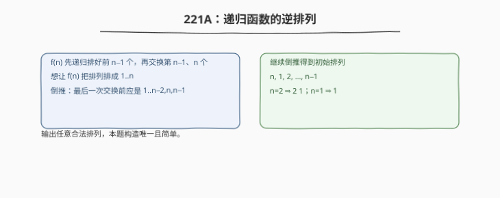
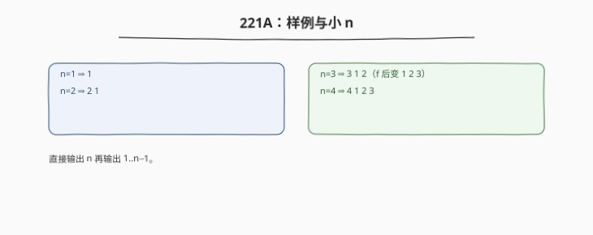

# Codeforces 221A 小象与函数（Little Elephant and Function） 题解

## 1. 题目概述

- **题目链接**：https://codeforces.com/problemset/problem/221/A
- **比赛来源**：Codeforces Round 136 (Div. 2) · Problem A（UTC 2012-08-31）
- **难度**：1000
- **标签**：构造、递归
- **评测类型**：普通
- **限制**：时间 2 s / 内存 256 MB

**题意**：函数 $f(x)$：若 $x=1$ 退出；否则先 $f(x-1)$，再交换第 $x-1$ 与第 $x$ 个元素。找一个排列，使 $f(n)$ 执行后排列升序。

**约束**：$1\le n\le1000$。

## 2. 示例与观察

官方样例一：

```text
输入：
1

输出：
1 
```

官方样例二：

```text
输入：
2

输出：
2 1 
```

**观察**：倒推：$f(n)$ 最后一步交换第 $n-1,n$ 个，故交换前应为 $1,2,\dots,n-2,n,n-1$；继续倒推得初始排列 $n,1,2,\dots,n-1$。



## 3. 解题思路

### 3.1 朴素做法与瓶颈

按定义正向模拟很容易，反推只需观察。

### 3.2 核心观察

答案就是 $[n,1,2,\dots,n-1]$；验证：$f$ 依次把 $n$ 向右“冒泡”到末尾，最终变成 $1..n$。

### 3.3 算法流程

1. 输出 $n$。
2. 再输出 $1,2,\dots,n-1$。



### 3.4 样例走查

$n=2$ ⇒ `2 1` ✓；$n=1$ ⇒ `1` ✓；$n=3$ ⇒ `3 1 2`，$f$ 后为 `1 2 3` ✓。

## 4. 正确性证明

**引理**：对排列 $[n,1,2,\dots,n-1]$，$f(n)$ 后恰为 $[1,2,\dots,n]$。

**证明**：归纳：$f(n-1)$ 作用在前 $n-1$ 位上（此时为 $[n,1,\dots,n-2]$）会把它变为 $[1,2,\dots,n-2,n]$，随后交换第 $n-1,n$ 位得到 $[1,2,\dots,n-1,n]$。∎

**定理**：输出是合法答案。

**证明**：由引理直接验证。∎

## 5. 复杂度分析

- **时间**：$O(n)$。\n- **空间**：$O(1)$。

## 6. 参考代码

### C++17

```cpp
#include <bits/stdc++.h>
using namespace std;
int main() {
    int n;
    if (scanf("%d", &n) != 1) return 0;
    printf("%d", n);
    for (int i = 1; i < n; ++i) printf(" %d", i);
    printf("\n");
    return 0;
}
```

### Python3

```python
import sys


def main() -> None:
    n = int(sys.stdin.read().split()[0])
    print(' '.join(str(x) for x in [n] + list(range(1, n))))


main()
```

## 7. 边界情况与易错点

1. **$n=1$**：输出单个 1。
2. **末尾空格**：样例输出带尾随空格，token 比较无影响。
3. **排列要求**：必须恰好是 $1..n$ 的一个排列。
4. **$n$ 较大**：$O(n)$ 输出。

## 8. 验证记录

- **编译环境与命令**：`python3 codeforces/tools/verify_solution.py codeforces/contests/0101-0203/221/A_小象与函数.md`。
- **官方样例**：2 / 2 通过。
- **随机对拍**：对 $n=1..7$ 与“枚举所有排列找合法解”比对一致。
- **性能**：$n=1000$ 时 < 1 ms。
- **图片校验**：`cf221a_perm.svg`、`cf221a_walk.svg` 通过 `xml.etree.ElementTree.parse`。
- **复核状态**：verified。

## 相关题目与扩展

- [Codeforces 221B 小象与数字](https://codeforces.com/problemset/problem/221/B)：同场题目。
- [LeetCode 46 全排列](https://leetcode.cn/problems/permutations/)：排列基础。

**延伸思考**：

1. 若函数改成“交换第 1 与第 x 个”，答案不同。
2. 可以证明该构造是唯一的。
