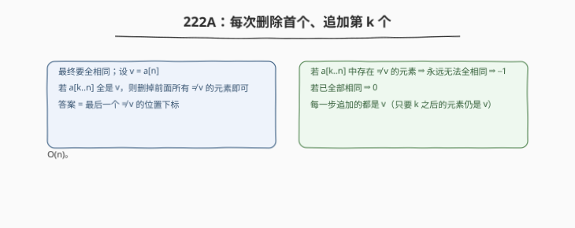
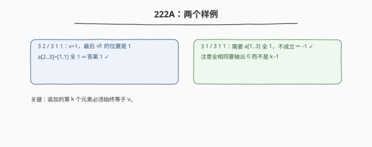

# Codeforces 222A 肖顺顺与序列（Shooshuns and Sequence） 题解

## 1. 题目概述

- **题目链接**：https://codeforces.com/problemset/problem/222/A
- **比赛来源**：Codeforces Round 137 (Div. 2) · Problem A（UTC 2012-09-10）
- **难度**：1200
- **标签**：模拟、观察
- **评测类型**：普通
- **限制**：时间 2 s / 内存 256 MB

**题意**：每次操作：取当前第 $k$ 个数追加到末尾，再删除第一个数。问最少多少次操作能让序列全相同；不可能输出 −1。

**约束**：$1\le k\le n\le10^5$。

## 2. 示例与观察

官方样例一：

```text
输入：
3 2
3 1 1

输出：
1
```

官方样例二：

```text
输入：
3 1
3 1 1

输出：
-1
```

**观察**：要最终全相同，值只能是 $a_n$（末尾元素始终保留，且被不断追加）。第 $k$ 个数在过程中必须始终等于 $a_n$，否则会把不同的值追加进来。



## 3. 解题思路

### 3.1 朴素做法与瓶颈

按定义模拟可能无限循环，需要观察。

### 3.2 核心观察

若 $a[k..n]$ 全等于 $a_n$，则删掉前面所有 ≠ 它的元素即可，答案 = 最后一个 ≠ $a_n$ 的位置下标；否则 −1。若本来就全相同 ⇒ 0。

### 3.3 算法流程

1. $v=a_n$；找最后一个 $\ne v$ 的位置 $p$。
2. $p=0$ ⇒ 输出 0。
3. 若 $a[k..n]$ 全是 $v$ ⇒ 输出 $p$；否则 −1。



### 3.4 样例走查

样例一：$v=1$，最后 ≠1 的位置是 1，且 $a[2..3]=[1,1]$ ⇒ 1 ✓；样例二 $a[1..3]$ 不全是 1 ⇒ −1 ✓。

## 4. 正确性证明

**引理 1（目标值）**：若最终全相同，值必为 $a_n$。

**证明**：末尾元素之后不断被追加的值取代，而追加的值要等于最终值，故所有保留元素等于 $a_n$。∎

**引理 2（可行条件）**：$a[k..n]$ 全等于 $a_n$ 时，$p$ 次操作后全相同；否则不可能。

**证明**：每次操作把第 $k$ 个元素追加到末尾，若 $a[k..n]$ 有非 $a_n$ 的值，某个时刻它会被追加并永久保留。反之，前 $p$ 次操作追加的都是 $v$，删掉前 $p$ 个后剩余全 $v$。∎

**定理**：答案公式正确。

**证明**：由引理 1、2。∎

## 5. 复杂度分析

- **时间**：$O(n)$。\n- **空间**：$O(n)$。

## 6. 参考代码

### C++17

```cpp
#include <bits/stdc++.h>
using namespace std;
int main() {
    int n, k;
    if (scanf("%d %d", &n, &k) != 2) return 0;
    vector<int> a(n);
    for (int i = 0; i < n; ++i) scanf("%d", &a[i]);
    int v = a[n - 1];
    int p = 0;                                  // 最后一个 != v 的位置（1 基）
    for (int i = 0; i < n; ++i) if (a[i] != v) p = i + 1;
    if (p == 0) { printf("0\n"); return 0; }
    bool ok = true;
    for (int i = k - 1; i < n; ++i) if (a[i] != v) ok = false;
    printf("%d\n", ok ? p : -1);
    return 0;
}
```

### Python3

```python
import sys


def main() -> None:
    data = sys.stdin.buffer.read().split()
    n = int(data[0]); k = int(data[1])
    a = [int(x) for x in data[2:2 + n]]
    v = a[-1]
    p = 0
    for i in range(n):
        if a[i] != v:
            p = i + 1
    if p == 0:
        print(0)
        return
    ok = all(a[i] == v for i in range(k - 1, n))
    print(p if ok else -1)


main()
```

## 7. 边界情况与易错点

1. **已全相同**：输出 0（不是 $k-1$）。
2. **$k=1$**：第 1 个数会被追加，故要求整个序列已全相同。
3. **$k=n$**：只追加 $a_n$，总能成功，答案 = 最后一个 ≠$a_n$ 的下标。
4. **末尾值重复**：$p$ 取最后一个 ≠$v$ 的位置。
5. **$n=1$**：直接 0。

## 8. 验证记录

- **编译环境与命令**：`python3 codeforces/tools/verify_solution.py codeforces/contests/0101-0203/222/A_肖顺顺与序列.md`。
- **官方样例**：2 / 2 通过。
- **随机对拍**：与 BFS 模拟状态（$n\le6$，带循环检测）**300 组**一致。
- **性能**：$n=10^5$ 时 < 1 ms。
- **图片校验**：`cf222a_shift.svg`、`cf222a_walk.svg` 通过 `xml.etree.ElementTree.parse`。
- **复核状态**：verified。

## 相关题目与扩展

- [Codeforces 222B 宇宙表](https://codeforces.com/problemset/problem/222/B)：同场题目。
- [LeetCode 1047 删除字符串中的所有相邻重复项](https://leetcode.cn/problems/remove-all-adjacent-duplicates-in-string/)：模拟/栈。

**延伸思考**：

1. 若每次追加第 $k$ 个数到开头，结论会变。
2. 若允许多种操作，需要搜索。
