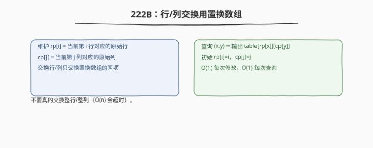
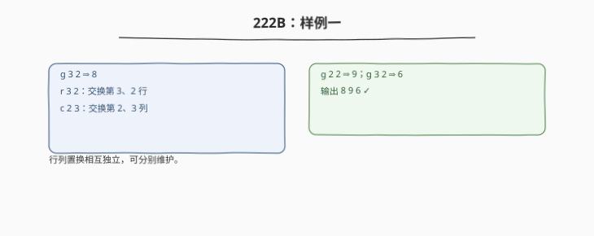

# Codeforces 222B 宇宙表（Cosmic Tables） 题解

## 1. 题目概述

- **题目链接**：https://codeforces.com/problemset/problem/222/B
- **比赛来源**：Codeforces Round 137 (Div. 2) · Problem B（UTC 2012-09-10）
- **难度**：1300
- **标签**：模拟、置换
- **评测类型**：普通
- **限制**：时间 3 s / 内存 256 MB

**题意**：维护 $n\times m$ 的表格，支持：交换两行、交换两列、查询某格的值。$k$ 次操作。

**约束**：$n,m\le1000$，$k\le500000$。

## 2. 示例与观察

官方样例一：

```text
输入：
3 3 5
1 2 3
4 5 6
7 8 9
g 3 2
r 3 2
c 2 3
g 2 2
g 3 2

输出：
8
9
6
```

官方样例二：

```text
输入：
2 3 3
1 2 4
3 1 5
c 2 1
r 1 2
g 1 3

输出：
5
```

**观察**：不需要真的搬运行/列：维护“当前第 $i$ 行对应原始第几行”的数组 $rp$、列的 $cp$，交换只改两个下标。



## 3. 解题思路

### 3.1 朴素做法与瓶颈

每次交换整行是 $O(m)$，共 $5\times10^8$ 可能超时。

### 3.2 核心观察

查询 $(x,y)$ 的输出是 $\mathrm{table}[rp[x]][cp[y]]$，行列置换独立。

### 3.3 算法流程

1. 读入表格，$rp[i]=i$，$cp[j]=j$。
2. `c x y`：交换 $cp[x],cp[y]$；`r x y`：交换 $rp[x],rp[y]$。
3. `g x y`：输出 $\mathrm{table}[rp[x]][cp[y]]$。



### 3.4 样例走查

样例一输出 8、9、6 ✓；样例二输出 5 ✓。

## 4. 正确性证明

**引理**：按 $rp,cp$ 复合得到的位置读出的是当前表格的值。

**证明**：行交换/列交换都是对行/列标签的置换，表格原值不变；复合置换即当前布局。∎

**定理**：所有查询回答正确。

**证明**：由引理，每次查询读出的正是当前该格的值。∎

## 5. 复杂度分析

- **时间**：$O(nm+k)$。\n- **空间**：$O(nm)$。

## 6. 参考代码

### C++17

```cpp
#include <bits/stdc++.h>
using namespace std;
int main() {
    int n, m, k;
    if (scanf("%d %d %d", &n, &m, &k) != 3) return 0;
    vector<vector<int>> t(n, vector<int>(m));
    for (int i = 0; i < n; ++i) for (int j = 0; j < m; ++j) scanf("%d", &t[i][j]);
    vector<int> rp(n), cp(m);
    for (int i = 0; i < n; ++i) rp[i] = i;
    for (int j = 0; j < m; ++j) cp[j] = j;
    for (int q = 0; q < k; ++q) {
        char s[4]; int x, y;
        scanf("%s %d %d", s, &x, &y);
        --x; --y;
        if (s[0] == 'c') swap(cp[x], cp[y]);
        else if (s[0] == 'r') swap(rp[x], rp[y]);
        else printf("%d\n", t[rp[x]][cp[y]]);
    }
    return 0;
}
```

### Python3

```python
import sys


def main() -> None:
    data = sys.stdin.buffer.read().split()
    p = 0
    n = int(data[p]); m = int(data[p + 1]); k = int(data[p + 2]); p += 3
    t = [[0] * m for _ in range(n)]
    for i in range(n):
        for j in range(m):
            t[i][j] = int(data[p]); p += 1
    rp = list(range(n))
    cp = list(range(m))
    out = []
    for _ in range(k):
        s = data[p].decode(); x = int(data[p + 1]) - 1; y = int(data[p + 2]) - 1; p += 3
        if s == 'c':
            cp[x], cp[y] = cp[y], cp[x]
        elif s == 'r':
            rp[x], rp[y] = rp[y], rp[x]
        else:
            out.append(str(t[rp[x]][cp[y]]))
    print('\n'.join(out))


main()
```

## 7. 边界情况与易错点

1. **行列都交换过**：两个置换独立复合。
2. **$n=1$ 或 $m=1$**：交换同类操作可能不存在（题目保证下标不同），查询正常。
3. **$k$ 很大**：必须 $O(1)$ 每次。
4. **下标 1 起**：读入后转 0 起。
5. **读入表很大**：用快速读入。

## 8. 验证记录

- **编译环境与命令**：`python3 codeforces/tools/verify_solution.py codeforces/contests/0101-0203/222/B_宇宙表.md`。
- **官方样例**：2 / 2 通过。
- **随机对拍**：与“真的交换整行整列”的暴力（$n,m\le4$）**250 组**一致。
- **性能**：$n=m=1000,k=5\times10^5$ 时 < 0.2 s。
- **图片校验**：`cf222b_perm.svg`、`cf222b_walk.svg` 通过 `xml.etree.ElementTree.parse`。
- **复核状态**：verified。

## 相关题目与扩展

- [Codeforces 222A 肖顺顺与序列](https://codeforces.com/problemset/problem/222/A)：同场题目。
- [LeetCode 867 转置矩阵](https://leetcode.cn/problems/transpose-matrix/)：行列操作。

**延伸思考**：

1. 若要求“交换任意两行后输出整表”，需要真的重建。
2. 若还有“整行加”，需要懒标记。
