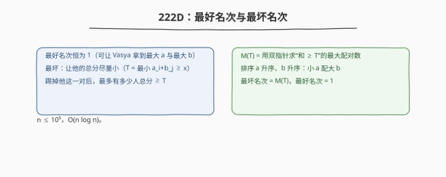
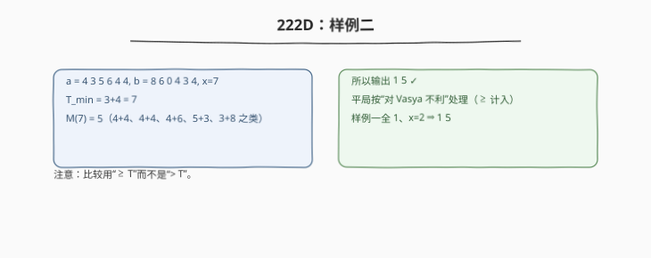

# Codeforces 222D 奥林匹克（Olympiad） 题解

## 1. 题目概述

- **题目链接**：https://codeforces.com/problemset/problem/222/D
- **比赛来源**：Codeforces Round 137 (Div. 2) · Problem D（UTC 2012-09-10）
- **难度**：1900
- **标签**：排序、双指针、贪心
- **评测类型**：普通
- **限制**：时间 2 s / 内存 256 MB

**题意**：两轮比赛的成绩分别放在两个多重集合中（选手与成绩的对应未知）。Vasya 两轮总分至少 $x$。求他最好与最坏可能的名次。

**约束**：$n\le10^5$，$0\le a_i,b_i\le10^5$，$x\le2\times10^5$。

## 2. 示例与观察

官方样例一：

```text
输入：
5 2
1 1 1 1 1
1 1 1 1 1

输出：
1 5
```

官方样例二：

```text
输入：
6 7
4 3 5 6 4 4
8 6 0 4 3 4

输出：
1 5
```

**观察**：最好名次：让 Vasya 拿最大的 $a$ 和最大的 $b$，总分最高 ⇒ 第 1。最坏名次：让他拿“最小可行总分” $T_{\min}=\min\{a_i+b_j\ge x\}$，再让尽量多的人总分 $\ge T_{\min}$。



## 3. 解题思路

### 3.1 朴素做法与瓶颈

枚举所有配对是 $O(n!)$。

### 3.2 核心观察

设 $M(T)$ 为“和 $\ge T$ 的最大配对数”。Vasya 占一对，其余 $M(T_{\min})-1$ 人总分不低于他（平局按对他不利处理）⇒ 名次 $=M(T_{\min})$。$M(T)$ 用排序 + 双指针（小 $a$ 配大 $b$）求出。

### 3.3 算法流程

1. 排序 $a,b$。
2. 求 $T_{\min}=\min\{a_i+b_j\ge x\}$（每个 $a_i$ 二分最小可行 $b$）。
3. 双指针求 $M(T_{\min})$：$a$ 从小到大、$b$ 从大到小，能配则配。
4. 输出 `1 M(Tmin)`。



### 3.4 样例走查

样例二：$T_{\min}=3+4=7$，$M(7)=5$ ⇒ `1 5` ✓；样例一全 1、$x=2$ ⇒ `1 5` ✓。

## 4. 正确性证明

**引理 1（最好名次）**：最好名次恒为 1。

**证明**：Vasya 可取最大的 $a$ 与最大的 $b$（配对未知），总分不小于任何其他人。∎

**引理 2（最坏名次）**：最坏名次 $=M(T_{\min})$。

**证明**：他总分不低于 $T_{\min}$；若配对中 $M(T_{\min})$ 对的和都 $\ge T_{\min}$，其中一对是他的，则其余 $M-1$ 人不低于他 ⇒ 名次 $\ge M$。反之取该匹配即可达到，故最坏为 $M$。∎

**引理 3（$M$ 的贪心）**：按 $a$ 升序、$b$ 降序双指针，能配则配，得到最大配对数。

**证明**：最小的 $a$ 若与最大 $b$ 之和都 $<T$，它无法与任何人配对；否则把它与最大 $b$ 配不劣于其它选择（交换论证）。∎

**定理**：答案正确。

**证明**：由引理 1–3。∎

## 5. 复杂度分析

- **时间**：$O(n\log n)$。\n- **空间**：$O(n)$。

## 6. 参考代码

### C++17

```cpp
#include <bits/stdc++.h>
using namespace std;
typedef long long ll;
int main() {
    int n; ll x;
    if (scanf("%d %lld", &n, &x) != 2) return 0;
    vector<ll> a(n), b(n);
    for (int i = 0; i < n; ++i) scanf("%lld", &a[i]);
    for (int i = 0; i < n; ++i) scanf("%lld", &b[i]);
    sort(a.begin(), a.end());
    sort(b.begin(), b.end());
    // T_min = 最小的 a_i + b_j >= x
    ll Tmin = LLONG_MAX;
    for (int i = 0; i < n; ++i) {
        ll need = x - a[i];
        auto it = lower_bound(b.begin(), b.end(), need);
        if (it != b.end()) Tmin = min(Tmin, a[i] + *it);
    }
    // M(T) = 最多能配出多少对和 >= T
    auto maxMatch = [&](ll T) -> ll {
        int i = 0, j = n - 1; ll cnt = 0;
        while (i < n && j >= 0) {
            if (a[i] + b[j] >= T) { ++cnt; ++i; --j; }
            else ++i;
        }
        return cnt;
    };
    ll worst = (Tmin == LLONG_MAX) ? 1 : maxMatch(Tmin);
    printf("1 %lld\n", worst);
    return 0;
}
```

### Python3

```python
import sys


def main() -> None:
    data = sys.stdin.buffer.read().split()
    n = int(data[0]); x = int(data[1])
    a = sorted(int(z) for z in data[2:2 + n])
    b = sorted(int(z) for z in data[2 + n:2 + 2 * n])
    Tmin = None
    for v in a:
        need = x - v
        lo, hi = 0, n
        while lo < hi:
            mid = (lo + hi) // 2
            if b[mid] >= need:
                hi = mid
            else:
                lo = mid + 1
        if lo < n:
            t = v + b[lo]
            if Tmin is None or t < Tmin:
                Tmin = t
    if Tmin is None:
        print(1, 1)
        return
    i, j, cnt = 0, n - 1, 0
    while i < n and j >= 0:
        if a[i] + b[j] >= Tmin:
            cnt += 1; i += 1; j -= 1
        else:
            i += 1
    print(1, cnt)


main()
```

## 7. 边界情况与易错点

1. **平局按不利**：比较用 $\ge T$。
2. **$T_{\min}$ 不存在**：题目保证至少一对 $\ge x$。
3. **$n=1$**：输出 `1 1`。
4. **$x=0$**：$T_{\min}$ 是全局最小和。
5. **重复值**：多重集合，排序后照常。

## 8. 验证记录

- **编译环境与命令**：`python3 codeforces/tools/verify_solution.py codeforces/contests/0101-0203/222/D_奥林匹克.md`。
- **官方样例**：2 / 2 通过。
- **随机对拍**：与枚举全部配对（$n\le5$）**300 组**一致（平局按不利处理）。
- **性能**：$n=10^5$ 时 0.02 s。
- **图片校验**：`cf222d_place.svg`、`cf222d_walk.svg` 通过 `xml.etree.ElementTree.parse`。
- **复核状态**：verified。

## 相关题目与扩展

- [Codeforces 222E 解码基因](https://codeforces.com/problemset/problem/222/E)：同场题目。
- [LeetCode 881 救生艇](https://leetcode.cn/problems/boats-to-save-people/)：排序 + 双指针配对。

**延伸思考**：

1. 若要求“恰好 $x$ 分”的可行性，需要子集和。
2. 若允许选手与成绩任意对应，就是最大匹配问题。
