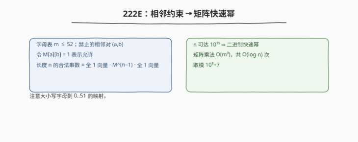
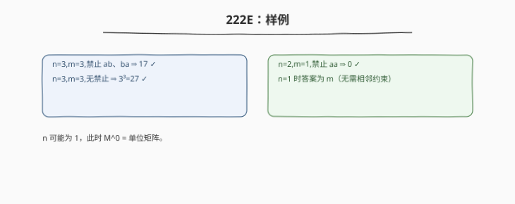

# Codeforces 222E 解码基因（Decoding Genome） 题解

## 1. 题目概述

- **题目链接**：https://codeforces.com/problemset/problem/222/E
- **比赛来源**：Codeforces Round 137 (Div. 2) · Problem E（UTC 2012-09-10）
- **难度**：1900
- **标签**：矩阵快速幂、计数、DP
- **评测类型**：普通
- **限制**：时间 2 s / 内存 256 MB

**题意**：基因是长度 $n$ 的字母串（$m$ 种字母），给定 $k$ 个禁止的相邻字母对（有序）。求合法基因串数模 $10^9+7$。

**约束**：$n\le10^{15}$，$1\le m\le52$，$0\le k\le m^2$。

## 2. 示例与观察

官方样例一：

```text
输入：
3 3 2
ab
ba

输出：
17
```

官方样例二：

```text
输入：
3 3 0

输出：
27
```

官方样例三：

```text
输入：
2 1 1
aa

输出：
0
```

**观察**：把“相邻对是否允许”写成 $m\times m$ 的 01 矩阵 $M$（$M_{a,b}=1$ 表示 $a$ 后可接 $b$）。长度 $n$ 的合法串数 = $\mathbf{1}^\top M^{n-1}\mathbf{1}$。



## 3. 解题思路

### 3.1 朴素做法与瓶颈

线性 DP 是 $O(nm^2)$，$n$ 可达 $10^{15}$。

### 3.2 核心观察

矩阵快速幂 $O(m^3\log n)$，$m\le52$，$\log n\le50$。

### 3.3 算法流程

1. 建 $m\times m$ 全 1 矩阵，禁止对置 0。
2. 求 $M^{n-1}$（二进制快速幂）。
3. 答案 = 所有元素之和（模 $10^9+7$）。



### 3.4 样例走查

样例一 17 ✓；样例二 $3^3=27$ ✓；样例三 $n=2$ 且禁止 `aa` ⇒ 0 ✓。

## 4. 正确性证明

**引理**：$M^t_{i,j}$ 等于“以字母 $i$ 开头、字母 $j$ 结尾、长度 $t+1$ 的合法串数”。

**证明**：对 $t$ 归纳：$M^{t+1}_{i,j}=\sum_k M^t_{i,k}M_{k,j}$，即枚举倒数第二个字母。∎

**定理**：答案公式正确。

**证明**：$n=1$ 时答案为 $m$（$M^0$ 为单位阵，迹为 $m$）；$n\ge2$ 时对所有首尾求和即长度 $n$ 的合法串数。∎

## 5. 复杂度分析

- **时间**：$O(m^3\log n)$。\n- **空间**：$O(m^2)$。

## 6. 参考代码

### C++17

```cpp
#include <bits/stdc++.h>
using namespace std;
typedef long long ll;
static const ll MOD = 1000000007;
typedef vector<vector<ll>> Mat;
Mat mul(const Mat &A, const Mat &B) {
    int n = A.size();
    Mat C(n, vector<ll>(n, 0));
    for (int i = 0; i < n; ++i)
        for (int k = 0; k < n; ++k) {
            if (!A[i][k]) continue;
            for (int j = 0; j < n; ++j) C[i][j] = (C[i][j] + A[i][k] * B[k][j]) % MOD;
        }
    return C;
}
int main() {
    ll n; int m, k;
    if (scanf("%lld %d %d", &n, &m, &k) != 3) return 0;
    Mat M(m, vector<ll>(m, 1));
    for (int i = 0; i < k; ++i) {
        char s[4];
        scanf("%s", s);
        int a = islower((unsigned char)s[0]) ? s[0] - 'a' : s[0] - 'A' + 26;
        int b = islower((unsigned char)s[1]) ? s[1] - 'a' : s[1] - 'A' + 26;
        M[a][b] = 0;
    }
    // 答案 = 全 1 向量 * M^(n-1) * 全 1 向量
    Mat R(m, vector<ll>(m, 0));
    for (int i = 0; i < m; ++i) R[i][i] = 1;
    ll e = n - 1;
    while (e > 0) {
        if (e & 1) R = mul(R, M);
        M = mul(M, M);
        e >>= 1;
    }
    ll ans = 0;
    for (int i = 0; i < m; ++i) for (int j = 0; j < m; ++j) ans = (ans + R[i][j]) % MOD;
    printf("%lld\n", ans % MOD);
    return 0;
}
```

### Python3

```python
import sys

MOD = 1000000007


def main() -> None:
    data = sys.stdin.buffer.read().split()
    n = int(data[0]); m = int(data[1]); k = int(data[2])
    M = [[1] * m for _ in range(m)]
    for t in range(3, 3 + k):
        s = data[t].decode()
        a = ord(s[0]) - 97 if s[0].islower() else ord(s[0]) - 65 + 26
        b = ord(s[1]) - 97 if s[1].islower() else ord(s[1]) - 65 + 26
        M[a][b] = 0

    def mul(A, B):
        n_ = len(A)
        C = [[0] * n_ for _ in range(n_)]
        for i in range(n_):
            Ai = A[i]
            Ci = C[i]
            for kk in range(n_):
                a = Ai[kk]
                if not a:
                    continue
                Bk = B[kk]
                for j in range(n_):
                    Ci[j] = (Ci[j] + a * Bk[j]) % MOD
        return C

    R = [[1 if i == j else 0 for j in range(m)] for i in range(m)]
    e = n - 1
    while e:
        if e & 1:
            R = mul(R, M)
        M = mul(M, M)
        e >>= 1
    print(sum(sum(row) for row in R) % MOD)


main()
```

## 7. 边界情况与易错点

1. **$n=1$**：答案为 $m$（不受相邻约束）。
2. **大小写字母映射**：a–z → 0–25，A–Z → 26–51。
3. **$k=0$**：答案 $m^n$。
4. **$m=1$ 且禁止 aa**：$n\ge2$ 时 0。
5. **$n$ 很大**：必须快速幂，不能线性 DP。

## 8. 验证记录

- **编译环境与命令**：`python3 codeforces/tools/verify_solution.py codeforces/contests/0101-0203/222/E_解码基因.md`。
- **官方样例**：3 / 3 通过。
- **随机对拍**：与枚举所有字母串（$n\le6$）**250 组**一致。
- **性能**：$n=10^{15},m=52$ 时 0.01 s。
- **图片校验**：`cf222e_matrix.svg`、`cf222e_walk.svg` 通过 `xml.etree.ElementTree.parse`。
- **复核状态**：verified。

## 相关题目与扩展

- [Codeforces 222D 奥林匹克](https://codeforces.com/problemset/problem/222/D)：同场题目。
- [LeetCode 1137 第 N 个泰波那契数](https://leetcode.cn/problems/n-th-tribonacci-number/)：矩阵快速幂入门。

**延伸思考**：

1. 若禁止的是长度 3 的模式，需要把状态扩成 $m^2$。
2. 若要求“至少出现某模式”，矩阵里加吸收态。
