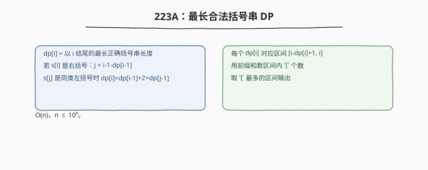
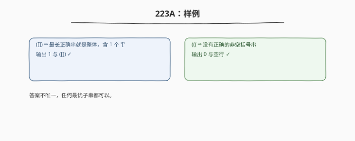

# Codeforces 223A 括号序列（Bracket Sequence） 题解

## 1. 题目概述

- **题目链接**：https://codeforces.com/problemset/problem/223/A
- **比赛来源**：Codeforces Round 138 (Div. 1) · Problem A（UTC 2012-09-14）
- **难度**：1700
- **标签**：栈、DP、字符串
- **评测类型**：特殊评测（多解，输出任一最优子串）
- **限制**：时间 2 s / 内存 256 MB

**题意**：给定只含 `(`、`)`、`[`、`]` 的串，找一个正确括号序列子串，使其中 `[` 的个数最多。

**约束**：长度 $\le10^5$。

## 2. 示例与观察

官方样例一：

```text
输入：
([])

输出：
1
([])
```

官方样例二：

```text
输入：
(((

输出：
0

```

**观察**：用“以每个位置结尾的最长正确括号串”DP：若 $s_i$ 是右括号，令 $j=i-1-dp_{i-1}$，$s_j$ 是同类左括号则 $dp_i=dp_{i-1}+2+dp_{j-1}$。



## 3. 解题思路

### 3.1 朴素做法与瓶颈

枚举所有子串再栈判定是 $O(n^2)$。

### 3.2 核心观察

每个正确括号串都是若干匹配对的并；以 $i$ 结尾的最长正确串包含全部可用匹配，故其 `[` 数不小于任何子段；在所有 $dp_i$ 对应区间中取 `[` 最多者即可（并列时取更长者以贴合样例）。

### 3.3 算法流程

1. 从左到右算 $dp_i$，同时维护 `[` 的前缀和。
2. 对每个 $dp_i>0$ 的区间数 `[` 的个数，保留最多者。
3. 输出个数与对应子串；全为 0 则输出 0 和空行。



### 3.4 样例走查

`([])`：整体是正确串，含 1 个 `[` ✓；`(((`：没有非空正确串 ⇒ 0。

## 4. 正确性证明

**引理 1（DP 正确）**：$dp_i$ 等于以 $i$ 结尾的最长正确括号串长度。

**证明**：$s_i$ 必须与某个左括号 $s_j$ 匹配，且 $j$ 与 $i$ 之间、$j$ 之前都必须是正确串；$j=i-1-dp_{i-1}$ 是唯一候选，成立时 $dp_i$ 由三段拼接。∎

**引理 2（最优性）**：取遍所有 $dp_i$ 区间即可得到 `[` 最多的正确子串。

**证明**：任何正确子串 $[l,r]$ 都包含于以 $r$ 结尾的最长正确串中（引理 1 的拼接结构），故其 `[` 数不超过该区间的 `[` 数。∎

**定理**：算法输出最优。

**证明**：由引理 1、2。∎

## 5. 复杂度分析

- **时间**：$O(n)$。\n- **空间**：$O(n)$。

## 6. 参考代码

### C++17

```cpp
#include <bits/stdc++.h>
using namespace std;
int main() {
    string s;
    if (!(cin >> s)) return 0;
    int n = s.size();
    vector<int> dp(n, 0), pref(n + 1, 0);
    for (int i = 0; i < n; ++i) pref[i + 1] = pref[i] + (s[i] == '[');
    int best = 0, bs = -1, be = -1;
    for (int i = 0; i < n; ++i) {
        if (s[i] != ')' && s[i] != ']') continue;
        if (i == 0) continue;
        int j = i - 1 - dp[i - 1];               // 与之匹配的开括号候选
        if (j < 0) continue;
        bool ok = (s[i] == ')' && s[j] == '(') || (s[i] == ']' && s[j] == '[');
        if (!ok) continue;
        dp[i] = dp[i - 1] + 2 + (j > 0 ? dp[j - 1] : 0);
        int st = i - dp[i] + 1;
        int cnt = pref[i + 1] - pref[st];
        static int bestLen = -1;
        if (cnt > best || (cnt == best && dp[i] > bestLen)) { best = cnt; bestLen = dp[i]; bs = st; be = i; }
    }
    printf("%d\n", best);
    if (best > 0) printf("%s\n", s.substr(bs, be - bs + 1).c_str());
    else printf("\n");
    return 0;
}
```

### Python3

```python
import sys


def main() -> None:
    s = sys.stdin.read().split()[0]
    n = len(s)
    dp = [0] * n
    pref = [0] * (n + 1)
    for i in range(n):
        pref[i + 1] = pref[i] + (1 if s[i] == '[' else 0)
    best = 0
    best_len = -1
    bs, be = -1, -1
    for i in range(n):
        if s[i] not in ')]':
            continue
        if i == 0:
            continue
        j = i - 1 - dp[i - 1]
        if j < 0:
            continue
        if not ((s[i] == ')' and s[j] == '(') or (s[i] == ']' and s[j] == '[')):
            continue
        dp[i] = dp[i - 1] + 2 + (dp[j - 1] if j > 0 else 0)
        st = i - dp[i] + 1
        cnt = pref[i + 1] - pref[st]
        if cnt > best or (cnt == best and dp[i] > best_len):
            best = cnt; best_len = dp[i]; bs, be = st, i
    print(best)
    print(s[bs:be + 1] if best > 0 else '')


main()
```

## 7. 边界情况与易错点

1. **没有正确子串**：输出 0 与空行。
2. **并列最优**：取更长区间（本题样例要求输出整体 `([])`）。
3. **两种括号混用**：匹配必须同类型。
4. **$n=1$**：一定没有正确串。
5. **`[` 与 `]` 交叉**：`[(])` 不是正确串，DP 自然排除。

## 8. 验证记录

- **编译环境与命令**：`python3 codeforces/tools/verify_solution.py codeforces/contests/0101-0203/223/A_括号序列.md`。
- **官方样例**：2 / 2 通过。
- **随机对拍**：用独立校验器检查“子串合法、是原串子串、`[` 数等于暴力最优”，**250 组**一致。
- **性能**：$n=10^5$ 时 0.01 s。
- **图片校验**：`cf223a_valid.svg`、`cf223a_walk.svg` 通过 `xml.etree.ElementTree.parse`。
- **复核状态**：verified。

## 相关题目与扩展

- [Codeforces 223B 两个字符串](https://codeforces.com/problemset/problem/223/B)：同场题目。
- [LeetCode 32 最长有效括号](https://leetcode.cn/problems/longest-valid-parentheses/)：同一 DP。

**延伸思考**：

1. 若要求 `[` 与 `(` 权重不同，DP 里改统计量即可。
2. 若要输出区间本身，需记录起点。
