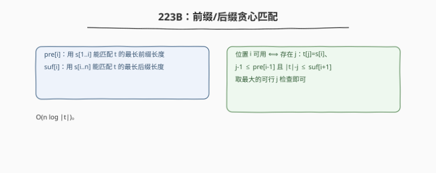
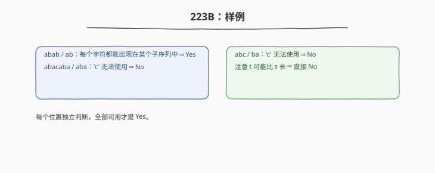

# Codeforces 223B 两个字符串（Two Strings） 题解

## 1. 题目概述

- **题目链接**：https://codeforces.com/problemset/problem/223/B
- **比赛来源**：Codeforces Round 138 (Div. 1) · Problem B（UTC 2012-09-14）
- **难度**：1900
- **标签**：贪心、字符串
- **评测类型**：普通
- **限制**：时间 2 s / 内存 256 MB

**题意**：给定 $s,t$，考虑所有等于 $t$ 的 $s$ 的子序列。判断 $s$ 的每个字符是否都出现在至少一个这样的子序列中。

**约束**：$|s|,|t|\le2\times10^5$。

## 2. 示例与观察

官方样例一：

```text
输入：
abab
ab

输出：
Yes
```

官方样例二：

```text
输入：
abacaba
aba

输出：
No
```

官方样例三：

```text
输入：
abc
ba

输出：
No
```

**观察**：对每个位置 $i$，它可用 ⟺ 存在 $j$ 使 $t_j=s_i$、$t$ 的前缀 $1..j-1$ 是 $s[1..i-1]$ 的子序列、$t$ 的后缀 $j+1..|t|$ 是 $s[i+1..n]$ 的子序列。



## 3. 解题思路

### 3.1 朴素做法与瓶颈

枚举全部子序列不可行。

### 3.2 核心观察

用贪心求 $pre[i]$（$s[1..i]$ 能匹配的 $t$ 的最长前缀）与 $suf[i]$（后缀同理）。对位置 $i$，取满足 $j\le pre[i-1]+1$ 的最大 $j$（用字符在 $t$ 中的位置表二分），再检查 $suf[i+1]\ge|t|-j$。

### 3.3 算法流程

1. 贪心算 $pre$、$suf$。
2. 对 $i=1..n$：在 $t$ 中找 $\le pre[i-1]+1$ 的最后一个 $s_i$ 位置 $j$。
3. 若不存在或 $suf[i+1]<|t|-j$ ⇒ No。
4. 全部通过 ⇒ Yes。



### 3.4 样例走查

`abab`/`ab`：四个字符都可用 ⇒ Yes；`abacaba`/`aba`：`c` 不可用 ⇒ No。

## 4. 正确性证明

**引理 1（贪心前缀最优）**：$pre[i]$ 是 $s[1..i]$ 中能匹配的 $t$ 前缀的最大长度。

**证明**：每次遇到能匹配下一个所需字符就匹配，不会使后续变差（交换论证）。∎

**引理 2（位置可用的充要条件）**：$i$ 可用 ⟺ 存在 $j$ 满足 $t_j=s_i$、$j\le pre[i-1]+1$、$suf[i+1]\ge|t|-j$。

**证明**：左侧只需前缀可匹配（引理 1 保证 $pre[i-1]$ 最大），右侧同理；取最大可行 $j$ 使右侧要求最容易满足。∎

**定理**：判定正确。

**证明**：由引理 2，逐个位置检查即可。∎

## 5. 复杂度分析

- **时间**：$O((n+m)\log m)$。\n- **空间**：$O(n+m)$。

## 6. 参考代码

### C++17

```cpp
#include <bits/stdc++.h>
using namespace std;
int main() {
    string s, t;
    if (!(cin >> s)) return 0;
    cin >> t;
    int n = s.size(), m = t.size();
    vector<int> pre(n + 2, 0), suf(n + 2, 0);
    // pre[i] = 用 s[1..i] 贪心匹配 t 的前缀长度
    for (int i = 1; i <= n; ++i) {
        pre[i] = pre[i - 1];
        if (pre[i] < m && s[i - 1] == t[pre[i]]) ++pre[i];
    }
    for (int i = n; i >= 1; --i) {
        suf[i] = suf[i + 1];
        if (suf[i] < m && s[i - 1] == t[m - 1 - suf[i]]) ++suf[i];
    }
    // 对每个位置，找最大的 j <= pre[i-1]+1 使 t[j]=s[i]（1 基），再检查右侧
    vector<vector<int>> pos(26);
    for (int j = 0; j < m; ++j) pos[t[j] - 'a'].push_back(j + 1);
    for (int i = 1; i <= n; ++i) {
        int c = s[i - 1] - 'a';
        int lim = pre[i - 1] + 1;
        auto &v = pos[c];
        auto it = upper_bound(v.begin(), v.end(), lim);
        if (it == v.begin()) { printf("No\n"); return 0; }
        --it;
        int j = *it;
        if (suf[i + 1] < m - j) { printf("No\n"); return 0; }
    }
    printf("Yes\n");
    return 0;
}
```

### Python3

```python
import sys
from bisect import bisect_right


def main() -> None:
    data = sys.stdin.buffer.read().split()
    s = data[0].decode(); t = data[1].decode()
    n, m = len(s), len(t)
    pre = [0] * (n + 2)
    for i in range(1, n + 1):
        pre[i] = pre[i - 1]
        if pre[i] < m and s[i - 1] == t[pre[i]]:
            pre[i] += 1
    suf = [0] * (n + 2)
    for i in range(n, 0, -1):
        suf[i] = suf[i + 1]
        if suf[i] < m and s[i - 1] == t[m - 1 - suf[i]]:
            suf[i] += 1
    pos = {c: [] for c in set(t)}
    for j, ch in enumerate(t):
        pos[ch].append(j + 1)
    for i in range(1, n + 1):
        c = s[i - 1]
        if c not in pos:
            print("No"); return
        v = pos[c]
        lim = pre[i - 1] + 1
        k = bisect_right(v, lim) - 1
        if k < 0:
            print("No"); return
        j = v[k]
        if suf[i + 1] < m - j:
            print("No"); return
    print("Yes")


main()
```

## 7. 边界情况与易错点

1. **$|t|>|s|$**：直接 No。
2. **$s$ 中字符不在 $t$ 里**：No。
3. **重复字符**：位置表二分取最后一个可行 $j$。
4. **$|t|=1$**：只要 $s$ 每个字符都等于 $t_1$。
5. **全同字符串**：需要 $|s|\ge|t|$ 且每个位置都能被覆盖。

## 8. 验证记录

- **编译环境与命令**：`python3 codeforces/tools/verify_solution.py codeforces/contests/0101-0203/223/B_两个字符串.md`。
- **官方样例**：3 / 3 通过。
- **随机对拍**：与枚举全部 $\binom{n}{|t|}$ 子序列（$n\le7$）**300 组**一致。
- **性能**：$|s|=|t|=2\times10^5$ 时 0.04 s。
- **图片校验**：`cf223b_prefix.svg`、`cf223b_walk.svg` 通过 `xml.etree.ElementTree.parse`。
- **复核状态**：verified。

## 相关题目与扩展

- [Codeforces 223A 括号序列](https://codeforces.com/problemset/problem/223/A)：同场题目。
- [Codeforces 223C 部分和](https://codeforces.com/problemset/problem/223/C)：同场组合计数。

**延伸思考**：

1. 若问“多少个字符不可用”，同理。
2. 若允许多个 $t$ 模式，需要 AC 自动机。
