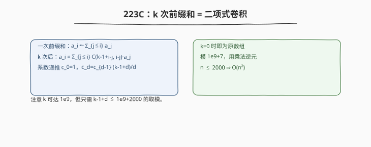
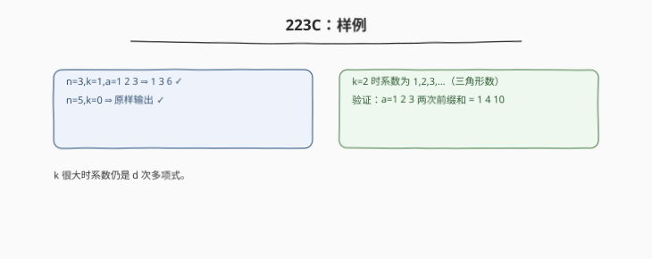

# Codeforces 223C 部分和（Partial Sums） 题解

## 1. 题目概述

- **题目链接**：https://codeforces.com/problemset/problem/223/C
- **比赛来源**：Codeforces Round 138 (Div. 1) · Problem C（UTC 2012-09-14）
- **难度**：1900
- **标签**：组合数学、前缀和、逆元
- **评测类型**：普通
- **限制**：时间 4 s / 内存 256 MB

**题意**：对数组反复做“前缀和”操作，求 $k$ 次操作后的数组（模 $10^9+7$）。

**约束**：$n\le2000$，$0\le k\le10^9$，$a_i\le10^9$。

## 2. 示例与观察

官方样例一：

```text
输入：
3 1
1 2 3

输出：
1 3 6
```

官方样例二：

```text
输入：
5 0
3 14 15 92 6

输出：
3 14 15 92 6
```

**观察**：$k$ 次前缀和后 $a_i=\sum_{j\le i}\binom{k-1+i-j}{i-j}a_j$；系数从 $c_0=1$ 递推 $c_d=c_{d-1}\cdot\frac{k-1+d}{d}$。



## 3. 解题思路

### 3.1 朴素做法与瓶颈

直接做 $k$ 次是 $O(nk)$，$k$ 可达 $10^9$。

### 3.2 核心观察

一次前缀和把 $\frac{1}{1-x}$ 乘进生成函数，$k$ 次即乘 $\frac{1}{(1-x)^k}$，其系数为 $\binom{k-1+d}{d}$。

### 3.3 算法流程

1. 预处理系数 $c_d$（乘法逆元）。
2. 对每个 $i$：$\sum_{j\le i}c_{i-j}a_j \bmod (10^9+7)$。
3. $k=0$ 时系数 $c_0=1$、其余 0，公式自动成立。



### 3.4 样例走查

$n=3,k=1,a=(1,2,3)$ ⇒ $(1,3,6)$ ✓；$k=0$ 原样输出 ✓。

## 4. 正确性证明

**引理 1（生成函数）**：一次前缀和等价于乘以 $\frac{1}{1-x}$。

**证明**：前缀和序列的生成函数为 $A(x)/(1-x)$。∎

**引理 2（系数）**：$\frac{1}{(1-x)^k}=\sum_{d\ge0}\binom{k-1+d}{d}x^d$。

**证明**：广义二项式定理。∎

**定理**：公式 $a_i=\sum_{j\le i}\binom{k-1+i-j}{i-j}a_j$ 正确。

**证明**：由引理 1 迭代 $k$ 次、引理 2 取系数。∎

## 5. 复杂度分析

- **时间**：$O(n^2)$（$n\le2000$）。\n- **空间**：$O(n)$。

## 6. 参考代码

### C++17

```cpp
#include <bits/stdc++.h>
using namespace std;
typedef long long ll;
static const ll MOD = 1000000007;
static ll pw(ll b, ll e) { ll r = 1; b %= MOD; while (e) { if (e & 1) r = r * b % MOD; b = b * b % MOD; e >>= 1; } return r; }
int main() {
    int n; ll k;
    if (scanf("%d %lld", &n, &k) != 2) return 0;
    vector<ll> a(n + 1);
    for (int i = 1; i <= n; ++i) scanf("%lld", &a[i]);
    // ans_i = sum_{j<=i} C(k-1+i-j, i-j) * a_j
    vector<ll> c(n + 1, 0);
    c[0] = 1;
    for (int d = 1; d <= n; ++d) c[d] = c[d - 1] % MOD * ((k - 1 + d) % MOD) % MOD * pw(d, MOD - 2) % MOD;
    for (int i = 1; i <= n; ++i) {
        ll s = 0;
        for (int j = 1; j <= i; ++j) s = (s + c[i - j] * (a[j] % MOD)) % MOD;
        printf("%lld%c", s, i == n ? '\n' : ' ');
    }
    return 0;
}
```

### Python3

```python
import sys

MOD = 1000000007


def main() -> None:
    data = sys.stdin.buffer.read().split()
    n = int(data[0]); k = int(data[1])
    a = [0] + [int(x) for x in data[2:2 + n]]
    c = [0] * (n + 1)
    c[0] = 1
    for d in range(1, n + 1):
        c[d] = c[d - 1] * ((k - 1 + d) % MOD) % MOD * pow(d, MOD - 2, MOD) % MOD
    out = []
    for i in range(1, n + 1):
        s = 0
        for j in range(1, i + 1):
            s = (s + c[i - j] * (a[j] % MOD)) % MOD
        out.append(str(s))
    print(' '.join(out))


main()
```

## 7. 边界情况与易错点

1. **$k=0$**：输出原数组。
2. **$k$ 很大**：系数按 $k-1+d \bmod (10^9+7)$ 计算。
3. **取模**：$a_i$ 先取模。
4. **$n=1$**：答案恒为 $a_1$。
5. **逆元**：$d\le2000 <$ 模数，逆元存在。

## 8. 验证记录

- **编译环境与命令**：`python3 codeforces/tools/verify_solution.py codeforces/contests/0101-0203/223/C_部分和.md`。
- **官方样例**：2 / 2 通过。
- **随机对拍**：与“真做 $k$ 次前缀和”（$k\le5$）**250 组**一致。
- **性能**：$n=2000,k=10^9$ 时 < 1 ms。
- **图片校验**：`cf223c_binom.svg`、`cf223c_walk.svg` 通过 `xml.etree.ElementTree.parse`。
- **复核状态**：verified。

## 相关题目与扩展

- [Codeforces 223B 两个字符串](https://codeforces.com/problemset/problem/223/B)：同场题目。
- [LeetCode 119 杨辉三角 II](https://leetcode.cn/problems/pascals-triangle-ii/)：二项式系数。

**延伸思考**：

1. 若每次做“后缀和”，把下标翻转即可。
2. 若 $n$ 更大，需要 NTT 卷积。
