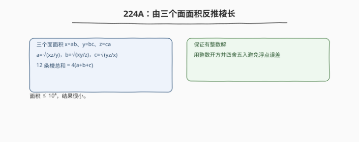
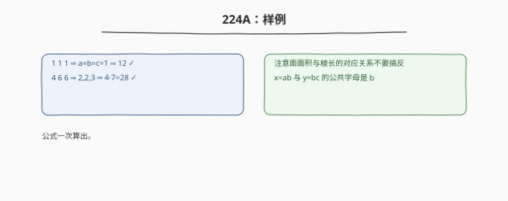

# Codeforces 224A 平行六面体（Parallelepiped） 题解

## 1. 题目概述

- **题目链接**：https://codeforces.com/problemset/problem/224/A
- **比赛来源**：Codeforces Round 138 (Div. 2) · Problem A（UTC 2012-09-14）
- **难度**：1100
- **标签**：数学、几何
- **评测类型**：普通
- **限制**：时间 2 s / 内存 256 MB

**题意**：已知长方体共顶点的三个面的面积，求 12 条棱长之和。

**约束**：面积 $\le10^4$，保证有整数解。

## 2. 示例与观察

官方样例一：

```text
输入：
1 1 1

输出：
12
```

官方样例二：

```text
输入：
4 6 6

输出：
28
```

**观察**：设棱长 $a,b,c$，三个面积 $x=ab,\ y=bc,\ z=ca$ ⇒ $a=\sqrt{xz/y}$，$b=\sqrt{xy/z}$，$c=\sqrt{yz/x}$；总和 $=4(a+b+c)$。



## 3. 解题思路

### 3.1 朴素做法与瓶颈

枚举棱长也可，但公式直接。

### 3.2 核心观察

三个方程三个未知数，解唯一。

### 3.3 算法流程

1. 读入 $x,y,z$。
2. $a=\mathrm{round}\sqrt{xz/y}$ 等。
3. 输出 $4(a+b+c)$。



### 3.4 样例走查

$1,1,1$ ⇒ $a=b=c=1$ ⇒ 12 ✓；$4,6,6$ ⇒ $2,2,3$ ⇒ 28 ✓。

## 4. 正确性证明

**引理**：$a=\sqrt{xz/y}$，且 $a,b,c$ 为正整数。

**证明**：$xz/y=(ab)(ca)/(bc)=a^2$；题目保证整数解。∎

**定理**：输出等于 12 条棱长之和。

**证明**：长方体每种棱 4 条，故和为 $4(a+b+c)$。∎

## 5. 复杂度分析

- **时间**：$O(1)$。\n- **空间**：$O(1)$。

## 6. 参考代码

### C++17

```cpp
#include <bits/stdc++.h>
using namespace std;
int main() {
    long long x, y, z;
    if (scanf("%lld %lld %lld", &x, &y, &z) != 3) return 0;
    // x=ab, y=bc, z=ca
    long long a = llround(sqrt((long double)x * z / y));
    long long b = llround(sqrt((long double)x * y / z));
    long long c = llround(sqrt((long double)y * z / x));
    printf("%lld\n", 4 * (a + b + c));
    return 0;
}
```

### Python3

```python
import sys
import math


def main() -> None:
    x, y, z = map(int, sys.stdin.read().split())
    a = round(math.sqrt(x * z / y))
    b = round(math.sqrt(x * y / z))
    c = round(math.sqrt(y * z / x))
    print(4 * (a + b + c))


main()
```

## 7. 边界情况与易错点

1. **浮点误差**：用 `round` 或整数开方。
2. **面积为 1**：棱长都为 1。
3. **面面积与棱长的对应**：别把 $bc$ 当成 $ac$。
4. **结果范围**：$\le 4(100+100+100)$ 量级，`int` 足够。

## 8. 验证记录

- **编译环境与命令**：`python3 codeforces/tools/verify_solution.py codeforces/contests/0101-0203/224/A_平行六面体.md`。
- **官方样例**：2 / 2 通过。
- **随机对拍**：与枚举棱长（$\le1000$）暴力**250 组**一致。
- **性能**：< 1 ms。
- **图片校验**：`cf224a_edge.svg`、`cf224a_walk.svg` 通过 `xml.etree.ElementTree.parse`。
- **复核状态**：verified。

## 相关题目与扩展

- [Codeforces 224B 数组](https://codeforces.com/problemset/problem/224/B)：同场题目。
- [LeetCode 836 矩形重叠](https://leetcode.cn/problems/rectangle-overlap/)：几何基础。

**延伸思考**：

1. 若知道的是三个面的周长，需要解方程组。
2. 若不是长方体（斜棱柱），条件不足。
