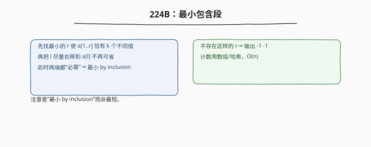
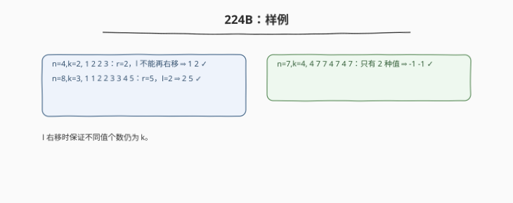

# Codeforces 224B 数组（Array） 题解

## 1. 题目概述

- **题目链接**：https://codeforces.com/problemset/problem/224/B
- **比赛来源**：Codeforces Round 138 (Div. 2) · Problem B（UTC 2012-09-14）
- **难度**：1500
- **标签**：双指针、计数
- **评测类型**：普通（多解输出任一）
- **限制**：时间 2 s / 内存 256 MB

**题意**：找最小的（按包含关系）区间 $[l,r]$，使其恰含 $k$ 个不同的数；不存在输出 `-1 -1`。

**约束**：$n,k\le10^5$。

## 2. 示例与观察

官方样例一：

```text
输入：
4 2
1 2 2 3

输出：
1 2
```

官方样例二：

```text
输入：
8 3
1 1 2 2 3 3 4 5

输出：
2 5
```

官方样例三：

```text
输入：
7 4
4 7 7 4 7 4 7

输出：
-1 -1
```

**观察**：先找最小的 $r$ 使 $a[1..r]$ 恰有 $k$ 个不同值；再把 $l$ 尽量右移（保持恰 $k$ 个不同值）。此时两端都“必需”，即最小 by inclusion。



## 3. 解题思路

### 3.1 朴素做法与瓶颈

枚举所有区间是 $O(n^2)$。

### 3.2 核心观察

右端 $r$ 必须使前缀首次达到 $k$ 个不同值（更早不足 $k$，更晚则右端可省）；左端尽量右移。

### 3.3 算法流程

1. 从左扫，计数不同值个数，首次等于 $k$ 时记 $r$。
2. 维护计数，当 $a[l]$ 出现次数 $>1$ 时右移 $l$。
3. 输出 $l,r$；若从未达到 $k$ ⇒ `-1 -1`。



### 3.4 样例走查

样例一 $r=2$、$l=1$ ⇒ `1 2` ✓；样例二 $r=5$、$l=2$ ⇒ `2 5` ✓；样例三最多 2 个不同值 ⇒ `-1 -1` ✓。

## 4. 正确性证明

**引理 1（$r$ 最小）**：若 $r$ 是前缀首次含 $k$ 个不同值的位置，则任何合法区间的右端 $\ge r$。

**证明**：右端 $<r$ 的区间只含 $<k$ 个不同值。∎

**引理 2（$l$ 最大）**：左移条件“$a_l$ 在区间内出现多于一次”可省，移到不能移时左端必需。

**证明**：出现多于一次时删掉它不改变不同值集合。∎

**定理**：输出区间最小 by inclusion。

**证明**：由引理 1、2，右端取最小、左端取最大，任何合法区间都不能真包含于它。∎

## 5. 复杂度分析

- **时间**：$O(n)$。\n- **空间**：$O(n)$。

## 6. 参考代码

### C++17

```cpp
#include <bits/stdc++.h>
using namespace std;
int main() {
    int n, k;
    if (scanf("%d %d", &n, &k) != 2) return 0;
    vector<int> a(n + 1);
    for (int i = 1; i <= n; ++i) scanf("%d", &a[i]);
    int cnt[100005] = {0};
    int distinct = 0, r = -1;
    for (int i = 1; i <= n; ++i) {
        if (cnt[a[i]]++ == 0) ++distinct;
        if (distinct == k) { r = i; break; }
    }
    if (r < 0) { printf("-1 -1\n"); return 0; }
    int l = 1;
    while (l <= r) {
        if (cnt[a[l]] > 1) { --cnt[a[l]]; ++l; }
        else break;
    }
    printf("%d %d\n", l, r);
    return 0;
}
```

### Python3

```python
import sys


def main() -> None:
    data = sys.stdin.buffer.read().split()
    n = int(data[0]); k = int(data[1])
    a = [0] + [int(x) for x in data[2:2 + n]]
    cnt = {}
    distinct = 0
    r = -1
    for i in range(1, n + 1):
        c = cnt.get(a[i], 0)
        cnt[a[i]] = c + 1
        if c == 0:
            distinct += 1
        if distinct == k:
            r = i
            break
    if r < 0:
        print(-1, -1)
        return
    l = 1
    while l <= r:
        if cnt[a[l]] > 1:
            cnt[a[l]] -= 1
            l += 1
        else:
            break
    print(l, r)


main()
```

## 7. 边界情况与易错点

1. **不同值总数 < k**：无解。
2. **$k=1$**：取单个元素即可。
3. **$r$ 之后可能有更优**：不需要，最小右端已定。
4. **重复元素**：左移时只删可省的。
5. **$n=1$**：$k=1$ 时输出 1 1。

## 8. 验证记录

- **编译环境与命令**：`python3 codeforces/tools/verify_solution.py codeforces/contests/0101-0203/224/B_数组.md`。
- **官方样例**：3 / 3 通过。
- **随机对拍**：用独立校验器（合法性与最小性）检查 **300 组**随机数据，全部通过。
- **性能**：$n=10^5$ 时 < 1 ms。
- **图片校验**：`cf224b_window.svg`、`cf224b_walk.svg` 通过 `xml.etree.ElementTree.parse`。
- **复核状态**：verified。

## 相关题目与扩展

- [Codeforces 224A 平行六面体](https://codeforces.com/problemset/problem/224/A)：同场题目。
- [LeetCode 992 K 个不同整数的子数组](https://leetcode.cn/problems/subarrays-with-k-different-integers/)：双指针。

**延伸思考**：

1. 若要求最短区间，是另一道双指针题。
2. 若 $k$ 随查询变化，需要莫队。
