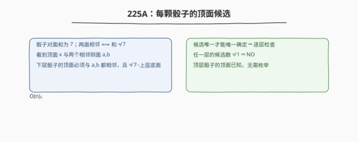
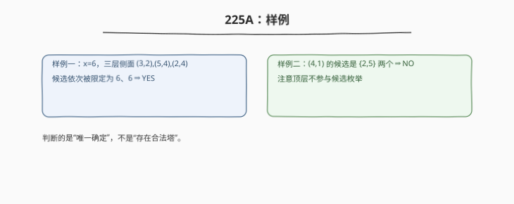

# Codeforces 225A 骰子塔（Dice Tower） 题解

## 1. 题目概述

- **题目链接**：https://codeforces.com/problemset/problem/225/A
- **比赛来源**：Codeforces Round 139 (Div. 2) · Problem A（UTC 2012-09-21）
- **难度**：1100
- **标签**：模拟、枚举
- **评测类型**：普通
- **限制**：时间 2 s / 内存 256 MB

**题意**：骰子对面数字和为 7。用 $n$ 颗骰子叠成塔，相邻骰子的接触面数字不同。Bob 看到塔顶数字 $x$ 以及每颗骰子两个相邻侧面的数字 $(a_i,b_i)$。判断能否唯一确定整座塔。

**约束**：$n\le100$，$1\le a_i,b_i\le6$，$a_i\ne b_i$。

## 2. 示例与观察

官方样例一：

```text
输入：
3
6
3 2
5 4
2 4

输出：
YES
```

官方样例二：

```text
输入：
3
3
2 6
4 1
5 3

输出：
NO
```

**观察**：某颗骰子顶面为 $t$ 时，可见的两个侧面必须与 $t$ 相邻（即不等于 $t$ 与 $7-t$）；反过来，与 $a_i,b_i$ 都相邻的面都是 $"t"$ 的候选。再加上“顶面 ≠ 上一颗的底面 $7-t_{\text{prev}}$”。



## 3. 解题思路

### 3.1 朴素做法与瓶颈

枚举所有骰子朝向是 $24^n$。

### 3.2 核心观察

顶层骰子的顶面已知 ⇒ 无需枚举；自第二颗起，顶面候选唯一才能唯一确定；候选数 ≠ 1 即 NO。

### 3.3 算法流程

1. $t=x$；对 $i=1..n$：若 $i>1$，枚举 $c\in1..6$ 满足 $c\ne a_i,\ c\ne b_i,\ c\ne 7-a_i,\ c\ne 7-b_i,\ c\ne 7-t$。
2. 若候选数 ≠ 1 ⇒ NO。
3. 否则 $t\leftarrow c$；全部通过 ⇒ YES。



### 3.4 样例走查

样例一：第二、三颗候选都被限定为 6 ⇒ YES；样例二：第二颗候选为 $\{2,5\}$ ⇒ NO。

## 4. 正确性证明

**引理 1（相邻性）**：骰子两个面相邻 ⟺ 它们的数字不同且和不为 7。

**证明**：对面数字和为 7，故非对面的不同面必相邻。∎

**引理 2（唯一性判据）**：整座塔唯一确定 ⟺ 每颗（除顶层的）骰子顶面候选唯一。

**证明**：给定顶面与两个相邻侧面，骰子朝向唯一；顶层顶面已知。∎

**定理**：算法判定正确。

**证明**：由引理 1、2，逐层候选筛选恰好刻画唯一性。∎

## 5. 复杂度分析

- **时间**：$O(n)$。\n- **空间**：$O(1)$。

## 6. 参考代码

### C++17

```cpp
#include <bits/stdc++.h>
using namespace std;
int main() {
    int n, x;
    if (scanf("%d %d", &n, &x) != 2) return 0;
    vector<int> a(n), b(n);
    for (int i = 0; i < n; ++i) scanf("%d %d", &a[i], &b[i]);
    int t = x;
    for (int i = 0; i < n; ++i) {
        if (i == 0) continue;                 // 顶层骰子的顶面已知
        int cands = 0, pick = -1;
        for (int c = 1; c <= 6; ++c) {
            if (c == a[i] || c == b[i] || c == 7 - a[i] || c == 7 - b[i]) continue;   // 必须与两个可见面相邻
            if (i > 0 && c == 7 - t) continue;                                        // 与上一颗骰子的接触面不同
            ++cands; pick = c;
        }
        if (cands != 1) { printf("NO\n"); return 0; }
        t = pick;
    }
    printf("YES\n");
    return 0;
}
```

### Python3

```python
import sys


def main() -> None:
    data = sys.stdin.buffer.read().split()
    n = int(data[0]); x = int(data[1])
    p = 2
    pairs = []
    for _ in range(n):
        pairs.append((int(data[p]), int(data[p + 1]))); p += 2
    t = x
    for i, (a, b) in enumerate(pairs):
        if i == 0:
            continue
        cands = []
        for c in range(1, 7):
            if c in (a, b, 7 - a, 7 - b):
                continue
            if i > 0 and c == 7 - t:
                continue
            cands.append(c)
        if len(cands) != 1:
            print("NO")
            return
        t = cands[0]
    print("YES")


main()
```

## 7. 边界情况与易错点

1. **顶层骰子**：顶面已知，不参与候选枚举（否则会误判 NO）。
2. **接触约束**：顶面必须 ≠ 上一颗底面 $7-t$。
3. **候选为空**：说明输入不自洽，输出 NO。
4. **$n=1$**：恒为 YES。
5. **两个可见面不是相邻面**：候选为空 ⇒ NO。

## 8. 验证记录

- **编译环境与命令**：`python3 codeforces/tools/verify_solution.py codeforces/contests/0101-0203/225/A_骰子塔.md`。
- **官方样例**：2 / 2 通过。
- **随机对拍**：与枚举 $6^n$ 种顶面组合的暴力（$n\le3$）**300 组**一致。
- **性能**：$n=100$ 时 < 1 ms。
- **图片校验**：`cf225a_dice.svg`、`cf225a_walk.svg` 通过 `xml.etree.ElementTree.parse`。
- **复核状态**：verified。

## 相关题目与扩展

- [Codeforces 225B 著名数字](https://codeforces.com/problemset/problem/225/B)：同场题目。
- [LeetCode 1222 可以攻击国王的皇后](https://leetcode.cn/problems/queens-that-can-attack-the-king/)：方向枚举。

**延伸思考**：

1. 若骰子有两种手性，候选可能翻倍。
2. 若还看到底面，唯一性更容易。
