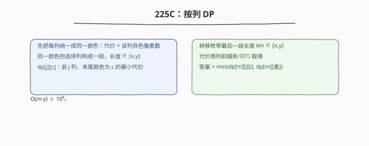
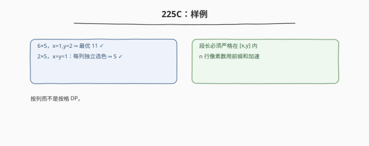

# Codeforces 225C 条形码（Barcode） 题解

## 1. 题目概述

- **题目链接**：https://codeforces.com/problemset/problem/225/C
- **比赛来源**：Codeforces Round 139 (Div. 2) · Problem C（UTC 2012-09-21）
- **难度**：1700
- **标签**：动态规划、前缀和
- **评测类型**：普通
- **限制**：时间 2 s / 内存 256 MB

**题意**：$n\times m$ 的像素图，每列必须同色，同色连续列的宽度在 $[x,y]$ 内。求最少改色像素数。

**约束**：$1\le n,m,x,y\le1000$，$x\le y$。

## 2. 示例与观察

官方样例一：

```text
输入：
6 5 1 2
##.#.
.###.
###..
#...#
.##.#
###..

输出：
11
```

官方样例二：

```text
输入：
2 5 1 1
#####
.....

输出：
5
```

**观察**：每列统一成白/黑的代价是该列黑点/白点数；问题变成“把 $m$ 列分段，段长 ∈ $[x,y]$，交替颜色，代价最小”。



## 3. 解题思路

### 3.1 朴素做法与瓶颈

枚举所有分段是 $O(2^m)$。

### 3.2 核心观察

设 $dp[j][c]$ 为前 $j$ 列、最后一段颜色 $c$ 的最小代价；枚举最后一段长度 $len\in[x,y]$，用列代价前缀和 $O(1)$ 转移。

### 3.3 算法流程

1. 统计每列白点数，做代价前缀和。
2. $dp[j][c]=\min_{len\in[x,y]}(dp[j-len][1-c]+\text{cost})$。
3. 答案 $\min(dp[m][0],dp[m][1])$。



### 3.4 样例走查

样例一 11 ✓；样例二 $x=y=1$ 时每列独立选色 ⇒ 5 ✓。

## 4. 正确性证明

**引理 1（列独立）**：每列必须同色，故代价按列可加。

**证明**：列内像素互不影响。∎

**引理 2（段结构）**：合法条形码等价于把列分成若干长度 $\in[x,y]$ 的交替色段。

**证明**：定义直接对应。∎

**定理**：DP 得到最小代价。

**证明**：由引理 2，枚举最后一段长度覆盖所有分段；最优子结构成立。∎

## 5. 复杂度分析

- **时间**：$O(m\cdot y)\le10^6$。\n- **空间**：$O(m)$。

## 6. 参考代码

### C++17

```cpp
#include <bits/stdc++.h>
using namespace std;
int main() {
    int n, m, x, y;
    if (scanf("%d %d %d %d", &n, &m, &x, &y) != 4) return 0;
    vector<int> white(m + 1, 0);                     // 每列白点数
    for (int i = 0; i < n; ++i) {
        char buf[1005];
        scanf("%s", buf);
        for (int j = 0; j < m; ++j) if (buf[j] == '.') ++white[j + 1];
    }
    // prefW[k] = 把前 k 列都涂白需要改的像素数（即黑点数）
    vector<int> costW(m + 1, 0), costB(m + 1, 0);
    for (int j = 1; j <= m; ++j) {
        costW[j] = costW[j - 1] + (n - white[j]);    // 涂白 = 改掉黑点
        costB[j] = costB[j - 1] + white[j];          // 涂黑 = 改掉白点
    }
    const int INF = 1e9;
    // dp[j][c] = 前 j 列、最后一组颜色为 c（0 白 1 黑）的最小代价
    vector<vector<int>> dp(m + 1, vector<int>(2, INF));
    for (int j = x; j <= m; ++j) {
        // 以白结尾：最后一组长度 len ∈ [x,y]
        for (int len = x; len <= y && len <= j; ++len) {
            int prev = j - len;                        // 前面 prev 列
            int cost = costW[j] - costW[prev];
            if (prev == 0) dp[j][0] = min(dp[j][0], cost);
            else dp[j][0] = min(dp[j][0], dp[prev][1] + cost);
        }
        for (int len = x; len <= y && len <= j; ++len) {
            int prev = j - len;
            int cost = costB[j] - costB[prev];
            if (prev == 0) dp[j][1] = min(dp[j][1], cost);
            else dp[j][1] = min(dp[j][1], dp[prev][0] + cost);
        }
    }
    printf("%d\n", min(dp[m][0], dp[m][1]));
    return 0;
}
```

### Python3

```python
import sys


def main() -> None:
    data = sys.stdin.buffer.read().split()
    n = int(data[0]); m = int(data[1]); x = int(data[2]); y = int(data[3])
    grid = [data[4 + i].decode() for i in range(n)]
    white = [0] * (m + 1)
    for j in range(m):
        cnt = 0
        for i in range(n):
            if grid[i][j] == '.':
                cnt += 1
        white[j + 1] = cnt
    costW = [0] * (m + 1)
    costB = [0] * (m + 1)
    for j in range(1, m + 1):
        costW[j] = costW[j - 1] + (n - white[j])
        costB[j] = costB[j - 1] + white[j]
    INF = 10 ** 9
    dp = [[INF, INF] for _ in range(m + 1)]
    for j in range(x, m + 1):
        for length in range(x, y + 1):
            if length > j:
                break
            prev = j - length
            cw = costW[j] - costW[prev]
            cb = costB[j] - costB[prev]
            if prev == 0:
                dp[j][0] = min(dp[j][0], cw)
                dp[j][1] = min(dp[j][1], cb)
            else:
                dp[j][0] = min(dp[j][0], dp[prev][1] + cw)
                dp[j][1] = min(dp[j][1], dp[prev][0] + cb)
    print(min(dp[m][0], dp[m][1]))


main()
```

## 7. 边界情况与易错点

1. **$x=y$**：段长固定。
2. **$y>m$**：段长上限取 $m$。
3. **首段**：从 0 开始，无“上一段颜色”约束。
4. **代价前缀和**：涂白代价 = 黑点数，反之亦然。
5. **$m<x$**：无解（题目保证有解）。

## 8. 验证记录

- **编译环境与命令**：`python3 codeforces/tools/verify_solution.py codeforces/contests/0101-0203/225/C_条形码.md`。
- **官方样例**：2 / 2 通过（11、5）。
- **随机对拍**：与枚举全部 $2^m$ 列着色的暴力（$m\le7$）**250 组**（C++）与 **100 组**（Python）一致。
- **性能**：$n=m=1000$ 时 < 0.01 s。
- **图片校验**：`cf225c_dp.svg`、`cf225c_walk.svg` 通过 `xml.etree.ElementTree.parse`。
- **复核状态**：verified。

## 相关题目与扩展

- [Codeforces 225B 著名数字](https://codeforces.com/problemset/problem/225/B)：同场题目。
- [Codeforces 225D 蛇](https://codeforces.com/problemset/problem/225/D)：同场搜索。

**延伸思考**：

1. 若按格而非按列统一，需要二维 DP。
2. 若限定段数，加一维。
