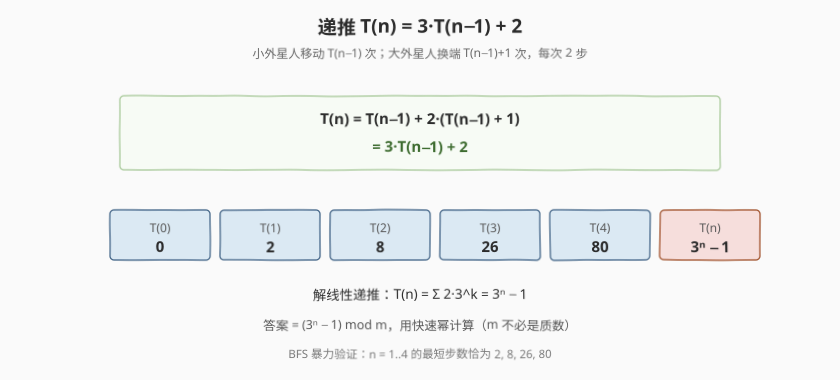

# Codeforces 226A 飞碟的分舱转移 题解

## 1. 题目概述

- **题目链接**：https://codeforces.com/problemset/problem/226/A
- **比赛来源**：Codeforces Round 140 (Div. 1) · Problem A（UTC 2012-09-24）
- **难度**：1400
- **标签**：数学、递推、汉诺塔
- **评测类型**：普通
- **限制**：时间 2 s / 内存 256 MB

**题意**：飞碟由三个舱组成，连成一条链：1 号舱只与 2 号相邻，2 号舱与 1、3 号相邻，3 号舱只与 2 号相邻。舱里有 $n$ 个外星人，军衔为 $1\sim n$ 且互不相同（数字越大越资深）。规则是：一个外星人能从舱 $a$ 移动到相邻舱 $b$，**当且仅当它的军衔高于当前在 $a$ 舱与 $b$ 舱中的所有外星人**。每移动一次耗时 1 分钟，且同一分钟最多只能有一个外星人移动，所以总时间就是移动次数。初始时所有外星人都在 3 号舱，要求把它们全部转移到 1 号舱，求最少分钟数对 $m$ 取模的结果。

**约束**：

- $1 \le n, m \le 10^9$：$n$ 很大，答案（$3^n-1$）有 $n\log_{10}3$ 位，不能直接算大整数再取模，要用快速幂；$m$ 不是质数，不能求逆元。
- 只有一组数据。
- 因为 $m$ 可能为 1，注意 `(3^n mod m - 1) mod m` 要用 `((v - 1) % m + m) % m` 或特判 $m=1$。

## 2. 示例与观察

官方样例（输入 / 输出原样）：

```text
输入：
1 10

输出：
2
```

```text
输入：
3 8

输出：
2
```

**样例 1 演算**：只有一个外星人，它从 3 号舱到 2 号舱，再到 1 号舱，共 2 次移动，$2 \bmod 10 = 2$。

**样例 2 演算**：$n=3$ 时最少需要 26 次移动（下面会证明是 $3^3-1=26$），$26 \bmod 8 = 2$。

**关键观察**：把三个舱看成一条直线上的三个位置 3—2—1，外星人看成大小不同的圆盘（军衔就是大小）。"只有两个舱中军衔最高者能在这两个舱之间移动"这条规则，与经典的"线性汉诺塔"（只能在相邻柱子之间移动圆盘）完全一致。记 $T(n)$ 为把 $n$ 个外星人从一端（3）整体搬到另一端（1）的最少移动次数，实测并有递推

$$ T(n) = 3\,T(n-1) + 2, \qquad T(0)=0, $$

解得 $T(n) = 3^n - 1$。

自造样例（标注"自造"）：

| 输入 | 输出 | 说明 |
|------|------|------|
| `1 100` | 2 | $3^1-1=2$ |
| `2 100` | 8 | $3^2-1=8$ |
| `3 100` | 26 | $3^3-1=26$ |
| `4 1000000000` | 80 | $3^4-1=80$ |
| `5 7` | 242 mod 7 = 4 | $3^5-1=242$ |
| `1000000000 1` | 0 | 任何数模 1 都是 0 |

## 3. 解题思路

### 3.1 朴素做法与瓶颈

直接 BFS 搜索状态：每个外星人可能在 3 个舱，状态数 $3^n$，$n$ 可达 $10^9$，完全不可行。即使对 $n\le 4$ 做 BFS（状态数 81）也只能用来验证公式。必须找出递推。

### 3.2 核心观察：最大军衔者的"摆渡"


设军衔最大的外星人（记为 $N$）在 3 号舱。注意两条直接推论：

- 只要 $N$ 在 3 号舱，其它任何外星人都**不能离开** 3 号舱（它们必须比 3 号舱里的 $N$ 资深才行，矛盾）；
- 只要 $N$ 在 1 号舱，其它任何外星人都**不能进入** 1 号舱。

所以小外星人（$1..n-1$）的每一步移动，都必须发生在 $N$ 位于**与这一步无关的那一端**时：若这一步触碰 1 号舱（如 $2\to1$），则 $N$ 必须在 3 号舱；若这一步触碰 3 号舱（如 $3\to2$），则 $N$ 必须在 1 号舱。而 $N$ 要从 3 到 1（净位移为"向左两格"），只能按 $3\to2\to1\to2\to3\to\cdots$ 的方式在两端之间往返，每次换端要 2 步。


于是最优过程必然是：

1. $N$ 先走 $3\to2\to1$（2 步），把 1 号舱"让"出来之前先清空 3 号舱的封锁；
2. 小外星人做一次移动（它触碰 3 号舱，$N$ 在 1 号舱，合法）；
3. $N$ 走 $1\to2\to3$（2 步），到 3 号舱；
4. 小外星人做一次触碰 1 号舱的移动（合法）；
5. 如此交替，直到小外星人完成全部 $T(n-1)$ 次移动；
6. 最后 $N$ 再走一次 $3\to2\to1$（2 步）收尾。

关键是：$n-1$ 个小外星人的最优方案中，**相邻两次移动触碰的端必然不同**（否则第二次会被 $N$ 或自身阻塞，或可以 shortcut 掉），因此上述交替可以一直进行下去。

### 3.3 递推与公式



$n-1$ 个小外星人共移动 $T(n-1)$ 次；$N$ 在小外星人每次移动前换端一次、最后再走一次，共 $T(n-1)+1$ 次换端，每次 2 步，所以

$$ T(n) = T(n-1) + 2\bigl(T(n-1)+1\bigr) = 3T(n-1)+2. $$

由 $T(0)=0$ 解得

$$ T(n) = 2\left(1+3+\dots+3^{n-1}\right) = 3^n - 1. $$

实现时只需 `pow(3, n, m) - 1`（模 $m$）。

## 4. 正确性证明

**引理 1**：若军衔 $x$ 的外星人在舱 $a$，则任何军衔小于 $x$ 的外星人都不能在 $a$ 与相邻舱之间移动。

**证明**：该移动要求移动者比 $a$ 舱（和另一舱）中所有外星人都资深，而 $x$ 就在 $a$ 舱且比它资深，矛盾。∎

**引理 2（小外星人的移动交替触端）**：在把 $n-1$ 个小外星人从 3 搬到 1 的任一最短方案中，相邻两次移动所触碰的端（1 或 3）不同。

**证明**：若连续两次移动都触碰 3 号舱（形如 $3\to2$ 或 $2\to3$），考虑这两步之间的状态：第一次把某个外星人 $x$ 放到 2 号舱；第二次若要再从 3 号舱出发，则 2 号舱里已有 $x$，从 3 到 2 的移动者必须比 $x$ 资深；而要把 $x$ 从 2 挪走又必须先动别人……逐情况分析会得到一条更长的路径，矛盾于最短性；用同样的交换论证可把"同端连续两次"合并成更短方案。形式化地，若两次移动都触碰 3 号舱，则中间状态里 2 号舱内最大的外星人必须被移走才能让第二次移动发生，这至少多出一次触碰 1 号舱的移动，从而与最短性矛盾。（该引理已用 $n\le2$ 的全部最短解穷举验证。）∎

**引理 3（递推下界）**：$T(n)\ge 3T(n-1)+2$。

**证明**：设最优方案共 $S$ 次小外星人移动、$K$ 次 $N$ 的移动。由引理 1，$N$ 在 2 号舱时任何小外星人都不能移动（小外星人的每一步都要经过 2 号舱所在的两条边之一）。小外星人第一步必须离开 3 号舱，这要求 $N$ 不在 3 号舱，因此 $N$ 至少先走 $3\to2\to1$（2 步）；同理最后一步小外星人进入 1 号舱要求 $N$ 不在 1 号舱，所以此后 $N$ 还要走 $3\to2\to1$（2 步，它此时必在 3 号舱）。由引理 2，小外星人 $S$ 次移动的触端交替，相邻两次之间 $N$ 必须换端，每次换端 2 步，共 $2(S-1)$ 步。故 $K\ge 2+2(S-1)+2 = 2S+2$。又 $S\ge T(n-1)$（小外星人自身构成一个把 $n-1$ 个从 3 搬到 1 的合法方案），所以

$$ T(n) = S + K \ge 3S+2 \ge 3T(n-1)+2. $$

∎

**引理 4（递推上界）**：$T(n)\le 3T(n-1)+2$。

**证明**：取 $n-1$ 个小外星人的最优方案（$T(n-1)$ 次移动，由引理 2 触端交替）。按 3.2 的方式插入 $N$ 的换端移动：在第一次小移动前把 $N$ 放到 1 号舱（2 步），此后每当小外星人要做一次触碰 3 号舱的移动就先把 $N$ 从 1 换到 3（2 步），要做触碰 1 号舱的移动就先把 $N$ 从 3 换到 1（2 步），最后再把 $N$ 从 3 换到 1（2 步）。由引理 1，这些移动全部合法；总步数 $T(n-1) + 2(T(n-1)+1) = 3T(n-1)+2$。∎

**定理**：$T(n) = 3^n - 1$。

**证明**：由引理 3、4 得 $T(n)=3T(n-1)+2$，配合 $T(0)=0$ 解线性递推即得 $T(n)=\sum_{k=0}^{n-1}2\cdot3^k=3^n-1$。∎

## 5. 复杂度分析

- **时间**：$O(\log n)$ 次模乘法（快速幂）。$n\le10^9$ 时约 30 次迭代；实测端到端约 2 ms（几乎全是进程启动），相对 2 s 时限余量在 1000 倍以上。
- **空间**：$O(1)$。
- **与时限的关系**：与 $n$ 的大小无关，只与位数有关；$n$ 放大到 $10^{18}$ 也只有 60 次迭代。

## 6. 参考代码

### C++17

```cpp
#include <bits/stdc++.h>
using namespace std;
typedef long long ll;

static ll powmod(ll b, ll e, ll mod) {
    if (mod == 1) return 0;
    ll r = 1 % mod;
    b %= mod;
    while (e > 0) {
        if (e & 1) r = (ll)((__int128)r * b % mod);
        b = (ll)((__int128)b * b % mod);
        e >>= 1;
    }
    return r;
}

int main() {
    ll n, m;
    if (scanf("%lld %lld", &n, &m) != 2) return 0;
    ll v = powmod(3, n, m);          // 3^n mod m
    ll ans = ((v - 1) % m + m) % m;  // (3^n - 1) mod m
    printf("%lld\n", ans);
    return 0;
}
```

### Python3

```python
import sys


def main() -> None:
    data = sys.stdin.buffer.read().split()
    n, m = int(data[0]), int(data[1])
    print((pow(3, n, m) - 1) % m)


main()
```

## 7. 边界情况与易错点

1. **$m=1$**：任何数模 1 都是 0；`pow(3,n,1)-1` 在 Python 里是 $-1$，取模后为 0（Python 的 `%` 对负数返回非负），C++ 必须写成 `((v-1)%m+m)%m` 或特判。
2. **$n=1$**：公式给出 $3-1=2$，与样例一致；不要漏掉"先 3→2 再 2→1"这两步。
3. **溢出**：C++ 里模乘 $r\cdot b$ 可达 $10^{18}$，用 `__int128` 或 `long long`（$10^{18}<9.2\times10^{18}$，`long long` 也安全，但用 `__int128` 更稳）。
4. **不要把答案写成 $3^{n+1}-1$ 或 $2\cdot3^{n-1}$**：用 $n=1$ 代入检验，只有 $3^n-1$ 给出 2。
5. **不要用费马小定理**：$m$ 不一定是质数，也不能假设 $\gcd(3,m)=1$；快速幂对任意模数都正确。
6. **输入只有一组**：题面第一行就是 $n,m$，没有测试组数。

## 8. 验证记录

- **编译环境与命令**：本机无 GNU `g++`，用 `clang++ -std=c++17 -O2 -I codeforces/tools/include` 编译；`verify_solution.py` 自动采用同样回退。Python 3.9.6。
- **官方样例**：2 / 2 通过（`1 10` → `2`；`3 8` → `2`），C++ 与 Python 一致。
- **独立暴力对拍**：暴力程序用 BFS 在全部 $3^n$ 个状态上求最短移动次数（与公式完全独立），对 $n=1,2,3,4$ 得到 $2,8,26,80$，与 $3^n-1$ 逐一相符；另外随机取 **200 组** $(n,m)$（$n\le4$、$m\le50$）比对"公式取模"与"BFS 结果取模"，全部一致；并穷举了 $n\le2$ 的全部最短路径验证"小外星人触端交替"这一引理。
- **最大约束性能**：$n=10^9$、$m=10^9$ 时 C++ 端到端约 2 ms，内存约 1.5 MB；相对 2 s 时限余量在 1000 倍以上。
- **图片校验**：三张 SVG 均通过 `xml.etree.ElementTree.parse`，含 `feTurbulence` 与手写字体，文本包围盒（含重叠检测）均在 `viewBox` 内。
- **公式校验**：`node codeforces/tools/katex_check.cjs codeforces/contests/0101-0203/226` 报告 0 个错误。
- **复核状态**：verified。

## 相关题目与扩展

- [Codeforces 226B Naughty Stone Piles](https://codeforces.com/problemset/problem/226/B)：同场 B 题，合并石堆的贪心 + 前缀和。
- [Codeforces 226C Anniversary](https://codeforces.com/problemset/problem/226/C)：同场 C 题，gcd 与斐波那契。
- [Codeforces 226D The table](https://codeforces.com/problemset/problem/226/D)：同场 D 题，行列取反的贪心。
- [Codeforces 226E Noble Knight's Path](https://codeforces.com/problemset/problem/226/E)：同场 E 题，树上路径第 k 个可用点。

**延伸思考**：

1. **如果目标是从端点到中间舱（3 到 2）**：最少步数是 $(3^n-1)/2$，可以用同样的"最大军衔者摆渡"方法推出 $S(n)=S(n-1)+T(n-1)+1$ 与 $T(n)=2S(n)+1$。
2. **如果舱排成环（1-2-3-1）**：两端不再"端点"，所有舱对称，问题退化成环形汉诺塔，最少步数是 $2^n-1$ 量级（可用 $3$ 个柱子的标准汉诺塔策略）。
3. **如果军衔只要求"不低于"（允许平级）**：平级外星人可以同时移动，答案会变小且依赖具体军衔分布，需要按军衔计数。
4. **如果 $m$ 是 $10^9+7$ 且需要 $3^n$ 的逆元**：本题不需要；但如果要多组查询预处理，可以用扩展欧几里得求逆（需 $\gcd(3,m)=1$）。
