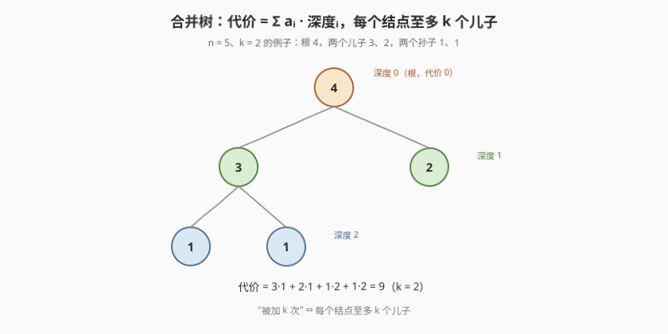
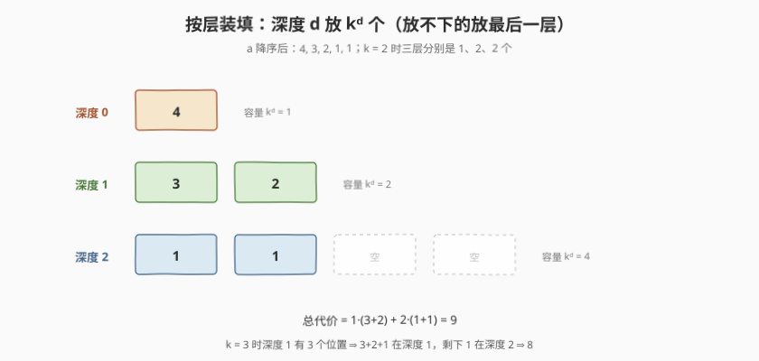

# Codeforces 226B 石堆合并的最小代价 题解

## 1. 题目概述

- **题目链接**：https://codeforces.com/problemset/problem/226/B
- **比赛来源**：Codeforces Round 140 (Div. 1) · Problem B（UTC 2012-09-24）
- **难度**：1900
- **标签**：贪心、排序、前缀和、树
- **评测类型**：普通
- **限制**：时间 2 s / 内存 256 MB

**题意**：桌上有 $n$ 堆石子，大小分别为 $a_1,\dots,a_n$。一次操作可以把一堆 $i$ 加到另一堆 $j$ 上：$j$ 的大小增加 $i$ 的**当前**大小，$i$ 消失，操作代价等于 $i$ 的当前大小。每个石堆最多允许被"加" $k$ 次（即作为接收方最多 $k$ 次），超过后它只能被加到别的堆上。给出 $q$ 个 $k$ 的询问，对每个询问求把所有石子合并成一堆的最小总代价。

**约束**：

- $n\le10^5$，$a_i\le10^9$，$q\le10^5$，$k\le10^5$。
- 总代价可达 $\sum a_i\cdot i$ 量级，最大约 $10^9\cdot\frac{10^5\cdot10^5}{2}=5\times10^{18}$，必须用 64 位整数（`long long`）；C++ 里不要用 `%lld` 读入（题面提醒），用 `cin` 即可。
- 只有一组数据、$q$ 个询问同行给出；$k_i$ 可能重复。

## 2. 示例与观察

官方样例（输入 / 输出原样）：

```text
输入：
5
2 3 4 1 1
2
2 3

输出：
9 8 
```

**样例演算**：

- $k=2$：先排序 $a=[4,3,2,1,1]$。把最大的一堆 $4$ 作为"根"（代价 0），第二、三大的 $3,2$ 直接加到根上（各付自身大小），最小的两个 $1,1$ 先各加到某个堆上再随它并入根（各付 $1$ 两次，即深度 2）。总代价 $3+2+2\cdot1+2\cdot1=9$。
- $k=3$：根为 $4$，$3,2,1$ 直接加到根上（深度 1），剩下一个 $1$ 深度 2：$3+2+1+2\cdot1=8$。

**关键观察**：把合并过程看成一棵**有根树**：每个初始石堆是一个结点，若把 $i$ 加到 $j$ 上，就让 $i$ 成为 $j$ 的儿子。一次操作把 $i$ 所在的整棵子树"抬"到 $j$ 上，代价 = 该子树内所有 $a$ 的和。因此总代价

$$ \sum_{\text{初始堆 } p} a_p \cdot \text{depth}(p), $$

其中深度是从根往下数的边数。而"每堆最多被加 $k$ 次"恰好意味着**每个结点最多有 $k$ 个儿子**。于是问题变成：构造一棵每个结点至多 $k$ 个儿子的有根树，最小化 $\sum a_p\cdot\text{depth}(p)$。

自造样例（标注"自造"）：

| 输入 | 输出 | 说明 |
|------|------|------|
| `1` / `5` / `1` / `1` | `0` | 只有一堆，不需要操作 |
| `2` / `7 3` / `2` / `1 2` | `3 3` | 小堆并入大堆，代价 3 |
| `3` / `1 1 1` / `2` / `1 3` | `3 2` | $k=1$ 时只能链式合并：$1+2\cdot1=3$ |
| `4` / `10 1 1 1` / `1` / `1` | `3` | 全部直接并入 10，代价 $1+1+1$ |

## 3. 解题思路

### 3.1 朴素做法与瓶颈

枚举合并顺序是 $(n-1)!$ 量级；即使对每个 $k$ 单独贪心也要 $O(n)$，$q=10^5$ 时 $10^{10}$ 不可行。必须找出每个询问的快速公式。

### 3.2 核心观察：深度分配



设最终合并树深度为 $d$ 的结点有 $c_d$ 个（根深度 0，$c_0=1$）。由"每点至多 $k$ 个儿子"得 $c_d\le k\cdot c_{d-1}$，归纳得 $c_d\le k^d$；反过来，只要满足 $c_d\le k\cdot c_{d-1}$，就能逐层构造出这样的树（第 $d$ 层的结点挂到第 $d-1$ 层的任意结点下，容量足够）。

在深度集合固定时，由重排不等式：把**最大的 $a$ 放到最浅的深度**最优（若 $a_i>a_j$ 而 $depth_i>depth_j$，交换两者可使总代价减少 $(a_i-a_j)(depth_i-depth_j)>0$）。所以把 $a$ 降序排序后，第 $0$ 个放根、接下来 $k$ 个放深度 1、再接下来 $k^2$ 个放深度 2……即按层"装填"。



于是对给定 $k$：把 $a$ 降序排序并做前缀和，第 $d$ 层（$d\ge1$）占据的下标区间是 $[\text{start},\text{end})$，其中 $\text{start}$ 从 1 开始、每层容量 $k^d$，该层贡献 $d\cdot(\text{pre}[\text{end}]-\text{pre}[\text{start}])$。

### 3.3 算法流程

1. 读入 $a$，降序排序，求前缀和 `pre`；
2. 对每个询问 $k$：
   - 若 $k=1$：深度 $d$ 只有 1 个结点，第 $i$ 个（0-based）深度为 $i$，答案 $=\sum_{i\ge1}a_i\cdot i$；
   - 否则从 `start=1, cap=k, depth=1` 开始：`end=min(n,start+cap)`，答案累加 $depth\cdot(pre[end]-pre[start])$，然后 `start=end, depth++, cap=min(n,cap*k)`，直到 `start==n`；
3. 输出每个询问的答案（同一 $k$ 可缓存复用）。

每层容量至少翻倍（$k\ge2$），层数 $O(\log_k n)$，单次询问 $O(\log n)$。

## 4. 正确性证明

**引理 1**：任意合并方案对应一棵有根树，总代价等于 $\sum_p a_p\cdot\text{depth}(p)$；反之任意"每点至多 $k$ 个儿子"的有根树都能按后序（先合并子树再并入父亲）实现，代价相同。

**证明**：把"$i$ 加到 $j$"记为 $i\to j$ 的父子边。子树内的石子最终全部进入该子树根，故这次操作的代价正是子树和；对每条边求和的贡献等于每个叶子（初始堆）$a_p$ 乘以其到根的边数。可行性：自底向上依次合并，每次接收方在本步只接收一个儿子，累计接收次数等于儿子数 $\le k$，合法。∎

**引理 2**：给定各深度结点数 $c_0=1,c_1,\dots$，最优的 $a$ 分配是把 $a$ 降序后按深度从小到大依次填入。

**证明**：重排不等式。若存在 $a_i>a_j$ 但 $depth_i>depth_j$，交换两者总代价变化为 $(a_i-a_j)(depth_i-depth_j)>0$ 的相反数，即严格减少，矛盾于最优性。∎

**引理 3**：在 $c_d\le k^d$ 的约束下，使 $\sum a_p\,depth_p$ 最小的深度分布是"能放浅层就放浅层"，即 $c_d=\min(k^d,\ \text{剩余})$。

**证明**：设某一层 $d$ 还有空位，而某个结点被放在更深的 $d'>d$ 层：把它移到 $d$ 层，深度减少 $d'-d>0$，总代价严格减少（$a>0$）。因此最优解中不可能出现"浅层有空位而更深层有结点"的情形，即每层都填满到容量上限（最后一层除外）。∎

**定理**：算法对每个 $k$ 输出最小总代价。

**证明**：由引理 1，问题等价于选择满足容量约束的深度分布并分配 $a$；由引理 3 最优分布是逐层填满，由引理 2 分配应按 $a$ 降序填入这些深度。算法正是这样按层累加前缀和，故结果最优；$k=1$ 时每层只有一个结点，公式退化为 $\sum_{i\ge1}a_i i$，同样正确。∎

## 5. 复杂度分析

- **时间**：排序 $O(n\log n)$；每个询问 $O(\log_k n)\le O(\log n)$ 层（$k=1$ 特判为 $O(n)$ 一次或直接用预计算）。$n=q=10^5$、$k=2$ 时约 $1.7\times10^6$ 次操作，实测端到端约 35 ms。
- **空间**：$O(n)$ 的前缀和数组与缓存表。
- **与时限的关系**：$k$ 越大层数越少；$k\ge n$ 时只有 2 层，$O(1)$。

## 6. 参考代码

### C++17

```cpp
#include <bits/stdc++.h>
using namespace std;
typedef long long ll;

int main() {
    int n;
    if (scanf("%d", &n) != 1) return 0;
    vector<ll> a(n);
    for (int i = 0; i < n; i++) scanf("%lld", &a[i]);
    sort(a.begin(), a.end(), greater<ll>());
    vector<ll> pre(n + 1, 0);
    for (int i = 0; i < n; i++) pre[i + 1] = pre[i] + a[i];
    int q;
    scanf("%d", &q);
    vector<ll> ks(q);
    for (int i = 0; i < q; i++) scanf("%lld", &ks[i]);
    vector<ll> ans(q);
    unordered_map<ll, ll> memo;
    for (int qi = 0; qi < q; qi++) {
        ll k = ks[qi];
        auto it = memo.find(k);
        if (it != memo.end()) { ans[qi] = it->second; continue; }
        ll cost = 0;
        if (k == 1) {
            // 深度 d 只有 1 个节点：第 i 个（0-based）深度为 i
            for (ll i = 1; i < n; i++) cost += a[i] * i;
        } else {
            ll start = 1, cap = k, depth = 1;
            while (start < n) {
                ll end = start + cap;
                if (end > n) end = n;
                cost += depth * (pre[end] - pre[start]);
                start = end;
                depth++;
                if (cap > n) cap = n; else cap *= k;
                if (cap > n) cap = n;
            }
        }
        memo[k] = cost;
        ans[qi] = cost;
    }
    for (int i = 0; i < q; i++) printf("%lld%c", ans[i], i + 1 == q ? '\n' : ' ');
    return 0;
}
```

### Python3

```python
import sys


def main() -> None:
    data = sys.stdin.buffer.read().split()
    n = int(data[0])
    a = sorted((int(x) for x in data[1:1 + n]), reverse=True)
    pre = [0] * (n + 1)
    for i in range(n):
        pre[i + 1] = pre[i] + a[i]
    q = int(data[1 + n])
    ks = [int(x) for x in data[2 + n: 2 + n + q]]
    out = []
    memo = {}
    for k in ks:
        if k in memo:
            out.append(str(memo[k]))
            continue
        cost = 0
        if k == 1:
            for i in range(1, n):
                cost += a[i] * i
        else:
            start, cap, depth = 1, k, 1
            while start < n:
                end = min(n, start + cap)
                cost += depth * (pre[end] - pre[start])
                start = end
                depth += 1
                cap = min(n, cap * k)
        memo[k] = cost
        out.append(str(cost))
    sys.stdout.write(" ".join(out) + "\n")


main()
```

## 7. 边界情况与易错点

1. **$k=1$ 的退化**：此时每层容量恒为 1，循环写法会退化成 $O(n)$ 层，虽然本题 $q\le10^5$ 也能过，但用闭式 $\sum a_i\cdot i$ 更快且不易溢出。
2. **`k^d` 溢出**：层容量按 $k$ 倍增，$k$ 很大时很快超过 $n$，必须及时 `cap=min(cap,n)`，否则 `long long` 也会溢出。
3. **答案溢出**：最大约 $5\times10^{18}$，接近 `long long` 上限；用 `long long` 保存，累加时不要用 `int`。
4. **$n=1$**：答案恒为 0（无需操作），循环 `while(start<n)` 不进入。
5. **重复询问**：同一 $k$ 用哈希表缓存，避免重复计算；注意 `unordered_map` 的键用 `long long`。
6. **排序方向**：必须**降序**，让大的 $a$ 拿浅的深度；升序会得到完全错误的结果。
7. **读入**：$q$ 个 $k$ 可能跨多行，按 token 读入即可；题面提醒不要用 `%lld`，用 `cin` 或 `%I64d`。

## 8. 验证记录

- **编译环境与命令**：本机无 GNU `g++`，用 `clang++ -std=c++17 -O2 -I codeforces/tools/include` 编译；`verify_solution.py` 自动采用同样回退。Python 3.9.6。
- **官方样例**：1 / 1 通过（输出 `9 8`），C++ 与 Python 一致。
- **独立暴力对拍**：暴力程序用 Dijkstra 在"当前各堆（大小, 已接收次数）的多重集合"状态上搜索最小总代价（与公式/树模型完全独立），对 $n\le6$、$a_i\le8$、$k\le4$ 的 **200 组**随机数据逐组比对，全部一致。
- **最大约束性能**：$n=q=10^5$、$a_i$ 随机、$k_i$ 随机（含大量 $k=1,2$），C++ 端到端约 35 ms，内存约 3 MB；另外全部 $k=1$ 的 $10^5$ 个询问约 22 ms。
- **图片校验**：三张 SVG 均通过 `xml.etree.ElementTree.parse`，含 `feTurbulence` 与手写字体，文本包围盒（含重叠检测）均在 `viewBox` 内。
- **公式校验**：`node codeforces/tools/katex_check.cjs codeforces/contests/0101-0203/226` 报告 0 个错误。
- **复核状态**：verified。

## 相关题目与扩展

- [Codeforces 226C Anniversary](https://codeforces.com/problemset/problem/226/C)：同场 C 题，gcd 与斐波那契。
- [Codeforces 226D The table](https://codeforces.com/problemset/problem/226/D)：同场 D 题，行列取反。
- [Codeforces 226E Noble Knight's Path](https://codeforces.com/problemset/problem/226/E)：同场 E 题，树上路径查询。
- [Codeforces 545C Woodcutters](https://codeforces.com/problemset/problem/545/C)：排序 + 贪心的经典题，与本题"降序分配"的思路相通。

**延伸思考**：

1. **如果每堆被接收的次数上限不同（$k_i$ 各不相同）**：合并树变成"每个结点有各自的儿子上限"，贪心不再简单地按层填满，需要按容量做优先队列（每次挑当前最浅且有剩余容量的结点挂儿子），可用类似 Huffman 的构造。
2. **如果合并代价改为"接收后的大小"**：目标函数变成 $\sum a_p(\text{depth}_p+1)$，只差一个常数 $\sum a_p$，答案不变。
3. **如果要求输出具体的合并方案**：由深度分配可从浅到深依次把结点挂到上一层，构造是显式的。
4. **如果 $a_i$ 允许为负（合并反而获利）**：贪心会尽量加深大负数，问题变成带权深度和的最小化，需要重新排序并可能把负数放最深。
