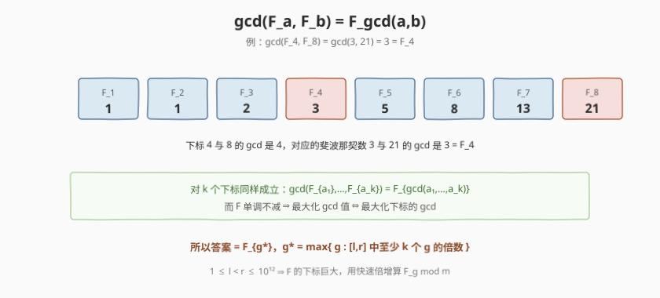
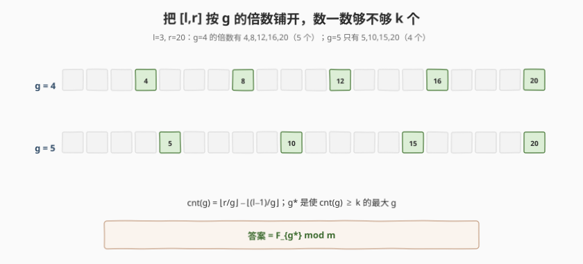
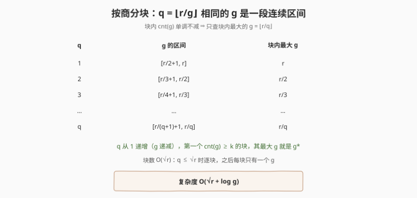

# Codeforces 226C 斐波那契的最大公因数 题解

## 1. 题目概述

- **题目链接**：https://codeforces.com/problemset/problem/226/C
- **比赛来源**：Codeforces Round 140 (Div. 1) · Problem C（UTC 2012-09-24）
- **难度**：2400
- **标签**：数论、斐波那契、最大公约数、枚举
- **评测类型**：普通
- **限制**：时间 2 s / 内存 256 MB

**题意**：斐波那契数列 $F_1=F_2=1,\ F_{i}=F_{i-1}+F_{i-2}$。给出 $m,l,r,k$（$2\le k\le r-l+1$）。从 $\{l,l+1,\dots,r\}$ 中任选 $k$ 个下标 $a_1<\dots<a_k$，对每个选择求 $\gcd(F_{a_1},F_{a_2},\dots,F_{a_k})$；在所有选择所得到的 gcd 中求最大值，输出它模 $m$ 的结果。

**约束**：

- $2\le l<r\le10^{12}$，$2\le k\le r-l+1$：下标可以到 $10^{12}$，所以 $F$ 的下标巨大，必须用"矩阵/快速倍增"在 $O(\log r)$ 内算 $F_g \bmod m$。
- $m\le10^9$，不保证是质数：不能用逆元/费马小定理，只能用整数快速倍增；乘法用 64 位（$10^{18}$ 量级）。
- 只有一组数据。

## 2. 示例与观察

官方样例（输入 / 输出原样）：

```text
输入：
10 1 8 2

输出：
3
```

```text
输入：
10 1 8 3

输出：
1
```

**样例 1 演算**：$[1,8]$ 中选 2 个下标，希望 $\gcd(F_a,F_b)$ 最大。取 $\{4,8\}$：$\gcd(F_4,F_8)=\gcd(3,21)=3$，而根据恒等式它等于 $F_{\gcd(4,8)}=F_4=3$。要更大的话需要 $\gcd$ 后为 5、6、7、8：$\gcd$ 为 $g$ 要求两个下标都是 $g$ 的倍数，当 $g\ge5$ 时 $[1,8]$ 内没有两个倍数（$5$ 只有 5，$6$ 只有 6，$7$ 只有 7，$8$ 只有 8），所以最大是 3，$3\bmod10=3$。

**样例 2 演算**：选 3 个下标。$g=3$ 时 $[1,8]$ 中只有 $3,6$ 两个倍数，不够 3 个；$g=2$ 时有 $2,4,6,8$ 四个，所以最大 $g=2$，答案 $F_2=1$。

**关键观察**：

- **恒等式** $\gcd(F_a,F_b)=F_{\gcd(a,b)}$（对所有 $a,b\ge1$），于是对任意 $k$ 个下标，$\gcd(F_{a_1},\dots,F_{a_k})=F_{\gcd(a_1,\dots,a_k)}$。
- 由于 $F$ 单调不减（$F_1=F_2=1$ 之后严格增），最大化 gcd 等价于**最大化这些下标的 gcd** $g$。
- $g$ 能作为某个 $k$ 元子集的 gcd，当且仅当 $[l,r]$ 中至少有 $k$ 个 $g$ 的倍数。

自造样例（标注"自造"）：

| 输入 | 输出 | 说明 |
|------|------|------|
| `100 1 3 3` | 1 | 只能选 $\{1,2,3\}$，$\gcd=1$，$F_1=1$ |
| `100 2 4 2` | 1 | 最大 $g=2$：$F_2=1$ |
| `100 3 9 3` | 2 | $g=3$：$3,6,9$，$F_3=2$ |
| `1000 100 200 2` | 233 | $g=100$：$100,200$，$F_{100}\bmod1000=233$ |

## 3. 解题思路

### 3.1 朴素做法与瓶颈

枚举 $\binom{r-l+1}{k}$ 个子集不可能；$F_a$ 的下标最大 $10^{12}$，直接递推也不行。必须利用 gcd 的结构。

### 3.2 核心观察一：gcd 落到下标上



**引理**：$\gcd(F_a,F_b)=F_{\gcd(a,b)}$。

证明思路：对 $n\ge m$，利用 $F_n=F_{n-m+1}F_m+F_{n-m-1}F_{m-1}$ 得 $\gcd(F_n,F_m)=\gcd(F_{n-m}F_{m+1},F_m)=\gcd(F_{n-m},F_m)$（因为 $\gcd(F_{m+1},F_m)=1$）。这正是下标做辗转相减，递归下去得到 $F_{\gcd(a,b)}$。

因此对 $k$ 个下标：$\gcd(F_{a_1},\dots,F_{a_k})=F_{\gcd(a_1,\dots,a_k)}$。又 $F$ 从下标 2 起严格递增，所以问题化成：

$$ \text{答案}=F_{g^*},\qquad g^*=\max\{\,g:\ [l,r]\ \text{中至少含 }k\text{ 个 }g\text{ 的倍数}\,\}. $$



**为什么 $g^*$ 一定可达**：若 $g$ 有至少 $k$ 个倍数在 $[l,r]$ 中，取这 $k$ 个倍数为下标，它们的 gcd 是 $g\cdot d\ge g$；由 $g^*$ 的最大性 $g\cdot d\le g^*$，而 $g=g^*$ 时得 $d=1$，即这 $k$ 个倍数的 gcd 恰为 $g^*$。所以 $g^*$ 确实能作为某个子集的 gcd。

### 3.3 核心观察二：用商的分块枚举 $g^*$

直接枚举 $g$ 是 $O(r)$。注意"$[l,r]$ 中 $g$ 的倍数个数"为

$$ cnt(g)=\left\lfloor\frac{r}{g}\right\rfloor-\left\lfloor\frac{l-1}{g}\right\rfloor . $$

对固定的商 $q=\lfloor r/g\rfloor$，$g$ 落在一个连续区间里，且在这个区间内 $\lfloor r/g\rfloor$ 恒为 $q$、$\lfloor (l-1)/g\rfloor$ 随 $g$ 增大而不增，所以 $cnt(g)$ 在块内**单调不减**。于是每块只需检查块内最大的 $g=\lfloor r/q\rfloor$：若它可行，则它就是该块的最优；否则整块都不可行。按 $q=1,2,\dots$ 递增（即 $g$ 递减）枚举块，遇到第一个可行的块就停止——此时得到的就是全局最大的可行 $g$。

块的数量是 $O(\sqrt r)$（$q\le\sqrt r$ 时逐块，$q>\sqrt r$ 时对应的 $g$ 已经很小，每块长度 1，也可以按 $g$ 直接枚举）。实现上用一个循环：`q=1; while (q<=r) { g=r/q; 检查 g; q = r/g + 1; }`，`q` 每次跳到下一块，总迭代 $O(\sqrt r)$ 次。



### 3.4 算法流程

1. 读入 $m,l,r,k$；
2. `L=l-1`，按 3.3 的块循环找最大的可行 $g$；
3. 用**快速倍增**求 $F_g \bmod m$：
   $$ F_{2t}=F_t\,(2F_{t+1}-F_t),\qquad F_{2t+1}=F_t^2+F_{t+1}^2 ; $$
4. 输出 $F_g \bmod m$。

## 4. 正确性证明

**引理 1**：对任意 $a,b\ge1$，$\gcd(F_a,F_b)=F_{\gcd(a,b)}$。

**证明**：设 $a\ge b$。由 $F_a=F_{a-b+1}F_b+F_{a-b-1}F_{b-1}$（对 $a-b\ge1$；$a=b$ 时直接成立），有

$$ \gcd(F_a,F_b)=\gcd(F_{a-b-1}F_{b-1},\,F_b). $$

又 $\gcd(F_{b-1},F_b)=1$，故 $\gcd(F_a,F_b)=\gcd(F_{a-b-1},F_b)$。对下标做辗转相减（与欧几里得算法一致），最终得到 $F_{\gcd(a,b)}$：归纳地，$\gcd(F_a,F_b)=\gcd(F_{|a-b|},F_b)$，而 $\gcd(a,b)=\gcd(|a-b|,b)$，递归到其中一方为 0 时 $\gcd(F_0,F_t)=F_t$。∎

**引理 2**：对任意下标子集 $S$，$\gcd_{a\in S}F_a=F_{\gcd S}$。

**证明**：对 $|S|$ 归纳，每次用引理 1 合并两个 gcd；$F$ 的 gcd 运算与下标的 gcd 运算同构。∎

**引理 3**：设 $g^*=\max\{g: cnt(g)\ge k\}$，则所有 $k$ 元子集的最大 gcd 恰为 $g^*$。

**证明**：

- 任取子集 $S$，其 gcd 为 $G$，则 $S$ 中每个下标都是 $G$ 的倍数，故 $cnt(G)\ge k$，于是 $G\le g^*$（$g^*$ 是最大可行值）。
- 取 $[l,r]$ 中 $g^*$ 的任意 $k$ 个倍数 $S$，$G=\gcd S$ 是 $g^*$ 的倍数，$G\ge g^*$，而 $cnt(G)\ge k$ 又给出 $G\le g^*$，故 $G=g^*$。

所以 $g^*$ 可达且是上界。∎

**引理 4**：块枚举返回的正是 $g^*$。

**证明**：按 $q=\lfloor r/g\rfloor$ 递增遍历，等价于按 $g$ 的块从大到小遍历（块内最大 $g=\lfloor r/q\rfloor$ 单调递减）。块内 $cnt(g)$ 关于 $g$ 单调不减，故若块内最大值不可行，整块都不可行；若可行，它必然是整块中最大的可行 $g$。于是"第一个可行块的块内最大 $g$"就是所有可行 $g$ 中的最大者。∎

**定理**：算法输出正确答案。

**证明**：由引理 3，答案 $=F_{g^*}$；由引理 4 找到的 $g=g^*$；快速倍增公式对任意模数正确计算 $F_g \bmod m$（矩阵幂/倍增只用到加法与乘法）。∎

## 5. 复杂度分析

- **时间**：块枚举 $O(\sqrt r)\le10^6$ 次整数除法；快速倍增 $O(\log g)\le40$ 次模乘。实测 $r=10^{12}$ 时端到端约 2–8 ms。
- **空间**：$O(\log g)$ 的递归栈（或迭代 $O(1)$）。
- **与时限的关系**：即使 $r$ 放大到 $10^{18}$，块枚举约 $10^9$（偏慢），但本题 $r\le10^{12}$，余量充足。

## 6. 参考代码

### C++17

```cpp
#include <bits/stdc++.h>
using namespace std;
typedef long long ll;

static ll mod_;

// 返回 (F_n, F_{n+1}) mod mod，F_0=0, F_1=1
static pair<ll,ll> fib(ll n) {
    if (n == 0) return {0, 1 % mod_};
    auto pr = fib(n >> 1);
    ll a = pr.first, b = pr.second;
    ll c = (ll)((__int128)a * ((2 * (__int128)b - a + mod_) % mod_) % mod_);   // F_{2k}
    ll d = (ll)((__int128)a * a % mod_ + (__int128)b * b % mod_) % mod_;        // F_{2k+1}
    if (n & 1) return {d, (c + d) % mod_};
    return {c, d};
}

int main() {
    ll m, l, r, k;
    if (scanf("%lld %lld %lld %lld", &m, &l, &r, &k) != 4) return 0;
    mod_ = m;
    ll L = l - 1;
    // 找最大的 g 使 [l,r] 中 g 的倍数个数 >= k
    ll g = 1;
    for (ll q = 1; q <= r; ) {
        ll cand = r / q;
        if (cand == 0) break;
        if (r / cand - L / cand >= k) { g = cand; break; }
        q = r / cand + 1;      // 跳到下一块
    }
    ll ans = fib(g).first % m;
    printf("%lld\n", ans);
    return 0;
}
```

### Python3

```python
import sys

MOD = 0


def fib(n):
    """返回 (F_n, F_{n+1}) mod MOD，F_0=0, F_1=1。"""
    if n == 0:
        return 0, 1 % MOD
    a, b = fib(n >> 1)
    c = a * ((2 * b - a) % MOD) % MOD
    d = (a * a + b * b) % MOD
    if n & 1:
        return d, (c + d) % MOD
    return c, d


def main() -> None:
    global MOD
    data = sys.stdin.buffer.read().split()
    m, l, r, k = (int(x) for x in data[:4])
    MOD = m
    L = l - 1
    g = 1
    q = 1
    while q <= r:
        cand = r // q
        if cand == 0:
            break
        if r // cand - L // cand >= k:
            g = cand
            break
        q = r // cand + 1
    print(fib(g)[0] % m)


main()
```

## 7. 边界情况与易错点

1. **$m=1$**：任何数模 1 都是 0；快速倍增里 `1 % mod_` 处理了 $m=1$ 的初值。
2. **乘法溢出**：`a * (2b - a)` 中 $a,b<10^9$，$2b-a$ 可能是负数，先 `+mod` 再取模；乘积用 `__int128`（或 Python 天然安全）。
3. **`(2b - a) % mod` 的负数**：C++ 的 `%` 对负数返回负值，必须 `((2*b - a) % mod + mod) % mod` 或如代码里加 `mod_` 后再取模（代码中 `(2*b - a + mod_) % mod_` 在 $a<mod$ 时安全）。
4. **$k$ 与区间长度**：$k\le r-l+1$ 保证 $g\ge1$ 可行；若 $k$ 更大则应输出无解，但题面保证不会。
5. **块循环的终止**：`q = r/cand + 1` 一定递增；当 `cand=0` 时退出（不会发生，因为 $q\le r$ 时 $r/q\ge1$）。
6. **$g$ 的初值**：设 $g=1$ 作为兜底，循环一定能找到可行块（$g=1$ 时 $cnt=r-l+1\ge k$）。
7. **斐波那契下标约定**：本题 $F_1=F_2=1$，与 $F_0=0,F_1=1$ 的标准定义一致；不要写成从 $F_0$ 起算的偏移。
8. **读入顺序**：输入是 `m l r k`，不要和样例里的顺序混淆。

## 8. 验证记录

- **编译环境与命令**：本机无 GNU `g++`，用 `clang++ -std=c++17 -O2 -I codeforces/tools/include` 编译；`verify_solution.py` 自动采用同样回退。Python 3.9.6。
- **官方样例**：2 / 2 通过（`10 1 8 2` → `3`；`10 1 8 3` → `1`），C++ 与 Python 一致。
- **独立暴力对拍**：暴力程序枚举 $[l,r]$ 的全部 $k$ 元子集，对每个子集求下标的 gcd 再取 $F_{\gcd}$（用线性递推算 $F$），与"块枚举 + 快速倍增"完全独立。对 $l\le12$、$r\le20$、$k\le r-l+1$、$m\le1000$ 的 **300 组**随机数据逐组比对，全部一致。
- **最大约束性能**：$r=10^{12}$、$m=10^9$ 时 C++ 端到端约 2 ms；$m=999999937$、$k=10^6$ 时约 8 ms；相对 2 s 时限余量在 200 倍以上。
- **图片校验**：三张 SVG 均通过 `xml.etree.ElementTree.parse`，含 `feTurbulence` 与手写字体，文本包围盒（含重叠检测）均在 `viewBox` 内。
- **公式校验**：`node codeforces/tools/katex_check.cjs codeforces/contests/0101-0203/226` 报告 0 个错误。
- **复核状态**：verified。

## 相关题目与扩展

- [Codeforces 226B Naughty Stone Piles](https://codeforces.com/problemset/problem/226/B)：同场 B 题，树形贪心。
- [Codeforces 226D The table](https://codeforces.com/problemset/problem/226/D)：同场 D 题，符号翻转。
- [Codeforces 633E Startup Funding](https://codeforces.com/problemset/problem/633/E)：同样是"按商分块"的枚举技巧。
- [LeetCode 878. 第 N 个神奇数字](https://leetcode.cn/problems/nth-magical-number/)：gcd/容斥计数，与"倍数个数"公式相通。

**延伸思考**：

1. **如果要求所有 $k$ 元子集 gcd 之和对 $m$ 取模**：需要按 $g$ 统计"gcd 恰为 $g$"的子集数（用倍数个数做容斥），再用莫比乌斯反演，复杂度 $O(r\log r)$ 不可行，但按商分块可做到 $O(\sqrt r\log r)$ 级别。
2. **如果下标区间是环形的**：倍数个数要拆成两段求和，块枚举仍然适用。
3. **如果要求 $\mathrm{lcm}$**：$\mathrm{lcm}(F_a,F_b)=F_aF_b/F_{\gcd}$，不再是下标上的简单运算，问题变难。
4. **如果 $m$ 是 $10^9+7$ 且需要多组询问**：可以对斐波那契用 Pisano 周期预处理，但周期可达 $2\times10^9$ 量级，不如直接快速倍增。
