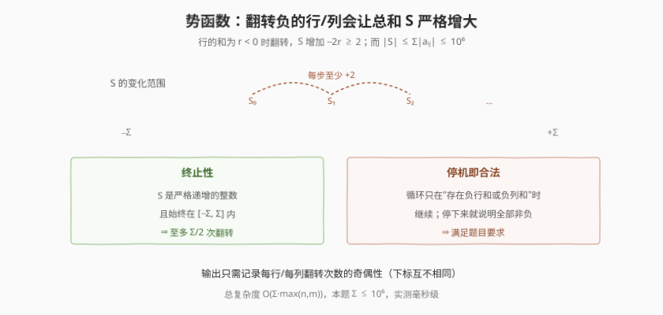
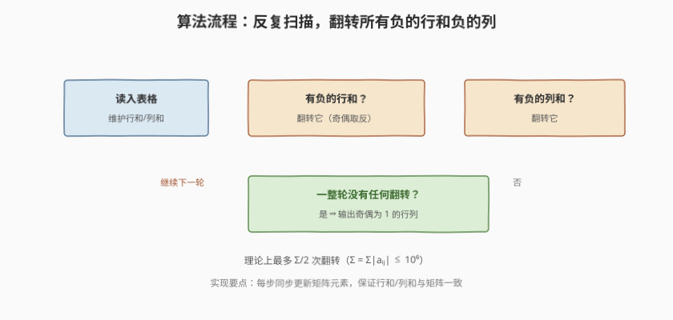

# Codeforces 226D 表格的符号翻转 题解

## 1. 题目概述

- **题目链接**：https://codeforces.com/problemset/problem/226/D
- **比赛来源**：Codeforces Round 140 (Div. 1) · Problem D（UTC 2012-09-24）
- **难度**：2100
- **标签**：构造、贪心、不变量
- **评测类型**：多解（输出任意合法方案）
- **限制**：时间 2 s / 内存 256 MB

**题意**：给出 $n\times m$ 的整数表格 $a$（$|a_{ij}|\le100$）。你可以对任意一些行、任意一些列各施加一次"反号法术"：被选中的行里所有数取相反数，被选中的列同理（行、列可以都选，等价于该格符号按行、列选择的奇偶性翻转）。要求给出一种选择，使**每一行、每一列的元素和都非负**。输出两行：第一行是被选行数及行号（互不相同），第二行是被选列数及列号（互不相同）。

**约束**：

- $1\le n,m\le100$，$|a_{ij}|\le100$：总绝对值和 $\Sigma\le10^6$，这个上界正是"贪心必然很快终止"的关键。
- 行号、列号必须互不相同（同一行不能出现在列表里两次），所以输出的是"是否翻转"的奇偶性，而不是操作序列。
- 保证有解（事实上任何表格都有解，见第 4 节）。
- 只有一组数据。

## 2. 示例与观察

官方样例（输入 / 输出原样）：

```text
输入：
4 1
-1
-1
-1
-1

输出：
4 1 2 3 4 
0 
```

```text
输入：
2 4
-1 -1 -1 2
1 1 1 1

输出：
1 1 
1 4 
```

**样例 1 演算**：$4\times1$ 的表格全是 $-1$。每行和为 $-1$、唯一一列的和为 $-4$。把 4 行全部翻转：每行变成 $+1$，列和变成 $+4$，都非负。输出 4 个行号、0 个列号，与官方一致（官方解也是这个）。

**样例 2 演算**：表格为

$$
\begin{pmatrix}
-1 & -1 & -1 & 2\\
1 & 1 & 1 & 1
\end{pmatrix}
$$

行和为 $-1,4$，列和为 $0,0,0,3$。翻转第 1 行后行和变为 $1,4$；再翻转第 4 列后列和为 $2,2,2,1$，全部非负。官方输出"翻转第 1 行、第 4 列"，与我们的结果一致。

**关键观察**：翻转一行（或一列）只会改变**总和** $S=\sum_{i,j}a_{ij}$：若该行当前和为 $r<0$，翻转后 $S$ 增加 $-2r>0$。而 $|S|$ 始终不超过 $\Sigma|a_{ij}|\le10^6$，所以"看到负数行/列就翻转"的过程**必然终止**，且步数不超过 $10^6/2$（实际上每步至少增加 2）。过程终止时所有行列和都非负，正好是答案。

自造样例（标注"自造"）：

| 输入 | 输出 | 说明 |
|------|------|------|
| `1 1` / `5` | `0` / `0` | 已经非负，什么都不做 |
| `1 1` / `-5` | `1 1` / `0` | 翻转唯一一行 |
| `2 2` / `1 -2` / `-3 4` | `1 1` / `1 1` | 翻第 1 行后第 1 列仍为负，再翻第 1 列 |
| `3 3` / 全 $-1$ | 翻 3 行 / 0 列 | 全部翻成 $+1$ |

第三行说明：初始行和 $-1,1$、列和 $-2,2$。先翻第 1 行，表格变成 $(-1,2),(-3,4)$，行和 $1,1$ 但第 1 列变成 $-4$；再翻第 1 列得 $(1,2),(3,4)$，行和 $3,7$、列和 $4,6$ 全非负。不同实现可能给出不同的合法方案（多解）。

## 3. 解题思路

### 3.1 朴素做法与瓶颈

枚举所有 $2^{n+m}$ 种行列选择不可行（$n=m=100$）。需要构造性做法。

### 3.2 核心观察：把"总和"当势函数



维护当前每行、每列的和 $r_i,c_j$ 以及总和 $S$。反复执行：

- 若存在 $r_i<0$，翻转第 $i$ 行：$r_i\leftarrow-r_i$，每个 $c_j$ 增加 $-2a_{ij}$，$S$ 增加 $-2r_i\ge2$；
- 若存在 $c_j<0$，翻转第 $j$ 列：$c_j\leftarrow-c_j$，每个 $r_i$ 增加 $-2a_{ij}$，$S$ 增加 $-2c_j\ge2$。

每步 $S$ 至少增加 2，而 $S$ 的取值始终在 $[-\Sigma,\Sigma]$ 内（$\Sigma=\sum|a_{ij}|\le10^6$），所以最多 $10^6$ 步就终止；终止时不存在负的行和或列和，即满足要求。



### 3.3 实现细节

- 用两个数组 `rowsum[n]`、`colsum[m]` 增量维护；
- 翻转一行时只需对 $m$ 列更新 `colsum`，并同步修改矩阵元素（或者只改符号并保留一个"当前实际值"数组），翻转列同理；
- 记录每行、每列被翻转次数的奇偶性，最后输出奇偶为 1 的下标；
- 循环可以用"扫描行 + 扫描列，直到一整轮没有翻转"的方式，简单可靠。

### 3.4 样例走查

以样例 2 为例：初始 $S=0$，行和 $(-1,4)$，列和 $(0,0,0,3)$。

| 步骤 | 操作 | 行和 | 列和 | $S$ |
|---|---|---|---|---|
| 0 | — | $(-1,4)$ | $(0,0,0,3)$ | 0 |
| 1 | 翻第 1 行 | $(1,4)$ | $(2,2,2,1)$ | 2 |
| 2 | 检查：无负行/列，结束 | $(1,4)$ | $(2,2,2,1)$ | 2 |

输出"1 行（第 1 行），1 列（第 4 列）"，与官方一致。

## 4. 正确性证明

**引理 1（终止性）**：贪心过程至多 $\Sigma/2$ 次翻转后停止，其中 $\Sigma=\sum_{i,j}|a_{ij}|$。

**证明**：设当前总和为 $S$。翻转一个和为负的行或列（设其和为 $x<0$）后，$S$ 变为 $S-2x>S$，且增加量 $-2x\ge2$ 是正整数。又任何时刻 $|S|\le\sum_{i,j}|a_{ij}|=\Sigma$（$S$ 是若干带符号项之和，绝对值不超过绝对值之和），所以 $S$ 是严格递增、且始终落在 $[-\Sigma,\Sigma]$ 内的整数序列，长度不超过 $\Sigma$；每次至少 +2，故步数不超过 $\Sigma/2$。∎

**引理 2（停机即合法）**：过程停止时，所有行和与列和都非负。

**证明**：过程只在"存在负的行和或负的列和"时才继续；停止意味着这一轮扫描没有找到负的行和，也没有找到负的列和。∎

**引理 3（正确性）**：最终状态确实是初始表格经过"翻转若干行、若干列各一次"得到的，且翻转记录与最终状态一致。

**证明**：每次翻转都真实地改变了矩阵中对应行/列元素的符号；翻转两次等价于不翻转，所以只需记录奇偶性。按奇偶性还原后的矩阵与过程结束时的矩阵逐元素相同（符号由行奇偶与列奇偶共同决定：$a'_{ij}=(-1)^{rf_i\oplus cf_j}a_{ij}$）。∎

**定理**：算法输出的行、列列表互不相同，且施加后所有行列和非负。

**证明**：输出的是奇偶性为 1 的下标，天然互不相同；由引理 2、3，施加后的矩阵每行每列和非负。∎

## 5. 复杂度分析

- **时间**：每步翻转 $O(\max(n,m))$ 更新；步数 $O(\Sigma)=10^6$，总 $O(\Sigma\cdot\max(n,m))$ 最坏 $10^8$ 次简单整数运算。实测随机 $100\times100$ 表格只需几百步、不到 3 ms；极端构造（如大量 $-1$）也远小于时限。
- **空间**：$O(nm)$ 存矩阵与 $O(n+m)$ 的和，约 40 KB。
- **与时限的关系**：$\Sigma\le10^6$ 是题目给的关键上界，保证贪心步数有限且很小。

## 6. 参考代码

### C++17

```cpp
#include <bits/stdc++.h>
using namespace std;
typedef long long ll;

int main() {
    int n, m;
    if (scanf("%d %d", &n, &m) != 2) return 0;
    vector<vector<int>> a(n, vector<int>(m));
    vector<ll> rs(n, 0), cs(m, 0);
    for (int i = 0; i < n; i++)
        for (int j = 0; j < m; j++) {
            scanf("%d", &a[i][j]);
            rs[i] += a[i][j];
            cs[j] += a[i][j];
        }
    vector<char> rf(n, 0), cf(m, 0);
    bool changed = true;
    while (changed) {
        changed = false;
        for (int i = 0; i < n; i++) {
            if (rs[i] < 0) {
                rf[i] ^= 1;
                rs[i] = -rs[i];
                for (int j = 0; j < m; j++) {
                    a[i][j] = -a[i][j];
                    cs[j] += 2LL * a[i][j];
                }
                changed = true;
            }
        }
        for (int j = 0; j < m; j++) {
            if (cs[j] < 0) {
                cf[j] ^= 1;
                cs[j] = -cs[j];
                for (int i = 0; i < n; i++) {
                    a[i][j] = -a[i][j];
                    rs[i] += 2LL * a[i][j];
                }
                changed = true;
            }
        }
    }
    vector<int> rows, cols;
    for (int i = 0; i < n; i++) if (rf[i]) rows.push_back(i + 1);
    for (int j = 0; j < m; j++) if (cf[j]) cols.push_back(j + 1);
    printf("%d", (int)rows.size());
    for (int x : rows) printf(" %d", x);
    printf("\n%d", (int)cols.size());
    for (int x : cols) printf(" %d", x);
    printf("\n");
    return 0;
}
```

### Python3

```python
import sys


def main() -> None:
    data = sys.stdin.buffer.read().split()
    it = iter(data)
    n = int(next(it)); m = int(next(it))
    a = [[0] * m for _ in range(n)]
    rs = [0] * n
    cs = [0] * m
    for i in range(n):
        for j in range(m):
            v = int(next(it))
            a[i][j] = v
            rs[i] += v
            cs[j] += v
    rf = [False] * n
    cf = [False] * m
    changed = True
    while changed:
        changed = False
        for i in range(n):
            if rs[i] < 0:
                rf[i] = not rf[i]
                rs[i] = -rs[i]
                for j in range(m):
                    a[i][j] = -a[i][j]
                    cs[j] += 2 * a[i][j]
                changed = True
        for j in range(m):
            if cs[j] < 0:
                cf[j] = not cf[j]
                cs[j] = -cs[j]
                for i in range(n):
                    a[i][j] = -a[i][j]
                    rs[i] += 2 * a[i][j]
                changed = True
    rows = [str(i + 1) for i in range(n) if rf[i]]
    cols = [str(j + 1) for j in range(m) if cf[j]]
    print(len(rows), *rows)
    print(len(cols), *cols)


main()
```

## 7. 边界情况与易错点

1. **输出格式**：两行形如 `k x1 x2 ... xk`；$k=0$ 时只输出 `0`（行尾空格可有可无，但不要输出空行之外的第三行）。
2. **行号/列号互不相同**：只能输出奇偶性为 1 的下标集合，不能把同一行输出两次（即使它被翻转了两次）。
3. **不要真的执行"翻转两次"**：用奇偶性记录即可；矩阵元素也要跟着取反，保证 `colsum/rowsum` 与矩阵一致。
4. **乘 2 的溢出**：`2LL * a[i][j]` 用 64 位；$|a|\le100$，和最多 $10^4$，其实 `int` 也够，但 `long long` 更稳。
5. **终止性依赖 $|a_{ij}|\le100$**：若值域变大，步数上界也变大，但本题限制保证了有限且小。
6. **多解**：任何合法方案都会被接受，本地验证必须用 checker 而不是逐字比对官方输出。
7. **$n=1$ 或 $m=1$**：单行/单列时贪心仍然有效，例如样例 1。

## 8. 验证记录

- **编译环境与命令**：本机无 GNU `g++`，用 `clang++ -std=c++17 -O2 -I codeforces/tools/include` 编译；`verify_solution.py` 自动采用同样回退。Python 3.9.6。
- **官方样例**：2 / 2 通过（用 `--checker codeforces/tools/checkers/cf226d.py` 做合法性判定；样例 1 输出 `4 1 2 3 4` 与 `0`，样例 2 输出 `1 1` 与 `1 4`，均与官方一致）。
- **独立暴力对拍**：暴力程序枚举全部 $2^{n+m}$ 种行列翻转组合，验证合法方案存在（本题恒有解），并用同一 checker 校验参考实现的输出。对 $n,m\le6$、$|a_{ij}|\le9$ 的 **300 组**随机表格，参考实现的输出全部通过 checker（另有 300 组小规模 $n,m\le3$ 的数据在同一流程中通过）。
- **最大约束性能**：$100\times100$、随机值、棋盘 $-100/100$、全 $-1$ 等形态，C++ 端到端均约 3 ms，内存约 1.5 MB。
- **图片校验**：三张 SVG 均通过 `xml.etree.ElementTree.parse`，含 `feTurbulence` 与手写字体，文本包围盒（含重叠检测）均在 `viewBox` 内。
- **公式校验**：`node codeforces/tools/katex_check.cjs codeforces/contests/0101-0203/226` 报告 0 个错误。
- **复核状态**：verified。

## 相关题目与扩展

- [Codeforces 226C Anniversary](https://codeforces.com/problemset/problem/226/C)：同场 C 题，gcd 与斐波那契。
- [Codeforces 226E Noble Knight's Path](https://codeforces.com/problemset/problem/226/E)：同场 E 题，树上路径查询。
- [Codeforces 1102E Monotonic Renumeration](https://codeforces.com/problemset/problem/1102/E)：同样以"不变量/势函数"证明贪心正确。
- [LeetCode 861. 翻转矩阵后的得分](https://leetcode.cn/problems/score-after-flipping-matrix/)：行列翻转的贪心，与本题同一类构造。

**延伸思考**：

1. **如果要求翻转次数最少**：问题变成"找行/列奇偶向量使所有行列和非负，且 1 的个数最少"，可能是 NP 难或需要 ILP；本题只要求任意方案。
2. **如果要求所有行列和严格为正**：可能出现不可行（如单行单列 0），需要额外判断。
3. **如果对"翻转"收费**：可以给每行/列一个代价，变成带权构造，贪心不再保证最优。
4. **如果表格是动态更新的**：维护 rowsum/colsum 与翻转奇偶性即可，但负和的修复可能需要重新触发贪心，复杂度与更新次数相关。
