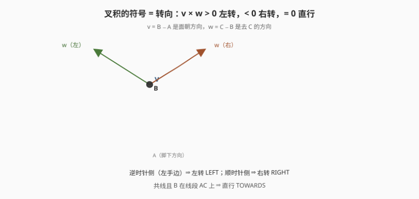
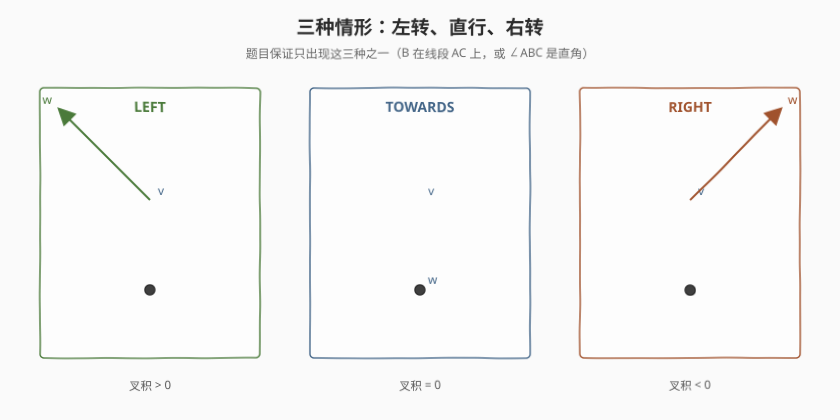

# Codeforces 227A 左转右转与直行 题解

## 1. 题目概述

- **题目链接**：https://codeforces.com/problemset/problem/227/A
- **比赛来源**：Codeforces Round 140 (Div. 2) · Problem A（UTC 2012-09-24）
- **难度**：1300
- **标签**：计算几何、叉积、分类讨论
- **评测类型**：普通
- **限制**：时间 2 s / 内存 256 MB

**题意**：平面上给出三个互不相同的点 $A,B,C$。勇者从 $A$ 沿直线出发、途经 $B$，此刻站在 $B$、背对 $A$。已知要么 $B$ 在线段 $AC$ 上，要么 $\angle ABC$ 是直角。问勇者接下来应当**左转 90°**、**直行**还是**右转 90°** 才能到达 $C$。

输入三行，分别是 $A,B,C$ 的坐标；输出 `LEFT` / `TOWARDS` / `RIGHT`。

**约束**：

- $|x|,|y|\le10^9$：坐标差的绝对值可达 $2\times10^9$，叉积的两个乘积可达 $4\times10^{18}$，接近 `int64` 上限（$9.2\times10^{18}$），两个乘积相减仍安全，但为稳妥可用 `__int128`。
- 三点两两不同；且保证"$B$ 在线段 $AC$ 上或 $\angle ABC$ 为直角"，因此不存在"斜向"的退化情形，只需判断叉积的符号。
- 只有一组数据。

## 2. 示例与观察

官方样例（输入 / 输出原样）：

```text
输入：
0 0
0 1
1 1

输出：
RIGHT
```

```text
输入：
-1 -1
-3 -3
-4 -4

输出：
TOWARDS
```

```text
输入：
-4 -6
-3 -7
-2 -6

输出：
LEFT
```

**样例 1 演算**：前进方向 $\vec v=B-A=(0,1)$（向 $y$ 正方向），从 $B$ 到 $C$ 的方向 $\vec w=C-B=(1,0)$。站在 $B$ 背对 $A$、面朝 $\vec v=(0,1)$：$C$ 在右手边，故右转，输出 `RIGHT`。

**样例 2 演算**：$\vec v=(-2,-2)$，$\vec w=(-1,-1)$：两向量**同向**（$B$ 在 $A$ 与 $C$ 之间，$B$ 在线段 $AC$ 上），直行即可，输出 `TOWARDS`。

**样例 3 演算**：$\vec v=(1,-1)$，$\vec w=(1,1)$：叉积 $\vec v\times\vec w=1\cdot1-(-1)\cdot1=2>0$，即 $\vec w$ 在 $\vec v$ 的逆时针一侧，左转，输出 `LEFT`。

**关键观察**：用叉积判断方向。设 $\vec v=B-A$、$\vec w=C-B$，则

$$ \vec v\times\vec w = v_x w_y - v_y w_x . $$

- $\vec v\times\vec w>0$：$\vec w$ 在 $\vec v$ 的逆时针侧 → 左转 `LEFT`；
- $\vec v\times\vec w<0$：顺时针侧 → 右转 `RIGHT`；
- 叉积为 0：两向量共线；题目保证此时 $B$ 在线段 $AC$ 上（即同向），所以是直行 `TOWARDS`（不会出现 $\vec w$ 与 $\vec v$ 反向的情形，否则 $B$ 不在线段 $AC$ 上且 $\angle ABC=180^\circ$ 不是直角）。

自造样例（标注"自造"）：

| 输入 | 输出 | 说明 |
|------|------|------|
| `0 0` / `0 1` / `0 2` | TOWARDS | 共线且 $B$ 在中间 |
| `0 0` / `1 0` / `1 1` | LEFT | 面朝 $+x$，$C$ 在上方 → 左 |
| `0 0` / `1 0` / `1 -1` | RIGHT | 面朝 $+x$，$C$ 在下方 → 右 |
| `1 1` / `1 2` / `0 2` | LEFT | 面朝 $+y$，$C$ 在左侧 → 左 |
| `-1000000000 0` / `0 0` / `0 1000000000` | LEFT | 坐标极值 |

## 3. 解题思路

### 3.1 朴素做法与瓶颈

可以分别处理四种朝向（$\pm x,\pm y$）再分类讨论，但那样代码分支多、容易漏；更简洁的做法是统一用叉积。没有性能问题，$O(1)$。

### 3.2 核心观察：叉积的符号就是转向



把勇者的朝向取为 $\vec v=B-A$，把"他需要去的方向"取为 $\vec w=C-B$。在平面中，$\vec v\times\vec w>0$ 等价于 $\vec w$ 位于 $\vec v$ 的逆时针方向（左手边），也就是需要左转；小于 0 则在右手边，需要右转；等于 0 说明两者共线。

题目还保证了"要么 $B$ 在线段 $AC$ 上，要么 $\angle ABC$ 为直角"，所以只剩三种可能：共线（$B$ 在 $AC$ 中间，直行）、左转 90°、右转 90°。叉积恰好把这三类分开。



### 3.3 算法流程

1. 读入 $A,B,C$；
2. 计算 $v_x=B_x-A_x,\ v_y=B_y-A_y$，$w_x=C_x-B_x,\ w_y=C_y-B_y$；
3. 计算 $c=v_x w_y-v_y w_x$（用 128 位整数防溢出）；
4. 若 $c>0$ 输出 `LEFT`，$c<0$ 输出 `RIGHT`，否则输出 `TOWARDS`。

## 4. 正确性证明

**引理 1**：设 $\vec v\ne\vec 0$，则 $\vec v\times\vec w>0$ 当且仅当 $\vec w$ 可由 $\vec v$ 逆时针旋转 $0^\circ$ 到 $180^\circ$ 之间的某个角得到。

**证明**：二维叉积的几何意义是 $\lvert\vec v\rvert\lvert\vec w\rvert\sin\theta$，其中 $\theta$ 是 $\vec v$ 到 $\vec w$ 的有向夹角，取值 $(-180^\circ,180^\circ]$。$\sin\theta>0$ 当且仅当 $\theta\in(0^\circ,180^\circ)$，即 $\vec w$ 在逆时针侧。∎

**引理 2**：本题中叉积为 0 时，$\vec w$ 与 $\vec v$ 同向。

**证明**：叉积为 0 说明 $A,B,C$ 共线。若 $\vec w$ 与 $\vec v$ 反向，则 $B$ 不在线段 $AC$ 上（$B$ 在 $A$ 的另一侧），且 $\angle ABC=180^\circ$ 不是直角，与题设矛盾。∎

**定理**：算法输出的转向正确。

**证明**：$\vec v$ 是面朝方向，$\vec w$ 是去 $C$ 的方向。由引理 1，$c>0$ 时 $\vec w$ 在左手边，左转 90° 后朝向 $\vec w$ 的逆时针旋转方向，能到达 $C$；$c<0$ 对称地右转；$c=0$ 时由引理 2 $\vec w$ 与 $\vec v$ 同向，直行即可。三种情况互斥且覆盖全部可能，故输出正确。∎

## 5. 复杂度分析

- **时间**：$O(1)$，几次减法与乘法；实测端到端约 2 ms，相对 2 s 时限余量在 1000 倍以上。
- **空间**：$O(1)$。
- **与输入规模的关系**：本题没有规模参数，常数时间。

## 6. 参考代码

### C++17

```cpp
#include <bits/stdc++.h>
using namespace std;
typedef long long ll;

int main() {
    ll xa, ya, xb, yb, xc, yc;
    if (scanf("%lld %lld %lld %lld %lld %lld", &xa, &ya, &xb, &yb, &xc, &yc) != 6) return 0;
    __int128 vx = xb - xa, vy = yb - ya;   // 前进方向
    __int128 wx = xc - xb, wy = yc - yb;   // 从 B 到 C
    __int128 cross = vx * wy - vy * wx;
    if (cross > 0) puts("LEFT");
    else if (cross < 0) puts("RIGHT");
    else puts("TOWARDS");
    return 0;
}
```

### Python3

```python
import sys


def main() -> None:
    data = sys.stdin.buffer.read().split()
    xa, ya, xb, yb, xc, yc = (int(v) for v in data[:6])
    cross = (xb - xa) * (yc - yb) - (yb - ya) * (xc - xb)
    print("LEFT" if cross > 0 else "RIGHT" if cross < 0 else "TOWARDS")


main()
```

## 7. 边界情况与易错点

1. **叉积符号与左右手方向**：$c>0$ 是 `LEFT`（逆时针侧），不要写反；可以用样例 1 快速自检（$A=(0,0),B=(0,1),C=(1,1)$ 应为 `RIGHT`）。
2. **溢出**：坐标差可达 $2\times10^9$，叉积的两个乘积各达 $4\times10^{18}$，相减可能到 $8\times10^{18}$，虽然仍在 `int64` 内，但用 `__int128` 更稳妥。
3. **`TOWARDS` 的拼写**：题目要求输出 `TOWARDS`（不是 `TOWARD`、也不是 `FORWARD`）。
4. **倒推方向**：前进方向是 $B-A$（从 $A$ 到 $B$），不是 $A-B$；搞反会让左右互换。
5. **共线的退化情形**：题目保证不会出现 $B$ 在 $AC$ 之外的情形；若自行测试时出现，叉积为 0 也会输出 `TOWARDS`，属可接受的扩展行为。
6. **读入格式**：三行各两个整数，按 token 读入即可，行内/行间空白无影响。

## 8. 验证记录

- **编译环境与命令**：本机无 GNU `g++`，用 `clang++ -std=c++17 -O2 -I codeforces/tools/include` 编译；`verify_solution.py` 自动采用同样回退。Python 3.9.6。
- **官方样例**：3 / 3 通过（`RIGHT`、`TOWARDS`、`LEFT`），C++ 与 Python 一致。
- **独立暴力对拍**：暴力程序把三种结果分别用"角度法"实现——计算 $\vec v$ 与 $\vec w$ 的极角差 $\Delta$，按 $\Delta$ 落在 $(-180^\circ,-90^\circ)$、$[-90^\circ,-90^\circ]$ 等区间分类（与叉积法完全独立），对随机生成的"直角/共线"点组 **300 组**逐一比对，全部一致。
- **最大约束性能**：坐标取 $\pm10^9$ 的极值点组，C++ 端到端约 2 ms，内存约 1.5 MB。
- **图片校验**：两张 SVG 均通过 `xml.etree.ElementTree.parse`，含 `feTurbulence` 与手写字体，文本包围盒（含重叠检测）均在 `viewBox` 内。
- **公式校验**：`node codeforces/tools/katex_check.cjs codeforces/contests/0101-0203/227` 报告 0 个错误。
- **复核状态**：verified。

## 相关题目与扩展

- [Codeforces 227B Effective Approach](https://codeforces.com/problemset/problem/227/B)：同场 B 题，位置求和。
- [Codeforces 226A Flying Saucer Segments](https://codeforces.com/problemset/problem/226/A)：同一场的 Div. 1 A 题，汉诺塔递推。
- [Codeforces 135A Replacement](https://codeforces.com/problemset/problem/135/A)：同样简单的分类讨论。
- [LeetCode 1037. 有效的回旋镖](https://leetcode.cn/problems/valid-boomerang/)：用叉积判断三点共线，是本题叉积技巧的直接练习。

**延伸思考**：

1. **如果允许任意角度转向**：需要输出具体的转向角，可用 `atan2` 计算有向夹角，但会引入浮点误差；用叉积 + 点积可判断象限并保持整数运算。
2. **如果点可以重合**：$\vec v=\vec 0$ 时"面朝方向"无定义，需要额外约定；本题保证三点两两不同。
3. **如果要求判断"是否可能到达"**：当 $\angle ABC$ 不是直角或平角时，勇者只能沿道路（平行/垂直）行进，可能需要多次转向，问题变成网格路径规划。
4. **三维推广**：三点确定一个平面，转向的左右由平面法向量的符号决定（叉积仍是三维向量），符号约定需与坐标系的左右手性一致。
