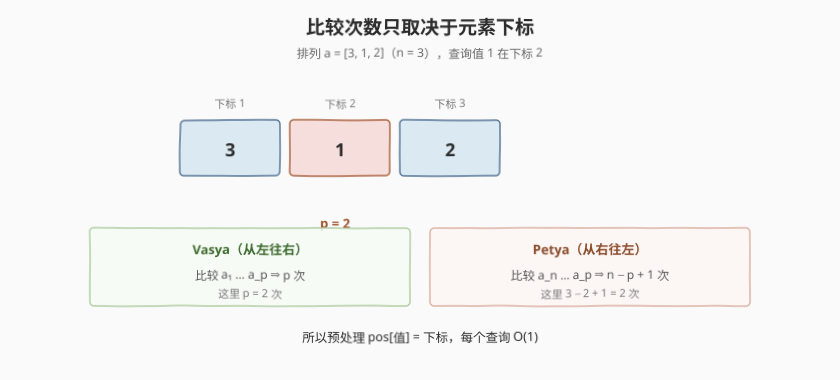
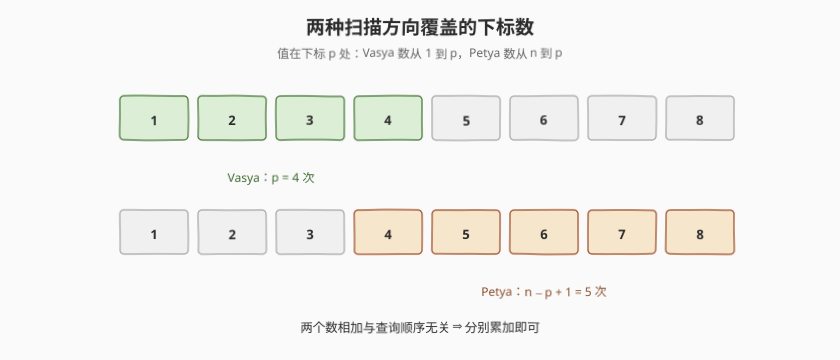

# Codeforces 227B 线性查找的比较次数 题解

## 1. 题目概述

- **题目链接**：https://codeforces.com/problemset/problem/227/B
- **比赛来源**：Codeforces Round 140 (Div. 2) · Problem B（UTC 2012-09-24）
- **难度**：1100
- **标签**：模拟、前缀和、位置映射
- **评测类型**：普通
- **限制**：时间 2 s / 内存 256 MB

**题意**：给定一个 $1\sim n$ 的排列 $a$（数组下标从 1 开始）和 $m$ 个查询 $b_1,\dots,b_m$。Vasya 的线性查找从下标 1 往 $n$ 扫，Petya 的从 $n$ 往 1 扫；每次比较一个元素，相等就停止。对每个查询统计比较次数，分别求两种策略下所有查询的比较次数总和（先输出 Vasya 的，再输出 Petya 的）。

**约束**：

- $1\le n,m\le10^5$：每次查询直接线性查找是 $O(nm)=10^{10}$，太慢；用位置映射可做到 $O(n+m)$。
- $a$ 是排列（$1\sim n$ 各出现一次），所以每个值的位置唯一，可以预处理 `pos[v]`。
- 答案最大为 $m\cdot n=10^{10}$，超过 32 位，必须用 64 位整数（C++ `long long`，Python 天然安全）。
- 只有一组数据，查询可以重复。

## 2. 示例与观察

官方样例（输入 / 输出原样）：

```text
输入：
2
1 2
1
1

输出：
1 2
```

```text
输入：
2
2 1
1
1

输出：
2 1
```

```text
输入：
3
3 1 2
3
1 2 3

输出：
6 6
```

**样例 1 演算**：$a=[1,2]$，查询 $1$。Vasya 从下标 1 扫，第 1 次就比较到 $a_1=1$，计 1 次；Petya 从下标 2 扫：先比较 $a_2=2$（不等），再比较 $a_1=1$（相等），计 2 次。输出 `1 2`。

**样例 2 演算**：$a=[2,1]$，查询 $1$：Vasya 比较 $a_1=2$、$a_2=1$ 共 2 次；Petya 第 1 次就命中 $a_2=1$，计 1 次。输出 `2 1`。

**样例 3 演算**：$a=[3,1,2]$，查询 $1,2,3$。$1$ 在下标 2（Vasya 2 次、Petya $3-2+1=2$ 次）；$2$ 在下标 3（Vasya 3 次、Petya 1 次）；$3$ 在下标 1（Vasya 1 次、Petya 3 次）。总和：Vasya $2+3+1=6$，Petya $2+1+3=6$，输出 `6 6`。

**关键观察**：值 $b$ 在下标 $p$ 处，则

- Vasya 需要比较 $p$ 次（从 1 扫到 $p$）；
- Petya 需要比较 $n-p+1$ 次（从 $n$ 扫到 $p$）。

于是先预处理 `pos[值] = 下标`，再对每个查询 $O(1)$ 累加即可。

自造样例（标注"自造"）：

| 输入 | 输出 | 说明 |
|------|------|------|
| `1` / `1` / `1` / `1` | `1 1` | $n=1$ 时两种策略相同 |
| `3` / `1 2 3` / `2` / `3 3` | `6 2` | 查询重复值 |
| `4` / `4 3 2 1` / `3` / `1 2 3` | `10 5` | 逆序排列 |
| `5` / `1 2 3 4 5` / `1` / `5` | `5 1` | 查询最后一个元素 |

## 3. 解题思路

### 3.1 朴素做法与瓶颈

对每个查询分别做两种线性查找：最坏 $O(n)$ 每次，总 $O(nm)=10^{10}$，2 s 内不可能完成。

### 3.2 核心观察：位置决定比较次数



数组是排列，所以每个值只有一个位置。设值 $b$ 的下标为 $p$（1-based）：

- 从左往右扫，会依次比较 $a_1,a_2,\dots,a_p$，共 $p$ 次；
- 从右往左扫，会依次比较 $a_n,a_{n-1},\dots,a_p$，共 $n-p+1$ 次。

这两条公式对任何排列、任何查询都成立，且与查询顺序无关，所以可以把所有查询的贡献直接相加。



### 3.3 算法流程

1. 读入 $n$ 与排列 $a$，对每个 $i$ 记录 `pos[a[i]] = i`；
2. 读入 $m$ 与 $m$ 个查询 $b_i$；
3. `vasya += pos[b_i]`，`petya += n - pos[b_i] + 1`；
4. 输出两个和。

复杂度 $O(n+m)$，空间 $O(n)$。

## 4. 正确性证明

**引理 1**：对任意查询 $b$，Vasya 的策略恰好比较 $p=\text{pos}[b]$ 次。

**证明**：Vasya 从下标 1 开始依次比较。因为 $a$ 是排列，值 $b$ 只在 $p$ 处出现，所以前 $p-1$ 次比较都不等，第 $p$ 次相等并停止，共 $p$ 次。∎

**引理 2**：对任意查询 $b$，Petya 的策略恰好比较 $n-p+1$ 次。

**证明**：Petya 从下标 $n$ 开始递减比较；$b$ 唯一出现在 $p$，所以下标 $n,n-1,\dots,p+1$ 共 $n-p$ 次不等，第 $n-p+1$ 次在 $p$ 处命中。∎

**定理**：算法输出的两个和分别等于两种策略下所有查询的比较次数总和。

**证明**：由引理 1、2，每次查询的两个次数都被正确计算；对所有查询求和即得总和。∎

## 5. 复杂度分析

- **时间**：$O(n+m)$，一次建位置表、一次遍历查询；$n=m=10^5$ 时约 $2\times10^5$ 次操作，实测端到端约 2 ms。
- **空间**：$O(n)$ 的位置数组，约 0.4 MB，远低于 256 MB。
- **数值范围**：总和最大 $m\cdot n=10^{10}$，`int` 溢出，必须用 `long long`（Python 无此问题）。

## 6. 参考代码

### C++17

```cpp
#include <bits/stdc++.h>
using namespace std;
typedef long long ll;

int main() {
    int n;
    if (scanf("%d", &n) != 1) return 0;
    vector<int> pos(n + 1);
    for (int i = 1; i <= n; i++) { int v; scanf("%d", &v); pos[v] = i; }
    int m;
    scanf("%d", &m);
    ll vasya = 0, petya = 0;
    for (int i = 0; i < m; i++) {
        int b;
        scanf("%d", &b);
        vasya += pos[b];
        petya += (ll)n - pos[b] + 1;
    }
    printf("%lld %lld\n", vasya, petya);
    return 0;
}
```

### Python3

```python
import sys


def main() -> None:
    data = sys.stdin.buffer.read().split()
    n = int(data[0])
    a = [int(x) for x in data[1:1 + n]]
    pos = [0] * (n + 1)
    for i, v in enumerate(a, 1):
        pos[v] = i
    m = int(data[1 + n])
    qs = data[2 + n: 2 + n + m]
    vasya = sum(pos[int(b)] for b in qs)
    petya = sum(n - pos[int(b)] + 1 for b in qs)
    print(vasya, petya)


main()
```

## 7. 边界情况与易错点

1. **`int` 溢出**：总和最大 $10^{10}$，必须用 64 位；C++ 里写成 `petya += n - pos[b] + 1` 时注意 `n - pos[b] + 1` 是 `int`，但累加到 `long long` 时会先转成 `long long`（`petya += ...` 的右值会提升），稳妥写法是 `(ll)n - pos[b] + 1`。
2. **$n=1$**：两种策略都是 1 次；公式给出 $p=1$、$n-p+1=1$。
3. **查询重复**：同一值被查多次时，每次都要累加，不能去重（样例 3 的 `1 2 3`、自造样例的 `3 3` 都在检验这一点）。
4. **下标从 1 开始**：题面明确 1-based；Python 实现里 `enumerate(a, 1)` 保证这一点。
5. **数组是排列的假设**：如果存在重复值或缺失值，位置映射就不合法；本题保证是排列。
6. **输出格式**：`Vasya Petya` 两个整数、空格分隔；不要输出谁赢谁输的额外文字。

## 8. 验证记录

- **编译环境与命令**：本机无 GNU `g++`，用 `clang++ -std=c++17 -O2 -I codeforces/tools/include` 编译；`verify_solution.py` 自动采用同样回退。Python 3.9.6。
- **官方样例**：3 / 3 通过（`1 2`、`2 1`、`6 6`），C++ 与 Python 一致。
- **独立暴力对拍**：暴力程序对每个查询真的分别从两端线性扫描计数（与位置公式完全独立），对 $n\le8$、$m\le8$ 的 **300 组**随机排列与随机查询逐组比对，全部一致。
- **最大约束性能**：$n=m=10^5$ 的随机排列与随机查询，C++ 端到端约 2 ms，内存约 2 MB。
- **图片校验**：两张 SVG 均通过 `xml.etree.ElementTree.parse`，含 `feTurbulence` 与手写字体，文本包围盒（含重叠检测）均在 `viewBox` 内。
- **公式校验**：`node codeforces/tools/katex_check.cjs codeforces/contests/0101-0203/227` 报告 0 个错误。
- **复核状态**：verified。

## 相关题目与扩展

- [Codeforces 227A Where do I Turn?](https://codeforces.com/problemset/problem/227/A)：同场 A 题，叉积判转向。
- [Codeforces 226B Naughty Stone Piles](https://codeforces.com/problemset/problem/226/B)：另一场同级别题，排序 + 前缀和。
- [LeetCode 1. 两数之和](https://leetcode.cn/problems/two-sum/)：用值到位置的映射把查找从 $O(n)$ 降到 $O(1)$，与本题思路一致。

**延伸思考**：

1. **如果数组不是排列**：一个值可能出现多次，Vasya 会在**第一次**出现处停止，Petya 会在**最后一次**出现处停止。预处理每个值的最小下标与最大下标即可，公式变成 $p_{\min}$ 与 $n-p_{\max}+1$。
2. **如果要求每次查询返回两种策略的比较次数之差**：可以用前缀和一次性预处理所有值，$O(1)$ 回答；本题直接累加亦可。
3. **如果查询是"值域区间 $[L,R]$ 内的所有值"**：变成二维偏序/区间求和问题，可用树状数组或离线排序，难度显著上升。
4. **如果每次查找后把命中的元素移到最前面（自组织表）**：比较次数依赖历史，需要模拟或摊还分析，与本题的静态统计完全不同。
