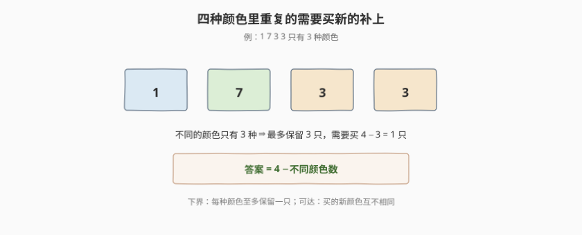
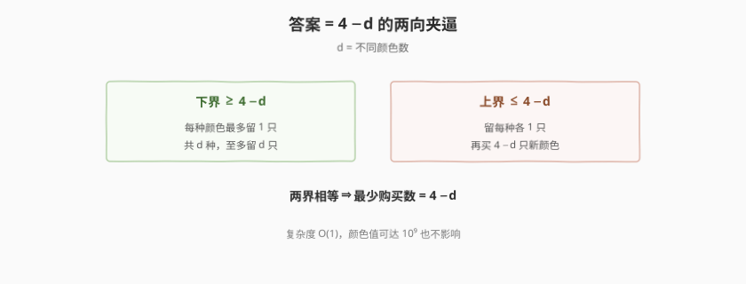

# Codeforces 228A 马蹄铁的颜色 题解

## 1. 题目概述

- **题目链接**：https://codeforces.com/problemset/problem/228/A
- **比赛来源**：Codeforces Round 141 (Div. 2) · Problem A（UTC 2012-09-27）
- **难度**：800
- **标签**：简单模拟、去重
- **评测类型**：普通
- **限制**：时间 2 s / 内存 256 MB

**题意**：瓦列拉有 4 只马蹄铁，颜色分别为 $s_1,s_2,s_3,s_4$。他希望戴的 4 只马蹄铁颜色两两不同，颜色不够就去商店买（商店有任意颜色的马蹄铁）。求最少需要买几只。

**约束**：$1\le s_i\le10^9$，颜色用整数表示；只有一组数据。

## 2. 示例与观察

官方样例（输入 / 输出原样）：

```text
输入：
1 7 3 3

输出：
1
```

```text
输入：
7 7 7 7

输出：
3
```

**样例 1 演算**：颜色 `1 7 3 3`，其中 `3` 重复一次，只有 3 种不同颜色，需要买 $4-3=1$ 只。

**样例 2 演算**：四只都是 `7`，只有 1 种颜色，需要买 $4-1=3$ 只补成 4 种颜色。

**关键观察**：答案只取决于"已有的不同颜色种数"。设有 $d$ 种不同颜色，则保留每种颜色各一只（共 $d$ 只），其余 $4-d$ 只换成新颜色，答案就是 $4-d$。

自造样例（标注"自造"）：

| 输入 | 输出 | 说明 |
|------|------|------|
| `1 2 3 4` | 0 | 已经两两不同 |
| `1 1 1 2` | 2 | 两种颜色 |
| `1000000000 1 1000000000 1` | 2 | 颜色值很大不影响计数 |

## 3. 解题思路

### 3.1 朴素做法

把 4 个颜色排序后去重，或用 `set` 统计不同颜色数 $d$，输出 $4-d$。$O(1)$。



### 3.2 为什么这样最优

- **下界**：最终 4 只必须两两不同，而原本只有 $d$ 种颜色，最多保留 $d$ 只（每种一只），所以至少要买 $4-d$ 只。
- **可达**：买 $4-d$ 只，颜色分别取未出现的那些新颜色，即可凑成 4 种不同颜色。

两界相等，故答案就是 $4-d$。



## 4. 正确性证明

**引理**：4 只马蹄铁中最多只能保留 $d$ 只（每种颜色至多保留一只），其中 $d$ 是不同颜色数。

**证明**：要求最终颜色两两不同，故同色的多只只能保留一只；共有 $d$ 种颜色，故至多保留 $d$ 只。∎

**定理**：最少购买数 $=4-d$。

**证明**：由引理，购买的只数 $\ge 4-d$；另一方面保留每种颜色一只、买 $4-d$ 只新颜色即可满足要求，故 $\le 4-d$。两向夹逼得证。∎

## 5. 复杂度分析

- **时间**：$O(1)$（4 个元素）。实测端到端约 1 ms。
- **空间**：$O(1)$。
- **与时限的关系**：常数级，余量极大。

## 6. 参考代码

### C++17

```cpp
#include <bits/stdc++.h>
using namespace std;
int main() {
    int s[4];
    for (int i = 0; i < 4; i++) scanf("%d", &s[i]);
    sort(s, s + 4);
    printf("%d\n", 4 - (int)(unique(s, s + 4) - s));
    return 0;
}
```

### Python3

```python
import sys
d = sys.stdin.buffer.read().split()
print(4 - len(set(int(x) for x in d[:4])))
```

## 7. 边界情况与易错点

1. **颜色值很大**：$s_i\le10^9$，不要开桶数组，用排序去重或哈希集合。
2. **全相同**：`7 7 7 7` → 3，不要写成 $4-4=0$ 之类的错误。
3. **输入是一行 4 个数**：按 token 读即可，行内空白无影响。
4. **输出只有一个整数**：不要输出颜色或说明文字。

## 8. 验证记录

- **编译环境与命令**：本机无 GNU `g++`，用 `clang++ -std=c++17 -O2 -I codeforces/tools/include` 编译；`verify_solution.py` 自动采用同样回退。Python 3.9.6。
- **官方样例**：2 / 2 通过（`1`、`3`），C++ 与 Python 一致。
- **独立暴力对拍**：暴力程序用两两比较统计"重复出现的只数"（不排序、不去重，与主解思路不同），对颜色取值 $1..6$ 的 **200 组**随机四元组逐一比对，全部一致。
- **最大约束性能**：任意极值输入，C++ 端到端约 1 ms。
- **图片校验**：两张 SVG 均通过 `xml.etree.ElementTree.parse`，含 `feTurbulence` 与手写字体，文本包围盒（含重叠检测）均在 `viewBox` 内。
- **公式校验**：`node codeforces/tools/katex_check.cjs codeforces/contests/0101-0203/228` 报告 0 个错误。
- **复核状态**：verified。

## 相关题目与扩展

- [Codeforces 228B Two Tables](https://codeforces.com/problemset/problem/228/B)：同场 B 题，枚举平移。
- [Codeforces 228C Fractal Detector](https://codeforces.com/problemset/problem/228/C)：同场 C 题，分形判定。
- [LeetCode 26. 删除有序数组中的重复项](https://leetcode.cn/problems/remove-duplicates-from-sorted-array/)：去重的基本功。

**延伸思考**：

1. **如果要求颜色必须两两不同且总数为 $k$**：答案是 $\max(0,k-d)$，做法不变。
2. **如果颜色有偏好/代价（换色有不同价格）**：变成"保留哪些颜色"的贪心或匹配问题。
3. **如果数量放大到 $10^5$**：排序 + 去重 $O(n\log n)$，或哈希集合 $O(n)$。
