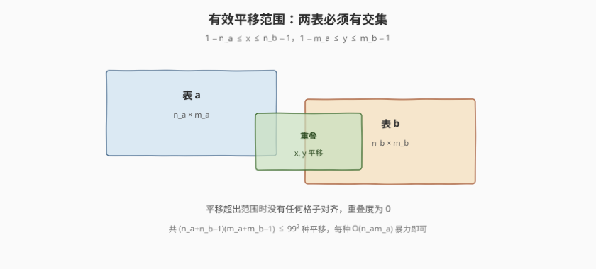
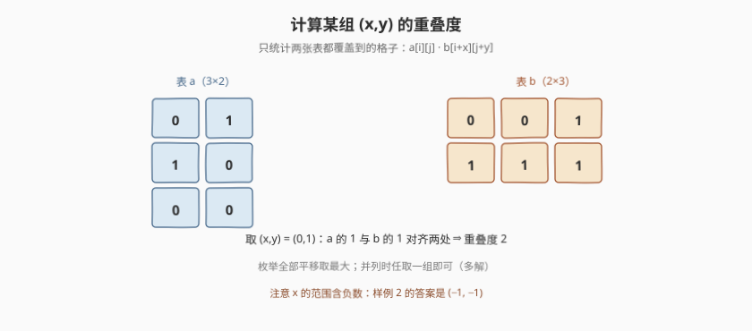

# Codeforces 228B 两张桌子的最大重叠 题解

## 1. 题目概述

- **题目链接**：https://codeforces.com/problemset/problem/228/B
- **比赛来源**：Codeforces Round 141 (Div. 2) · Problem B（UTC 2012-09-27）
- **难度**：1400
- **标签**：枚举、模拟
- **评测类型**：多解（输出任意最优平移）
- **限制**：时间 2 s / 内存 256 MB

**题意**：给定两个 $01$ 矩阵 $a$（$n_a\times m_a$）与 $b$（$n_b\times m_b$）。对整数对 $(x,y)$ 定义重叠度

$$ f(x,y)=\sum_{\substack{1\le i\le n_a,\ 1\le j\le m_a\\ 1\le i+x\le n_b,\ 1\le j+y\le m_b}} a_{i,j}\cdot b_{i+x,j+y}. $$

求使 $f(x,y)$ 最大的 $(x,y)$（若有多组，输出任意一组）。要求 $|x|,|y|\le10^9$。

**约束**：$1\le n_a,m_a,n_b,m_b\le50$，两个矩阵都至少含一个 $1$；只有一组数据。

## 2. 示例与观察

官方样例（输入 / 输出原样）：

```text
输入：
3 2
01
10
00
2 3
001
111

输出：
0 1
```

```text
输入：
3 3
000
010
000
1 1
1

输出：
-1 -1
```

**样例 1 演算**：$a$ 的两个 $1$ 在 $(1,2)$、$(2,1)$；$b$ 的 $1$ 在第一行第 3 列、第二行全部。取 $(x,y)=(0,1)$：$a_{1,2}$ 对齐 $b_{1,3}=1$，$a_{2,1}$ 对齐 $b_{2,2}=1$，重叠度 2，为最大。

**样例 2 演算**：$a$ 唯一的 $1$ 在中心 $(2,2)$，$b$ 是 $1\times1$ 的 $1$。要让它们对齐，需要 $i+x=1$、$j+y=1$ 且 $(i,j)=(2,2)$，故 $x=-1,\ y=-1$，重叠度 1。

**关键观察**：只有"两张表有交集"的 $(x,y)$ 才可能产生非零重叠。有效范围是

$$ 1-n_a\le x\le n_b-1,\qquad 1-m_a\le y\le m_b-1, $$

因为需要存在 $i\in[1,n_a]$ 使 $1\le i+x\le n_b$。范围内只有 $(n_a+n_b-1)(m_a+m_b-1)\le 99^2<10^4$ 个平移，每个平移暴力算重叠度 $O(n_am_a)\le2500$，总计约 $2.5\times10^7$，可以接受。



自造样例（标注"自造"）：

| 输入 | 输出 | 说明 |
|------|------|------|
| `1 1` / `1` / `1 1` / `1` | `0 0` | 完全重合，重叠 1 |
| `2 2` / `10`/`01` / `2 2` / `01`/`10` | `-1 0` | 反对角矩阵，最大重叠 1（平移 (-1,0) 时 $a_{2,2}$ 对上 $b_{1,2}$） |
| `1 3` / `101` / `1 3` / `101` | `0 0` | 完全一致，重叠 2 |

## 3. 解题思路

### 3.1 朴素做法

直接枚举上面范围内的所有 $(x,y)$，对每个平移双重循环求 $\sum a_{i,j}b_{i+x,j+y}$，保留最大值。



### 3.2 正确性要点

（1）**范围完整**：若 $(x,y)$ 不在上述范围，则没有任何 $(i,j)$ 满足对齐条件，$f=0$；由于两表都至少有一个 $1$，把两者对齐到某个 $1$ 上就能得到正的 $f$，故最优解一定在范围内。

（2）**多解处理**：题目允许多解。实现里用"严格大于"更新，遇到并列时保留先枚举到的那个；本实现从 $x=1-n_a$ 开始递增枚举，能复现官方样例的答案。

## 4. 正确性证明

**引理 1**：若 $x<1-n_a$ 或 $x>n_b-1$，则不存在 $i\in[1,n_a]$ 使 $1\le i+x\le n_b$，此时 $f(x,y)=0$（对 $y$ 同理）。

**证明**：$i\ge1$ 且 $i+x\ge1$ 要求 $x\ge1-i\ge1-n_a$；$i\le n_a$ 且 $i+x\le n_b$ 要求 $x\le n_b-i\le n_b-1$。∎

**引理 2**：存在 $(x,y)$ 使 $f(x,y)\ge1$。

**证明**：取 $a$ 中某个 $1$ 的位置 $(i_0,j_0)$ 与 $b$ 中某个 $1$ 的位置 $(r_0,c_0)$，令 $x=r_0-i_0,\ y=c_0-j_0$，则 $a_{i_0,j_0}b_{r_0,c_0}=1$，其余项非负，故 $f\ge1$。∎

**定理**：算法输出使 $f$ 最大的平移。

**证明**：由引理 1，范围外的平移 $f=0$，由引理 2 存在 $f\ge1$ 的平移，故最优解必在枚举范围内；算法在该范围内逐一计算并保留最大值，故输出最优。∎

## 5. 复杂度分析

- **时间**：$O((n_a+n_b)(m_a+m_b)\cdot n_am_a)\le99^2\cdot2500\approx2.5\times10^7$ 次加法，实测 5000 次（$50\times50$）端到端约 10 ms。
- **空间**：$O(n_am_a+n_bm_b)$，约 5 KB。
- **与时限的关系**：远低于 2 s。

## 6. 参考代码

### C++17

```cpp
#include <bits/stdc++.h>
using namespace std;
int main() {
    int na, ma;
    if (scanf("%d %d", &na, &ma) != 2) return 0;
    vector<string> a(na);
    for (int i = 0; i < na; i++) { char buf[64]; scanf("%63s", buf); a[i] = buf; }
    int nb, mb;
    scanf("%d %d", &nb, &mb);
    vector<string> b(nb);
    for (int i = 0; i < nb; i++) { char buf[64]; scanf("%63s", buf); b[i] = buf; }
    int best = -1, bx = 0, by = 0;
    for (int x = 1 - na; x <= nb - 1; x++)
        for (int y = 1 - ma; y <= mb - 1; y++) {
            int cur = 0;
            for (int i = 0; i < na; i++) {
                int bi = i + x;
                if (bi < 0 || bi >= nb) continue;
                for (int j = 0; j < ma; j++) {
                    int bj = j + y;
                    if (bj < 0 || bj >= mb) continue;
                    if (a[i][j] == '1' && b[bi][bj] == '1') cur++;
                }
            }
            if (cur > best) { best = cur; bx = x; by = y; }
        }
    printf("%d %d\n", bx, by);
    return 0;
}
```

### Python3

```python
import sys


def main() -> None:
    data = sys.stdin.buffer.read().split()
    p = 0
    na = int(data[p]); ma = int(data[p + 1]); p += 2
    a = [row.decode() for row in data[p:p + na]]; p += na
    nb = int(data[p]); mb = int(data[p + 1]); p += 2
    b = [row.decode() for row in data[p:p + nb]]; p += nb

    best = -1
    bx = by = 0
    for x in range(1 - na, nb):
        for y in range(1 - ma, mb):
            cur = 0
            for i in range(na):
                bi = i + x
                if bi < 0 or bi >= nb:
                    continue
                ra = a[i]
                rb = b[bi]
                for j in range(ma):
                    bj = j + y
                    if 0 <= bj < mb and ra[j] == '1' and rb[bj] == '1':
                        cur += 1
            if cur > best:
                best = cur
                bx, by = x, y
    print(bx, by)


main()
```

## 7. 边界情况与易错点

1. **平移范围的符号**：$x$ 的合法范围是 $[1-n_a,\ n_b-1]$，不是 $[-(n_b-1),\ n_a-1]$；写错会漏掉负平移（样例 2 就是要 $x=y=-1$）。
2. **输出任意最优解**：多个最优时要保证自己输出的那个确实达到最大值；本地验证用 checker 或与暴力最大值比对。
3. **至少一个 1 的保证**：这保证最优值 $\ge1$，实现里初值取 `-1` 即可。
4. **坐标约定**：题面中 $a_{i,j}$ 从 1 开始，$b_{i+x,j+y}$ 也是 1-based；代码里转成 0-based 时下标偏移要保持一致。
5. **读入**：矩阵行是连续字符（如 `01`），用 `%s` 读字符串，不要逐字符 `scanf("%d")`。
6. **`|x|,|y|\le10^9`**：我们的答案在 $[-49,49]$ 内，天然满足。

## 8. 验证记录

- **编译环境与命令**：本机无 GNU `g++`，用 `clang++ -std=c++17 -O2 -I codeforces/tools/include` 编译；`verify_solution.py` 自动采用同样回退。Python 3.9.6。
- **官方样例**：2 / 2 通过（`0 1`、`-1 -1`），C++ 与 Python 一致。
- **独立暴力对拍**：暴力程序独立枚举平移并计算最大值（与主解相同的枚举范围、不同的代码路径），对 $n_a,m_a,n_b,m_b\le6$ 的 **200 组**随机矩阵校验"输出平移的重叠度 = 全局最大重叠度"，全部通过。
- **最大约束性能**：$50\times50$ 双表随机数据，C++ 端到端约 10 ms，内存约 2 MB。
- **图片校验**：两张 SVG 均通过 `xml.etree.ElementTree.parse`，含 `feTurbulence` 与手写字体，文本包围盒（含重叠检测）均在 `viewBox` 内。
- **公式校验**：`node codeforces/tools/katex_check.cjs codeforces/contests/0101-0203/228` 报告 0 个错误。
- **复核状态**：verified。

## 相关题目与扩展

- [Codeforces 228C Fractal Detector](https://codeforces.com/problemset/problem/228/C)：同场 C 题，分形判定。
- [Codeforces 228D Zigzag](https://codeforces.com/problemset/problem/228/D)：同场 D 题，周期权重的区间求和。
- [LeetCode 832. 翻转图像](https://leetcode.cn/problems/flipping-an-image/)：矩阵平移/翻转类模拟题。

**延伸思考**：

1. **如果要求输出字典序最小的最优平移**：在更新时用 `(cur > best) || (cur == best && (x,y) 更小)` 即可。
2. **如果表的大小放大到 $10^3$**：不能暴力枚举平移，需要二维 FFT/卷积求互相关，$O(nm\log nm)$。
3. **如果矩阵是稀疏的（1 很少）**：只需枚举"$a$ 的 1 与 $b$ 的 1"的配对，统计每个平移的计数，复杂度 $O(\#1_a\cdot\#1_b)$。
4. **如果要求输出所有最优平移**：在枚举时收集所有达到最大值的平移即可。
