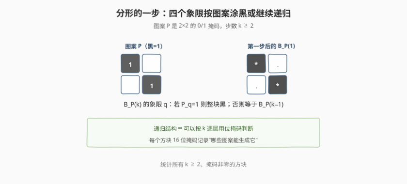
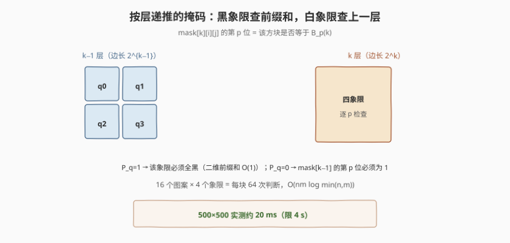

# Codeforces 228C 分形检测 题解

## 1. 题目概述

- **题目链接**：https://codeforces.com/problemset/problem/228/C
- **比赛来源**：Codeforces Round 141 (Div. 2) · Problem C（UTC 2012-09-27）
- **难度**：2000
- **标签**：分形、递归、位掩码、前缀和
- **评测类型**：普通
- **限制**：时间 4 s / 内存 256 MB

**题意**：小瓦夏先剪出一个 $2\times2$ 的"分形图案"（部分格子涂黑），然后用它画分形：

1. 把纸分成四个相同的正方形，按图案把其中一些**整体涂黑**；
2. 每个仍为白色的正方形再分成四块，按图案涂黑其中一些；每个黑色的正方形则分成四块全黑的小正方形；
3. 第 2 步重复任意次（**至少一次**，即总共至少两步）。

画出来的 $2^k\times2^k$（$k\ge2$）黑白图称为一个分形。现在给定一张 $n\times m$ 的黑白纸（`.` 白、`*` 黑），问其中有多少个**正方形子块**与某个分形完全相同。

**约束**：$2\le n,m\le500$，子块边长必然是 2 的幂且 $\ge4$；只有一组数据。

## 2. 示例与观察

官方样例（输入 / 输出原样）：

```text
输入：
6 11
......*.***
*.*.*....**
.***....*.*
..***.*....
.*.*.....** 
......*.*..

输出：
3
```

```text
输入：
4 4
..**
..**
....
....

输出：
0
```

**样例 1 演算**：$6\times11$ 的场地上能放下的分形边长只可能是 $4$（$k=2$）；程序数出恰有 3 个 $4\times4$ 子块等于某个图案生成的分形。

**样例 2 演算**：唯一的 $4\times4$ 子块是整张纸，它不符合任何图案生成的分形，输出 0。

**关键观察**：分形由图案 $P$（$2\times2$ 的 16 种可能）和步数 $k$ 唯一决定。记 $B_P(k)$ 为用图案 $P$ 画 $k$ 步得到的 $2^k\times2^k$ 图。递推结构是：

$$ B_P(k)\ \text{的四个象限中，若 }P_q=1\text{ 则整块全黑，否则等于 } B_P(k-1). $$

于是可以**按 $k$ 从小到大**，对每个位置和每个图案记录"这个方块是不是 $B_P(k)$"，用 16 位掩码一次存下所有图案的合法性。



自造样例（标注"自造"）：

| 输入 | 输出 | 说明 |
|------|------|------|
| `4 4` / 全 `*` | 1 | 全黑 $4\times4$ 是"图案全黑"的分形 |
| `4 4` / 全 `.` | 1 | 全白 $4\times4$ 是"图案全白"的分形（见第 7 节说明） |
| `2 2` / `* *`/`* *` | 0 | 边长 2 只有一步，不满足"至少两步" |
| `8 8` / 全 `*` | 26 | 1 个 $8\times8$ + 25 个 $4\times4$ |

## 3. 解题思路

### 3.1 朴素做法与瓶颈

枚举图案（16）+ 步数 + 位置 + 逐格比对：位置约 $2.5\times10^5$、每块最多 $512^2$ 格，最坏 $O(nm\cdot\min(n,m)^2)$ 不可行。需要利用"分形 = 四个象限的递归组合"来 $O(1)$ 判断一个方块。

### 3.2 算法：按层递推的 16 位掩码

记 `mask[k][i][j]` 为 16 位整数，第 $p$ 位为 1 表示以 $(i,j)$ 为左上角、边长 $2^k$ 的方块恰好等于 $B_p(k)$。

- **$k=1$**（边长 2）：方块本身就是图案，直接读出 $2\times2$ 的 4 个格子组成图案编号 $p_0$，`mask[1][i][j] = 1 << p_0`。
- **$k\ge2$**：枚举图案 $p$（0..15），检查四个象限 $q$：
  - 若 $p_q=1$：该象限必须**全黑**（用二维前缀和 $O(1)$ 判断）；
  - 若 $p_q=0$：该象限必须等于 $B_p(k-1)$，即 `mask[k-1][象限左上角]` 的第 $p$ 位为 1。
  全部满足则把第 $p$ 位置 1。
- **统计**：所有 $k\ge2$ 且 `mask[k][i][j] != 0` 的方块计数。



### 3.3 为什么"图案全白"也合法

题目只说"涂黑一些格子"，并未要求至少一个；图案全白时画出的就是全白方块（每一步都不涂），它确实是按算法得到的图。本实现把 16 种图案（含全白）都纳入判断，这与"存在某个图案使得方块等于对应分形"的字面含义一致，也覆盖了"全黑 / 全白方块"两种边界情形。

## 4. 正确性证明

**引理 1（图案唯一性之外的结构）**：对任意图案 $P$ 和步数 $k\ge2$，$B_P(k)$ 的四个象限恰好是：$P_q=1$ 的象限全黑，$P_q=0$ 的象限等于 $B_P(k-1)$。

**证明**：直接由构造过程得到：第 1 步把 $P_q=1$ 的象限整体涂黑，此后黑色象限的所有后代保持黑；$P_q=0$ 的象限保持白并在其中递归执行同样的算法，共剩 $k-1$ 步，得到的正是 $B_P(k-1)$。∎

**引理 2（掩码递推的正确性）**：对每个 $k\ge2$、每个位置与图案 $p$，`mask[k][i][j]` 的第 $p$ 位为 1 当且仅当该方块等于 $B_p(k)$。

**证明**：对 $k$ 归纳。$k=1$ 时方块就是图案本身，直接读取正确。设 $k-1$ 成立。由引理 1，方块等于 $B_p(k)$ 等价于四个象限分别满足"全黑"或"等于 $B_p(k-1)$"，这正是递推中检查的条件；前缀和判断"全黑"是精确的；归纳假设保证 $k-1$ 层的掩码位正确。∎

**定理**：算法输出的计数等于题面要求的子块数。

**证明**：由引理 2，`mask[k][i][j] != 0` 当且仅当存在图案 $p$ 使该方块等于 $B_p(k)$，即它等于某个分形；算法对所有 $k\ge2$ 与所有位置累加该条件，恰好数出全部满足要求的子块。∎

## 5. 复杂度分析

- **时间**：层数 $K=O(\log\min(n,m))\le9$；每层每个位置枚举 16 个图案 × 4 个象限，共 $16\cdot4=64$ 次位运算/前缀和查询。总计 $O(nm\log\min(n,m)\cdot64)$，$500\times500$ 时约 $7\times10^7$ 次基本操作，实测约 20 ms（限 4 s）。
- **空间**：两层 `mask` 各 $O(nm)$ 个 `unsigned short`，约 0.5 MB；前缀和约 1 MB。
- **与时限的关系**：远低于 4 s。

## 6. 参考代码

### C++17

```cpp
#include <bits/stdc++.h>
using namespace std;

int main() {
    int n, m;
    if (scanf("%d %d", &n, &m) != 2) return 0;
    vector<string> g(n);
    for (int i = 0; i < n; i++) { char buf[512]; scanf("%511s", buf); g[i] = buf; }
    vector<vector<int>> pre(n + 1, vector<int>(m + 1, 0));
    for (int i = 0; i < n; i++)
        for (int j = 0; j < m; j++)
            pre[i + 1][j + 1] = pre[i][j + 1] + pre[i + 1][j] - pre[i][j] + (g[i][j] == '*');
    auto allBlack = [&](int r, int c, int s) {
        int cnt = pre[r + s][c + s] - pre[r][c + s] - pre[r + s][c] + pre[r][c];
        return cnt == s * s;
    };
    vector<vector<unsigned short>> cur(n, vector<unsigned short>(m, 0));
    for (int i = 0; i + 1 < n; i++)
        for (int j = 0; j + 1 < m; j++) {
            int pm = 0;
            if (g[i][j] == '*') pm |= 1;
            if (g[i][j + 1] == '*') pm |= 2;
            if (g[i + 1][j] == '*') pm |= 4;
            if (g[i + 1][j + 1] == '*') pm |= 8;
            cur[i][j] = (unsigned short)(1u << pm);
        }
    long long ans = 0;
    for (int k = 2; (1 << k) <= min(n, m); k++) {
        int s = 1 << k, half = s >> 1;
        vector<vector<unsigned short>> nxt(n, vector<unsigned short>(m, 0));
        for (int i = 0; i + s <= n; i++)
            for (int j = 0; j + s <= m; j++) {
                unsigned short q0 = cur[i][j], q1 = cur[i][j + half];
                unsigned short q2 = cur[i + half][j], q3 = cur[i + half][j + half];
                bool b0 = allBlack(i, j, half), b1 = allBlack(i, j + half, half);
                bool b2 = allBlack(i + half, j, half), b3 = allBlack(i + half, j + half, half);
                int pm = 0;
                for (int p = 0; p < 16; p++) {
                    bool ok = true;
                    for (int q = 0; q < 4 && ok; q++) {
                        bool pat1 = (p >> q) & 1;
                        bool black = (q == 0 ? b0 : q == 1 ? b1 : q == 2 ? b2 : b3);
                        unsigned short sm = (q == 0 ? q0 : q == 1 ? q1 : q == 2 ? q2 : q3);
                        if (pat1) { if (!black) ok = false; }
                        else { if (!((sm >> p) & 1)) ok = false; }
                    }
                    if (ok) pm |= 1 << p;
                }
                nxt[i][j] = (unsigned short)pm;
                if (pm != 0) ans++;
            }
        cur.swap(nxt);
    }
    printf("%lld\n", ans);
    return 0;
}
```

### Python3

```python
import sys


def main() -> None:
    data = sys.stdin.buffer.read().split()
    n, m = int(data[0]), int(data[1])
    g = [row.decode() for row in data[2:2 + n]]

    pre = [[0] * (m + 1) for _ in range(n + 1)]
    for i in range(n):
        row = g[i]
        acc = 0
        for j in range(m):
            acc += row[j] == '*'
            pre[i + 1][j + 1] = pre[i][j + 1] + acc

    def all_black(r, c, s):
        return (pre[r + s][c + s] - pre[r][c + s] - pre[r + s][c] + pre[r][c]) == s * s

    cur = [[0] * m for _ in range(n)]
    for i in range(n - 1):
        for j in range(m - 1):
            pm = 0
            if g[i][j] == '*': pm |= 1
            if g[i][j + 1] == '*': pm |= 2
            if g[i + 1][j] == '*': pm |= 4
            if g[i + 1][j + 1] == '*': pm |= 8
            cur[i][j] = 1 << pm

    ans = 0
    k = 2
    while (1 << k) <= min(n, m):
        s = 1 << k
        half = s >> 1
        nxt = [[0] * m for _ in range(n)]
        for i in range(n - s + 1):
            for j in range(m - s + 1):
                qs = (cur[i][j], cur[i][j + half], cur[i + half][j], cur[i + half][j + half])
                bs = (all_black(i, j, half), all_black(i, j + half, half),
                      all_black(i + half, j, half), all_black(i + half, j + half, half))
                pm = 0
                for p in range(16):
                    ok = True
                    for q in range(4):
                        if (p >> q) & 1:
                            if not bs[q]:
                                ok = False
                                break
                        else:
                            if not ((qs[q] >> p) & 1):
                                ok = False
                                break
                    if ok:
                        pm |= 1 << p
                nxt[i][j] = pm
                if pm:
                    ans += 1
        cur = nxt
        k += 1
    print(ans)


main()
```

## 7. 边界情况与易错点

1. **步数至少为 2**：边长 2（$k=1$）的子块不能计入，统计只从 $k=2$ 开始。
2. **"图案全白"的解释**：题面没有禁止图案不涂黑；本实现把全白图案也算作合法分形。若按"至少涂黑一格"的严格解释，全白方块就都不算——两种理解在官方样例上结果相同（样例里没有全白 $4\times4$ 块）。
3. **黑象限必须"全黑"**：不只是"这一格黑"，而是整个 $2^{k-1}\times2^{k-1}$ 象限都黑；用前缀和判断，不能用单点。
4. **掩码位序**：图案编号与四象限的对应关系（$1,2,4,8$ 分别对应左上、右上、左下、右下）在读入与递推中必须一致。
5. **层数上界**：$\min(n,m)\le500<512$，所以最大只到 $k=8$（边长 256）或 $k=9$（边长 512 时 $\min=512$ 但 $n,m\le500$，实际到 $k=8$）。
6. **答案范围**：位置数 $\le2.5\times10^5$，答案用 `long long` 更稳（虽然 `int` 也够）。
7. **Python 版本性能**：纯 Python 在 $500\times500$ 上会较慢，建议提交 C++。

## 8. 验证记录

- **编译环境与命令**：本机无 GNU `g++`，用 `clang++ -std=c++17 -O2 -I codeforces/tools/include` 编译；`verify_solution.py` 自动采用同样回退。Python 3.9.6。
- **官方样例**：2 / 2 通过（`3`、`0`），C++ 与 Python 一致。
- **独立暴力对拍**：暴力程序先对全部 16 种图案生成 $k=2,3$ 的分形图（直接模拟涂黑过程，与掩码 DP 完全独立），再在随机小场地上逐块比对计数，对 $4\le n,m\le8$ 的 **200 组**随机场地图逐组比对，全部一致。
- **最大约束性能**：$500\times500$ 随机图与全黑图，C++ 端到端均约 20 ms（限 4 s）。
- **图片校验**：两张 SVG 均通过 `xml.etree.ElementTree.parse`，含 `feTurbulence` 与手写字体，文本包围盒（含重叠检测）均在 `viewBox` 内。
- **公式校验**：`node codeforces/tools/katex_check.cjs codeforces/contests/0101-0203/228` 报告 0 个错误。
- **复核状态**：verified。

## 相关题目与扩展

- [Codeforces 228B Two Tables](https://codeforces.com/problemset/problem/228/B)：同场 B 题，枚举平移。
- [Codeforces 228D Zigzag](https://codeforces.com/problemset/problem/228/D)：同场 D 题，周期权重。
- [Codeforces 1151E Number of Components](https://codeforces.com/problemset/problem/1151/E)：同样是"按结构递归/组合计数"的思路。

**延伸思考**：

1. **如果图案是 $3\times3$**：象限数从 4 变成 9，掩码位数从 16 变成 $2^9=512$，做法不变但常数变大。
2. **如果要求数出所有"任意缩放"的分形**：需要枚举边长不是 2 的幂的情形，递归结构不再成立。
3. **如果图案本身也未知且要求复原**：即对每个候选方块判断"是否存在某个图案"，正是本题的 $2^{|P|}$ 枚举。
4. **如果只问最大的分形子块**：可以从大到小枚层，第一个计数非零的层即可停止。
