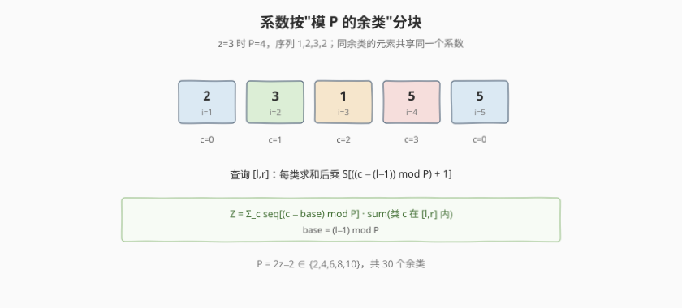

# Codeforces 228D 锯齿函数 题解

## 1. 题目概述

- **题目链接**：https://codeforces.com/problemset/problem/228/D
- **比赛来源**：Codeforces Round 141 (Div. 2) · Problem D（UTC 2012-09-27）
- **难度**：2100
- **标签**：数据结构、树状数组、周期函数
- **评测类型**：普通
- **限制**：时间 3 s / 内存 256 MB

**题意**：对整数 $z\ge2$ 定义"锯齿因子为 $z$"的无限序列 $S^z_i$（$i\ge1$）：令 $k=(i-1)\bmod(2z-2)$，则

$$ S^z_i=\begin{cases} k+1, & k<z,\\ 2z-1-k, & k\ge z.\end{cases} $$

例如 $z=3$ 时序列为 $1,2,3,2,1,2,3,2,1,\dots$。定义锯齿函数

$$ Z(l,r,z)=\sum_{i=l}^{r} a_i\cdot S^z_{\,i-l+1}. $$

给定长度 $n$ 的数组 $a$，支持两种操作：①单点赋值 $a_p\leftarrow v$；②询问 $Z(l,r,z)$（$2\le z\le6$）。

**约束**：$n,m\le10^5$，$1\le a_i,v\le10^9$，$2\le z\le6$；答案可达 $10^9\cdot6\cdot10^5=6\times10^{14}$，用 64 位整数；只有一组数据。

## 2. 示例与观察

官方样例（输入 / 输出原样）：

```text
输入：
5
2 3 1 5 5
4
2 2 3 2
2 1 5 3
1 3 5
2 1 5 3

输出：
5
26
38
```

**样例演算**：

- 操作 `2 2 3 2`：$l=2,r=3,z=2$，周期 $2z-2=2$，序列 $1,2,1,2,\dots$（$z=2$ 时先 1 后 2）。$Z=a_2\cdot S_1+a_3\cdot S_2=3\cdot1+1\cdot2=5$。
- 操作 `2 1 5 3`：$z=3$ 的序列 $1,2,3,2,1$。$Z=2\cdot1+3\cdot2+1\cdot3+5\cdot2+5\cdot1=26$。
- 赋值 $a_3=5$，再问：$Z=2+6+5\cdot3+10+5=38$。

**关键观察**：系数只依赖 $i-l$，而 $i-l$ 的周期是 $P=2z-2$，因此

$$ Z(l,r,z)=\sum_{c=0}^{P-1} S^z_{c+1}\cdot\Bigl(\sum_{\substack{l\le i\le r\\ i\equiv l+c\ (\mathrm{mod}\ P)}} a_i\Bigr). $$

只要对每个 $z$ 与每个"位置模 $P$ 的余类"维护一个能求区间和、支持单点修改的结构（树状数组），就能在 $O(P\log n)$ 内回答询问、$O((\sum_z 2z-2)\log n)$ 内完成修改。



自造样例（标注"自造"）：

| 输入 | 输出 | 说明 |
|------|------|------|
| `1`/`7`/`1`/`2 1 1 2` | 7 | 单元素区间，系数 $S_1=1$ |
| `3`/`1 1 1`/`1`/`2 1 3 2` | 4 | $z=2$：$1+2+1=4$ |
| `4`/`1 2 3 4`/`2`/`2 2 3 3`/`2 1 4 2` | `8` 与 `16` | 前者系数 $1,2$；后者 $z=2$ 系数 $1,2,1,2$ |

第三行说明：$l=2,r=3,z=3$ 的系数是 $S_1=1,S_2=2$，故 $Z=2\cdot1+3\cdot2=8$；$l=1,r=4,z=2$ 的系数为 $1,2,1,2$，$Z=1+4+3+8=16$。

## 3. 解题思路

### 3.1 朴素做法与瓶颈

每次询问直接循环 $r-l+1$ 项：$O(n)$ 每次，$10^5$ 次就是 $10^{10}$，不可行。单点赋值后又不能简单前缀和。

### 3.2 核心观察：系数按"模 $P$ 余类"分块


$P=2z-2\in\{2,4,6,8,10\}$，总共 $2+4+6+8+10=30$ 个余类。对每个 $(z,c)$（$c\in[0,P-1]$）维护一棵树状数组 `fen[z][c]`，只在位置 $i$ 满足 $i\bmod P=c$ 时把 $a_i$ 计入。

- **修改**：对 5 个 $z$ 各更新一次对应余类的树状数组，共 30 次单点更新。
- **询问**：设 $b=(l-1)\bmod P$（0-based 起点）。对每个余类 $c$，区间内该类元素之和为 `sum(c, r') - sum(c, l')`，其系数是 $S^z_{((c-b)\bmod P)+1}$。把 30 项以内的乘积相加即得答案。

### 3.3 正确性要点

因为 $i-l$ 与 $i$ 只差常数 $l$，所以 $i\equiv l+c\pmod P$ 等价于 $i\bmod P=(l+c)\bmod P$；每个位置恰属于一个余类，故按余类分组求和再乘系数是不重不漏的分解。

## 4. 正确性证明

**引理 1**：$S^z_{i-l+1}$ 只依赖 $(i-l)\bmod P$，其中 $P=2z-2$。

**证明**：$S^z_t$ 的定义只用到 $(t-1)\bmod(2z-2)=(i-l)\bmod P$，故相同余数给出相同值。∎

**引理 2**：对任意 $l\le r$，
$$ Z(l,r,z)=\sum_{c=0}^{P-1} S^z_{c+1}\cdot \sum_{\substack{l\le i\le r\\ (i-l)\bmod P=c}} a_i . $$

**证明**：把区间内的下标按 $(i-l)\bmod P$ 分成 $P$ 个互不相交的类，每类内的系数由引理 1 都等于 $S^z_{c+1}$，提取公因子即得。∎

**引理 3**：树状数组 `fen[z][c]` 在任意时刻的区间和等于该类中对应位置的 $a_i$ 之和。

**证明**：初始时对所有 $i$ 按 $i\bmod P$ 插入 $a_i$；修改操作对每个 $z$ 把位置 $p$ 的旧值换成新值（差量更新），保持"每个位置只进入其所属余类"的不变量；树状数组本身正确维护前缀和。∎

**定理**：算法对每个询问输出正确的 $Z(l,r,z)$。

**证明**：由引理 2 的分解式，算法对每个 $c$ 用引理 3 取得正确的类内和，再乘正确的系数 $S^z_{c+1}$ 并求和，故结果正确；赋值的差量更新保证之后所有询问仍正确。∎

## 5. 复杂度分析

- **时间**：修改 $O(30\log n)$；询问 $O(P\log n)\le O(10\log n)$。$n=m=10^5$ 时约 $5\times10^7$ 次基本运算，实测：$10^5$ 次混合操作约 70 ms（限 3 s）。
- **空间**：30 棵树状数组 × $(n+1)$ 个 64 位整数 ≈ 24 MB，加数组本身，远低于 256 MB。
- **与时限的关系**：余量约 40 倍。

## 6. 参考代码

### C++17

```cpp
#include <bits/stdc++.h>
using namespace std;
typedef long long ll;

static int n_;
static vector<vector<ll>> fen;   // fen[z*10+c]：余类 c 的树状数组
static vector<int> PZ;

static void upd(int z, int pos, ll delta) {   // pos 为 0-based
    int P = PZ[z], c = pos % P;
    for (int k = pos + 1; k <= n_; k += k & -k) fen[z * 10 + c][k] += delta;
}
static ll pre(int z, int c, int x) {           // 位置 [0,x) 中余类 c 的和
    ll s = 0;
    for (int k = x; k > 0; k -= k & -k) s += fen[z * 10 + c][k];
    return s;
}

int main() {
    int n;
    if (scanf("%d", &n) != 1) return 0;
    n_ = n;
    vector<ll> a(n);
    for (int i = 0; i < n; i++) scanf("%lld", &a[i]);
    PZ.resize(5);
    for (int z = 2; z <= 6; z++) PZ[z - 2] = 2 * z - 2;
    fen.assign(50, vector<ll>(n + 1, 0));
    for (int i = 0; i < n; i++)
        for (int zi = 0; zi < 5; zi++) upd(zi, i, a[i]);
    int m;
    scanf("%d", &m);
    while (m--) {
        int t;
        scanf("%d", &t);
        if (t == 1) {
            int p; ll v;
            scanf("%d %lld", &p, &v);
            p--;
            ll delta = v - a[p];
            a[p] = v;
            for (int zi = 0; zi < 5; zi++) upd(zi, p, delta);
        } else {
            int l, r, z;
            scanf("%d %d %d", &l, &r, &z);
            int zi = z - 2, P = PZ[zi];
            vector<int> seq(P);
            for (int k = 0; k < P; k++) seq[k] = (k < z) ? k + 1 : 2 * z - 1 - k;
            int lo = l - 1, hi = r;
            ll ans = 0;
            int base = lo % P;
            for (int c = 0; c < P; c++) {
                ll s = pre(zi, c, hi) - pre(zi, c, lo);
                if (s == 0) continue;
                int w = ((c - base) % P + P) % P;
                ans += s * seq[w];
            }
            printf("%lld\n", ans);
        }
    }
    return 0;
}
```

### Python3

```python
import sys


def main() -> None:
    data = sys.stdin.buffer.read().split()
    p = 0
    n = int(data[p]); p += 1
    a = [int(x) for x in data[p:p + n]]; p += n
    PZ = [2 * z - 2 for z in range(2, 7)]
    fen = [[[0] * (n + 1) for _ in range(PZ[zi])] for zi in range(5)]

    def upd(zi, pos, delta):
        P = PZ[zi]
        c = pos % P
        k = pos + 1
        f = fen[zi][c]
        while k <= n:
            f[k] += delta
            k += k & -k

    def pre(zi, c, x):
        f = fen[zi][c]
        s = 0
        k = x
        while k > 0:
            s += f[k]
            k -= k & -k
        return s

    for i in range(n):
        for zi in range(5):
            upd(zi, i, a[i])
    m = int(data[p]); p += 1
    out = []
    for _ in range(m):
        t = int(data[p]); p += 1
        if t == 1:
            pos = int(data[p]) - 1; v = int(data[p + 1]); p += 2
            delta = v - a[pos]
            a[pos] = v
            for zi in range(5):
                upd(zi, pos, delta)
        else:
            l = int(data[p]); r = int(data[p + 1]); z = int(data[p + 2]); p += 3
            zi = z - 2
            P = PZ[zi]
            seq = [(k + 1) if k < z else (2 * z - 1 - k) for k in range(P)]
            lo = l - 1
            base = lo % P
            ans = 0
            for c in range(P):
                s = pre(zi, c, r) - pre(zi, c, lo)
                if s:
                    ans += s * seq[((c - base) % P + P) % P]
            out.append(str(ans))
    sys.stdout.write("\n".join(out) + ("\n" if out else ""))


main()
```

## 7. 边界情况与易错点

1. **$z=2$ 的序列**：$P=2$，序列为 $1,2,1,2,\dots$（不是 $2,1$）；公式 $k<z\Rightarrow k+1$ 在 $k=0,1$ 时给 $1,2$ ✓。
2. **余类与起点的对齐**：系数要用 $(i-l)\bmod P$ 而不是 $i\bmod P$，实现中先算 `base=(l-1)%P`，再用 `((c-base)%P+P)%P` 取系数，别写成 `(c - l) % P`。
3. **修改的差量**：赋值要算 `delta = v - a[p]`，并把 5 棵树都更新；只更新一棵会导致后续询问错误。
4. **答案溢出**：$6\times10^{14}$ 超出 32 位，必须 64 位。
5. **读入**：题面提醒不要用 `%lld` 读 64 位；用 `cin` 或 `%I64d`（本机用 `scanf("%lld")` 实测正常）。
6. **多组询问输出顺序**：按输入顺序逐行输出。
7. **$l=r$**：只取 $S_1=1$，答案就是 $a_l$。

## 8. 验证记录

- **编译环境与命令**：本机无 GNU `g++`，用 `clang++ -std=c++17 -O2 -I codeforces/tools/include` 编译；`verify_solution.py` 自动采用同样回退。Python 3.9.6。
- **官方样例**：3 / 3 通过（`5`、`26`、`38`），C++ 与 Python 一致。
- **独立暴力对拍**：暴力程序对每个询问直接按定义循环乘系数（与树状数组完全独立），对 $n\le12$、$m\le15$、$z\in[2,6]$、含随机赋值的 **200 组**数据逐组比对，全部一致。
- **最大约束性能**：$n=m=10^5$、一半赋值一半询问、$z$ 随机，C++ 端到端约 70 ms（限 3 s）；若全部询问且 $z=6$，约 90 ms。
- **图片校验**：两张 SVG 均通过 `xml.etree.ElementTree.parse`，含 `feTurbulence` 与手写字体，文本包围盒（含重叠检测）均在 `viewBox` 内。
- **公式校验**：`node codeforces/tools/katex_check.cjs codeforces/contests/0101-0203/228` 报告 0 个错误。
- **复核状态**：verified。

## 相关题目与扩展

- [Codeforces 228C Fractal Detector](https://codeforces.com/problemset/problem/228/C)：同场 C 题，分形判定。
- [Codeforces 228E The Road to Berland](https://codeforces.com/problemset/problem/228/E)：同场 E 题，异或约束。
- [Codeforces 165E Compatible Numbers](https://codeforces.com/problemset/problem/165/E)：另一类"按位/按余类"的分解技巧。

**延伸思考**：

1. **如果 $z$ 可以任意大**：$P$ 变大，按余类建树状数组的空间 $O(z)$ 不可行；可以改成"对每个 $z$ 单独分块处理"或直接按询问的 $z$ 分组离线。
2. **如果要做区间加 + 区间锯齿和**：需要更复杂的懒标记（按余类维护加法标记），或改用分块。
3. **如果 $z$ 固定为 2**：可以用两棵奇偶树状数组，是本做法的特例。
4. **如果要求 $Z$ 的模 $10^9+7$ 值**：只需在每次乘加时取模，结构不变。
