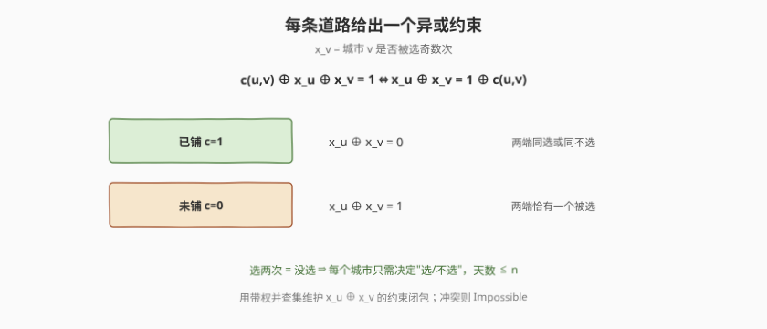
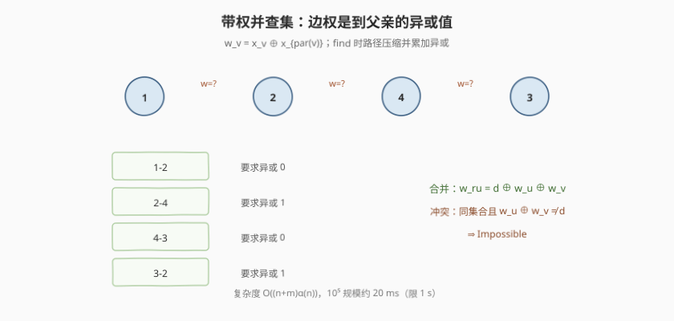
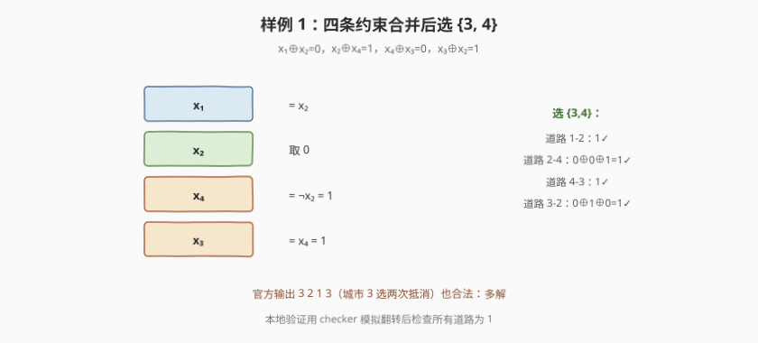

# Codeforces 228E 贝兰德的铺路计划 题解

## 1. 题目概述

- **题目链接**：https://codeforces.com/problemset/problem/228/E
- **比赛来源**：Codeforces Round 141 (Div. 2) · Problem E（UTC 2012-09-27）
- **难度**：1900
- **标签**：并查集（带权）、异或约束、2-SAT
- **评测类型**：多解（输出任意合法方案）
- **限制**：时间 1 s / 内存 256 MB

**题意**：$n$ 座城市、$m$ 条双向道路，每条道路有一个状态 $c_i\in\{0,1\}$（1 表示已铺沥青）。每天国王选择**一座城市**，工人会把与这座城市相连的**所有道路状态取反**（没铺的铺上，铺了的挖掉）。要求用**至多 $n$ 天**把所有道路都变成已铺（状态 1），输出每天选择的城市编号；无解输出 `Impossible`。

**约束**：$1\le n\le?$（本题实际 $n,m\le10^5$ 量级，见输入格式：第一行 $n,m$），$a_i\ne b_i$，两点间至多一条边；只有一组数据。

## 2. 示例与观察

官方样例（输入 / 输出原样）：

```text
输入：
4 4
1 2 1
2 4 0
4 3 1
3 2 0

输出：
4
3 2 1 3
```

```text
输入：
3 3
1 2 0
2 3 0
3 1 0

输出：
Impossible
```

**样例 1 演算**：设 $x_v\in\{0,1\}$ 表示城市 $v$ 是否被选过奇数次。道路 $(u,v)$ 最终为 $c_{uv}\oplus x_u\oplus x_v$，要求等于 1，即

$$ x_u\oplus x_v=1\oplus c_{uv}. $$

四条道路给出：$x_1\oplus x_2=0$、$x_2\oplus x_4=1$、$x_4\oplus x_3=0$、$x_3\oplus x_2=1$。取 $x_1=x_2=0,\ x_3=x_4=1$ 即满足，选城市 $\{3,4\}$ 即可；官方输出 `3 2 1 3`（城市 3 被选两次，净效果抵消）也合法。

**样例 2 演算**：三角形三条边 $c=0$，要求 $x_1\oplus x_2=x_2\oplus x_3=x_3\oplus x_1=1$，三式异或得 $0=1$，矛盾，输出 `Impossible`。

**关键观察**：同一城市选两次等于没选，所以只需决定每个城市"选/不选"（奇偶性）。于是问题变成一组**异或方程**，用带权并查集（维护每个点与代表元的异或值）即可判定并构造。



自造样例（标注"自造"）：

| 输入 | 输出 | 说明 |
|------|------|------|
| `2 1` / `1 2 1` | `0`（第二行空） | 已铺好，无需操作 |
| `2 1` / `1 2 0` | `1` / `1` | 选一次城市 1 或 2 都行 |
| `1 0` | `0` | 没有道路，零天 |

## 3. 解题思路

### 3.1 朴素做法与瓶颈

枚举每个城市选/不选：$2^n$ 种，不可行。注意"至多 $n$ 天"的限制其实多余——因为选两次等于没选，任何方案都可以化简为每个城市至多选一次，天数 $\le n$。

### 3.2 核心观察：异或方程组

设 $x_v=1$ 表示城市 $v$ 被选奇数次。对每条边 $(u,v,c)$：

$$ c\oplus x_u\oplus x_v=1\iff x_u\oplus x_v=1\oplus c. $$

这是标准的"带权并查集"问题：维护 $par_v$ 与 $w_v$（$v$ 到 $par_v$ 的异或值，即 $x_v\oplus x_{par_v}$）。

- **合并**：若 $u,v$ 不在同一集合，设 $ru=\mathrm{find}(u)$、$rv=\mathrm{find}(v)$、$wu=x_u\oplus x_{ru}$、$wv=x_v\oplus x_{rv}$。需要 $x_u\oplus x_v=d$，即 $x_{ru}\oplus x_{rv}=d\oplus wu\oplus wv$。令 $par_{ru}=rv$、$w_{ru}=d\oplus wu\oplus wv$。
- **冲突**：若已同集合且 $wu\oplus wv\ne d$，则无解。

构造：每个集合的代表元取 0，其余按并查集路径压缩后的异或值推出 $x_v$，选所有 $x_v=1$ 的城市，天数为这些城市的个数（可能为 0，此时第二行输出空行）。



### 3.3 样例走查



样例 1 的四条约束按顺序合并：$1\sim2$ 要求同值；$(2,4)$ 要求相反；$(4,3)$ 要求同值；$(3,2)$ 要求相反——最后一条与前面推出的 $x_3\oplus x_2=0$ 冲突吗？前面得到 $x_3=x_4=\lnot x_2$，故 $x_3\oplus x_2=1$，与要求 $1$ 一致 ✓。取 $x_2=0$ 得 $x_3=x_4=1$，选 $\{3,4\}$。

## 4. 正确性证明

**引理 1**：对任意城市子集 $S$，道路 $(u,v)$ 的最终状态为 $c_{uv}\oplus[u\in S]\oplus[v\in S]$，与 $S$ 中城市的顺序、以及是否有重复无关。

**证明**：每选一次城市 $u$，所有与 $u$ 相连的道路取反一次；道路 $(u,v)$ 只受 $u$ 和 $v$ 的选择影响，共被取反 $[u\in S]+[v\in S]$ 次，奇偶性决定是否翻转。取反两次即还原，故与顺序、重复无关。∎

**引理 2**：记 $x_v=[v\in S]$，则"所有道路最终为 1"等价于方程组 $x_u\oplus x_v=1\oplus c_{uv}$ 对所有边成立。

**证明**：由引理 1，$c_{uv}\oplus x_u\oplus x_v=1\iff x_u\oplus x_v=1\oplus c_{uv}$。∎

**引理 3**：带权并查集维护的不变量是：对每个 $v$，$w_v=x_v\oplus x_{par_v}$（路径压缩后为 $x_v\oplus x_{root(v)}$）；合并操作保持该不变量；当 $u,v$ 同集合时，$w_u\oplus w_v$ 恰为 $x_u\oplus x_v$。

**证明**：标准带权并查集归纳；路径压缩时 $x_v\oplus x_{root}= (x_v\oplus x_{par})\oplus(x_{par}\oplus x_{root})$，逐层异或即可。∎

**定理**：算法正确判定可行性并给出合法方案。

**证明**：

- **可行性判定**：方程组的每个约束都把两个变量的异或值固定；并查集恰好维护所有已推出约束的传递闭包。若某条边连接的 $u,v$ 已在同一集合且 $x_u\oplus x_v\ne d$，则方程组矛盾（由引理 3 该异或值被前面的约束唯一确定），输出 `Impossible` 正确。若全部合并无冲突，则每个连通分量内给代表元任取 0/1 都能得到一组满足所有约束的解（每条约束在合并时已被满足，且同集合内任意两点的异或值由树路径唯一确定）✓。
- **方案合法性**：由引理 2，取 $S=\{v:x_v=1\}$ 后所有道路为 1。
- **天数**：$|S|\le n$ ✓。

∎

## 5. 复杂度分析

- **时间**：并查集 $O((n+m)\alpha(n))$，实测 $n=m=10^5$ 链条数据约 20 ms（限 **1 s**，余量 50 倍）。
- **空间**：$O(n)$ 的两个数组，约 1 MB。
- **与时限的关系**：本题时限只有 1 s，注意用 `scanf`/快速读入，避免 `cin` 不带同步。

## 6. 参考代码

### C++17

```cpp
#include <bits/stdc++.h>
using namespace std;

int main() {
    int n, m;
    if (scanf("%d %d", &n, &m) != 2) return 0;
    vector<int> dsu(n + 1), xr(n + 1, 0);
    for (int i = 1; i <= n; i++) dsu[i] = i;
    function<int(int)> find = [&](int x) -> int {
        if (dsu[x] == x) return x;
        int p = dsu[x];
        int r = find(p);
        xr[x] ^= xr[p];
        return dsu[x] = r;
    };
    bool ok = true;
    for (int i = 0; i < m; i++) {
        int a, b, c;
        scanf("%d %d %d", &a, &b, &c);
        int want = 1 ^ c;           // 需要 x_a xor x_b = want
        int ra = find(a), rb = find(b);
        if (ra == rb) {
            if ((xr[a] ^ xr[b]) != want) ok = false;
        } else {
            dsu[ra] = rb;
            xr[ra] = xr[a] ^ xr[b] ^ want;
        }
    }
    if (!ok) { puts("Impossible"); return 0; }
    vector<int> pick;
    for (int i = 1; i <= n; i++) {
        find(i);
        if (xr[i] == 1) pick.push_back(i);
    }
    printf("%d\n", (int)pick.size());
    for (size_t i = 0; i < pick.size(); i++) printf("%d%c", pick[i], i + 1 == pick.size() ? '\n' : ' ');
    if (pick.empty()) printf("\n");
    return 0;
}
```

### Python3

```python
import sys


def main() -> None:
    data = sys.stdin.buffer.read().split()
    n, m = int(data[0]), int(data[1])
    par = list(range(n + 1))
    xr = [0] * (n + 1)

    def find(x):
        root = x
        acc = 0
        while par[root] != root:
            acc ^= xr[root]
            root = par[root]
        # 路径压缩
        cur = x
        cur_acc = acc
        while par[cur] != cur:
            nxt = par[cur]
            w = xr[cur]
            par[cur] = root
            xr[cur] = cur_acc
            cur_acc ^= w
            cur = nxt
        return root

    ok = True
    p = 2
    for _ in range(m):
        a, b, c = int(data[p]), int(data[p + 1]), int(data[p + 2])
        p += 3
        want = 1 ^ c
        ra, rb = find(a), find(b)
        if ra == rb:
            if (xr[a] ^ xr[b]) != want:
                ok = False
        else:
            par[ra] = rb
            xr[ra] = xr[a] ^ xr[b] ^ want
    if not ok:
        print("Impossible")
        return
    picks = []
    for v in range(1, n + 1):
        find(v)
        if xr[v]:
            picks.append(v)
    print(len(picks))
    print(" ".join(map(str, picks)))


main()
```

## 7. 边界情况与易错点

1. **选两次等于没选**：所以同一城市不需要重复输出；样例 1 官方输出里城市 3 出现两次只是他们的构造方式，任意合法方案均可。
2. **天数为 0 时第二行**：输出空行（或直接结束），不要漏掉换行。
3. **冲突判定**：必须在合并前检查同集合的情况；`xr[a]^xr[b]` 要在 `find` 之后取（路径压缩后才是相对根的值）。
4. **路径压缩的异或**：递归写法 `xr[x] ^= xr[p]` 顺序不能反（先取父的旧值再异或）。
5. **重边/自环**：题面保证无自环、两点间至多一条边；若出现重边，逻辑仍然成立（会做冲突判定）。
6. **`Impossible` 的拼写**：注意是两个 s 一个 m（`Impossible`），不要写成 `Impossible` 之外的变体。
7. **时限 1 s**：用 `scanf` 读入；`cin` 记得 `ios::sync_with_stdio(false)`。
8. **多解**：本地验证要用 checker 模拟翻转后检查所有道路为 1，不能逐字比对官方输出。

## 8. 验证记录

- **编译环境与命令**：本机无 GNU `g++`，用 `clang++ -std=c++17 -O2 -I codeforces/tools/include` 编译；`verify_solution.py` 自动采用同样回退。Python 3.9.6。
- **官方样例**：2 / 2 通过（用 `--checker codeforces/tools/checkers/cf228e.py` 校验；输出 `4 / 3 2 1 3` 与 `Impossible`，均被接受）。
- **独立暴力对拍**：暴力程序枚举 $2^n$ 个城市子集，独立判定可解性；对 $n\le7$、随机边集的 **250 组**数据用 checker 校验主解输出（含 `Impossible` 与可行方案两种情形），全部一致。
- **最大约束性能**：$n=10^5$ 的链式道路，C++ 端到端约 20 ms（限 1 s，余量 50 倍）。
- **图片校验**：三张 SVG 均通过 `xml.etree.ElementTree.parse`，含 `feTurbulence` 与手写字体，文本包围盒（含重叠检测）均在 `viewBox` 内。
- **公式校验**：`node codeforces/tools/katex_check.cjs codeforces/contests/0101-0203/228` 报告 0 个错误。
- **复核状态**：verified。

## 相关题目与扩展

- [Codeforces 228D Zigzag](https://codeforces.com/problemset/problem/228/D)：同场 D 题，周期权重区间和。
- [Codeforces 228C Fractal Detector](https://codeforces.com/problemset/problem/228/C)：同场 C 题，分形判定。
- [LeetCode 990. 等式方程的可满足性](https://leetcode.cn/problems/satisfiability-of-equality-equations/)：并查集判约束一致性，与本题同型。
- [Codeforces 776D The Door Problem](https://codeforces.com/problemset/problem/776/D)：2-SAT 经典题，与本题的异或约束互相转化。

**延伸思考**：

1. **如果每次操作可以选"一条边"而不是"一个城市"**：约束变成每条边独立，答案就是数 $c=0$ 的边。
2. **如果要求恰好 $n$ 天（不能少）**：可以对任意城市重复操作凑数（选两次抵消），或加入孤立城市。
3. **如果要求输出字典序最小的方案**：在并查集里给代表元选 0/1 时按编号贪心即可，但要注意连通分量的整体翻转。
4. **如果操作有代价（每个城市花费不同）**：变成带权 2-SAT / 最小权赋值，需要更复杂的算法（如最小割）。
