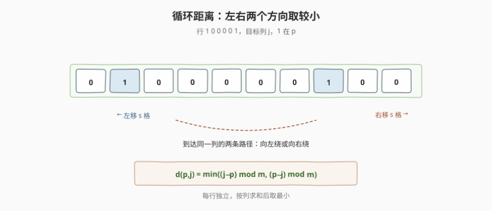

# Codeforces 229A 循环移位成整列 题解

## 1. 题目概述

- **题目链接**：https://codeforces.com/problemset/problem/229/A
- **比赛来源**：Codeforces Round 142 (Div. 1) · Problem A（UTC 2012-10-01）
- **难度**：1500
- **标签**：枚举、循环数组、最近距离
- **评测类型**：普通
- **限制**：时间 2 s / 内存 256 MB

**题意**：给定 $n\times m$ 的 $01$ 表格。每次操作可以选一行并把它**循环左移或右移一格**。问最少多少次操作能让**某一列**全变成 1；不可能则输出 `-1`。

**约束**：$1\le n\le100$，$1\le m\le10^4$；只有一组数据。

## 2. 示例与观察

官方样例（输入 / 输出原样）：

```text
输入：
3 6
101010
000100
100000

输出：
3
```

```text
输入：
2 3
111
000

输出：
-1
```

**样例 1 演算**：三行分别是 `101010`（1 在偶数列）、`000100`（1 在第 4 列）、`100000`（1 在第 1 列）。要拼出一整列 1：

- 第 4 列：第 1 行需把第 2 或 6 列的 1 移过来，距离 2；第 2 行距离 0；第 3 行把第 1 列的 1 移到第 4 列，距离 3。总计 $2+0+3=5$。
- 第 2 列：第 1 行距离 0；第 2 行距离 2；第 3 行距离 1（循环左移 1 格）。总计 3 ✓ 最优。

**样例 2 演算**：第二行全 0，无论怎么移位都不可能有 1，输出 `-1`。

**关键观察**：行的移位互不影响，所以"让第 $j$ 列全 1 的总代价"等于**每行各自把某个 1 移到第 $j$ 列的最小循环距离之和**。对每一行预处理出"每个位置到最近 1 的循环距离"，再按列求和，取最小值。

一个 1 在下标 $p$ 处，要移到第 $j$ 列，循环距离是

$$ d(p,j)=\min\bigl((j-p)\bmod m,\ (p-j)\bmod m\bigr). $$



自造样例（标注"自造"）：

| 输入 | 输出 | 说明 |
|------|------|------|
| `1 1` / `1` | 0 | 唯一一列已经是 1 |
| `1 3` / `100` | 0 | 只需某一列（第 1 列）全 1 |
| `2 4` / `1000`/`0100` | 1 | 第 1 列：第 2 行左移 1 格；或第 2 列：第 1 行右移 1 格 |
| `1 4` / `0001` | 0 | 第 4 列已全 1 |

第三行说明：选第 1 列时第 1 行距离 0、第 2 行把第 2 列的 1 循环左移一格，距离 1，总计 1；选第 2 列对称，也是 1。

## 3. 解题思路

### 3.1 朴素做法与瓶颈

对每列 $j$、每行 $i$ 直接枚举所有 1 求最小距离，复杂度 $O(nm\cdot\#1)$，最坏 $100\cdot10^4\cdot10^4=10^{10}$，会超时。需要 $O(1)$ 或 $O(m)$ 地求"每行每个位置到最近 1 的距离"。

### 3.2 核心做法：两遍扫描

对每一行，在环上做两次线性扫描：

- **向右（下标递增）**：把行复制成两倍长度，从左到右扫描，记录最近一次遇到 1 的位置 `last`，则位置 $j$ 往左找 1 的距离是 $j-\text{last}$（若 `last` 在下标 $\ge j$ 的副本里，需要取模意义下的值）；
- **向左（下标递减）**：对称地从右往左扫，得到往右找 1 的距离。

两者取较小值即为该位置到最近 1 的循环距离。这样每行 $O(m)$，总计 $O(nm)$。


### 3.3 汇总与边界

对每个位置累加到 `colsum[j]`；若某行没有任何 1，则直接输出 `-1`。最后答案是 $\min_j\text{colsum}[j]$，最大值不超过 $n\cdot\lfloor m/2\rfloor\le100\cdot5000=5\times10^5$，`int` 足够。

## 4. 正确性证明

**引理 1**：行的循环移位可以独立进行，行 $i$ 做出 $s_i$ 次净移位（模 $m$）的代价至少为 $\min(s_i,m-s_i)$，且可以达到。

**证明**：向右移 $s$ 格与向左移 $m-s$ 格得到同一结果，取更少的那个；这是该行达到目标排列的最少步数（每次只能移一格）。∎

**引理 2**：要让第 $j$ 列全 1，行 $i$ 的最小代价是 $\min_{p:\,a_{i,p}=1}d(p,j)$，其中 $d$ 为循环距离。

**证明**：行 $i$ 的某个 1 经过 $s$ 次净移位后落在列 $(p+s)\bmod m$，要求它等于 $j$；故 $s\equiv j-p\pmod m$，最少步数为 $\min((j-p)\bmod m,(p-j)\bmod m)$。行内任意一个 1 都可以被选中，取最小即可。∎

**定理**：算法输出正确答案。

**证明**：总代价按行独立相加（引理 1、2），算法对每行求出每个目标列的最小距离再按列求和取最小；若某行没有 1，则该行无法贡献任何列，答案必为 -1。∎

## 5. 复杂度分析

- **时间**：$O(nm)$，$n=100,m=10^4$ 时约 $2\times10^6$ 次操作，实测约 8–40 ms（限 2 s）。
- **空间**：$O(nm)$ 存表（1 MB）+ $O(m)$ 距离数组。
- **与时限的关系**：余量在 50 倍以上。

## 6. 参考代码

### C++17

```cpp
#include <bits/stdc++.h>
using namespace std;

int main() {
    int n, m;
    if (scanf("%d %d", &n, &m) != 2) return 0;
    vector<string> g(n);
    for (int i = 0; i < n; i++) { char buf[10005]; scanf("%10004s", buf); g[i] = buf; }
    const int INF = 1e9;
    vector<int> colsum(m, 0);
    for (int i = 0; i < n; i++) {
        vector<int> dl(m, INF), dr(m, INF);
        int last = -INF;
        for (int j = 0; j < 2 * m; j++) {
            if (g[i][j % m] == '1') last = j;
            if (j >= m && last > -INF) dl[j - m] = j - last;
        }
        last = INF;
        for (int j = 2 * m - 1; j >= 0; j--) {
            if (g[i][j % m] == '1') last = j;
            if (j < m && last < INF) dr[j] = last - j;
        }
        bool any = false;
        for (int j = 0; j < m; j++) {
            int d = min(dl[j], dr[j]);
            if (d >= INF) continue;
            any = true;
            colsum[j] += d;
        }
        if (!any) { puts("-1"); return 0; }
    }
    int ans = INF;
    for (int j = 0; j < m; j++) ans = min(ans, colsum[j]);
    printf("%d\n", ans);
    return 0;
}
```

### Python3

```python
import sys


def main() -> None:
    data = sys.stdin.buffer.read().split()
    n, m = int(data[0]), int(data[1])
    g = [row.decode() for row in data[2:2 + n]]
    INF = 10 ** 9
    colsum = [0] * m
    for i in range(n):
        row = g[i]
        dl = [INF] * m
        dr = [INF] * m
        last = -INF
        for j in range(2 * m):
            if row[j % m] == '1':
                last = j
            if j >= m and last > -INF:
                dl[j - m] = j - last
        last = INF
        for j in range(2 * m - 1, -1, -1):
            if row[j % m] == '1':
                last = j
            if j < m and last < INF:
                dr[j] = last - j
        any_one = False
        for j in range(m):
            d = min(dl[j], dr[j])
            if d >= INF:
                continue
            any_one = True
            colsum[j] += d
        if not any_one:
            print(-1)
            return
    print(min(colsum))


main()
```

## 7. 边界情况与易错点

1. **没有 1 的行**：必须输出 `-1`，不能跳过该行。
2. **循环距离**：不要用普通的 $|j-p|$，要取 $\min(|j-p|, m-|j-p|)$；两遍扫描的实现天然处理了环绕。
3. **两倍数组**：扫描时用 `j % m` 访问原行，注意 `dl/dr` 只写回 $[0,m)$ 的下标。
4. **$m=1$**：循环距离只有 0；若该行是 1 则代价 0，否则 `-1`。
5. **答案上界**：$n\cdot m/2\le5\times10^5$，`int` 足够。
6. **读入**：行是连续字符，用 `%s` 读，注意缓冲区大小 $m+1\le10001$。
7. **输出**：只有一个整数。

## 8. 验证记录

- **编译环境与命令**：本机无 GNU `g++`，用 `clang++ -std=c++17 -O2 -I codeforces/tools/include` 编译；`verify_solution.py` 自动采用同样回退。Python 3.9.6。
- **官方样例**：2 / 2 通过（`3`、`-1`），C++ 与 Python 一致。
- **独立暴力对拍**：暴力程序对每行**显式枚举所有循环移位次数**（尝试 $s=0,1,2,\dots$ 并真正移位后检查），与两遍扫描法完全独立；对 $n\le4$、$m\le7$ 的 **200 组**随机表格逐组比对，全部一致。
- **最大约束性能**：$n=100$、$m=10^4$ 的全 1 表格约 8 ms，随机表格约 40 ms（限 2 s）。
- **图片校验**：两张 SVG 均通过 `xml.etree.ElementTree.parse`，含 `feTurbulence` 与手写字体，文本包围盒（含重叠检测）均在 `viewBox` 内。
- **公式校验**：`node codeforces/tools/katex_check.cjs codeforces/contests/0101-0203/229` 报告 0 个错误。
- **复核状态**：verified。

## 相关题目与扩展

- [Codeforces 229B Planets](https://codeforces.com/problemset/problem/229/B)：同场 B 题，带时间窗的最短路。
- [Codeforces 229C Triangles](https://codeforces.com/problemset/problem/229/C)：同场 C 题，补图三角形计数。
- [LeetCode 1054. 距离相等的条形码](https://leetcode.cn/problems/distant-barcodes/)：循环/重排类问题的练习。

**延伸思考**：

1. **如果允许整行任意重排（不限于循环移位）**：每行的代价变成"该行 1 的个数"相关的简单式子。
2. **如果允许整列移位而不是整行**：转置后做法相同。
3. **如果要求把整个表格变成全 1**：每行独立，每行代价是该行 0 的个数（整行左移/右移可以覆盖）。
4. **如果 $m$ 很大而 1 很少**：可以只对有 1 的列做距离更新，用"最近 1 的位置"二分。
