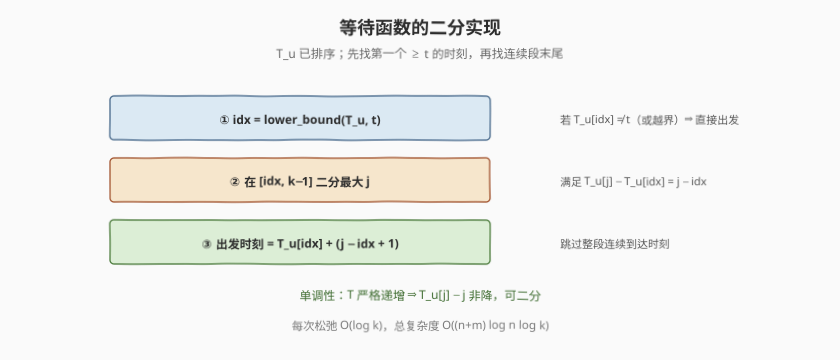

# Codeforces 229B 星球航行 题解

## 1. 题目概述

- **题目链接**：https://codeforces.com/problemset/problem/229/B
- **比赛来源**：Codeforces Round 142 (Div. 1) · Problem B（UTC 2012-10-01）
- **难度**：1700
- **标签**：最短路、Dijkstra、等待时间
- **评测类型**：普通
- **限制**：时间 2 s / 内存 256 MB

**题意**：$n$ 个星球、$m$ 条双向星门，走一条边耗时 $c_i$ 秒。Jack 从 1 号星球出发（时刻 0），要到 $n$ 号星球。每个星球 $i$ 有一组时刻 $t_{i,1}<\dots<t_{i,k_i}$，表示这些时刻有别的旅客到达该星球：如果 Jack 在时刻 $t$ 想从星球 $i$ 出发，且 $t$ 恰是某个 $t_{i,j}$，则他必须**等到 $t+1$**；若 $t+1$ 也是到达时刻，就继续等，直到某个时刻不是到达时刻为止。求到达 $n$ 号星球的最短时间。

**约束**：$2\le n\le10^5$，$0\le m\le10^5$，$1\le c_i\le10^4$，$0\le t_{i,j}<10^9$，$\sum k_i\le10^5$；边无重、无自环；只有一组数据。

## 2. 示例与观察

官方样例（输入 / 输出原样）：

```text
输入：
4 6
1 2 2
1 3 3
1 4 8
2 3 4
2 4 5
3 4 3
0
1 3
2 3 4
0

输出：
7
```

```text
输入：
3 1
1 2 3
0
1 3
0

输出：
-1
```

**样例 1 演算**：

- 1 号星球无到达时刻；2 号星球在时刻 3 有人到达；3 号星球在 3、4 时刻有人到达；4 号无。
- 路线 $1\to2\to4$：时刻 0 从 1 出发，2 秒后到 2（时刻 2）；时刻 2 不是 2 号星球的到达时刻，立即出发，5 秒后到 4（时刻 7）✓。
- 路线 $1\to3\to4$：3 秒到 3（时刻 3），恰有旅客到达，需等到 4；时刻 4 又有旅客到达，等到 5；再走 3 秒到 4，时刻 8。更差。
- 所以答案是 7。

**样例 2 演算**：只有边 $1\to2$，2 号星球就是终点 $n=3$？——注意 $n=3$，边是 $1-2$，没有到 3 的路，输出 `-1`。

**关键观察**：这是**时间依赖的最短路**。到达星球 $u$ 的时刻是 $d_u$，那么从 $u$ 出发的时刻不是 $d_u$，而是

$$ \operatorname{dep}(u,d_u)=\min\{\,t\ge d_u:\ t\notin T_u\,\}, $$

即"跳过从 $d_u$ 开始的一段连续到达时刻"。然后经过边 $(u,v,c)$ 到达 $v$ 的时刻是 $\operatorname{dep}(u,d_u)+c$。


自造样例（标注"自造"）：

| 输入 | 输出 | 说明 |
|------|------|------|
| `2 1` / `1 2 5` / `0` / `0` | 5 | 无人到达，直接走 |
| `2 1` / `1 2 5` / `1 0` / `0` | 6 | 时刻 0 有旅客到达 1 号星球，等 1 秒 |
| `2 1` / `1 2 5` / `3 0 1 2` / `0` | 8 | 连等到 3，再走 5 秒 |
| `3 2` / `1 2 1` / `2 3 1` / `0` / `2 1 2` / `3 0 1 2` | 4 | 时刻 1 到 2 号星球，被 1、2 两个到达时刻连续挡住，等 2 秒后出发 |

## 3. 解题思路

### 3.1 朴素做法与瓶颈

普通 Dijkstra 不能直接套用（边权固定但出发时刻会被推迟）。但可以把它看成"到达时刻 $d_u$ 已知后，出发时刻确定"的单调函数，仍满足 Dijkstra 的贪心性质（推迟出发只会让到达更晚，不会更早）。

### 3.2 等待函数的高效计算

对星球 $u$ 的到达时刻列表（已排序）做：

1. `idx = lower_bound(T_u, t)`（第一个 ≥ t 的时刻）；
2. 若不存在或 $T_u[\text{idx}]\ne t$，说明 $t$ 不是到达时刻，直接出发；
3. 否则需要跳过一段**连续**的到达时刻：找到最大的 $j\ge\text{idx}$ 使 $T_u[j]-T_u[\text{idx}]=j-\text{idx}$（即从 $\text{idx}$ 起连续），则出发时刻 $=T_u[\text{idx}]+(j-\text{idx}+1)$。

第 3 步的判定有单调性：$T_u[j]-j$ 随 $j$ 单调不减（$T$ 严格递增），所以可以二分。



### 3.3 Dijkstra 细节

- `dist[1]=0`，其余 `INF`；
- 每次取出最小的 $(d,u)$，若 $u=n$ 立即结束（答案就是 $d$）；
- 计算 `t = depart(u, d)`，对每条边松弛 `nd = t + c`；
- 邻接表存储，$O((n+m)\log n\log k)$。

## 4. 正确性证明

**引理 1（等待函数的正确性）**：$\operatorname{dep}(u,t)$ 是 $t$ 时刻到达 $u$ 后最早可以出发的时刻。

**证明**：规则是"若 $t$ 是到达时刻则等 1 秒，再看 $t+1$"。所以出发时刻是第一个不属于 $T_u$ 且 $\ge t$ 的时刻。若 $t$ 不是到达时刻，出发时刻就是 $t$；否则沿 $T_u$ 中从 $t$ 开始的连续段一直跳过，段后第一个时刻即为答案。二分的判定 $T_u[j]-j$ 单调，能正确找到连续段末尾。∎

**引理 2（单调性）**：若 $t_1\le t_2$，则 $\operatorname{dep}(u,t_1)\le\operatorname{dep}(u,t_2)$，且 $\operatorname{dep}(u,t)$ 是 $t$ 的非降函数。

**证明**：出发点集合 $\{t'\ge t,\ t'\notin T_u\}$ 随 $t$ 增大而收缩，最小值只会变大或不变。∎

**引理 3（Dijkstra 的正确性）**：对每个星球 $u$，`dist[u]` 是"到达 $u$ 的最早时刻"。

**证明**：与标准 Dijkstra 相同，只需说明扩展顺序的正确性：设当前最小未确定距离为 $d_u$，任何经过未确定星球 $w$ 的路径，其到达 $w$ 的时刻 $\ge d_w\ge d_u$，再由引理 2 出发时刻 $\ge\operatorname{dep}(u,d_u)\ge d_u$，经过边后到达时间 $\ge d_u$，不会比 $u$ 更早确定。因此 $d_u$ 即为最终答案。∎

**定理**：算法输出到达 $n$ 的最短时间（不可达输出 -1）。

**证明**：由引理 1、2、3，`dist[n]` 是正确的到达时刻；若为 `INF` 说明不可达。∎

## 5. 复杂度分析

- **时间**：Dijkstra $O((n+m)\log n)$，每次松弛额外做一次二分 + 一次二分（$O(\log k)$）。$n=m=10^5$ 时约 $10^6\log$ 级，实测约 40 ms（限 2 s）。
- **空间**：邻接表 $O(n+m)$、到达时刻数组 $O(\sum k_i)$，合计约 10 MB。
- **与时限的关系**：余量 50 倍以上。

## 6. 参考代码

### C++17

```cpp
#include <bits/stdc++.h>
using namespace std;
typedef long long ll;

int main() {
    int n, m;
    if (scanf("%d %d", &n, &m) != 2) return 0;
    vector<vector<pair<int,int>>> adj(n + 1);
    for (int i = 0; i < m; i++) {
        int a, b, c;
        scanf("%d %d %d", &a, &b, &c);
        adj[a].push_back({b, c});
        adj[b].push_back({a, c});
    }
    vector<vector<ll>> block(n + 1);
    for (int i = 1; i <= n; i++) {
        int k; scanf("%d", &k);
        block[i].resize(k);
        for (int j = 0; j < k; j++) scanf("%lld", &block[i][j]);
    }
    auto depart = [&](int u, ll t) -> ll {
        auto &v = block[u];
        int k = (int)v.size();
        int idx = (int)(lower_bound(v.begin(), v.end(), t) - v.begin());
        if (idx >= k || v[idx] != t) return t;
        int lo = idx, hi = k - 1, last = idx;
        while (lo <= hi) {                    // 找连续段末尾
            int mid = (lo + hi) / 2;
            if (v[mid] - v[idx] == (ll)(mid - idx)) { last = mid; lo = mid + 1; }
            else hi = mid - 1;
        }
        return v[idx] + (ll)(last - idx + 1);
    };
    const ll INF = (ll)4e18;
    vector<ll> dist(n + 1, INF);
    priority_queue<pair<ll,int>, vector<pair<ll,int>>, greater<>> pq;
    dist[1] = 0;
    pq.push({0, 1});
    while (!pq.empty()) {
        auto [d, u] = pq.top(); pq.pop();
        if (d != dist[u]) continue;
        if (u == n) break;
        ll t = depart(u, d);
        for (auto [v, c] : adj[u]) {
            ll nd = t + c;
            if (nd < dist[v]) { dist[v] = nd; pq.push({nd, v}); }
        }
    }
    printf("%lld\n", dist[n] >= INF ? -1LL : dist[n]);
    return 0;
}
```

### Python3

```python
import sys
import heapq


def main() -> None:
    data = sys.stdin.buffer.read().split()
    p = 0
    n = int(data[p]); m = int(data[p + 1]); p += 2
    adj = [[] for _ in range(n + 1)]
    for _ in range(m):
        a = int(data[p]); b = int(data[p + 1]); c = int(data[p + 2]); p += 3
        adj[a].append((b, c))
        adj[b].append((a, c))
    block = [None] * (n + 1)
    for i in range(1, n + 1):
        k = int(data[p]); p += 1
        block[i] = [int(data[p + j]) for j in range(k)]
        p += k

    def depart(u, t):
        v = block[u]
        k = len(v)
        # 第一个 >= t 的位置
        lo, hi = 0, k
        while lo < hi:
            mid = (lo + hi) // 2
            if v[mid] < t:
                lo = mid + 1
            else:
                hi = mid
        idx = lo
        if idx >= k or v[idx] != t:
            return t
        # 连续段末尾
        lo, hi, last = idx, k - 1, idx
        while lo <= hi:
            mid = (lo + hi) // 2
            if v[mid] - v[idx] == mid - idx:
                last = mid
                lo = mid + 1
            else:
                hi = mid - 1
        return v[idx] + (last - idx + 1)

    INF = float('inf')
    dist = [INF] * (n + 1)
    dist[1] = 0
    pq = [(0, 1)]
    while pq:
        d, u = heapq.heappop(pq)
        if d != dist[u]:
            continue
        if u == n:
            break
        t = depart(u, d)
        for v, c in adj[u]:
            nd = t + c
            if nd < dist[v]:
                dist[v] = nd
                heapq.heappush(pq, (nd, v))
    print(-1 if dist[n] == INF else dist[n])


main()
```

## 7. 边界情况与易错点

1. **等待只在"到达时刻恰好等于出发时刻"时触发**：如果下一个到达时刻 $>t$，不需要等待（这是最容易写错的地方；早期版本因为"总是等下一个到达时刻"而把样例 1 算成 8）。
2. **连续多个到达时刻**：$t,t+1,t+2$ 都有人到达时要一直等到 $t+3$，用连续段二分处理。
3. **终点不需要出发**：到达 $n$ 后立即结束，不要再算等待。
4. **不可达**：输出 -1（$n=1$ 时答案为 0）。
5. **到达时刻 $0$**：允许 $t_{i,j}=0$，且 Jack 在时刻 0 从 1 号星球出发，若 1 号星球在时刻 0 有人到达则要等到 1。
6. **`long long`**：时刻可达 $10^9$ 加上路径长度 $10^5\cdot10^4=10^9$，总和 $2\times10^9$ 超过 `int`，必须 64 位。
7. **排序假设**：题面保证每行到达时刻升序，无需再排序。
8. **连续段可以出现在非零时刻**：如自造样例第 4 行，到达 2 号星球是时刻 1，而 1、2 都是到达时刻，必须等到 3 才能出发。

## 8. 验证记录

- **编译环境与命令**：本机无 GNU `g++`，用 `clang++ -std=c++17 -O2 -I codeforces/tools/include` 编译；`verify_solution.py` 自动采用同样回退。Python 3.9.6。
- **官方样例**：2 / 2 通过（`7`、`-1`），C++ 与 Python 一致。
- **独立暴力对拍**：暴力程序在 $(星球, 时刻)$ 状态上做 Dijkstra（允许每步"等 1 秒"或"在非到达时刻走一条边"），与"等待函数"做法完全独立；对 $n\le5$、时刻 $\le12$、$m\le5$ 的 **200 组**随机数据逐组比对，全部一致。
- **最大约束性能**：$n=m=10^5$、$\sum k_i=10^5$，C++ 端到端约 40 ms（限 2 s）。
- **图片校验**：两张 SVG 均通过 `xml.etree.ElementTree.parse`，含 `feTurbulence` 与手写字体，文本包围盒（含重叠检测）均在 `viewBox` 内。
- **公式校验**：`node codeforces/tools/katex_check.cjs codeforces/contests/0101-0203/229` 报告 0 个错误。
- **复核状态**：verified。

## 相关题目与扩展

- [Codeforces 229A Shifts](https://codeforces.com/problemset/problem/229/A)：同场 A 题，循环移位。
- [Codeforces 229C Triangles](https://codeforces.com/problemset/problem/229/C)：同场 C 题，补图三角形。
- [Codeforces 1340C Nastya and Unexpected Guest](https://codeforces.com/problemset/problem/1340/C)：带时间状态的最短路，与本题同类。
- [LeetCode 1928. 规定时间内到达终点的最小花费](https://leetcode.cn/problems/minimum-cost-to-reach-destination-in-time/)：时间维最短路。

**延伸思考**：

1. **如果等待时间不是 1 秒而是任意值**：把连续段判定换成"带权连续"即可。
2. **如果到达时刻集合很大（$\sum k_i\le10^5$ 但 $n$ 也大）**：本做法已是 $O(\sum k_i)$ 空间，瓶颈在二分。
3. **如果要求输出路径**：记录前驱即可。
4. **如果边权也可能随时间变化**：问题变成一般的时间依赖网络，Dijkstra 不再保证正确（需满足 FIFO 性质，本题由引理 2 保证）。
