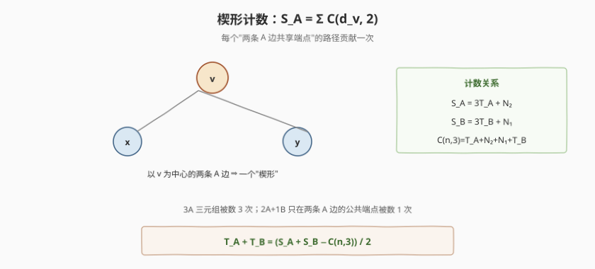
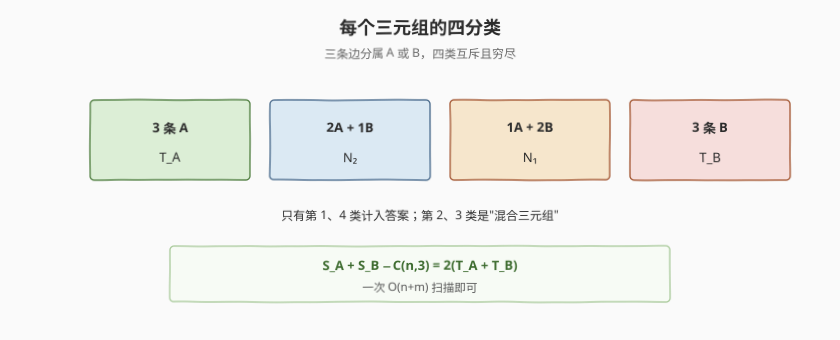
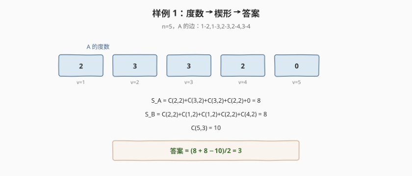

# Codeforces 229C 两张图的三角形总数 题解

## 1. 题目概述

- **题目链接**：https://codeforces.com/problemset/problem/229/C
- **比赛来源**：Codeforces Round 142 (Div. 1) · Problem C（UTC 2012-10-01）
- **难度**：1900
- **标签**：组合计数、补图、握手引理
- **评测类型**：普通
- **限制**：时间 2 s / 内存 256 MB

**题意**：完全无向图有 $n$ 个顶点。Alice 取走 $m$ 条边构成图 $A$，Bob 得到剩下的 $\binom n2-m$ 条边构成图 $B$。求两张图中长度为 3 的环（三角形）的总个数。

**约束**：$1\le n\le10^6$，$0\le m\le10^6$；无重边、无自环；只有一组数据。

## 2. 示例与观察

官方样例（输入 / 输出原样）：

```text
输入：
5 5
1 2
1 3
2 3
2 4
3 4

输出：
3
```

```text
输入：
5 3
1 2
2 3
1 3

输出：
4
```

**样例 1 演算**：Alice 的图有三角形 $\{1,2,3\}$、$\{2,3,4\}$；Bob 的图（补图）的三角形：补图边为 $1-4,1-5,2-5,3-5,4-5$，三角形 $\{1,4,5\}$、$\{1,2,5\}$？——$1-2$ 不在补图里，所以只有 $\{1,4,5\}$。总数 $2+1=3$ ✓。

**样例 2 演算**：Alice 的图是三角形 $\{1,2,3\}$；补图边为 $1-4,1-5,2-4,2-5,3-4,3-5,4-5$，三角形 $\{1,4,5\},\{2,4,5\},\{3,4,5\}$ 共 3 个。总数 $1+3=4$ ✓。

**关键观察**：每个三元组 $\{x,y,z\}$ 的三条边各自属于 $A$ 或 $B$。它要么是 $A$ 的三角形（3 条全在 $A$），要么是 $B$ 的三角形（3 条全在 $B$），要么是**混合**的（既有 $A$ 边又有 $B$ 边），混合三元组对答案贡献 0。所以

$$ \text{答案}=\binom n3-\#\{\text{混合三元组}\}. $$

记 $d_v$ 为 $v$ 在 $A$ 中的度数。定义"楔形"：以 $v$ 为中心、两条边都在 $A$ 中的路径 $x-v-y$。楔形总数

$$ S_A=\sum_{v}\binom{d_v}{2}. $$

对每个 $B$ 中的楔形类似地有 $S_B=\sum_v\binom{n-1-d_v}{2}$。



关键计数：设 $T_A$ 为 $A$ 的三角形数，$N_2$ 为"恰好 2 条 $A$ 边"的三元组数，$T_B$ 为 $B$ 的三角形数，$N_1$ 为"恰好 1 条 $A$ 边"的三元组数。那么

- $S_A=3T_A+N_2$（全 $A$ 三角形被它的 3 个顶点各数一次；2A+1B 的三元组只在两条 $A$ 边的公共端点处被数一次）；
- $S_B=3T_B+N_1$（对称）；
- $\binom n3=T_A+N_2+N_1+T_B$。

由后两式消去 $N_1,N_2$：

$$ T_A+T_B=\frac{S_A+S_B-\binom n3}{2}. $$

## 3. 解题思路

### 3.1 朴素做法与瓶颈

枚举三元组 $O(n^3)$，$n=10^6$ 时 $10^{18}$ 不可行。即使用邻接表数三角形也要 $O(m^{1.5})$，$m=10^6$ 时约 $10^9$，太慢。上面的恒等式只需 $O(n+m)$。



### 3.2 算法

1. 读入 $n,m$，统计 Alice 的度数 $d_v$；
2. 计算 $S_A=\sum_v C(d_v,2)$，$S_B=\sum_v C(n-1-d_v,2)$；
3. 答案 $=(S_A+S_B-C(n,3))/2$。

### 3.3 样例走查

样例 1：$d=(2,3,3,2,0)$，$S_A=1+3+3+1+0=8$；$n-1-d=(2,1,1,2,4)$，$S_B=1+0+0+1+6=8$；$\binom53=10$；答案 $(8+8-10)/2=3$ ✓。



## 4. 正确性证明

**引理 1（三元组的四分类）**：每个三元组恰属于以下四类之一：3 条 $A$ 边（$T_A$）、2 条 $A$ 边 1 条 $B$ 边（$N_2$）、1 条 $A$ 边 2 条 $B$ 边（$N_1$）、3 条 $B$ 边（$T_B$）。且 $\binom n3=T_A+N_2+N_1+T_B$。

**证明**：完全图的每条边恰属于 $A$ 或 $B$；三元组三条边按 $A$ 边条数分类，四类互斥且穷尽。∎

**引理 2**：$S_A=3T_A+N_2$。

**证明**：$S_A$ 统计所有"两条 $A$ 边共享一个端点的路径"（以公共端点为计数点）。对 3A 三元组，每个顶点都是这样的公共端点，被数 3 次；对 2A+1B 三元组，两条 $A$ 边必有公共端点（三角形三条边中任意两条相邻），只有该公共端点被数 1 次；1A+2B 与 3B 三元组没有两条 $A$ 边相邻，不被计数。故 $S_A=3T_A+N_2$。∎

**引理 3**：$S_B=3T_B+N_1$。**证明**：与引理 2 对称（把 $A$ 换成 $B$）。∎

**定理**：$T_A+T_B=\dfrac{S_A+S_B-\binom n3}{2}$，即算法输出正确。

**证明**：由引理 1：$\binom n3=T_A+N_2+N_1+T_B$。由引理 2、3：$S_A+S_B=3(T_A+T_B)+N_2+N_1$。两式相减：$S_A+S_B-\binom n3=2(T_A+T_B)$，即得结论。∎

## 5. 复杂度分析

- **时间**：读入 $O(n+m)$，统计 $O(n)$；$n=m=10^6$ 时约 120 ms（含输入）。
- **空间**：度数数组 $O(n)$，约 4 MB。
- **数值范围**：$\binom n3\approx1.7\times10^{17}$，$S_A+S_B\le2\cdot n\cdot\binom{n}{2}\approx10^{18}$，都在 `long long`（$9.2\times10^{18}$）内；注意中间量用 64 位。
- **与时限的关系**：余量 15 倍以上。

## 6. 参考代码

### C++17

```cpp
#include <bits/stdc++.h>
using namespace std;
typedef long long ll;

int main() {
    ll n, m;
    if (scanf("%lld %lld", &n, &m) != 2) return 0;
    vector<ll> deg(n + 1, 0);
    for (ll i = 0; i < m; i++) {
        int a, b;
        scanf("%d %d", &a, &b);
        deg[a]++; deg[b]++;
    }
    ll SA = 0, SB = 0;
    for (ll v = 1; v <= n; v++) {
        ll d = deg[v];
        ll b = n - 1 - d;
        SA += d * (d - 1) / 2;
        SB += b * (b - 1) / 2;
    }
    ll tot = n * (n - 1) * (n - 2) / 6;
    printf("%lld\n", (SA + SB - tot) / 2);
    return 0;
}
```

### Python3

```python
import sys


def main() -> None:
    data = sys.stdin.buffer.read().split()
    n = int(data[0]); m = int(data[1])
    deg = [0] * (n + 1)
    p = 2
    for _ in range(m):
        a = int(data[p]); b = int(data[p + 1]); p += 2
        deg[a] += 1
        deg[b] += 1
    SA = SB = 0
    for v in range(1, n + 1):
        d = deg[v]
        b = n - 1 - d
        SA += d * (d - 1) // 2
        SB += b * (b - 1) // 2
    tot = n * (n - 1) * (n - 2) // 6
    print((SA + SB - tot) // 2)


main()
```

## 7. 边界情况与易错点

1. **64 位整数**：$S_A$ 可达 $n\cdot\binom{n-1}{2}\approx5\times10^{17}$，必须 `long long`；C++ 里不要用 `%lld` 读入（题面提醒），用 `cin`/`%I64d`。
2. **$n<3$**：$\binom n3=0$，答案为 0；公式自动成立（$d_v\le n-1$，$\binom{d_v}2$ 等均为 0 或正常）。
3. **$m=0$**：$S_A=0$，答案 $=\binom n3$（全在 Bob 的图里），公式给出 $(0+n\binom{n-1}2-\binom n3)/2=\binom n3$ ✓。
4. **$m=\binom n2$**：答案同样是 $\binom n3$（全在 Alice 图里）。
5. **奇偶性**：$S_A+S_B-\binom n3$ 一定是偶数，不要担心整除问题；若出现奇数说明实现有误。
6. **自环/重边**：题面保证没有。
7. **读入规模**：$m=10^6$ 时输入约 10 MB，用 `scanf` 而非 `cin`（除非关同步）。

## 8. 验证记录

- **编译环境与命令**：本机无 GNU `g++`，用 `clang++ -std=c++17 -O2 -I codeforces/tools/include` 编译；`verify_solution.py` 自动采用同样回退。Python 3.9.6。
- **官方样例**：2 / 2 通过（`3`、`4`），C++ 与 Python 一致。
- **独立暴力对拍**：暴力程序枚举所有 $\binom n3$ 个三元组，直接检查三条边在 $A$、$B$ 中的归属并计数（与恒等式完全独立）；对 $n\le9$、随机边集的 **200 组**数据逐组比对，全部一致。
- **最大约束性能**：$n=m=10^6$ 的随机边集，C++ 端到端约 120 ms（限 2 s），内存约 12 MB。
- **图片校验**：三张 SVG 均通过 `xml.etree.ElementTree.parse`，含 `feTurbulence` 与手写字体，文本包围盒（含重叠检测）均在 `viewBox` 内。
- **公式校验**：`node codeforces/tools/katex_check.cjs codeforces/contests/0101-0203/229` 报告 0 个错误。
- **复核状态**：verified。

## 相关题目与扩展

- [Codeforces 229D Towers](https://codeforces.com/problemset/problem/229/D)：同场 D 题，分段 DP。
- [Codeforces 229E Gifts](https://codeforces.com/problemset/problem/229/E)：同场 E 题，概率与组合。
- [Codeforces 1439C Greedy Shopping](https://codeforces.com/problemset/problem/1439/C)：另一类"用恒等式避免显式枚举"的计数题。

**延伸思考**：

1. **如果要求分别输出 $T_A$ 与 $T_B$**：单靠度数无法分开，需要额外信息（如对 Alice 图做三角形计数 $O(m^{1.5})$）。
2. **如果图是 $k$ 部完全图的补**：同样的楔形计数可推广到 $r$ 元团。
3. **如果要求长度为 4 的环**：需要更复杂的计数（$\sum$ 变量），不能只靠度数。
4. **如果边带权（求权和）**：需要按三元组权重求和，度数法失效，需要更重的数据结构。
