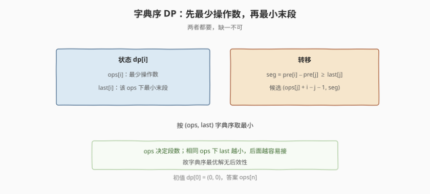
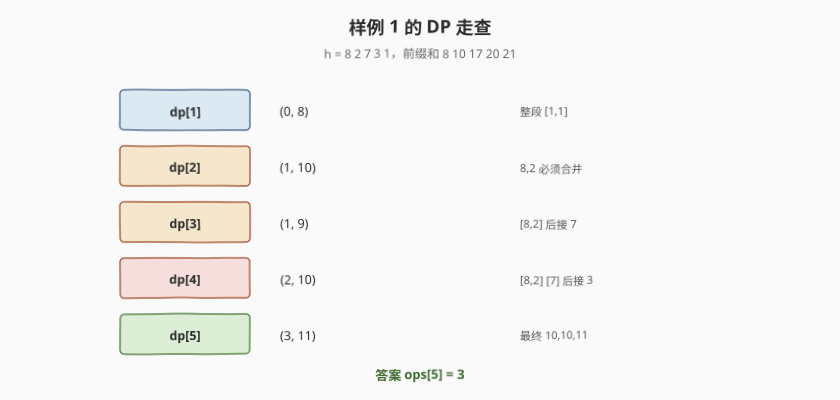

# Codeforces 229D 塔的合并 题解

## 1. 题目概述

- **题目链接**：https://codeforces.com/problemset/problem/229/D
- **比赛来源**：Codeforces Round 142 (Div. 1) · Problem D（UTC 2012-10-01）
- **难度**：2100
- **标签**：动态规划、前缀和、贪心
- **评测类型**：普通
- **限制**：时间 2 s / 内存 256 MB

**题意**：$n$ 座塔从左到右排成一排，第 $i$ 座高度 $h_i$。一次操作可以把第 $i$ 座塔放到相邻的 $(i-1)$ 或 $(i+1)$ 座塔上，新塔高度为两者之和，塔数减 1。求把塔的高度变成**非降序**（从左到右 $H_1\le H_2\le\dots$）所需的最少操作数。

**约束**：$1\le n\le5000$，$1\le h_i\le10^5$；只有一组数据。

## 2. 示例与观察

官方样例（输入 / 输出原样）：

```text
输入：
5
8 2 7 3 1

输出：
3
```

```text
输入：
3
5 2 1

输出：
2
```

**样例 1 演算**：一种最优方案：把 $8$ 与 $2$ 合并为 $10$（1 次），把 $7$ 与 $3$ 合并为 $10$（1 次），再把 $10$ 与 $1$ 合并为 $11$（1 次），得到 $10,10,11$ 非降，共 3 次。

**样例 2 演算**：$5,2,1$ 需要全部合并：$5+2=7$ 后 $7>1$，再合并得 $8$，共 2 次。

**关键观察**：最终的第 $k$ 座塔一定是原数组的**一段连续区间**的和（合并只能把相邻的塔并起来）。所以问题等价于：把 $h_1..h_n$ 划分成若干连续段，段和从左到右非降，**最少操作数 = $n-$ 段数**，即**最大化段数**。设前缀和 `pre[]`，答案是 $n$ 减去满足条件的段数最大值。

不过"段数最多"与"最后一段尽量小"并不完全等价，需要同时优化两个目标：段数优先，段数相同时让**最后一段高度最小**（这样后面更容易接上）。


自造样例（标注"自造"）：

| 输入 | 输出 | 说明 |
|------|------|------|
| `1` / `5` | 0 | 只有一座塔，已经非降 |
| `3` / `1 2 3` | 0 | 已非降 |
| `3` / `3 2 1` | 1 | 合并后两个：$3,3$ ✓ |
| `3` / `2 1 2` | 1 | 合并前两个：$3,2$ ✗；合并后两个：$2,3$ ✓ |
| `4` / `1 3 2 4` | 1 | 合并 $2,4$ 得 $1,3,6$，已非降 |

## 3. 解题思路

### 3.1 朴素做法与瓶颈

枚举所有分段方案是 $2^{n-1}$，不可行。直接 DP 若只记"最少操作数"会丢失必要信息（同样的操作数下，最后一段越小越好），所以用二元组 DP。

### 3.2 状态设计

`dp[i] = (ops, last)`：把前缀 $h_1..h_i$ 划分成若干非降段时的最小操作数 `ops`，在操作数最小的前提下最后一段高度 `last` 最小。转移：

$$ dp[i]=\min_{\substack{0\le j<i\\ \text{pre}[i]-\text{pre}[j]\ \ge\ dp[j].last}}\bigl(dp[j].ops+(i-j-1),\ \text{pre}[i]-\text{pre}[j]\bigr), $$

其中 `(ops, last)` 按字典序比较（先比 `ops`，再比 `last`）。初值 $dp[0]=(0,0)$，答案 $dp[n].ops$。



### 3.3 为什么字典序 DP 正确

- **可行性只依赖 `last`**：后续段的下界只看当前最后一段高度，故在操作数相同时保留更小的 `last` 一定不劣。
- **操作数单调**：要让段数更多（操作数更少），需要前面的划分支持更小的段和；字典序最小化恰好同时优化了这两个目标。

### 3.4 样例走查



以样例 1 的 $h=8,2,7,3,1$、前缀和 $8,10,17,20,21$ 为例：$dp[1]=(0,8)$；$dp[2]$：$j=1$ 时 $10-8=2<8$ 不可行，$j=0$ 时段和 $10\ge0$ 可行，得 $(1,10)$；$dp[3]$：$j=2$ 段和 $7<10$ 不可行，$j=1$ 段和 $9<8$？$17-8=9\ge8$ 可行 → $(0+1,9)$；$j=0$ 段和 $17$ → $(2,17)$；取 $(1,9)$。依此类推，$dp[5]=(3,11)$，答案 3 ✓。

## 4. 正确性证明

**引理 1（分段模型）**：任意合并方案最终的各塔高度，恰好对应把原数组划分成若干连续段后的段和；操作数 = $n-$ 段数。反之任意分段都能通过段内合并实现。

**证明**：合并只作用于相邻塔，因此每个最终塔对应的原塔集合是连续区间，且互不相交、覆盖全部；段内合并 $k$ 座塔需要 $k-1$ 次操作，求和得 $n-$ 段数。分段方案可以自左向右依次合并段内塔实现。∎

**引理 2（字典序最优子结构）**：设 $f(i)$ 为前缀 $i$ 的最优二元组（按操作数最小、再按最后一段最小）。若最优解中前缀 $i$ 的最后一段是 $[j+1,i]$，则它关于前缀 $j$ 的部分必是 $f(j)$ 的字典序最优解。

**证明**：若存在前缀 $j$ 的另一个划分操作数更少，替换后总操作数更少，矛盾；若操作数相同但最后一段更小，替换后段和 $[j+1,i]$ 不变、整段可行性不变，而总操作数相同、最后一段不变——但前缀 $j$ 的最后一段变小时并不影响本段可行性（本段只要求 $\ge$ 前缀 $j$ 的 last），故原解不会因此更优；实际上 $f(j)$ 的 last 更小只会让未来更宽松，因此用 $f(j)$ 不会比最优解差。∎

**定理**：按上述转移得到的 $dp[n].ops$ 是最少操作数。

**证明**：由引理 1，问题等价于分段；由引理 2，最优解在每个前缀处都能取字典序最优的 $f(j)$，故转移枚举所有可能的"最后一段起点" $j$ 并取字典序最小即为最优。∎

## 5. 复杂度分析

- **时间**：$O(n^2)$ 次转移，$n=5000$ 时约 $1.25\times10^7$，实测约 10 ms（限 2 s）。
- **空间**：$O(n)$ 的 `dp` 数组与前缀和。
- **与时限的关系**：余量 100 倍以上；若 $n$ 放大到 $10^5$ 需要更复杂的优化（如单调队列/二分）。

## 6. 参考代码

### C++17

```cpp
#include <bits/stdc++.h>
using namespace std;
typedef long long ll;

int main() {
    int n;
    if (scanf("%d", &n) != 1) return 0;
    vector<ll> h(n + 1), pre(n + 1, 0);
    for (int i = 1; i <= n; i++) { scanf("%lld", &h[i]); pre[i] = pre[i - 1] + h[i]; }
    const ll INF = (ll)4e18;
    vector<ll> ops(n + 1, INF), last(n + 1, 0);
    ops[0] = 0; last[0] = 0;
    for (int i = 1; i <= n; i++) {
        for (int j = 0; j < i; j++) {
            if (ops[j] >= INF) continue;
            ll seg = pre[i] - pre[j];
            if (seg < last[j]) continue;
            ll co = ops[j] + (i - j - 1);
            if (co < ops[i] || (co == ops[i] && seg < last[i])) { ops[i] = co; last[i] = seg; }
        }
    }
    printf("%lld\n", ops[n]);
    return 0;
}
```

### Python3

```python
import sys


def main() -> None:
    data = sys.stdin.buffer.read().split()
    n = int(data[0])
    h = [int(x) for x in data[1:1 + n]]
    pre = [0] * (n + 1)
    for i in range(n):
        pre[i + 1] = pre[i] + h[i]
    INF = float('inf')
    ops = [INF] * (n + 1)
    last = [0] * (n + 1)
    ops[0] = 0
    for i in range(1, n + 1):
        for j in range(i):
            if ops[j] == INF:
                continue
            seg = pre[i] - pre[j]
            if seg < last[j]:
                continue
            co = ops[j] + (i - j - 1)
            if co < ops[i] or (co == ops[i] and seg < last[i]):
                ops[i] = co
                last[i] = seg
    print(ops[n])


main()
```

## 7. 边界情况与易错点

1. **$n=1$**：答案 0（`ops[1]=0`）。
2. **只比较操作数是不够的**：必须同时最小化最后一段高度，否则会丢失更优的后续划分（例如有多组同样操作数的划分时）。
3. **字典序比较**：先 `co < ops[i]`，相等时再 `seg < last[i]`；不要反过来。
4. **前缀和**：$h_i\le10^5$、$n\le5000$，总和 $\le5\times10^8$，`long long` 稳妥。
5. **初值**：`ops[0]=0, last[0]=0`，允许第一段任意高。
6. **不可行状态**：`ops[j]` 为 INF 时跳过。
7. **输出**：仅一个整数（最少操作数），不是最终高度序列。

## 8. 验证记录

- **编译环境与命令**：本机无 GNU `g++`，用 `clang++ -std=c++17 -O2 -I codeforces/tools/include` 编译；`verify_solution.py` 自动采用同样回退。Python 3.9.6。
- **官方样例**：2 / 2 通过（`3`、`2`），C++ 与 Python 一致。
- **独立暴力对拍**：暴力程序枚举所有 $2^{n-1}$ 种分段方式，直接检查段和非降并取最少操作数（与 DP 完全独立）；对 $n\le9$、$h_i\le9$ 的 **200 组**随机数据逐组比对，全部一致。
- **最大约束性能**：$n=5000$ 的随机与递减数据，C++ 端到端均约 10 ms（限 2 s）。
- **图片校验**：三张 SVG 均通过 `xml.etree.ElementTree.parse`，含 `feTurbulence` 与手写字体，文本包围盒（含重叠检测）均在 `viewBox` 内。
- **公式校验**：`node codeforces/tools/katex_check.cjs codeforces/contests/0101-0203/229` 报告 0 个错误。
- **复核状态**：verified。

## 相关题目与扩展

- [Codeforces 229C Triangles](https://codeforces.com/problemset/problem/229/C)：同场 C 题，组合恒等式。
- [Codeforces 229E Gifts](https://codeforces.com/problemset/problem/229/E)：同场 E 题，概率与 DP。
- [Codeforces 467C George and Job](https://codeforces.com/problemset/problem/467/C)：分段 DP 的经典题。

**延伸思考**：

1. **如果要求最终塔数恰好为 $k$**：在 DP 中加一维段数，$O(n^2k)$。
2. **如果 $n$ 放大到 $10^5$**：需要利用"$f(i)$ 的 last 单调"做决策单调性优化或二分栈，把转移降到 $O(n\log n)$。
3. **如果允许把塔放到任意位置（不是相邻）**：分段模型失效，问题变难。
4. **如果要求严格递增**：把"$\ge$"改成"$>$"，DP 不变。
