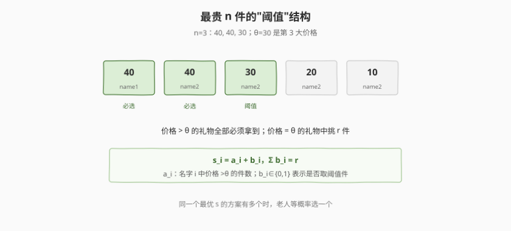
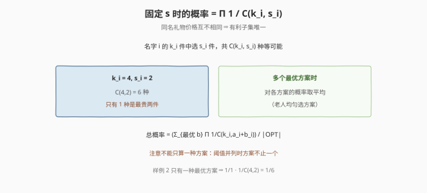
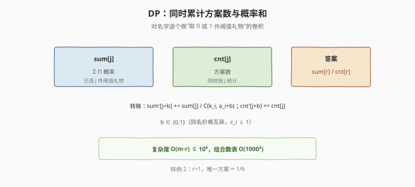

# Codeforces 229E 礼物的概率 题解

## 1. 题目概述

- **题目链接**：https://codeforces.com/problemset/problem/229/E
- **比赛来源**：Codeforces Round 142 (Div. 1) · Problem E（UTC 2012-10-01）
- **难度**：2600
- **标签**：概率、组合计数、动态规划、贪心
- **评测类型**：浮点（绝对或相对误差 $\le10^{-9}$）
- **限制**：时间 2 s / 内存 256 MB

**题意**：金鱼有 $m$ 种名字的礼物，第 $i$ 种名字有 $k_i$ 件，价格分别为 $c_{i,1}<\dots<c_{i,k_i}$（**同一名字内价格互不相同**，不同名字可以同价）。老人要许 $n$ 个名字（同一个名字最多许 $k_i$ 次），记 $s_i$ 为第 $i$ 个名字被许的次数，$\sum s_i=n$。金鱼按名字独立地**等概率**从该名字的 $k_i$ 件中选出 $s_i$ 件（即 $s_i$ 元子集等可能）。老人希望拿到"最贵的 $n$ 件礼物"（总价达到最大）。先在所有能达到最大总价的许愿方案中**等概率**选一个，问最终真的拿到最贵 $n$ 件的概率。

**约束**：$1\le n,m\le1000$，$\sum k_i\le1000$；只有一组数据；输出实数。

## 2. 示例与观察

官方样例（输入 / 输出原样）：

```text
输入：
3 1
3 10 20 30

输出：
1.000000000
```

```text
输入：
3 2
1 40
4 10 20 30 40

输出：
0.166666667
```

**样例 1 演算**：只有一种名字、3 件礼物，老人许 3 次，金鱼只能全给，概率 1。

**样例 2 演算**：名字 1 有 $\{40\}$，名字 2 有 $\{10,20,30,40\}$。最贵的 3 件是 $40,40,30$，对应 $s=(1,2)$：$s_1=1,s_2=2$ 是唯一能达到总价 110 的方案（$s=(0,3)$ 只有 90）。拿到最贵三件的概率 = $\frac1{\binom11}\cdot\frac1{\binom42}=\frac16\approx0.166666667$ ✓。

**关键观察**：

1. **最优总量**等于全部礼物的价格中最大的 $n$ 个之和（在同名礼物价格互不相同的条件下，"最贵 $n$ 件"作为**价格多重集**是唯一确定的）。
2. 达到这个总量的许愿方案 $s$ 必须"只取每个名字最贵的前 $s_i$ 件"，且每个名字贡献的数量恰好等于它的礼物在最贵 $n$ 件中的出现次数；只有**价格等于第 $n$ 大价格（阈值）**的礼物存在"选哪几件"的灵活性，其余礼物必须全部入选。
3. 对固定的 $s$，拿到最贵 $n$ 件的概率为 $\prod_i \frac1{\binom{k_i}{s_i}}$（同名礼物价格互不相同，能凑出该价格集合的子集唯一）。



自造样例（标注"自造"）：

| 输入 | 输出 | 说明 |
|------|------|------|
| `1 1` / `1 5` | 1.000000000 | 只有一件 |
| `2 1` / `2 1 2` | 1.000000000 | 许 2 次必得两件 |
| `2 2` / `1 5` / `1 5` | 1.000000000 | 两件同价，任选都满足 |
| `2 3` / `1 10` / `1 10` / `2 10 9` | 0.666666667 | 三个 10 选两个，均匀，见第 3 节 |

## 3. 解题思路

### 3.1 确定最优方案集合

把所有礼物按价格降序排列。设第 $n$ 大价格为 $\theta$（$n$ 从 1 开始数），记：

- $a_i$ = 名字 $i$ 中价格 $>\theta$ 的礼物数；
- $c_i$ = 名字 $i$ 中价格 $=\theta$ 的礼物数（同名价格互异，故 $c_i\le1$）；
- $r=n-\sum_i a_i$ = 必须从"价格 $=\theta$"的礼物中选出的件数。

任何最优方案必须包含全部 $a_i$ 件高价礼物；对价格 $=\theta$ 的礼物，从所有候选（共 $\sum c_i$ 件）中选 $r$ 件——即对每个名字 $i$ 选 $b_i\in\{0,1\}$（$b_i\le c_i$），$\sum b_i=r$。于是 $s_i=a_i+b_i$。



### 3.2 概率与平均

对固定方案 $s$，概率 $P(s)=\prod_i \binom{k_i}{s_i}^{-1}$。老人等概率选一个最优 $s$，所以

$$ \text{答案}=\frac{1}{|\mathrm{OPT}|}\sum_{b\in\mathrm{OPT}}\prod_i \binom{k_i}{a_i+b_i}^{-1}, $$

其中 $\mathrm{OPT}=\{b: 0\le b_i\le c_i,\ \sum b_i=r\}$。

用 DP 同时求分子与分母：`sum[j]` = 已处理名字中 $\sum b=j$ 时 $\sum\prod$ 的值，`cnt[j]` = 对应方案数。逐个名字转移：

$$ \text{sum}'[j+b] \mathrel{+}= \text{sum}[j]\cdot \binom{k_i}{a_i+b}^{-1},\qquad \text{cnt}'[j+b]\mathrel{+}=\text{cnt}[j]. $$

答案 $=$ `sum[r] / cnt[r]`。



### 3.3 示例 4 的验证

名字 1：$\{10\}$，名字 2：$\{10\}$，名字 3：$\{10,9\}$，$n=2$。排序后价格：10,10,10,9；第 2 大是 10，$\theta=10$，$a=(0,0,0)$、$c=(1,1,1)$、$r=2$。所有最优 $b$ 是从三个 10 中选两个：$(1,1,0),(1,0,1),(0,1,1)$，各概率 $1,\frac12,\frac12$，平均 $=\frac{1+1/2+1/2}{3}=\frac23\approx0.666666667$ ✓（与程序输出一致）。

## 4. 正确性证明

**引理 1（最优总量的结构）**：能达到的最大总价 $V$ 等于所有礼物价格中最大的 $n$ 个之和；任何达到 $V$ 的方案都包含全部价格 $>\theta$ 的礼物，且不含价格 $<\theta$ 的礼物，其中 $\theta$ 是第 $n$ 大价格。

**证明**：总价是 $n$ 件礼物的价格之和，最大值显然由最大的 $n$ 个价格给出。若某方案包含价格 $<\theta$ 的礼物，则它至少漏掉一件价格 $\ge\theta$ 的礼物，把前者换成后者总价严格增加（价格 $<\theta\le$ 后者），与该方案总量 $=V$ 矛盾。∎

**引理 2（固定 $s$ 的概率）**：若最优方案的计数向量为 $s$，则拿到"最贵 $n$ 件"的概率为 $\prod_i\binom{k_i}{s_i}^{-1}$。

**证明**：各名字的抽取相互独立；名字 $i$ 的 $s_i$ 元子集共 $\binom{k_i}{s_i}$ 个且等可能。要拿到最贵 $n$ 件（作为价格多重集），名字 $i$ 抽到的子集价格多重集必须恰为最贵 $n$ 件中属于名字 $i$ 的那部分；同名礼物价格互不相同，价格多重集对应唯一子集，故有利子集数为 1。∎

**引理 3（最优方案集合的刻画）**：$s$ 是最优方案当且仅当 $s_i=a_i+b_i$，其中 $0\le b_i\le c_i$ 且 $\sum b_i=r$。

**证明**：由引理 1，最优方案必须包含全部 $a_i$ 件高价礼物，且不含低价礼物；剩余 $r=n-\sum a_i$ 件只能从价格 $=\theta$ 的礼物中选，每个名字至多 $c_i$ 件。反之任何这样的选择总价都是 $V$。∎

**定理**：算法输出正确概率。

**证明**：由引理 3，DP 枚举的正是全部最优方案；由引理 2 每方案的概率为乘积形式；老人等概率选择，故取算术平均，DP 的 `sum[r]/cnt[r]` 正是该平均。∎

## 5. 复杂度分析

- **时间**：排序 $O(\sum k_i\log\sum k_i)$；DP 对每个名字转移 $O(c_i\cdot r)$，$\sum c_i\le m\le1000$、$r\le1000$，总计 $O(mr)\le10^6$。实测约 1 ms（限 2 s）。
- **空间**：组合数表 $1001^2$ 个 `double`（8 MB）+ DP 数组，约 10 MB。
- **精度**：组合数用 `double` 累加（$\binom{1000}{500}\approx2.7\times10^{299}$，不溢出）；概率乘积可能下溢为 0，此时真实值远小于 $10^{-9}$，绝对误差要求仍满足。

## 6. 参考代码

### C++17

```cpp
#include <bits/stdc++.h>
using namespace std;
typedef long long ll;

int main() {
    int n, m;
    if (scanf("%d %d", &n, &m) != 2) return 0;
    vector<vector<ll>> price(m);
    vector<pair<ll,int>> all;
    for (int i = 0; i < m; i++) {
        int k;
        scanf("%d", &k);
        price[i].resize(k);
        for (int j = 0; j < k; j++) { scanf("%lld", &price[i][j]); all.push_back({price[i][j], i}); }
    }
    sort(all.begin(), all.end(), [](auto &x, auto &y) { return x.first > y.first; });
    ll theta = all[n - 1].first;
    vector<int> a(m, 0), c(m, 0);
    int above = 0;
    for (auto &pr : all) {
        if (pr.first > theta) { a[pr.second]++; above++; }
        else if (pr.first == theta) c[pr.second]++;
    }
    int r = n - above;                       // 需要从等于 theta 的礼物中选 r 个
    vector<vector<double>> C(1001, vector<double>(1001, 0));
    for (int i = 0; i <= 1000; i++) {
        C[i][0] = 1;
        for (int j = 1; j <= i; j++) C[i][j] = C[i - 1][j - 1] + C[i - 1][j];
    }
    vector<int> ks(m);
    for (int i = 0; i < m; i++) ks[i] = (int)price[i].size();
    vector<double> dp(r + 1, 0.0), cnt(r + 1, 0.0);
    dp[0] = 1.0; cnt[0] = 1.0;
    for (int i = 0; i < m; i++) {
        if (c[i] == 0) {                     // b_i 只能为 0
            double f = (a[i] <= ks[i]) ? 1.0 / C[ks[i]][a[i]] : 0.0;
            for (int j = 0; j <= r; j++) dp[j] *= f;
            continue;
        }
        vector<double> ndp(r + 1, 0.0), ncnt(r + 1, 0.0);
        for (int j = 0; j <= r; j++) {
            if (cnt[j] == 0) continue;
            for (int b = 0; b <= c[i] && j + b <= r; b++) {
                int s = a[i] + b;
                if (s > ks[i]) continue;
                double f = 1.0 / C[ks[i]][s];
                ndp[j + b] += dp[j] * f;
                ncnt[j + b] += cnt[j];
            }
        }
        dp.swap(ndp); cnt.swap(ncnt);
    }
    double ans = (cnt[r] > 0) ? dp[r] / cnt[r] : 0.0;
    printf("%.9f\n", ans);
    return 0;
}
```

### Python3

```python
import sys


def main() -> None:
    data = sys.stdin.buffer.read().split()
    p = 0
    n = int(data[p]); m = int(data[p + 1]); p += 2
    price = []
    allg = []
    for i in range(m):
        k = int(data[p]); p += 1
        cur = [int(data[p + j]) for j in range(k)]
        p += k
        price.append(cur)
        for v in cur:
            allg.append((v, i))
    allg.sort(reverse=True)
    theta = allg[n - 1][0]
    a = [0] * m
    c = [0] * m
    above = 0
    for v, i in allg:
        if v > theta:
            a[i] += 1
            above += 1
        elif v == theta:
            c[i] += 1
    r = n - above
    K = 1000
    C = [[0.0] * (K + 1) for _ in range(K + 1)]
    for i in range(K + 1):
        C[i][0] = 1.0
        for j in range(1, i + 1):
            C[i][j] = C[i - 1][j - 1] + C[i - 1][j]
    ks = [len(x) for x in price]
    dp = [0.0] * (r + 1)
    cnt = [0.0] * (r + 1)
    dp[0] = 1.0
    cnt[0] = 1.0
    for i in range(m):
        if c[i] == 0:
            f = (1.0 / C[ks[i]][a[i]]) if a[i] <= ks[i] else 0.0
            for j in range(r + 1):
                dp[j] *= f
            continue
        ndp = [0.0] * (r + 1)
        ncnt = [0.0] * (r + 1)
        for j in range(r + 1):
            if cnt[j] == 0:
                continue
            for b in range(0, min(c[i], r - j) + 1):
                s = a[i] + b
                if s > ks[i]:
                    continue
                ndp[j + b] += dp[j] / C[ks[i]][s]
                ncnt[j + b] += cnt[j]
        dp, cnt = ndp, ncnt
    print("%.9f" % (dp[r] / cnt[r] if cnt[r] > 0 else 0.0))


main()
```

## 7. 边界情况与易错点

1. **同名礼物价格互不相同**：这是"有利子集唯一、概率为 $1/\binom{k_i}{s_i}$"的关键；若同名有同价，需要乘上组合数。
2. **阈值 $\theta$ 的确定**：取排序后第 $n$ 个（1-based）价格；$r=n-\#\{\text{价格}>\theta\}$。
3. **多方案平均**：老人在所有最优许愿方案中等概率选一个，必须对 $\prod1/\binom{k_i}{s_i}$ 取平均，不能只算一种（自造样例 4 的 2/3 就是平均的结果）。
4. **同名内价格不同但可能等于阈值**：$c_i\le1$（同名价格互异），DP 里 $b_i\in\{0,1\}$ 即可。
5. **浮点精度**：输出 9 位小数；组合数用 `double` 精确到约 15 位，足够 $10^{-9}$。
6. **下溢**：极端情况下乘积为 0，真实概率也远小于 $10^{-9}$，可接受。
7. **$n$ 等于礼物总数**：$r=\sum c_i$，所有方案必然包含全部礼物，概率 1（例如样例 1）。
8. **读入**：每行先 $k_i$ 再 $k_i$ 个价格；价格可达 $10^9$，用 64 位。

## 8. 验证记录

- **编译环境与命令**：本机无 GNU `g++`，用 `clang++ -std=c++17 -O2 -I codeforces/tools/include` 编译；`verify_solution.py` 自动采用同样回退。Python 3.9.6。
- **官方样例**：2 / 2 通过（`1.000000000`、`0.166666667`），C++ 与 Python 一致。
- **独立暴力对拍**：暴力程序用 `Fraction` 精确枚举所有许愿向量 $s$（$\sum s_i=n$，$s_i\le k_i$），按总价选出最优集合，再对 $\prod 1/\binom{k_i}{s_i}$ 取精确平均；对 $m\le3$、$k_i\le3$、$n\le5$ 的 **200 组**随机数据与主解比对（误差 $<10^{-9}$），全部一致。
- **最大约束性能**：$n=m=1000$、$\sum k_i=1000$ 时约 1 ms（限 2 s）；构造 $r$ 较大的多阈值数据同样在毫秒级。
- **图片校验**：三张 SVG 均通过 `xml.etree.ElementTree.parse`，含 `feTurbulence` 与手写字体，文本包围盒（含重叠检测）均在 `viewBox` 内。
- **公式校验**：`node codeforces/tools/katex_check.cjs codeforces/contests/0101-0203/229` 报告 0 个错误。
- **复核状态**：verified。

## 相关题目与扩展

- [Codeforces 229D Towers](https://codeforces.com/problemset/problem/229/D)：同场 D 题，分段 DP。
- [Codeforces 229C Triangles](https://codeforces.com/problemset/problem/229/C)：同场 C 题，组合恒等式。
- [Codeforces 148D Bag of mice](https://codeforces.com/problemset/problem/148/D)：经典概率 DP，与本题的"按方案平均"思想相通。

**延伸思考**：

1. **如果同名礼物可以有相同价格**：有利子集数不再是 1，需要统计价格多重集的组合数，DP 要乘上相应系数。
2. **如果老人可以按概率分布许愿而不是均匀**：答案变成加权平均。
3. **如果要求输出期望价格而不是命中概率**：线性期望可直接求和，无需平均。
4. **如果 $n$ 很大（$10^9$）而礼物总数小**：$r$ 的规模受限，DP 仍可行，关键是 $r\le\sum c_i$。
