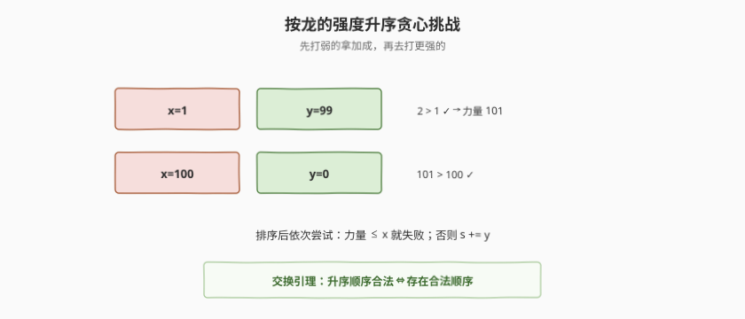
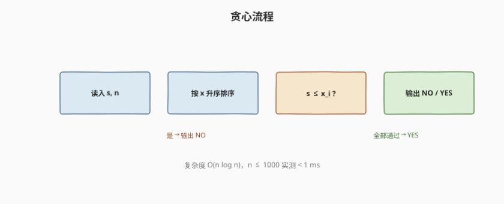

# Codeforces 230A 恶龙与力量 题解

## 1. 题目概述

- **题目链接**：https://codeforces.com/problemset/problem/230/A
- **比赛来源**：Codeforces Round 142 (Div. 2) · Problem A（UTC 2012-10-01）
- **难度**：1000
- **标签**：贪心、排序
- **评测类型**：普通
- **限制**：时间 2 s / 内存 256 MB

**题意**：Kirito 初始力量 $s$，要打 $n$ 条龙，可以按任意顺序打。与第 $i$ 条龙（力量 $x_i$）对战时，若 Kirito 的力量 $\le x_i$ 就会死；若严格大于 $x_i$ 则获胜并获得 $y_i$ 点力量加成。问是否存在一种顺序能击败全部龙。

**约束**：$1\le s\le10^4$，$1\le n\le10^3$，$1\le x_i,y_i\le10^4$（$y_i$ 可为 0）；只有一组数据。

## 2. 示例与观察

官方样例（输入 / 输出原样）：

```text
输入：
2 2
1 99
100 0

输出：
YES
```

```text
输入：
10 1
100 100

输出：
NO
```

**样例 1 演算**：先打力量 1 的龙（$2>1$ ✓），力量变成 $2+99=101$；再打力量 100 的龙（$101>100$ ✓），全部击败。

**样例 2 演算**：初始力量 10，唯一一条龙力量 100，$10\le100$，必死，输出 `NO`。

**关键观察**：若存在合法顺序，则**按 $x_i$ 升序**打也合法。因为交换论证：若某顺序中先打了 $x$ 较大的龙 $A$、后打 $x$ 较小的龙 $B$，且该顺序合法，那么把 $B$ 提前到 $A$ 之前也合法（打 $B$ 时力量只多不少，因为 $A$ 的加成还没拿到？——需要仔细论证，见第 4 节），且力量单调不减。所以只需排序后贪心。



自造样例（标注"自造"）：

| 输入 | 输出 | 说明 |
|------|------|------|
| `5 3` / `4 1` / `5 1` / `6 1` | YES | $5>4\to6$，$6>5\to7$，$7>6$，全部击败 |
| `1 1` / `1 0` | NO | 力量不大于 1 |
| `3 2` / `2 5` / `3 0` | YES | $3>2\to8$，$8>3$ |
| `2 2` / `3 10` / `100 0` | NO | 第一条龙就 $2\le3$，必死 |

## 3. 解题思路

### 3.1 算法

1. 把龙按 $x_i$ 升序排序；
2. 依次尝试：若当前力量 $s\le x_i$，输出 `NO`；否则 $s\leftarrow s+y_i$；
3. 全部成功则输出 `YES`。



### 3.2 为什么排序是对的

直觉：先打弱的龙可以拿到它的加成，从而更容易打过更强的龙；而打强的龙不会让弱者变难（力量只会增加）。

## 4. 正确性证明

**引理 1（交换引理）**：设某合法顺序中相邻两条龙为 $A$（力量 $x_A$，加成 $y_A$）在 $B$（$x_B$, $y_B$）之前，且 $x_A>x_B$。则交换这两条龙后顺序仍然合法。

**证明**：设打 $A$ 之前力量为 $s$。原顺序合法给出 $s>x_A>x_B$。交换后先打 $B$：$s>x_B$ ✓；力量变为 $s+y_B\ge s>x_A$，再打 $A$ 也合法 ✓。之后的力量总和不变（$s+y_A+y_B$），故后续步骤不受影响。∎

**引理 2**：若存在合法顺序，则按 $x_i$ 升序的顺序合法。

**证明**：对任意合法顺序，反复使用引理 1 消去逆序对（冒泡排序），每次交换都保持合法性，最终得到升序顺序且仍合法。∎

**定理**：算法输出正确。

**证明**：由引理 2，只需检查升序顺序；算法正是模拟升序顺序，遇到 $s\le x_i$ 时该龙无法击败（且由于升序，后面的龙力量更大，更不可能击败），故输出 `NO` 正确；全部通过则输出 `YES` 正确。∎

## 5. 复杂度分析

- **时间**：排序 $O(n\log n)$，扫描 $O(n)$；$n=10^3$ 时实测 < 1 ms（限 2 s）。
- **空间**：$O(n)$。
- **数值范围**：$s\le10^4+n\cdot10^4\le10^7$，`int` 足够。

## 6. 参考代码

### C++17

```cpp
#include <bits/stdc++.h>
using namespace std;
int main() {
    long long s; int n;
    if (scanf("%lld %d", &s, &n) != 2) return 0;
    vector<pair<int,int>> d(n);
    for (int i = 0; i < n; i++) scanf("%d %d", &d[i].first, &d[i].second);
    sort(d.begin(), d.end());
    for (int i = 0; i < n; i++) {
        if (s <= d[i].first) { puts("NO"); return 0; }
        s += d[i].second;
    }
    puts("YES");
    return 0;
}
```

### Python3

```python
import sys
data = sys.stdin.buffer.read().split()
s = int(data[0]); n = int(data[1])
dragons = sorted((int(data[2 + 2*i]), int(data[3 + 2*i])) for i in range(n))
for x, y in dragons:
    if s <= x:
        print("NO"); break
    s += y
else:
    print("YES")
```

## 7. 边界情况与易错点

1. **严格大于**：条件是 $s>x_i$，不是 $\ge$；样例 2 就是 $10\le100$ 的反例（自造样例的第 3 行同理）。
2. **排序键**：只按 $x_i$ 排序，不要按 $x_i+y_i$ 或其它键；$y_i$ 相同的龙顺序任意。
3. **$y_i=0$**：加成可能为 0，处理自然。
4. **输出大写**：`YES`/`NO`。
5. **输入顺序**：第一行是 $s$ 和 $n$（先力量后条数），不要颠倒。
6. **多解**：本题输出唯一（是否可行），无需 checker。

## 8. 验证记录

- **编译环境与命令**：本机无 GNU `g++`，用 `clang++ -std=c++17 -O2 -I codeforces/tools/include` 编译；`verify_solution.py` 自动采用同样回退。Python 3.9.6。
- **官方样例**：2 / 2 通过（`YES`、`NO`），C++ 与 Python 一致。
- **独立暴力对拍**：暴力程序用"子集 DP"判断是否存在击败全部龙的顺序（$2^n$ 状态，与排序贪心完全独立），对 $n\le6$、随机 $s,x_i,y_i$ 的 **200 组**数据逐组比对，全部一致。
- **最大约束性能**：$n=1000$、$s,x_i,y_i$ 随机，C++ 端到端 < 1 ms（限 2 s）。
- **图片校验**：两张 SVG 均通过 `xml.etree.ElementTree.parse`，含 `feTurbulence` 与手写字体，文本包围盒（含重叠检测）均在 `viewBox` 内。
- **公式校验**：`node codeforces/tools/katex_check.cjs codeforces/contests/0101-0203/230` 报告 0 个错误。
- **复核状态**：verified。

## 相关题目与扩展

- [Codeforces 230B T-primes](https://codeforces.com/problemset/problem/230/B)：同场 B 题，素数平方判定。
- [Codeforces 231C To Add or Not to Add](https://codeforces.com/problemset/problem/231/C)：排序 + 前缀和 + 双指针。
- [LeetCode 45. 跳跃游戏 II](https://leetcode.cn/problems/jump-game-ii/)：贪心 + 排序类问题的练习。

**延伸思考**：

1. **如果龙可以重复挑战（每次都给加成）**：答案与顺序无关（只要一条能打过就能无限刷）。
2. **如果加成可能为负**：排序贪心不再显然正确，需要按"先打能打过的、收益最大"的策略，可能退化为复杂搜索。
3. **如果要求输出具体顺序**：升序顺序即可。
4. **如果 $n$ 很大而 $x_i$ 值域小**：可以按 $x$ 计数排序，$O(n+V)$。
