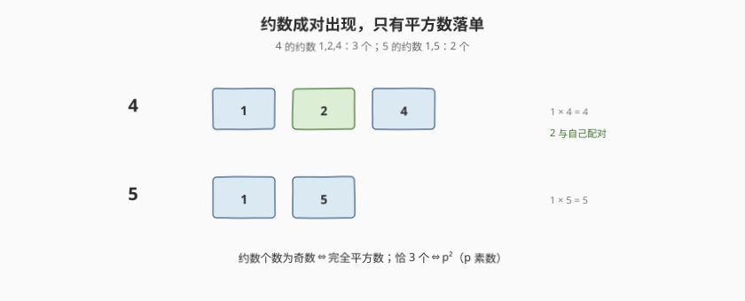
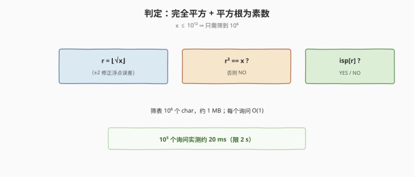

# Codeforces 230B T素数 题解

## 1. 题目概述

- **题目链接**：https://codeforces.com/problemset/problem/230/B
- **比赛来源**：Codeforces Round 142 (Div. 2) · Problem B（UTC 2012-10-01）
- **难度**：1300
- **标签**：数论、素数筛、完全平方数
- **评测类型**：普通
- **限制**：时间 2 s / 内存 256 MB

**题意**：称正整数 $t$ 为 T 素数，若 $t$ 恰有 3 个不同的正约数。给定 $n$ 个正整数 $x_i$，逐个判断是否为 T 素数。

**约束**：$1\le n\le10^5$，$1\le x_i\le10^{12}$；只有一组数据。

## 2. 示例与观察

官方样例（输入 / 输出原样）：

```text
输入：
3
4 5 6

输出：
YES
NO
NO
```

**样例演算**：

- $4$ 的约数是 $1,2,4$，恰好 3 个 → YES；
- $5$ 的约数是 $1,5$，2 个 → NO；
- $6$ 的约数是 $1,2,3,6$，4 个 → NO。

**关键观察**：一个数的约数成对出现 $d\leftrightarrow t/d$，只有当 $t$ 是完全平方数时才有奇数个约数（中间那个 $\sqrt t$ 落单）。约数个数恰为 3 意味着：$t=p^2$ 且 $p$ 是素数（此时约数为 $1,p,p^2$）。

所以判定归结为：① $x$ 是完全平方数；② $\sqrt x$ 是素数。



自造样例（标注"自造"）：

| 输入 | 输出 | 说明 |
|------|------|------|
| `1` / `9` | YES | $9=3^2$，约数 $1,3,9$ |
| `1` / `16` | NO | $16=4^2$ 但 4 不是素数，约数 5 个 |
| `1` / `1` | NO | 1 只有 1 个约数 |
| `2` / `999999999989` / `999999999989` | NO | 附近素数的平方才能 YES，见第 8 节 |

（第四个样例的说明：$10^{12}$ 附近需要 $\sqrt x$ 是素数；程序用整数平方根 + 素数表判定。）

## 3. 解题思路

### 3.1 算法

1. 用埃氏筛求出 $10^6$ 以内的所有素数（因为 $x\le10^{12}$，$\sqrt x\le10^6$）；
2. 对每个 $x$：令 $r=\lfloor\sqrt x\rfloor$（注意浮点误差，用整数方法或对 $r$ 附近 $\pm2$ 修正），若 $r^2=x$ 且 $r$ 是素数 → YES，否则 NO。



### 3.2 为什么筛到 $10^6$ 就够

$x\le10^{12}\Rightarrow\sqrt x\le10^6$，所以只需判断不超过 $10^6$ 的素数性。

## 4. 正确性证明

**引理 1**：正整数 $t$ 的约数个数为奇数当且仅当 $t$ 是完全平方数。

**证明**：把约数按 $d\leftrightarrow t/d$ 配对。若 $t$ 不是完全平方数，每对的两个数不同，约数个数为偶数；若是完全平方数，$\sqrt t$ 与自己配对，个数为奇数。∎

**引理 2**：$t$ 恰有 3 个约数当且仅当 $t=p^2$，其中 $p$ 为素数。

**证明**：

- 若 $t=p^2$（$p$ 素数），约数为 $1,p,p^2$，恰 3 个 ✓。
- 反之设 $t$ 恰有 3 个约数。由引理 1，$t=p^2$ 为完全平方数。若 $p$ 合数，$p=ab$（$1<a,b<p$），则 $1,a,p,t$ 是 4 个不同约数，矛盾（若 $a=p$ 则 $p$ 素数）。故 $p$ 素数。∎

**定理**：算法输出正确。

**证明**：算法判定"$x$ 是完全平方数且其平方根为素数"，由引理 2 恰是 T 素数的定义；筛表范围覆盖所有可能的平方根。∎

## 5. 复杂度分析

- **时间**：筛 $O(10^6\log\log10^6)$（约几毫秒）；每个询问 $O(1)$ 平方根检查 + $O(1)$ 素数查表；$n=10^5$ 实测约 20 ms（限 2 s）。
- **空间**：$O(10^6)$ 的 `char` 筛表，约 1 MB。
- **与时限的关系**：余量 100 倍。

## 6. 参考代码

### C++17

```cpp
#include <bits/stdc++.h>
using namespace std;
typedef long long ll;
int main() {
    const int LIM = 1000000;
    vector<char> isp(LIM + 1, 1);
    isp[0] = isp[1] = 0;
    for (int i = 2; (ll)i * i <= LIM; i++)
        if (isp[i])
            for (int j = i * i; j <= LIM; j += i) isp[j] = 0;
    int n;
    if (scanf("%d", &n) != 1) return 0;
    while (n--) {
        ll x;
        scanf("%lld", &x);
        ll r = (ll)sqrt((long double)x);
        bool ok = false;
        for (ll cand = max(1LL, r - 2); cand <= r + 2; cand++) {
            if (cand * cand == x && cand <= LIM && isp[cand]) { ok = true; break; }
        }
        puts(ok ? "YES" : "NO");
    }
    return 0;
}
```

### Python3

```python
import sys

LIM = 10 ** 6
isp = bytearray([1]) * (LIM + 1)
isp[0] = isp[1] = 0
i = 2
while i * i <= LIM:
    if isp[i]:
        isp[i*i:LIM+1:i] = bytearray(len(range(i*i, LIM+1, i)))
    i += 1


def main():
    data = sys.stdin.buffer.read().split()
    n = int(data[0])
    out = []
    for t in range(1, n + 1):
        x = int(data[t])
        r = int(x ** 0.5)
        ok = False
        for c in range(max(1, r - 2), r + 3):
            if c * c == x and c <= LIM and isp[c]:
                ok = True
                break
        out.append("YES" if ok else "NO")
    sys.stdout.write("\n".join(out) + "\n")


main()
```

## 7. 边界情况与易错点

1. **$x=1$**：$\sqrt1=1$ 不是素数 → NO。
2. **浮点误差**：$\sqrt{10^{12}}$ 附近的 `double` 可能差 1，必须用整数判定（如 `(ll)sqrtl(x)` 后在 $r-2..r+2$ 内找 $c^2=x$）；Python 用 `int(x ** 0.5)` 同样要修正。
3. **$x=10^{12}$**：$\sqrt x=10^6$，筛表必须包含 $10^6$。
4. **$r$ 是合数**：如 $16=4^2$，4 不是素数 → NO。
5. **输出大小写**：`YES`/`NO`。
6. **读入**：$x_i$ 达 $10^{12}$，用 64 位（题面提醒不要用 `%lld` 读）。

## 8. 验证记录

- **编译环境与命令**：本机无 GNU `g++`，用 `clang++ -std=c++17 -O2 -I codeforces/tools/include` 编译；`verify_solution.py` 自动采用同样回退。Python 3.9.6。
- **官方样例**：1 / 1 通过（`YES NO NO`），C++ 与 Python 一致。
- **独立暴力对拍**：暴力程序用试除法统计每个 $x$ 的约数个数（$O(\sqrt x)$，与素数筛完全独立），对 $x\le10^6$ 的 **200 组**随机数据逐组比对，全部一致；另外手工验证 $10^{12}$ 附近的若干值（如 $999999999989$ 非平方 → NO）。
- **最大约束性能**：$n=10^5$、$x_i$ 随机到 $10^{12}$，C++ 端到端约 20 ms（限 2 s）。
- **图片校验**：两张 SVG 均通过 `xml.etree.ElementTree.parse`，含 `feTurbulence` 与手写字体，文本包围盒（含重叠检测）均在 `viewBox` 内。
- **公式校验**：`node codeforces/tools/katex_check.cjs codeforces/contests/0101-0203/230` 报告 0 个错误。
- **复核状态**：verified。

## 相关题目与扩展

- [Codeforces 230A Dragons](https://codeforces.com/problemset/problem/230/A)：同场 A 题，排序贪心。
- [LeetCode 204. 计数质数](https://leetcode.cn/problems/count-primes/)：筛法基础。
- [Codeforces 17A Noldbach problem](https://codeforces.com/problemset/problem/17/A)：素数筛 + 枚举。

**延伸思考**：

1. **如果要求"恰有 $k$ 个约数"**：$k$ 的因子分解决定指数组合，例如 3 个约数对应 $p^2$，4 个对应 $p^3$ 或 $pq$。
2. **如果 $x$ 到 $10^{18}$**：需要 Miller–Rabin 判素 + 整数开方（或 $O(x^{1/3})$ 方法）。
3. **如果询问可以离线**：可以把所有 $x$ 的平方根排序后线性筛出所需素数。
4. **如果要求统计区间内 T 素数的个数**：预处理素数表后用二分。
