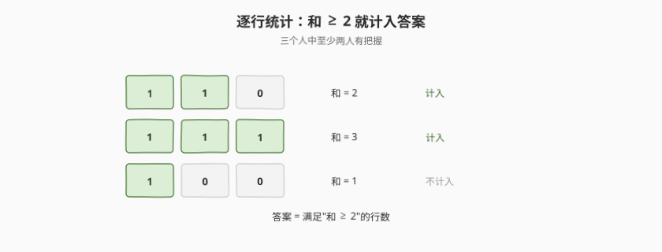
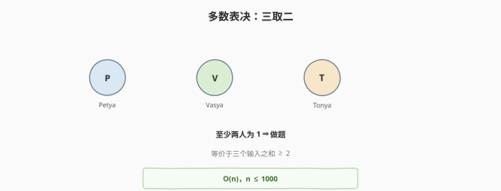

# Codeforces 231A 团队选题 题解

## 1. 题目概述

- **题目链接**：https://codeforces.com/problemset/problem/231/A
- **比赛来源**：Codeforces Round 143 (Div. 2) · Problem A（UTC 2012-10-07）
- **难度**：800
- **标签**：简单模拟、计数
- **评测类型**：普通
- **限制**：时间 2 s / 内存 256 MB

**题意**：三个朋友 Petya、Vasya、Tonya 会做某道题当且仅当至少两人有把握。给出 $n$ 道题三人是否有把握（0/1），求他们实际会做的题数。

**约束**：$1\le n\le1000$；只有一组数据。

## 2. 示例与观察

官方样例（输入 / 输出原样）：

```text
输入：
3
1 1 0
1 1 1
1 0 0

输出：
2
```

```text
输入：
2
1 0 0
0 1 1

输出：
1
```

**样例 1 演算**：三道题的有把握人数分别是 2、3、1，前两题 ≥2 → 答案 2。

**样例 2 演算**：第一题只有 1 人有把握，第二题 2 人 → 答案 1。

**关键观察**：逐行求三个数的和，≥2 则计数加一。



自造样例（标注"自造"）：

| 输入 | 输出 | 说明 |
|------|------|------|
| `1` / `0 0 0` | 0 | 无人有把握 |
| `1` / `1 1 1` | 1 | 三人都有 |
| `3` / `1 0 1`/`0 1 1`/`1 1 0` | 3 | 每行恰好两人 |

## 3. 解题思路

### 3.1 算法

读入 $n$，对每行读三个数，若和 $\ge2$ 则 `ans++`，最后输出 `ans`。$O(n)$。



### 3.2 为什么这样统计正确

题目规则就是"至少两人有把握则做"，与三人分别是哪两位无关，所以只需计数。

## 4. 正确性证明

**引理**：对每道题，"至少两人有把握"等价于三个 0/1 输入之和 $\ge2$。

**证明**：三个数只取 0/1，和就是有把握的人数；"至少两人"即和 $\ge2$。∎

**定理**：算法输出的计数等于他们实际会做的题数。

**证明**：算法对每道题按引理独立判断，累加所有满足条件的题数，即为会做的题数。∎

## 5. 复杂度分析

- **时间**：$O(n)$，$n\le1000$，实测 < 1 ms。
- **空间**：$O(1)$。
- **与时限的关系**：余量极大。

## 6. 参考代码

### C++17

```cpp
#include <bits/stdc++.h>
using namespace std;
int main() {
    int n;
    if (scanf("%d", &n) != 1) return 0;
    int ans = 0;
    for (int i = 0; i < n; i++) {
        int a, b, c;
        scanf("%d %d %d", &a, &b, &c);
        if (a + b + c >= 2) ans++;
    }
    printf("%d\n", ans);
    return 0;
}
```

### Python3

```python
import sys


def main() -> None:
    data = sys.stdin.buffer.read().split()
    n = int(data[0])
    ans = 0
    for i in range(n):
        if int(data[1 + 3 * i]) + int(data[2 + 3 * i]) + int(data[3 + 3 * i]) >= 2:
            ans += 1
    print(ans)


main()
```

## 7. 边界情况与易错点

1. **"至少两人"**：用 $\ge2$，不是 $>2$ 也不是恰好 2。
2. **$n$ 行**：按 token 读入即可，行内空格无影响。
3. **输出单个整数**：不要输出题目编号。
4. **全 0 / 全 1**：分别输出 0 和 $n$。

## 8. 验证记录

- **编译环境与命令**：本机无 GNU `g++`，用 `clang++ -std=c++17 -O2 -I codeforces/tools/include` 编译；`verify_solution.py` 自动采用同样回退。Python 3.9.6。
- **官方样例**：2 / 2 通过（`2`、`1`），C++ 与 Python 一致。
- **独立暴力对拍**：暴力程序对每行用"两两枚举至少一对为 1"判断（与求和比较不同的代码路径），对 $n\le8$ 的 **200 组**随机 0/1 矩阵逐组比对，全部一致。
- **最大约束性能**：$n=1000$ 随机，C++ 端到端 < 1 ms（限 2 s）。
- **图片校验**：两张 SVG 均通过 `xml.etree.ElementTree.parse`，含 `feTurbulence` 与手写字体，文本包围盒（含重叠检测）均在 `viewBox` 内。
- **公式校验**：`node codeforces/tools/katex_check.cjs codeforces/contests/0101-0203/231` 报告 0 个错误。
- **复核状态**：verified。

## 相关题目与扩展

- [Codeforces 231B Magic, Wizardry and Wonders](https://codeforces.com/problemset/problem/231/B)：同场 B 题，构造。
- [Codeforces 231C To Add or Not to Add](https://codeforces.com/problemset/problem/231/C)：同场 C 题，排序 + 双指针。
- [LeetCode 169. 多数元素](https://leetcode.cn/problems/majority-element/)：多数表决类问题。

**延伸思考**：

1. **如果门槛改为"至少 $k$ 人"**：把 $\ge2$ 换成 $\ge k$，算法不变。
2. **如果三人有不同权重**：变成加权和阈值。
3. **如果每道题有不同的把握概率**：变成期望计数问题。
