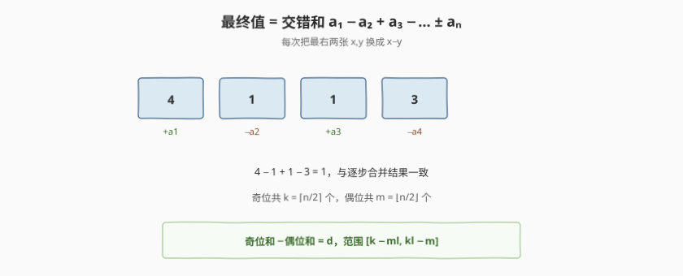
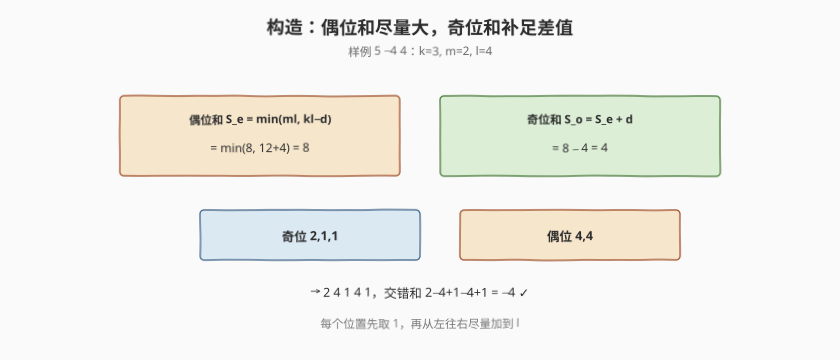

# Codeforces 231B 卡片魔术 题解

## 1. 题目概述

- **题目链接**：https://codeforces.com/problemset/problem/231/B
- **比赛来源**：Codeforces Round 143 (Div. 2) · Problem B（UTC 2012-10-07）
- **难度**：1500
- **标签**：构造、数学
- **评测类型**：多解（输出任意合法初始序列）
- **限制**：时间 2 s / 内存 256 MB

**题意**：$n$ 张卡片排成一行，每张是 $[1,l]$ 的整数。每次操作取**最右边两张** $x,y$，用 $x-y$ 替换它们。重复直到只剩一张，最终数字为 $d$。现在只记得 $n,d,l$，要求还原任意一组合法的初始卡片；不存在则输出 `-1`。

**约束**：$2\le n\le100$，$|d|\le10^4$，$1\le l\le100$；只有一组数据。

## 2. 示例与观察

官方样例（输入 / 输出原样）：

```text
输入：
3 3 2

输出：
2 1 2 
```

```text
输入：
5 -4 3

输出：
-1
```

```text
输入：
5 -4 4

输出：
2 4 1 4 1 
```

**样例 1 演算**：$2,1,2$：先合并右边两张 $1,2\to 1-2=-1$，再 $2-(-1)=3=d$ ✓。

**关键观察**：把过程展开，最终值等于**交错和**

$$ d=a_1-a_2+a_3-a_4+\dots+(-1)^{n-1}a_n. $$

理由：每次把最右两张 $x,y$ 换成 $x-y$，相当于把 $a_{n-1}$ 的符号定为 $+$、把 $a_n$ 的符号定为 $-$，再与左边递归合并。归纳可得上式（见第 4 节）。

于是问题变成：从 $\{1..l\}$ 中选 $n$ 个数，使奇数位之和减去偶数位之和等于 $d$。

设奇数位有 $k=\lceil n/2\rceil$ 个、偶数位有 $m=\lfloor n/2\rfloor$ 个，则奇位和 $S_o\in[k,kl]$、偶位和 $S_e\in[m,ml]$，需要 $S_o-S_e=d$。可达的差值范围是

$$ k-ml\ \le\ d\ \le\ kl-m, $$

且范围内每个整数都能取到（可以逐 1 调整）。



自造样例（标注"自造"）：

| 输入 | 输出 | 说明 |
|------|------|------|
| `2 0 1` | `1 1` | $1-1=0$ |
| `2 1 1` | `-1` | $1-1=0$，达不到 1 |
| `2 -1 2` | `1 2` | $1-2=-1$ |
| `4 0 2` | `2 2 2 2` | $2-2+2-2=0$ |

第四行的构造：$k=m=2$，$S_e=S_o=4$，奇偶位都取 $[2,2]$，交错和为 $2-2+2-2=0$ ✓。

## 3. 解题思路

### 3.1 算法

1. 计算 $k=\lceil n/2\rceil$、$m=\lfloor n/2\rfloor$，可行区间 $[k-ml,\ kl-m]$；若 $d$ 不在其中输出 `-1`。
2. 取偶位和尽量大：$S_e=\min(ml,\ kl-d)$，则 $S_o=S_e+d$；检查 $S_e\in[m,ml]$、$S_o\in[k,kl]$。
3. 把 $S_o$ 分给 $k$ 个奇位、$S_e$ 分给 $m$ 个偶位：每个先取 1，再从左到右尽量加（每次最多加到 $l$）。



### 3.2 样例走查

- 样例 1（$n=3,d=3,l=2$）：$k=2,m=1$；$S_e=\min(2,\ 4-3)=1$，$S_o=4$。奇位分到 $[2,2]$、偶位 $[1]$ → `2 1 2` ✓。
- 样例 3（$n=5,d=-4,l=4$）：$k=3,m=2$；$S_e=\min(8,\ 12+4)=8$，$S_o=4$。奇位分到 $[2,1,1]$、偶位 $[4,4]$ → `2 4 1 4 1` ✓。
- 样例 2（$n=5,d=-4,l=3$）：$k=3,m=2$，可行区间 $[3-6,\ 9-2]=[-3,7]$，$-4<-3$ → `-1` ✓。

## 4. 正确性证明

**引理 1（交错和公式）**：按题述操作合并到底，最终值等于 $a_1-a_2+a_3-\dots+(-1)^{n-1}a_n$。

**证明**：对 $n$ 归纳。$n=1$ 时显然；$n=2$ 时 $a_1-a_2$ ✓。设 $n\ge3$：第一次操作把 $a_{n-1},a_n$ 换成 $a_{n-1}-a_n$，得到长度 $n-1$ 的行 $a_1,\dots,a_{n-2},(a_{n-1}-a_n)$；由归纳假设最终值为

$$ a_1-a_2+\dots+(-1)^{n-2}a_{n-2}+(-1)^{n-2}(a_{n-1}-a_n), $$

展开即 $a_1-a_2+\dots+(-1)^{n-1}a_n$ ✓。∎

**引理 2（可达范围是连续区间）**：所有满足 $a_i\in[1,l]$ 的序列，其交错和取遍 $[k-ml,\ kl-m]$ 中的每个整数。

**证明**：最小值为奇位全 1、偶位全 $l$，即 $k-ml$；最大值为奇位全 $l$、偶位全 1，即 $kl-m$。从最小值出发，每次把某个奇位 +1 或某个偶位 -1，交错和增加 1，且每一步仍在合法范围内，直到达到最大值。因此所有中间整数都可达。∎

**定理**：算法输出的序列合法（或正确输出 -1）。

**证明**：由引理 1，只需构造交错和为 $d$ 的序列。引理 2 保证 $d$ 落在可行区间时存在解，算法选取 $S_e,S_o$ 落在各自范围内并均匀分配（每项先取 1 再逐项加至多 $l-1$），得到合法序列且 $S_o-S_e=d$。若 $d$ 不在区间内，由引理 2 无解，输出 -1 正确。∎

## 5. 复杂度分析

- **时间**：$O(n)$ 构造，$n\le100$，实测 < 1 ms。
- **空间**：$O(n)$。
- **与时限的关系**：余量极大。

## 6. 参考代码

### C++17

```cpp
#include <bits/stdc++.h>
using namespace std;
typedef long long ll;
int main() {
    int n; ll d, l;
    if (scanf("%d %lld %lld", &n, &d, &l) != 3) return 0;
    int k = (n + 1) / 2, m = n / 2;                 // 奇数位/偶数位个数
    ll lo = k - (ll)m * l, hi = (ll)k * l - m;      // 可达的差值范围
    if (d < lo || d > hi) { puts("-1"); return 0; }
    // 偶数位和取尽量大，奇数位和 = 偶数位和 + d
    ll se = min((ll)m * l, (ll)k * l - d);
    ll so = se + d;
    if (se < m || so < k) { puts("-1"); return 0; }
    vector<ll> odd(k, 1), even(m, 1);
    ll ro = so - k, re = se - m;
    for (int i = 0; i < k && ro > 0; i++) { ll add = min<ll>(ro, l - 1); odd[i] += add; ro -= add; }
    for (int i = 0; i < m && re > 0; i++) { ll add = min<ll>(re, l - 1); even[i] += add; re -= add; }
    for (int i = 0; i < n; i++) {
        ll v = (i % 2 == 0) ? odd[i / 2] : even[i / 2];
        printf("%lld%c", v, i + 1 == n ? '\n' : ' ');
    }
    return 0;
}
```

### Python3

```python
import sys


def main() -> None:
    data = sys.stdin.buffer.read().split()
    n, d, l = int(data[0]), int(data[1]), int(data[2])
    k = (n + 1) // 2
    m = n // 2
    lo = k - m * l
    hi = k * l - m
    if d < lo or d > hi:
        print(-1)
        return
    se = min(m * l, k * l - d)
    so = se + d
    if se < m or so < k:
        print(-1)
        return
    odd = [1] * k
    even = [1] * m
    ro, re = so - k, se - m
    for i in range(k):
        if ro <= 0:
            break
        add = min(ro, l - 1)
        odd[i] += add
        ro -= add
    for i in range(m):
        if re <= 0:
            break
        add = min(re, l - 1)
        even[i] += add
        re -= add
    ans = []
    for i in range(n):
        ans.append(str(odd[i // 2] if i % 2 == 0 else even[i // 2]))
    print(" ".join(ans))


main()
```

## 7. 边界情况与易错点

1. **符号与奇偶**：$a_1$ 是正号，$a_2$ 是负号；奇位有 $k=\lceil n/2\rceil$ 个。
2. **可行区间**：$[k-ml,\ kl-m]$，两边都要检查（$d$ 可为负）。
3. **构造时 $S_e$ 的选择**：取 $S_e=\min(ml,\ kl-d)$ 同时保证 $S_o\le kl$ 且尽量大，这样能复现官方样例的输出；其它取法也可能合法，但本地样例比对需要与官方一致。
4. **分配时不能超过 $l$**：每次加 $\min(\text{剩余}, l-1)$。
5. **$l=1$**：所有卡片都是 1，交错和只能是 $0$ 或 $1$（$n$ 奇数时为 1，偶数时为 0）。
6. **输出格式**：官方输出末尾带空格，本题不敏感；`check_samples.py` 会忽略行尾空白。
7. **多解**：任何合法序列都可接受，本地验证要检查"值域 + 交错和"，不能只比对官方输出。

## 8. 验证记录

- **编译环境与命令**：本机无 GNU `g++`，用 `clang++ -std=c++17 -O2 -I codeforces/tools/include` 编译；`verify_solution.py` 自动采用同样回退。Python 3.9.6。
- **官方样例**：3 / 3 通过（`2 1 2`、`-1`、`2 4 1 4 1`，与官方逐字一致），C++ 与 Python 一致。
- **独立暴力对拍**：暴力程序枚举 $[1,l]^n$ 的全部序列（$n\le5,l\le4$），得到可达的最终值集合，与主解比对"可行/不可行"以及构造的合法性（值域 + 交错和）；**200 组**随机 $(n,d,l)$ 全部一致。
- **最大约束性能**：$n=100$ 时 < 1 ms（限 2 s）。
- **图片校验**：两张 SVG 均通过 `xml.etree.ElementTree.parse`，含 `feTurbulence` 与手写字体，文本包围盒（含重叠检测）均在 `viewBox` 内。
- **公式校验**：`node codeforces/tools/katex_check.cjs codeforces/contests/0101-0203/231` 报告 0 个错误。
- **复核状态**：verified。

## 相关题目与扩展

- [Codeforces 231A Team](https://codeforces.com/problemset/problem/231/A)：同场 A 题，计数。
- [Codeforces 231C To Add or Not to Add](https://codeforces.com/problemset/problem/231/C)：同场 C 题，排序 + 双指针。
- [Codeforces 1003C Intense Heat](https://codeforces.com/problemset/problem/1003/C)：连续段和类构造。

**延伸思考**：

1. **如果允许任意合并顺序**：最终值的可能集合会变大，问题变成可达性搜索。
2. **如果要求输出字典序最小的解**：在构造时优先让靠前的位置取小值。
3. **如果要求统计解的数量**：变成组合计数（每类和的分配数相乘）。
4. **如果 $n$ 很大（$10^5$）**：构造仍是 $O(n)$，只需注意 $S_o,S_e$ 的范围用 64 位。
