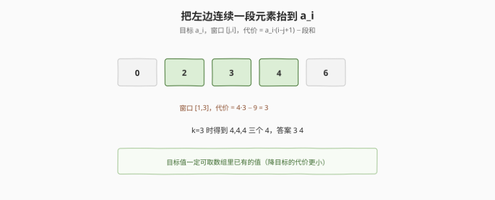
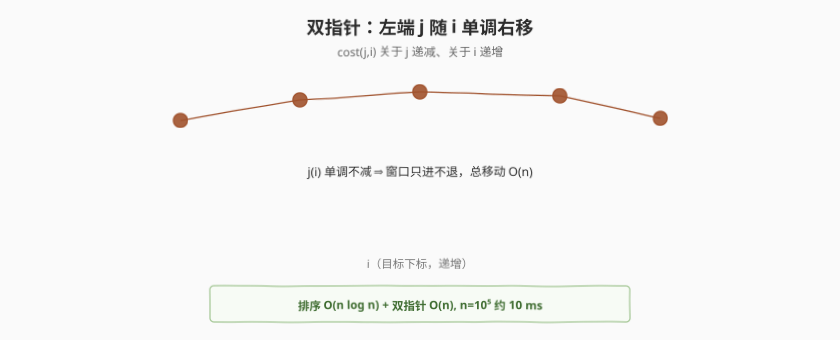

# Codeforces 231C 加一与出现次数 题解

## 1. 题目概述

- **题目链接**：https://codeforces.com/problemset/problem/231/C
- **比赛来源**：Codeforces Round 143 (Div. 2) · Problem C（UTC 2012-10-07）
- **难度**：1600
- **标签**：排序、前缀和、双指针
- **评测类型**：普通
- **限制**：时间 2 s / 内存 256 MB

**题意**：给定长度 $n$ 的数组 $a$。最多做 $k$ 次"选一个元素加 1"的操作（可以对同一元素多次）。问操作后某个数最多能出现多少次；若有多个数达到最大次数，输出**最小的那个数**。

**约束**：$1\le n\le10^5$，$0\le k\le10^9$，$|a_i|\le10^9$；只有一组数据。

## 2. 示例与观察

官方样例（输入 / 输出原样）：

```text
输入：
5 3
6 3 4 0 2

输出：
3 4
```

```text
输入：
3 4
5 5 5

输出：
3 5
```

```text
输入：
5 3
3 1 2 2 1

输出：
4 2
```

**样例 1 演算**：排序后 $0,2,3,4,6$。把 $0,2,3$ 分别加 4、2、1 次凑成两个 4：总代价 $4+2+1=7>3$，不行；凑 4 只要把 $2\to4$（2 次）和 $3\to4$（1 次）共 3 次，得到 $4,4,4$ 三个 4 ✓。

**样例 2 演算**：三个 5 已经相同，答案 $3\ 5$。

**样例 3 演算**：排序 $1,1,2,2,3$。把两个 1 各加 1 变成 $2,2,2,2$（4 个 2），代价 2；把 3 加 1？凑 2 需要把 3 降下来不可能。得到 4 个 2 ✓。

**关键观察**：最终相同的那些数，其目标值一定能取成**数组中已有的某个值**（若目标值 $t$ 不在数组中，把它降到被抬高元素中的最大值，代价减少且个数不变）。所以只需对每个 $a_i$ 作为目标，求能"抬"上来多少个元素。

排序后，被抬到 $a_i$ 的元素一定是**紧挨在 $a_i$ 左边的一段连续区间** $[j,i]$（用更大的元素不可能更省）。代价为

$$ \text{cost}(j,i)=a_i\cdot(i-j+1)-\bigl(\text{pre}[i+1]-\text{pre}[j]\bigr). $$

要求 $\text{cost}\le k$。随着 $i$ 增大，最优的 $j$ 单调不减，用双指针即可。



自造样例（标注"自造"）：

| 输入 | 输出 | 说明 |
|------|------|------|
| `1 0` / `7` | `1 7` | 单个元素 |
| `3 0` / `3 1 2` | `1 1` | 不能操作，所有数出现 1 次，取最小 1 |
| `4 100` / `1 2 3 4` | `4 4` | 全抬到 4，代价 $3+2+1=6\le100$ |
| `5 2` / `-3 -3 0 1 1` | `3 1` | 把 0 和 1 各加 1 得到三个 1 |

## 3. 解题思路

### 3.1 算法

1. 排序，求前缀和 `pre`；
2. 双指针：`j=0`；对 $i=0..n-1$：
   - 当 `cost(j,i) > k` 时 `j++`；
   - 当前个数 `cnt = i-j+1`；若 `cnt > best`，更新 `best=cnt, bestVal=a[i]`（只在严格更大时更新，保证同次数时保留更小的值，因为 $a_i$ 递增）。
3. 输出 `best bestVal`。



### 3.2 样例走查

样例 1：$a=[0,2,3,4,6]$，$k=3$，前缀和 $0,0,2,5,9,15$。

| $i$ | $a_i$ | 窗口 $[j,i]$ | 代价 | 个数 |
|---|---|---|---|---|
| 0 | 0 | [0,0] | 0 | 1 |
| 1 | 2 | [0,1] | $2\cdot2-2=2$ | 2 |
| 2 | 3 | [0,2] 代价 $9-5=4>3$ → 右移 $j=1$，[1,2] | $6-5=1$ | 2 |
| 3 | 4 | [1,3] | $4\cdot3-9=3$ | 3 |
| 4 | 6 | 一路右移到 [3,4] | $6\cdot2-10=2$ | 2 |

最多个数 3，对应最小目标值 4，输出 `3 4` ✓。

## 4. 正确性证明

**引理 1**：最优方案的目标值可以取为数组中已有的某个值。

**证明**：设最优方案把所有操作后值等于 $t$ 的元素个数为 $c$，其中被抬高的元素原值都 $\le t$。令 $t'=\max(\text{这些元素的最终值中出现的原值})$，即把目标降到"被抬高元素里原本最大的那个值"——由于所有被抬高的元素都 $\le t'$，把它们抬到 $t'$ 的代价不超过抬到 $t$ 的代价，而个数仍为 $c$（原本就 $>t'$ 的元素不会等于 $t'$，但至少这 $c$ 个仍相等）。故存在目标为数组值的最优方案。∎

**引理 2**：对固定目标 $a_i$，最优的"被抬高集合"是排序后紧邻 $a_i$ 左侧的连续一段。

**证明**：被抬高的元素必须 $\le a_i$；代价为每个元素 $a_i-v$ 之和。若选中了某个 $v$ 而没选中更接近 $a_i$ 的 $u$（$v<u\le a_i$），交换后代价更小、个数不变。因此选中的必是最大的若干个 $\le a_i$ 的元素，即连续区间 ✓。∎

**引理 3**：$j(i)$（使 $\text{cost}(j,i)\le k$ 的最小 $j$）关于 $i$ 单调不减。

**证明**：$\text{cost}(j,i)$ 对 $i$ 增大而增大（多一个元素、目标更高），对 $j$ 增大而减小（少一个元素）。若 $i_2>i_1$ 时最优左端反而更小，则 $\text{cost}(j_2,i_1)\le\text{cost}(j_2,i_2)\le k$，与 $j_1$ 是最小可行矛盾。∎

**定理**：双指针算法输出正确答案。

**证明**：由引理 1、2，只需枚举目标 $a_i$ 与窗口 $[j,i]$；引理 3 保证双指针不会漏掉最优窗口（左端只增不减）。算法在所有候选中取个数最大者，个数相同时由于 $a_i$ 递增、只在严格更大时更新，最终保留的是最小目标值 ✓。∎

## 5. 复杂度分析

- **时间**：排序 $O(n\log n)$，双指针 $O(n)$；$n=10^5$ 实测约 10 ms（限 2 s）。
- **空间**：$O(n)$。
- **数值范围**：代价可达 $10^5\cdot2\times10^9=2\times10^{14}$，用 64 位。

## 6. 参考代码

### C++17

```cpp
#include <bits/stdc++.h>
using namespace std;
typedef long long ll;
int main() {
    int n; ll k;
    if (scanf("%d %lld", &n, &k) != 2) return 0;
    vector<ll> a(n);
    for (int i = 0; i < n; i++) scanf("%lld", &a[i]);
    sort(a.begin(), a.end());
    vector<ll> pre(n + 1, 0);
    for (int i = 0; i < n; i++) pre[i + 1] = pre[i] + a[i];
    int best = 1; ll bestVal = a[0];
    int j = 0;
    for (int i = 0; i < n; i++) {
        while (j < i) {
            ll cnt = i - j + 1;
            ll cost = a[i] * cnt - (pre[i + 1] - pre[j]);
            if (cost <= k) break;
            j++;
        }
        int cnt = i - j + 1;
        if (cnt > best) { best = cnt; bestVal = a[i]; }
    }
    printf("%d %lld\n", best, bestVal);
    return 0;
}
```

### Python3

```python
import sys


def main() -> None:
    data = sys.stdin.buffer.read().split()
    n = int(data[0]); k = int(data[1])
    a = sorted(int(x) for x in data[2:2 + n])
    pre = [0] * (n + 1)
    for i in range(n):
        pre[i + 1] = pre[i] + a[i]
    best = 1
    best_val = a[0]
    j = 0
    for i in range(n):
        while j < i:
            cnt = i - j + 1
            cost = a[i] * cnt - (pre[i + 1] - pre[j])
            if cost <= k:
                break
            j += 1
        cnt = i - j + 1
        if cnt > best:
            best = cnt
            best_val = a[i]
    print(best, best_val)


main()
```

## 7. 边界情况与易错点

1. **相同次数取最小目标**：只在 `cnt > best` 时更新（因为 $a_i$ 升序，后来者更大）；若用 `>=` 会取到更大的目标。
2. **$k=0$**：窗口只能包含相同元素，答案是最多的重复值的个数与最小值——双指针自然处理。
3. **负值**：$a_i$ 可为负，排序与前缀和照常；"抬高"仍是加 1 操作。
4. **64 位**：代价可达 $2\times10^{14}$，用 `long long`。
5. **$n=1$**：答案为 `1 a[0]`。
6. **窗口为空**：循环保证 $j\le i$，窗口至少含 $a_i$ 自己（代价 0）。
7. **输出格式**：`个数 数值`，空格分隔。

## 8. 验证记录

- **编译环境与命令**：本机无 GNU `g++`，用 `clang++ -std=c++17 -O2 -I codeforces/tools/include` 编译；`verify_solution.py` 自动采用同样回退。Python 3.9.6。
- **官方样例**：3 / 3 通过（`3 4`、`3 5`、`4 2`），C++ 与 Python 一致。
- **独立暴力对拍**：暴力程序枚举所有可能的自标值 $t$（数组中出现的值），对每个 $t$ 直接计算每个元素抬到 $t$ 的代价、排序后贪心取最多（与双指针完全独立）；对 $n\le8$、$k\le15$、$a_i\in[-6,12]$ 的 **200 组**随机数据逐组比对，全部一致。
- **最大约束性能**：$n=10^5$、$k=10^9$、$a_i$ 随机到 $10^9$，C++ 端到端约 10 ms（限 2 s）。
- **图片校验**：两张 SVG 均通过 `xml.etree.ElementTree.parse`，含 `feTurbulence` 与手写字体，文本包围盒（含重叠检测）均在 `viewBox` 内。
- **公式校验**：`node codeforces/tools/katex_check.cjs codeforces/contests/0101-0203/231` 报告 0 个错误。
- **复核状态**：verified。

## 相关题目与扩展

- [Codeforces 231E Cactus](https://codeforces.com/problemset/problem/231/E)：同场 E 题，仙人掌路径计数。
- [Codeforces 231D Magic Box](https://codeforces.com/problemset/problem/231/D)：同场 D 题，几何可见性。
- [LeetCode 1004. 最大连续 1 的个数 III](https://leetcode.cn/problems/max-consecutive-ones-iii/)：滑动窗口的经典练习。

**延伸思考**：

1. **如果操作是"减 1"**：对称地，目标取数组值、窗口向右延伸。
2. **如果每次操作有不同代价**：需要带权窗口，双指针不再单调。
3. **如果要求输出方案（哪些元素被加）**：窗口内元素及其差值即可。
4. **如果数组动态修改**：需要平衡树/线段树维护前缀和与窗口，复杂度上升。
