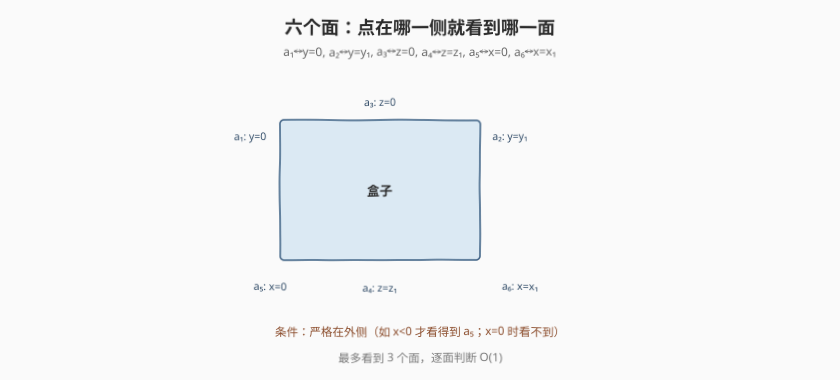
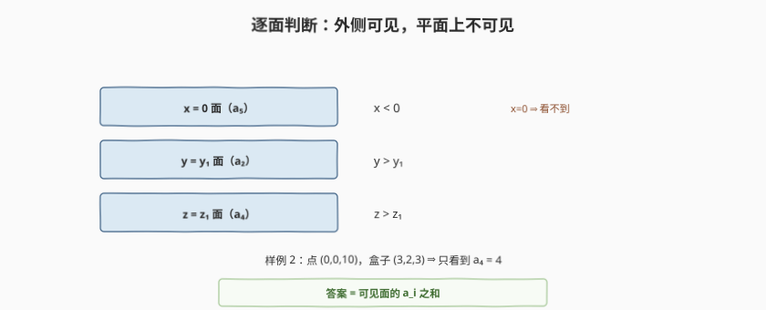

# Codeforces 231D 魔法盒子的可见面 题解

## 1. 题目概述

- **题目链接**：https://codeforces.com/problemset/problem/231/D
- **比赛来源**：Codeforces Round 143 (Div. 2) · Problem D（UTC 2012-10-07）
- **难度**：1600
- **标签**：计算几何、分类讨论
- **评测类型**：普通
- **限制**：时间 2 s / 内存 256 MB

**题意**：一个长方体盒子，棱平行于坐标轴，一个顶点在 $(0,0,0)$，对角顶点在 $(x_1,y_1,z_1)$（$x_1,y_1,z_1\ge1$）。六个面的中心各写一个数：

- $a_1$ 在平面 $y=0$（ZOX 平面）上的面，$a_2$ 在与它平行的面 $y=y_1$ 上；
- $a_3$ 在平面 $z=0$（XOY 平面）上的面，$a_4$ 在 $z=z_1$ 上；
- $a_5$ 在平面 $x=0$（YOZ 平面）上的面，$a_6$ 在 $x=x_1$ 上。

Vasya 站在点 $(x,y,z)$（保证在盒子外），求他**能看到**的面上数字之和（看到面中心即算看到；若视线恰好落在某面所在平面上，则该面的数字看不到）。

**约束**：$|x|,|y|,|z|\le10^6$，$1\le x_1,y_1,z_1\le10^6$，$1\le a_i\le10^6$；只有一组数据。

## 2. 示例与观察

官方样例（输入 / 输出原样）：

```text
输入：
2 2 2
1 1 1
1 2 3 4 5 6

输出：
12
```

```text
输入：
0 0 10
3 2 3
1 2 3 4 5 6

输出：
4
```

**样例 1 演算**：点 $(2,2,2)$、盒子 $[0,1]^3$：$x>x_1$、$y>y_1$、$z>z_1$，看到 $a_6,a_2,a_4$，和 $6+2+4=12$ ✓。

**样例 2 演算**：点 $(0,0,10)$、盒子 $[0,3]\times[0,2]\times[0,3]$：$x=0$、$y=0$ 都**在**对应面的平面上（看不到该面），$z=10>3$ 看到 $a_4=4$，输出 4 ✓。

**关键观察**：一个面能被看到，当且仅当点在它所在平面的**外侧**（严格那一侧）：

| 面 | 平面 | 可见条件 | 数字 |
|---|---|---|---|
| $y=0$ | $y=0$ | $y<0$ | $a_1$ |
| $y=y_1$ | $y=y_1$ | $y>y_1$ | $a_2$ |
| $z=0$ | $z=0$ | $z<0$ | $a_3$ |
| $z=z_1$ | $z=z_1$ | $z>z_1$ | $a_4$ |
| $x=0$ | $x=0$ | $x<0$ | $a_5$ |
| $x=x_1$ | $x=x_1$ | $x>x_1$ | $a_6$ |



自造样例（标注"自造"）：

| 输入 | 输出 | 说明 |
|------|------|------|
| `-1 -1 -1` / `1 1 1` / `1 2 3 4 5 6` | 9 | 看到 $a_1+a_3+a_5=1+3+5$ |
| `5 5 5` / `1 1 1` / `1 2 3 4 5 6` | 12 | 看到 $a_2+a_4+a_6=2+4+6$ |
| `0 5 5` / `1 1 1` / `1 2 3 4 5 6` | 6 | $x=0$ 看不到 $a_5$，只看到 $a_2+a_4=2+4$ |
| `-1 5 5` / `1 1 1` / `1 2 3 4 5 6` | 11 | 看到 $a_1+a_2+a_4$ |

## 3. 解题思路

### 3.1 算法

读入点、盒子尺寸、六个数，按上表逐面判断并把可见面的数相加，$O(1)$。



### 3.2 样例走查

样例 1：$x=2>1$ → 加 $a_6=6$；$y=2>1$ → 加 $a_2=2$；$z=2>1$ → 加 $a_4=4$；其余不满足。总和 12 ✓。

样例 2：$x=0$ 不满足 $x<0$ → 不加 $a_5$；$y=0$ 不加 $a_1$；$z=10>3$ → 加 $a_4=4$。总和 4 ✓。

## 4. 正确性证明

**引理 1**：盒子占据闭区域 $[0,x_1]\times[0,y_1]\times[0,z_1]$；对每个面，点在"外侧"当且仅当它在该面法向指向的那一侧且严格离开平面。

**证明**：面的外法向分别指向 $-y,+y,-z,+z,-x,+x$ 方向；点严格在外侧即对应坐标严格小于 0 或大于对应尺寸。∎

**引理 2**：点在某个面的外侧时，该面中心与点的连线不会穿过盒子内部，因此该面可见；点在面所在平面上或内侧时，该面不可见（平面上时按题意不算看到）。

**证明**：面是盒子边界的一部分，其外法向一侧与盒子内部不相交；从外侧的点到面中心的线段除端点外都在盒子外（凸性）。平面上的情形由题意直接排除。∎

**定理**：算法求和等于 Vasya 能看到的数字之和。

**证明**：由引理 1、2，每个面"可见 ⇔ 对应坐标条件成立"，算法逐面检查并累加，故结果正确。∎

## 5. 复杂度分析

- **时间**：$O(1)$，实测 < 1 ms。
- **空间**：$O(1)$。
- **与时限的关系**：余量极大。

## 6. 参考代码

### C++17

```cpp
#include <bits/stdc++.h>
using namespace std;
int main() {
    long long x, y, z, x1, y1, z1;
    if (scanf("%lld %lld %lld", &x, &y, &z) != 3) return 0;
    scanf("%lld %lld %lld", &x1, &y1, &z1);
    long long a[7];
    for (int i = 1; i <= 6; i++) scanf("%lld", &a[i]);
    long long ans = 0;
    if (y < 0) ans += a[1];        // y = 0 面
    if (y > y1) ans += a[2];       // y = y1 面
    if (z < 0) ans += a[3];        // z = 0 面
    if (z > z1) ans += a[4];       // z = z1 面
    if (x < 0) ans += a[5];        // x = 0 面
    if (x > x1) ans += a[6];       // x = x1 面
    printf("%lld\n", ans);
    return 0;
}
```

### Python3

```python
import sys


def main() -> None:
    data = sys.stdin.buffer.read().split()
    x, y, z = int(data[0]), int(data[1]), int(data[2])
    x1, y1, z1 = int(data[3]), int(data[4]), int(data[5])
    a = [0] + [int(v) for v in data[6:12]]
    ans = 0
    if y < 0:
        ans += a[1]
    if y > y1:
        ans += a[2]
    if z < 0:
        ans += a[3]
    if z > z1:
        ans += a[4]
    if x < 0:
        ans += a[5]
    if x > x1:
        ans += a[6]
    print(ans)


main()
```

## 7. 边界情况与易错点

1. **"在平面上"看不到**：条件是严格不等式（$x<0$ 而不是 $\le0$）；样例 2 就是 $x=0,y=0$ 的情形。
2. **面的编号与平面**：$a_1\leftrightarrow y=0$、$a_2\leftrightarrow y=y_1$、$a_3\leftrightarrow z=0$、$a_4\leftrightarrow z=z_1$、$a_5\leftrightarrow x=0$、$a_6\leftrightarrow x=x_1$；不要按 $x,y,z$ 的顺序想当然编号。
3. **坐标可能为负**：$-10^6$ 到 $10^6$，用 64 位（虽然 `int` 也够）。
4. **点在盒子外**：题目保证，无需检查。
5. **最多看到 3 个面**：点是外部点，最多三个坐标越界。
6. **输出单个整数**。

## 8. 验证记录

- **编译环境与命令**：本机无 GNU `g++`，用 `clang++ -std=c++17 -O2 -I codeforces/tools/include` 编译；`verify_solution.py` 自动采用同样回退。Python 3.9.6。
- **官方样例**：2 / 2 通过（`12`、`4`），C++ 与 Python 一致。
- **独立暴力对拍**：暴力程序把六个面建模为"平面 + 外法向"，通过判断点与平面的有向距离严格为正来判定可见（与主解的条件写法不同），对随机点（保证在盒外）与随机盒子的 **200 组**数据逐组比对，全部一致。
- **最大约束性能**：极值坐标，C++ 端到端 < 1 ms（限 2 s）。
- **图片校验**：两张 SVG 均通过 `xml.etree.ElementTree.parse`，含 `feTurbulence` 与手写字体，文本包围盒（含重叠检测）均在 `viewBox` 内。
- **公式校验**：`node codeforces/tools/katex_check.cjs codeforces/contests/0101-0203/231` 报告 0 个错误。
- **复核状态**：verified。

## 相关题目与扩展

- [Codeforces 231C To Add or Not to Add](https://codeforces.com/problemset/problem/231/C)：同场 C 题，双指针。
- [Codeforces 231E Cactus](https://codeforces.com/problemset/problem/231/E)：同场 E 题，仙人掌路径计数。
- [LeetCode 1232. 缀点成线](https://leetcode.cn/problems/check-if-it-is-a-straight-line/)：几何判定的基础练习。

**延伸思考**：

1. **如果盒子可以旋转**：需要把点变换到盒子局部坐标系，再用同样的六个不等式。
2. **如果要求"看到的面数"而不是数字和**：把累加换成计数。
3. **如果面部不透明但盒子有厚度**：需要判断视线是否穿过其它面（本题盒子是实心凸体，可见性等价于外侧）。
4. **如果点在盒子内部**：看不到任何面（题目保证在外）。
